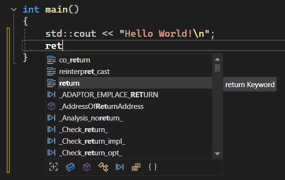
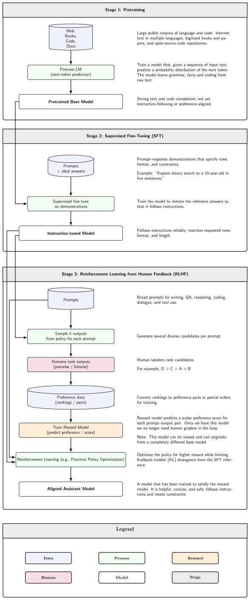
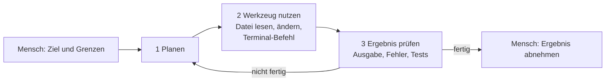
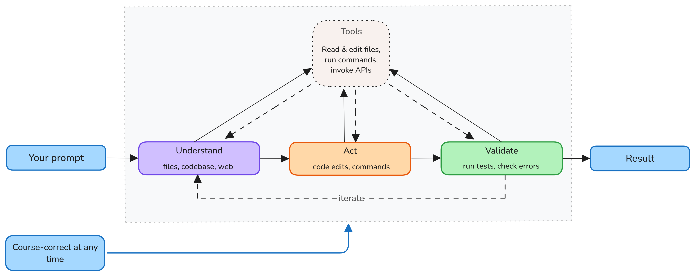

# Lab 1.1: LLM-Grundlagen und Agenten-Loop

**Leitfragen:**

<details>
<summary>Woher „weiß“ ein Programm, welches Wort als nächstes kommt?</summary>

Es weiß es nicht. Ein Sprachmodell hat beim Training aus riesigen Textmengen gelernt, welche Fortsetzung in welchem Zusammenhang wahrscheinlich ist, und wählt bei jedem Schritt ein wahrscheinliches nächstes Token.

</details>

<details>
<summary>Warum kann eine KI gut Code schreiben, aber schlecht rechnen?</summary>

Code folgt festen Mustern, die millionenfach öffentlich vorliegen. Rechnen verlangt exakte Schritte; ein Modell sagt Zahlen nur vorher, statt sie zu berechnen. Ein Agent löst das, indem er ein Werkzeug nutzt (z. B. ein Skript ausführt).

</details>

<details>
<summary>Was ist der Unterschied zwischen „mir einen Vorschlag machen“ und „es für mich erledigen“?</summary>

Beim Vorschlag entscheidet und handelt der Mensch. Beim Erledigen plant der Agent selbst, ändert Dateien, führt Befehle aus und prüft das Ergebnis; der Mensch setzt Ziel und Grenzen und nimmt das Ergebnis ab.

</details>

- Ein LLM sagt das nächste Token vorher; es versteht nicht, es rechnet Wahrscheinlichkeiten.
- Code passt gut dazu: viele öffentliche Beispiele, strenge Syntax, durch Tests prüfbar.
- Ein Agent ist ein LLM in einer Schleife mit Werkzeugen: planen → handeln → prüfen → wiederholen.
- Der Mensch bleibt verantwortlich: Ziel vorgeben, Grenzen setzen, Ergebnis abnehmen.

## Agentic Coding auf einen Blick

**Problem:** Entwickler:innen verbringen viel Zeit mit Routine: Code lesen, Boilerplate schreiben, Tests ergänzen, Fehlermeldungen nachgehen. Klassische Autovervollständigung hilft nur Zeile für Zeile.


_Quelle: Wikimedia Commons, „VS2022 Intellisense code completion.png“ (https://commons.wikimedia.org/wiki/File:VS2022_Intellisense_code_completion.png), Hwi.padam, Public Domain, abgerufen am 07.11.2026._

Autovervollständigung vor der KI: Sie ergänzt bekannte Schlüsselwörter und Namen, schreibt aber keinen neuen Code.

**Bild:**

```text
Vorschlag:   Mensch tippt  →  KI ergänzt eine Zeile  →  Mensch entscheidet
Chat:        Mensch fragt  →  KI antwortet mit Code  →  Mensch kopiert und testet
Agent:       Mensch nennt Ziel und Grenzen  →  KI liest, ändert, testet selbst  →  Mensch nimmt ab
```

**Definition:** Agentic Coding = Softwareentwicklung, bei der ein KI-Agent eine Aufgabe selbstständig in Schritten erledigt: Dateien lesen und ändern, Befehle im Terminal ausführen, Ergebnisse prüfen, bis das Ziel erreicht ist.

**Alltagsbild:** Ein Vorschlag ist wie die Beratung im Baumarkt: Jemand sagt, welche Schraube passt, montieren muss man selbst. Ein Agent ist wie ein Handwerksbetrieb: Er bekommt einen Auftrag, arbeitet selbst, fragt bei riskanten Schritten nach, und am Ende folgt die Abnahme durch den Bauherrn.

**Geschichte in einem Satz:** Seit 2021 Vorschläge im Editor, seit 2023 Chat, seit Februar 2025 Agenten, die Dateien ändern und Befehle ausführen (Details und Quellen: Lab 1.2).

**Verbreitung:** Laut Stack Overflow Developer Survey 2025 (veröffentlicht Juli 2025) nutzen 84 % der Befragten KI-Werkzeuge in der Entwicklung oder planen es; gut die Hälfte der Berufsentwickler:innen nutzt sie täglich.

**Bekannte Beispiele (Stand: 11/2026):** GitHub Copilot (Agent-Modus in VS Code, Copilot CLI, Cloud Agent), Claude Code (Anthropic), OpenAI Codex, Cursor. Überblick: Lab 1.3.

**Typische Einsatzfälle:** Code verstehen („Erkläre den Login-Ablauf“), Fehler beheben (Fehlermeldung lesen, Ursache suchen, ändern, testen), Tests ergänzen, Feature nach Beschreibung bauen, Umbauen (Funktion umbenennen, alle Aufrufe anpassen).

**Warum es zählt:** Der Agent übernimmt Tipparbeit und Suche. Die eigene Rolle verschiebt sich zu Auftrag formulieren, Rahmen setzen und Ergebnis prüfen. Genau das trainiert dieser Kurs.

## Begriffe

| Begriff | Bedeutung |
| --- | --- |
| LLM (Large Language Model) | Sprachmodell, das aus Text gelernt hat, wahrscheinliche Fortsetzungen zu erzeugen |
| Token | Textstück, mit dem das Modell rechnet (Wort, Wortteil, Zeichen); `function` ist oft ein Token, `Aufgabenliste` mehrere |
| Kontextfenster | Menge an Tokens, die das Modell gleichzeitig „sieht“: Anfrage, angehängte Dateien, bisheriger Verlauf |
| Halluzination | überzeugend formulierte, aber falsche Ausgabe, z. B. eine Funktion, die es nicht gibt |
| Agent | LLM, das in einer Schleife Werkzeuge nutzt, um ein Ziel zu erreichen |
| Werkzeug (Tool) | Fähigkeit, die der Agent aufrufen kann: Datei lesen, Datei ändern, Terminal-Befehl, Suche |

## Wie ein LLM Text erzeugt

Das Modell bekommt den bisherigen Text und berechnet für jedes mögliche nächste Token eine Wahrscheinlichkeit:

| Eingabe | Mögliche Fortsetzung | Wahrscheinlichkeit (Beispiel) |
| --- | --- | --- |
| `for i in range(` | `10` | hoch |
| | `len(` | hoch |
| | `"abc"` | sehr niedrig |

Ein Token wird gewählt, angehängt, und der Vorgang beginnt von vorn. So entsteht Token für Token eine ganze Funktion.


_Quelle: Wikimedia Commons, „Three-stage large language model training workflow.svg“ (https://commons.wikimedia.org/wiki/File:Three-stage_large_language_model_training_workflow.svg), Kjerish, CC0, abgerufen am 07.11.2026._

Woher die Wahrscheinlichkeiten stammen: Im ersten Trainingsschritt übt das Modell an Web-Texten, Büchern und öffentlichem Code genau diese Vorhersage des nächsten Tokens; spätere Schritte machen daraus einen Assistenten, der Anweisungen folgt.

**Warum das bei Code gut funktioniert:**

- viel öffentlicher Code als Trainingsmaterial, häufige Muster wiederholen sich,
- strenge Syntax: wenige gültige Fortsetzungen,
- prüfbar: Compiler, Linter und Tests zeigen sofort, ob es stimmt.

**Wo es scheitert:**

| Grenze | Folge | Gegenmittel |
| --- | --- | --- |
| Trainingsstand endet zu einem Datum | veraltete APIs und Versionen | Doku prüfen, Versionen im Projekt nennen |
| nur Wahrscheinlichkeit, kein Wissen | Halluzination: erfundene Funktionen, Parameter, Pakete | ausführen, testen, nachschlagen |
| Kontextfenster ist begrenzt | Modell kennt nur, was im Kontext steht, nicht das ganze Projekt | relevante Dateien mitgeben, Projektregeln festhalten (ab m04) |
| plausibel ≠ richtig | Code sieht gut aus, hat aber Logikfehler | Grenzfälle testen, Code lesen |
| Rechnen | Zahlen werden geraten statt berechnet | Agent rechnen lassen per Skript |


_Quelle: VS Code Docs, „Understand context in AI agents“ (https://code.visualstudio.com/docs/agents/concepts/context), Microsoft, CC BY 3.0 US, abgerufen am 07.11.2026._

Alles, was das Modell über das Projekt weiß, muss in diesem Stapel stehen; was nicht hineinpasst oder nicht mitgegeben wird, existiert für das Modell nicht.

## Vom Antworten zum Handeln: der Agenten-Loop

Ein Chat liefert Text. Ein Agent bekommt zusätzlich Werkzeuge und arbeitet in einer Schleife, bis das Ziel erreicht ist. Leserichtung: von links nach rechts, die Schleife läuft so lange, bis die Prüfung „fertig“ ergibt.




_Quelle: VS Code Docs, „Understand AI agents“ (https://code.visualstudio.com/docs/agents/concepts/agents), Microsoft, CC BY 3.0 US, abgerufen am 07.11.2026._

Derselbe Loop in der VS-Code-Dokumentation: Verstehen, Handeln, Prüfen, wiederholen, bis das Ergebnis steht.

| Rolle des Menschen | Beispiel |
| --- | --- |
| Ziel vorgeben | „Leere Aufgabentitel sollen abgelehnt werden.“ |
| Grenzen setzen | „Nur Dateien in `src/` ändern, keine neuen Abhängigkeiten.“ |
| Ergebnis abnehmen | Diff lesen, Tests laufen lassen, im Browser prüfen, dann übernehmen |

Dieses Bild taucht im ganzen Kurs wieder auf: Jede spätere Copilot-Fähigkeit greift an einer Stelle dieses Loops ein.

## Beispiele: woran KI-Code scheitert

Drei kurze Snippets, wie sie ein Assistent liefern könnte: eines korrekt, eines plausibel falsch, eines veraltet.

```python
# Snippet 1 (Python)
def average(values: list[float]) -> float | None:
    """Durchschnitt einer Liste; None bei leerer Liste."""
    if not values:
        return None
    return sum(values) / len(values)
```

```javascript
// Snippet 2 (JavaScript): Liefert true, wenn das Datum auf ein Wochenende fällt.
function isWeekend(date) {
  const day = date.getDay();
  return day === 6 || day === 7;
}
```

```python
# Snippet 3 (Python)
from datetime import datetime

def created_at() -> str:
    """Zeitstempel in UTC für neue Datensätze."""
    return datetime.utcnow().isoformat()
```

| Snippet | Einordnung | Woran erkennbar |
| --- | --- | --- |
| 1 `average` | korrekt | leere Liste abgefangen, Typen stimmen; mit `average([])` und `average([2, 4])` schnell prüfbar |
| 2 `isWeekend` | plausibel falsch | `getDay()` liefert 0 (Sonntag) bis 6 (Samstag); `7` kommt nie vor, Sonntag wird nicht erkannt. Richtig: `day === 0 \|\| day === 6`. Fällt nur mit einem Test für einen Sonntag auf |
| 3 `created_at` | veraltet | `datetime.utcnow()` ist seit Python 3.12 als veraltet markiert (DeprecationWarning) und liefert ein Datum ohne Zeitzone. Aktuell: `datetime.now(timezone.utc)` mit `from datetime import datetime, timezone` |

Typische Fehlerquellen von KI-Code: erfundene Funktionen, Parameter oder Pakete; veraltete APIs und Versionen; Logikfehler in Grenzfällen (leere Liste, 0, Sonntag, Mitternacht); fehlende Fehlerbehandlung und Validierung; Sicherheitslücken (ungeprüfte Eingaben, Secrets im Code); Code, der nicht zum Projekt passt (anderer Stil, andere Struktur, unbekannte Konventionen).

## Beispiel: der Agenten-Loop bei einem Bugfix

Aufgabe: „Bug im Login beheben: Nutzer mit Großbuchstaben in der E-Mail-Adresse können sich nicht anmelden.“

1. Mensch: Ziel „Login mit Großbuchstaben funktioniert“, Grenze „nur Login-Modul ändern, Tests müssen grün sein“.
2. Planen: Login-Code und Nutzersuche finden.
3. Werkzeug: Suche nach `login`, Datei lesen → E-Mail wird ohne `lower()` mit der Datenbank verglichen.
4. Werkzeug: Test schreiben, der mit `Max@Example.com` scheitert; Tests ausführen → rot.
5. Werkzeug: Vergleich auf Kleinschreibung umstellen; Tests ausführen → grün.
6. Prüfen: alle Tests grün, keine weiteren Dateien geändert → fertig.
7. Mensch: Diff lesen, Randfälle bedenken (bestehende Konten mit Großbuchstaben?), übernehmen.

## Fazit

- Ein LLM erzeugt wahrscheinlichen Text, keinen geprüften Code; Prüfen bleibt Pflicht.
- Code eignet sich gut für LLMs, weil er strukturiert und durch Tests überprüfbar ist.
- Ein Agent arbeitet im Loop planen → Werkzeug → prüfen; das macht ihn mächtig und riskant zugleich.
- Ziel, Grenzen und Abnahme liegen beim Menschen.
