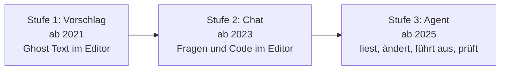
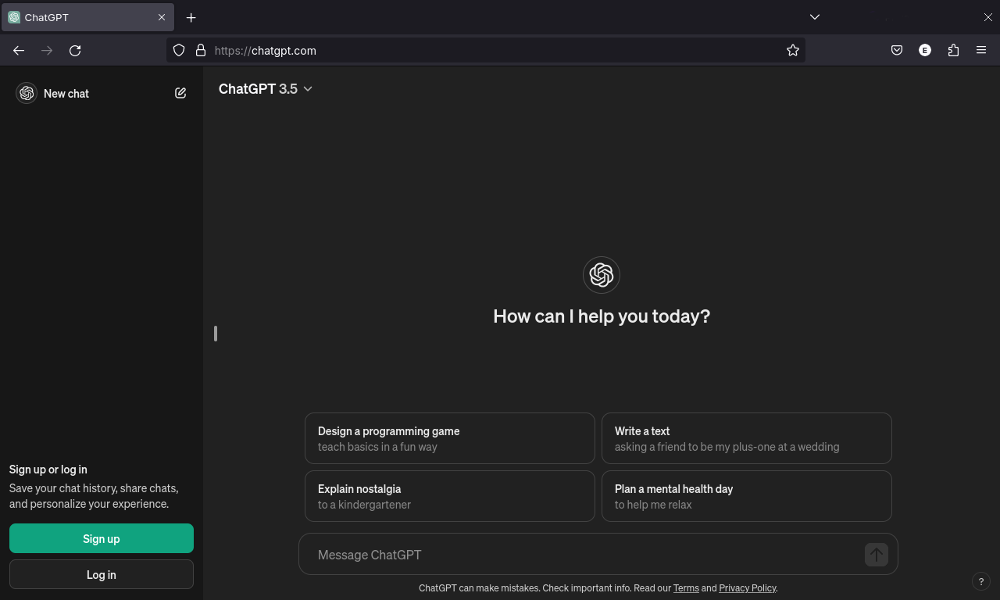
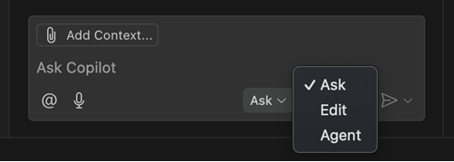
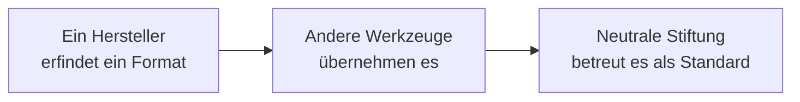

# Lab 1.2: Entwicklung von Agentic Coding 2021–2026

**Leitfragen:**

Seit wann nutzt man selbst KI beim Programmieren, und wofür zuerst?

Bei den meisten Teams begann es zwischen 2021 und 2023 mit Vorschlägen im Editor oder Fragen an ChatGPT: Boilerplate, Regex, Fehlermeldungen erklären. Die eigene Antwort ordnet den eigenen Stand in die Zeitleiste ein.

Was hat sich zwischen „Vorschlag im Editor“ und „Agent macht es“ für die eigene Rolle geändert?

Früher entschied der Mensch Zeile für Zeile. Beim Agenten formuliert der Mensch Auftrag und Grenzen, prüft Diffs und Tests und übernimmt Verantwortung für Änderungen, die er nicht selbst getippt hat.

Warum einigen sich konkurrierende Firmen auf gemeinsame Dateiformate?

Teams nutzen mehrere Werkzeuge parallel. Ein gemeinsames Format (z. B. `AGENTS.md`, MCP, `SKILL.md`) muss nur einmal geschrieben werden und funktioniert überall; ein Hersteller ohne Unterstützung wirkt dann unattraktiv.

- Agentic Coding entstand in drei Stufen: Vorschlag (2021) → Chat (2023) → Agent (2025).
- Die Bausteine, die der Kurs nutzt (MCP, `AGENTS.md`, Skills), sind zwischen Nov 2024 und Dez 2025 entstanden.
- Muster: Ein Hersteller erfindet ein Format, andere übernehmen es, es wird offener Standard.
- Viele Anleitungen im Netz stammen aus früheren Stufen und passen deshalb nicht mehr zum heutigen Stand.

## Begriffe

| Begriff | Bedeutung |
| --- | --- |
| MCP (Model Context Protocol) | offenes Protokoll, über das Agenten Werkzeuge außerhalb des Editors nutzen (Browser, GitHub, Datenbank) |
| `AGENTS.md` | Datei im Repo mit Projektregeln für Agenten, werkzeugübergreifend |
| Agent Skill (`SKILL.md`) | Ordner mit Anleitung für eine wiederkehrende Aufgabe, wird nur bei Bedarf geladen |
| Vibecoding | Programmieren nur über Prompts, ohne den Code zu lesen (Begriff von A. Karpathy, Feb 2025) |
| Agentic AI Foundation (AAIF) | Stiftung unter der Linux Foundation, die seit Dez 2025 MCP und `AGENTS.md` betreut |
| Harness | Laufzeit um das Modell, die Werkzeuge und gelesene Dateien bestimmt (Details: Lab 2.2) |

## Drei Stufen

| Stufe | Wer handelt | Was die KI sieht | Wie geprüft wird |
| --- | --- | --- | --- |
| Vorschlag | Mensch, KI ergänzt | aktuelle Datei, offene Tabs | Mensch liest jede Zeile |
| Chat | Mensch kopiert Antwort | Frage plus angehängter Kontext | Mensch testet selbst |
| Agent | KI im Loop (Lab 1.1) | Projekt, Terminal, Werkzeuge | KI testet, Mensch nimmt Diff ab |

**Stufe 1, Vorschlag (2021):**

_Quelle: GitHub Blog, „Introducing GitHub Copilot: your AI pair programmer“ (https://github.blog/news-insights/product-news/introducing-github-copilot-ai-pair-programmer/), © GitHub, Pressebild (extern verlinkt), abgerufen am 07.11.2026._

**Stufe 2, Chat (ab Nov 2022):**

_Quelle: Wikimedia Commons, „Chatgpt-screenshot.png“ (https://commons.wikimedia.org/wiki/File:Chatgpt-screenshot.png), Public Domain, abgerufen am 07.11.2026._

Ansicht 2024: Programmieren per Gespräch im Browser, der Code wird von Hand in das Projekt kopiert.

**Stufe 3, Agent (ab Feb 2025):**

_Quelle: VS Code Release Notes 1.99 (https://code.visualstudio.com/updates/v1_99), Microsoft, CC BY 3.0 US, abgerufen am 07.11.2026._

Ansicht März 2025: Der Chat bekommt den Modus „Agent“, der selbst Dateien ändert und Befehle ausführt. Die heutige Oberfläche sieht anders aus (Lab 2.4).

## Zeitleiste 2021–2026

Stand: 11/2026.

| Zeit | Ereignis | Bedeutung |
| --- | --- | --- |
| Jun 2021 | GitHub Copilot als Technical Preview (allgemein verfügbar Jun 2022) | Stufe 1: Vorschläge im Editor |
| Nov 2022 | ChatGPT | Programmieren per Gespräch wird Alltag |
| 2023 | Copilot Chat (angekündigt März, allgemein verfügbar Dez 2023) | Stufe 2: Chat im Editor |
| Nov 2024 | Anthropic veröffentlicht MCP | offener Standard, um Agenten Werkzeuge zu geben |
| Feb 2025 | Copilot Agent Mode (Preview) in VS Code ([VS Code Blog, 24.02.2025](https://code.visualstudio.com/blogs/2025/02/24/introducing-copilot-agent-mode)); Claude Code (Research Preview); Begriff „Vibecoding“ (A. Karpathy) | Stufe 3: Agent ändert Dateien und führt Befehle aus |
| Apr–Mai 2025 | OpenAI Codex CLI (Apr) und Codex Cloud (Mai) ([Wikipedia: Codex](https://en.wikipedia.org/wiki/Codex_(AI_agent))); Copilot Coding Agent auf GitHub (Mai) | Agenten im Terminal und in der Cloud |
| Aug 2025 | OpenAI veröffentlicht `AGENTS.md` | gemeinsame Instructions-Datei für alle Agenten |
| Sep 2025 | Copilot CLI (Public Preview; allgemein verfügbar Feb 2026) | Copilot im Terminal |
| Okt 2025 | Anthropic führt Agent Skills (`SKILL.md`) ein ([Agent Skills in VS Code](https://code.visualstudio.com/docs/agent-customization/agent-skills)) | Wissen und Abläufe nur bei Bedarf laden |
| Dez 2025 | Agentic AI Foundation (Linux Foundation) übernimmt MCP und `AGENTS.md`; Agent Skills als offener Standard (agentskills.io) ([Linux Foundation, 09.12.2025](https://www.linuxfoundation.org/press/linux-foundation-announces-the-formation-of-the-agentic-ai-foundation)) | aus Hersteller-Formaten werden Standards |
| Jul 2026 | VS Code 1.129: Agent Host für Copilot, Claude und Codex ([Help Net Security, 16.07.2026](https://www.helpnetsecurity.com/2026/07/16/vs-visual-studio-code-agent-host/)) | mehrere Harnesses in einem Editor |
| Okt 2026 | Copilot-Harness wird Standard für neue Sitzungen (ab VS Code 1.142) ([GitHub Changelog, 28.10.2026](https://github.blog/changelog/2026-10-28-github-copilot-in-vs-code-universe-releases/)) | heutiger Arbeitsstand dieses Kurses |

Auffällig: MCP ist älter als der Agent-Modus, und zwischen erstem Agenten (Feb 2025) und gemeinsamen Standards (Dez 2025) liegen weniger als zwölf Monate.

## Das Muster: Hersteller-Format → übernommen → Standard

| Format | Erfunden von | Übernommen | Standard |
| --- | --- | --- | --- |
| MCP | Anthropic, Nov 2024 | 2025 u. a. in Copilot und Codex | AAIF (Linux Foundation), Dez 2025 |
| `AGENTS.md` | OpenAI, Aug 2025 | u. a. Copilot liest die Datei als Instructions | AAIF (Linux Foundation), Dez 2025 |
| Agent Skills (`SKILL.md`) | Anthropic, Okt 2025 | u. a. Copilot in VS Code, Codex | offener Standard (agentskills.io), Dez 2025 |

**Folge für die Praxis:** Was im Kurs für Copilot gebaut wird, ist zum großen Teil auch in anderen Werkzeugen nutzbar (Lab 1.3).

**Folge für die Recherche:** Anleitungen aus 2023 oder Anfang 2025 beschreiben oft Funktionen einer früheren Stufe oder eines anderen Harness. Datum einer Quelle immer prüfen.

## Fazit

- Drei Stufen in fünf Jahren: Vorschlag, Chat, Agent.
- Die meisten heutigen Bausteine sind jünger als zwei Jahre; Quellen immer mit Datum lesen.
- Gemeinsame Formate machen das Gelernte übertragbar auf andere Werkzeuge.
