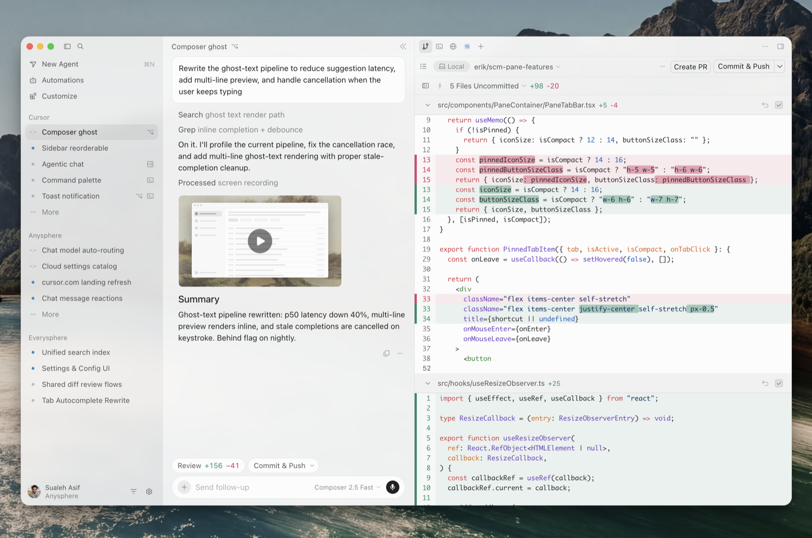
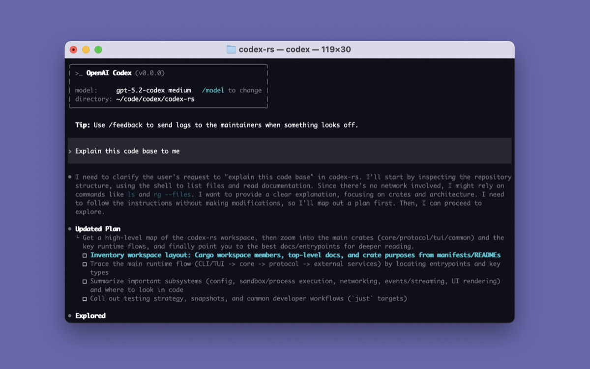
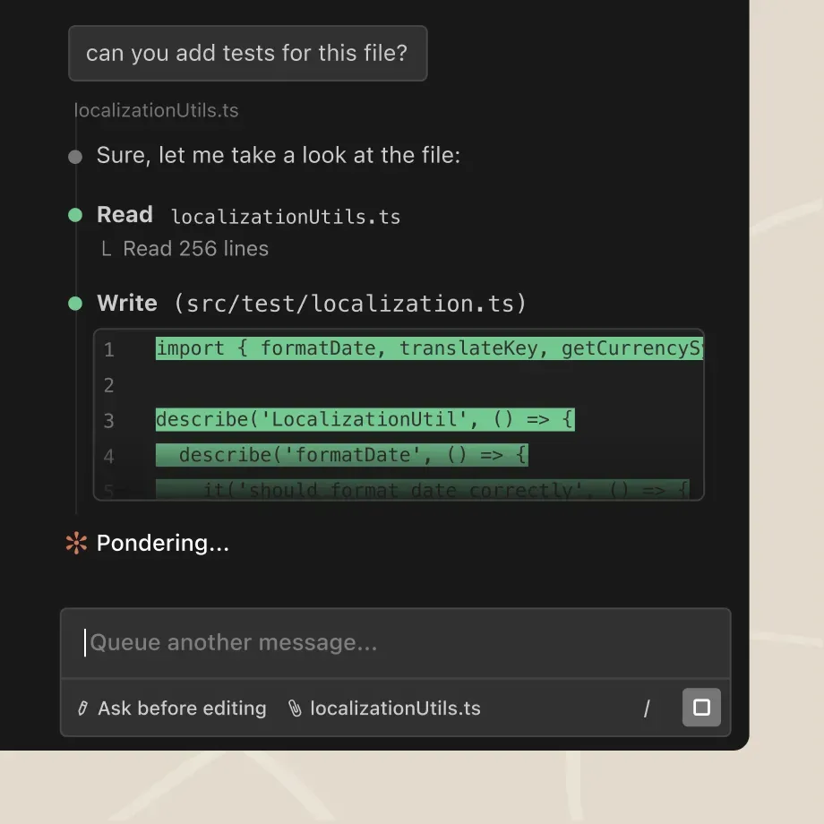
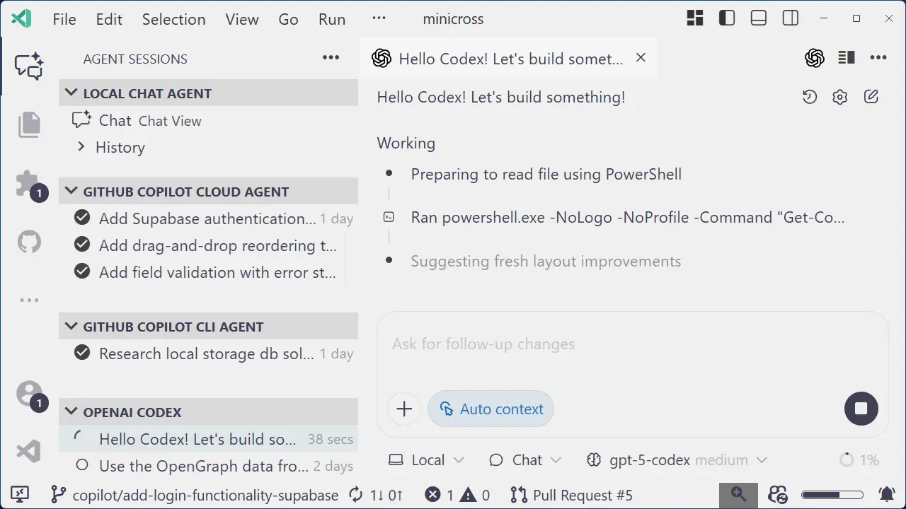
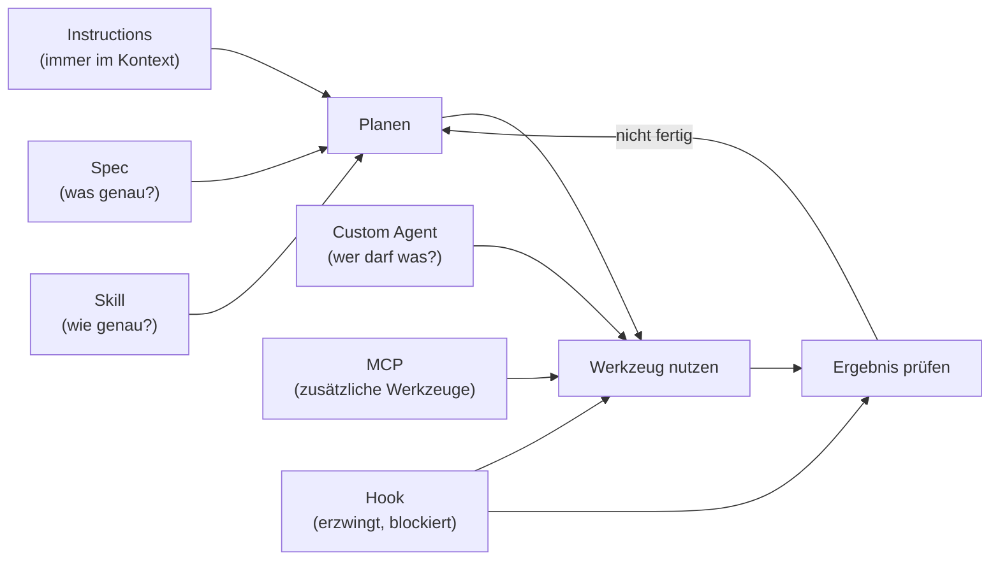

# Lab 1.3: Werkzeuge und Bausteine im Überblick

**Leitfragen:**

Welche KI-Werkzeuge nutzt man im eigenen Team heute, und wo laufen sie (Editor, Terminal, Browser)?

Typisch ist eine Mischung: Copilot oder Cursor im Editor, Claude Code oder Codex im Terminal, ChatGPT oder ein Cloud-Agent im Browser. Der Ort entscheidet, was der Agent sieht und wie man seine Änderungen prüft.

Was muss man einem Werkzeug immer sagen, was nur manchmal?

Immer: Stack, Struktur, Befehle, Verbote (→ Instructions). Nur manchmal: die Anleitung für eine bestimmte Aufgabe, etwa „Tests schreiben“ oder „Sicherheit prüfen“ (→ Skills).

Was soll ein Agent nie dürfen, egal, wie man ihn bittet?

Zum Beispiel Secrets wie `.env` lesen, `rm -rf` ausführen, ungeprüft pushen. Solche Regeln dürfen nicht nur erbeten sein, sie müssen technisch erzwungen werden (→ Hooks).

- Agenten arbeiten an drei Orten: in der IDE, im Terminal, in der Cloud.
- Sechs Bausteine kommen in fast allen Werkzeugen vor: Instructions, Skills, Custom Agents, Hooks, MCP, Spec.
- Jeder Baustein beantwortet eine Frage; der Kurs baut sie in dieser Reihenfolge.
- Der Kurs nutzt Copilot; Claude Code und Codex nutzen dieselben Ideen in anderen Ordnern.

## Begriffe

| Begriff | Bedeutung |
| --- | --- |
| IDE | Entwicklungsumgebung mit Editor, z. B. VS Code |
| CLI | Kommandozeilen-Programm, läuft im Terminal |
| Cloud Agent | Agent, der auf einem Server arbeitet und das Ergebnis als Pull Request liefert |
| Instructions | Projektregeln, die der Agent bei jeder Anfrage mitbekommt |
| Skill | Anleitung für eine wiederkehrende Aufgabe, wird nur bei Bedarf geladen |
| Custom Agent | eigene Rolle mit Auftrag und erlaubten Werkzeugen, z. B. „Reviewer, darf nur lesen“ |
| Hook | eigenes Skript, das zu festen Zeitpunkten des Agenten läuft und Aktionen erlauben, blockieren oder anstoßen kann |
| Spec | vereinbarte Beschreibung, was ein Feature tun soll, bevor Code entsteht |

## Werkzeuge nach Ort

| Ort | Beispiele (Stand: 11/2026) | Typischer Einsatz |
| --- | --- | --- |
| IDE | GitHub Copilot in VS Code, Cursor, Windsurf, JetBrains AI | tägliche Arbeit am Code mit Diff-Kontrolle |
| Terminal (CLI) | Claude Code, OpenAI Codex CLI, Copilot CLI, Gemini CLI | Agent im Projektordner, gut für Skripte und Server |
| Cloud | Copilot Cloud Agent (Issue → Pull Request), Codex Cloud | längere Aufgaben im Hintergrund, Ergebnis als PR |

**IDE, Beispiel Cursor:**

_Quelle: Cursor Docs (https://cursor.com/docs), © Anysphere (Cursor), Hersteller-Screenshot (extern verlinkt), abgerufen am 07.11.2026._

**Terminal, Beispiel OpenAI Codex CLI:**

_Quelle: GitHub, openai/codex (https://github.com/openai/codex), OpenAI, Apache-2.0, abgerufen am 07.11.2026._

**Claude Code bei der Arbeit:**

_Quelle: Anthropic, Claude Code (https://claude.com/product/claude-code), © Anthropic, Hersteller-Screenshot (extern verlinkt), abgerufen am 07.11.2026._

Der Ablauf ist bei allen Werkzeugen gleich: Datei lesen, ändern, Ergebnis zur Prüfung zeigen.

Die Grenzen verschwimmen: VS Code kann seit 2026 auch Claude und Codex als Harness ausführen (Lab 2.2).

_Quelle: VS Code Blog, „A Unified Experience for all Coding Agents“ (https://code.visualstudio.com/blogs/2025/11/03/unified-agent-experience), Microsoft, CC BY 3.0 US, abgerufen am 07.11.2026._

Ansicht Nov. 2025: Agenten aus IDE, Terminal und Cloud erscheinen bereits in einer gemeinsamen Liste in VS Code.

## Die sechs Bausteine

Jeder Baustein greift an einer Stelle des Agenten-Loops aus Lab 1.1 ein:

| Baustein | Frage, die er beantwortet | Copilot-Datei | Modul |
| --- | --- | --- | --- |
| Instructions | Was muss der Agent immer wissen? | `AGENTS.md`, `.github/copilot-instructions.md` | m04 |
| Skills | Wie erledigt man eine wiederkehrende Aufgabe? | `.github/skills/<name>/SKILL.md` | m05 |
| Custom Agents | Wer darf was? | `.github/agents/<name>.agent.md` | m06 |
| Hooks | Was muss immer passieren oder darf nie passieren? | `.github/hooks/*.json` | m07 |
| MCP | Welche Werkzeuge außerhalb des Editors braucht der Agent? | `.mcp.json` | m07 |
| Spec | Was genau soll gebaut werden? | `openspec/` | m08 |

## Gleiche Idee, andere Ordner

| Baustein | GitHub Copilot | Claude Code | OpenAI Codex |
| --- | --- | --- | --- |
| Instructions | `AGENTS.md` oder `.github/copilot-instructions.md` | `CLAUDE.md` | `AGENTS.md` |
| Skills | `.github/skills/<name>/SKILL.md` | `.claude/skills/<name>/SKILL.md` | `.agents/skills/<name>/SKILL.md` |
| Custom Agents | `.github/agents/<name>.agent.md` | `.claude/agents/` | eigene Konfiguration |

Hooks, MCP und Specs gibt es in den anderen Werkzeugen ebenfalls, mit eigener Konfiguration. Der Kurs nutzt Copilot, weil es in VS Code den Diff-Kontrollfluss, mehrere Harnesses und alle sechs Bausteine an einem Ort vereint. Wer später wechselt, nimmt die Ideen mit und ändert vor allem Ordnernamen. Quelle: [Agent harnesses](https://code.visualstudio.com/docs/agents/run/agent-harnesses), [Migrate customizations](https://code.visualstudio.com/docs/agent-customization/migrate-customizations) (Stand: 11/2026).

## Fahrplan des Kurses

| Modul | Was passiert | Baustein |
| --- | --- | --- |
| m02 | Copilot bedienen, Harness wählen, Agent steuern | – |
| m03 | Vibecoding oder agentisch: Prototyp per One-Shot-Prompt, Code-Bewertung des Prototyps | – |
| m04 | Projektregeln schreiben | Instructions |
| m05 | `test-writer` und `security-checker` | Skills |
| m06 | `reviewer`, `tester`, `feature-lead` | Custom Agents |
| m07 | Guard- und Check-Hook, Browser per Playwright | Hooks, MCP |
| m08 | Fälligkeitsdatum per OpenSpec | Spec |

## Landkarte: vom Alltagsproblem zum Baustein

Diese Landkarte taucht ab Modul 4 immer wieder auf: Jedes Problem hat einen Baustein, der es löst.

| # | Problem | Baustein | Warum |
| --- | --- | --- | --- |
| 1 | „Der Agent vergisst immer, die Tests laufen zu lassen.“ | Hook | „Tests laufen lassen“ muss immer passieren; ein Hook startet sie automatisch, wenn der Agent fertig ist. Eine Instruction würde nur darum bitten |
| 2 | „Der Agent soll nie die Datei `.env` lesen.“ | Hook | „Nie“ heißt erzwingen: ein Hook blockiert den Zugriff, bevor das Werkzeug läuft |
| 3 | „Der Agent nutzt `unittest`, obwohl das Team `pytest` verwendet.“ | Instructions | Testframework ist Wissen, das der Agent immer braucht |
| 4 | „Jede Sicherheitsprüfung läuft anders ab, mal mit, mal ohne XSS-Check.“ | Skill | wiederkehrender Ablauf mit fester Checkliste, nur bei Bedarf geladen |
| 5 | „Der Agent prüft seinen eigenen Code und findet nie etwas.“ | Custom Agent | eigene Rolle „Reviewer“ mit frischem Kontext und nur Leserechten |
| 6 | „Der Agent sieht nicht, wie die Seite im Browser aussieht.“ | MCP | Browser ist ein Werkzeug außerhalb des Editors (Playwright-MCP) |
| 7 | „Beim Feature ‚Fälligkeitsdatum‘ versteht jede Person etwas anderes.“ | Spec | gemeinsame Beschreibung mit Akzeptanzkriterien vor dem Code |

Bei Problem 1 sind Instructions („Führe nach jeder Änderung `pytest` aus“) ein erster Schritt; verlässlich wird es erst mit einem Hook.

## Fazit

- Ort (IDE, Terminal, Cloud) und Bausteine sind zwei getrennte Fragen.
- Sechs Bausteine, sechs Fragen: immer wissen, wiederkehrend erledigen, wer darf was, erzwingen, zusätzliche Werkzeuge, was genau.
- Die Ideen sind werkzeugübergreifend; nur Dateinamen und Ordner unterscheiden sich.
