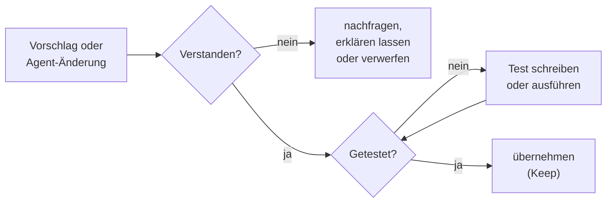

# Lab 1.4: Verantwortung, Sicherheit und Risiken

**Leitfragen:**

Wer haftet, wenn KI-Code ein Datenleck verursacht?

Nicht die KI. Verantwortlich ist, wer den Code übernimmt und ausliefert, also das Team und das Unternehmen. „Hat der Agent geschrieben“ ist keine Ausrede, genauso wenig wie „stand auf Stack Overflow“.

Welche Daten dürfen das Firmennetz nie verlassen?

Mindestens: Zugangsdaten und Secrets, personenbezogene Daten von Kunden und Mitarbeitenden, vertrauliche Geschäftsdaten. Was genau dazugehört, legt die Firmenrichtlinie fest; im Zweifel nicht in den Prompt.

Was würde ein Reviewer an Code bemängeln, den niemand im Team geschrieben hat?

Unklare Absicht, fremder Stil, fehlende Tests, unbekannte Abhängigkeiten, ungeprüfte Eingaben. Die Frage „Warum ist das so gelöst?“ muss jemand im Team beantworten können.

- Verantwortlich für KI-Code ist die Person, die ihn übernimmt.
- Typische Risiken: Sicherheitslücken, veraltete APIs, Secrets im Prompt, zerstörerische Befehle, unbekannte Pakete.
- Grundregel: nichts übernehmen, was man nicht versteht und nicht getestet hat.

## Begriffe

| Begriff | Bedeutung |
| --- | --- |
| Secret | Zugangsdaten wie API-Schlüssel, Passwort, Token; gehört in Umgebungsvariablen, nie in Code oder Chat |
| Abhängigkeit (Dependency) | fremdes Paket, das das Projekt nutzt (npm, PyPI) |
| Erfundenes Paket | Paketname, den die KI halluziniert; Angreifer registrieren solche Namen mit Schadcode |
| Freigabe | Bestätigung durch den Menschen, bevor der Agent ein Werkzeug oder einen Terminal-Befehl ausführt (Lab 2.5) |

_Quelle: Wikimedia Commons, „ChatGPT hallucination.png“ (https://commons.wikimedia.org/wiki/File:ChatGPT_hallucination.png), Public Domain, abgerufen am 07.11.2026._

Halluzination (2023): Die Antwort klingt sicher und ist trotzdem erfunden. Erfundene Paketnamen entstehen auf dieselbe Weise.

## Wer verantwortet KI-Code?

| Frage | Antwort im Alltag |
| --- | --- |
| Wer ist verantwortlich? | wer den Code übernimmt, reviewt und ausliefert, nicht das Werkzeug |
| Darf KI-Code ungelesen ins Repo? | nein; dieselben Regeln wie für Code von Kolleg:innen: Review, Tests |
| Muss man KI-Code kennzeichnen? | abhängig von Firmenrichtlinie und Kunde; vorher klären |

## Lizenz und Datenschutz

| Thema | Risiko | Umgang |
| --- | --- | --- |
| Lizenz | Vorschlag gleicht fast wörtlich öffentlichem Code unter einer fremden Lizenz | Copilot kann Vorschläge, die öffentlichem Code entsprechen, blockieren; Einstellung in der Organisation prüfen |
| Datenschutz | Prompt mit personenbezogenen Daten verlässt das Firmennetz | keine echten Kundendaten in Prompts und Testdaten; anonymisierte Beispiele nutzen |
| Training | Eingaben könnten zum Training von Modellen genutzt werden | Lizenz und Vertrag prüfen (Business/Enterprise vs. privat); Firmenrichtlinie befolgen |
| Vertraulichkeit | Code oder Architektur gelangt an Dritte | nur von der Firma freigegebene Werkzeuge und Modelle nutzen |

Rechtliche Details hängen von Vertrag, Land und Branche ab; dieses Handout ersetzt keine Rechtsberatung.

## Typische Risiken

| Risiko | Beispiel | Gegenmittel |
| --- | --- | --- |
| Sicherheitslücke | Eingabe ungeprüft in HTML ausgegeben (XSS), SQL aus Strings zusammengesetzt | Code lesen, Sicherheits-Checkliste (m05), Review |
| Veraltete API | `datetime.utcnow()` aus Lab 1.1 | Doku zur verwendeten Version prüfen, Warnungen ernst nehmen |
| Secret im Prompt | API-Schlüssel in den Chat kopiert, um einen Fehler zu zeigen | Schlüssel vorher ersetzen (`<API_KEY>`); geleakten Schlüssel sofort widerrufen |
| Zerstörerischer Befehl | Agent führt `rm -rf` oder `DROP TABLE` aus | Freigaben aktiv lassen und solche Befehle ablehnen (Lab 2.5), später Hooks (m07) |
| Unbekannte Abhängigkeit | Agent installiert ein Paket mit ähnlichem Namen wie ein bekanntes | Paket auf npm/PyPI prüfen: Herkunft, Downloads, Pflege; nur bewusst neue Abhängigkeiten |
| Überflüssiger Code | Agent baut mehr als verlangt | Diff lesen, Unnötiges verwerfen |

_Quelle: VS Code Blog, „Introducing GitHub Copilot agent mode (preview)“ (https://code.visualstudio.com/blogs/2025/02/24/introducing-copilot-agent-mode), Microsoft, CC BY 3.0 US, abgerufen am 07.11.2026._

Ansicht 2025: Vor jedem Terminal-Befehl zeigt der Agent den Befehl und wartet auf die Freigabe. Genau hier fällt ein `rm -rf` oder ein falscher Paketname auf.

## Die Grundregel

## Fünf Situationen nach Risiko

Fünf typische Situationen, nach Schaden sortiert:

| Rang | Situation | Warum | Sofortmaßnahme |
| --- | --- | --- | --- |
| 1 | Ein API-Schlüssel der Produktionsumgebung wurde in den Chat kopiert, um einen Fehler zu zeigen | Schlüssel hat das Firmennetz verlassen, Missbrauch möglich | Schlüssel sofort widerrufen und neu erzeugen, Vorfall melden |
| 2 | Zum Debuggen wurde ein Export mit echten Kundendaten als Kontext angehängt | möglicher Datenschutzverstoß, meldepflichtig je nach Lage | Datenschutzverantwortliche informieren, künftig nur anonymisierte Daten |
| 3 | Der Agent will im Terminal `rm -rf build/ data/` ausführen, um „aufzuräumen“ | Datenverlust, falls `data/` nirgends gesichert ist | Freigabe ablehnen, Befehl prüfen, nur gezielt löschen |
| 4 | Der Agent schlägt vor, das Paket `reqeusts` zu installieren | Tippfehler-Paket kann Schadcode enthalten | ablehnen; richtig ist `requests`, Paketnamen immer prüfen |
| 5 | Ein übernommener Vorschlag nutzt eine API, die seit zwei Versionen als veraltet markiert ist | funktioniert meist noch, bricht später | ersetzen und einen Test ergänzen |

Drei Regeln für die Arbeit mit Agenten:

1. Keine Secrets und keine echten Personendaten in Prompts oder angehängten Dateien.
2. Terminal-Befehle, die löschen, installieren oder pushen, nur nach eigener Prüfung freigeben.
3. Nichts übernehmen (Keep), was nicht verstanden und getestet ist.

## Fazit

- KI-Code wird behandelt wie Code einer neuen Kollegin: lesen, testen, dann übernehmen.
- Secrets und Personendaten gehören nie in den Prompt.
- Die gefährlichsten Fehler passieren im Terminal; die Freigabe ist die Stelle, an der sie auffallen.
