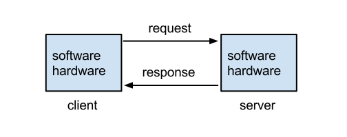
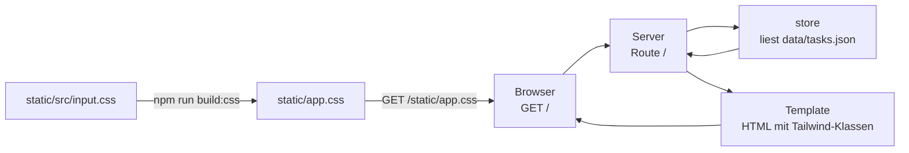
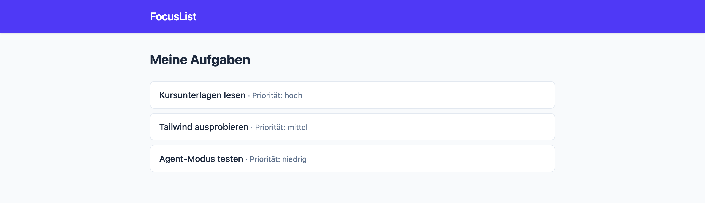
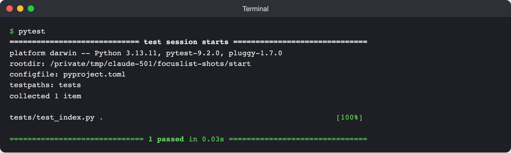

# Lab 2.1: Kursprojekt FocusList: Aufbau und Setup

**Leitfragen:**

<details>
<summary>Was braucht eine Web-App mindestens, damit im Browser etwas erscheint?</summary>

Einen Server, der auf einem Port lauscht, eine Route für `/`, die HTML liefert, und Daten, die ins HTML kommen. Für ein gestyltes Ergebnis zusätzlich eine CSS-Datei, die der Server ausliefert.

</details>

<details>
<summary>Wo würde man in einem fremden Projekt zuerst nachsehen?</summary>

`README.md` (Start, Test), die Paketdatei (`pyproject.toml` bzw. `package.json`) für Abhängigkeiten und Skripte, dann den Einstiegspunkt (`create_app()` bzw. `server.js`) und die Tests.

</details>

<details>
<summary>Woran merkt man, dass ein Setup „fertig“ ist?</summary>

An beobachtbaren Ergebnissen: Die App startet ohne Fehler, die Seite zeigt Daten mit Styling, und die Tests laufen grün.

</details>

- FocusList ist eine kleine Aufgaben-Web-App; sie wächst im Kurs von `start` bis v5.
- Zwei gleichwertige Stacks: Python (Flask + Jinja2, pytest) oder Node.js (nur eingebaute Module, `node:test`); jede Durchführung nutzt einen.
- Beide nutzen Tailwind CSS v4 über `@tailwindcss/cli` (npm) und speichern Daten in `data/tasks.json`.
- Das Startgerüst ist bewusst klein: Liste anzeigen, ein Test, kein Formular, keine API.

## Begriffe

| Begriff | Bedeutung |
| --- | --- |
| Route | Kombination aus HTTP-Methode und Pfad, z. B. `GET /`, mit Code, der die Antwort erzeugt |
| Template | HTML-Vorlage mit Platzhaltern, die der Server mit Daten füllt (Jinja2 bzw. Template-Funktion) |
| Tailwind CSS | CSS-Framework mit kleinen Klassen direkt im HTML (`bg-white`, `px-4`); ein Build erzeugt daraus `static/app.css` |
| `venv` | virtuelle Python-Umgebung, hält die Pakete des Projekts getrennt vom System |
| Startgerüst (`start/`) | Ausgangsstand von FocusList für Modul 2 und 3 |

## Aufbau des Startgerüsts


_Quelle: Wikimedia Commons, „Client-server model.svg“ (https://commons.wikimedia.org/wiki/File:Client-server_model.svg), Lubaochuan, CC BY-SA 4.0, abgerufen am 07.11.2026._

Grundprinzip jeder Web-App: Der Browser (Client) fragt, der Server antwortet. Bei FocusList laufen beide auf demselben Rechner.



### Python

| Datei | Aufgabe |
| --- | --- |
| `pyproject.toml` | Projektbeschreibung: Python ≥ 3.12, Abhängigkeit `flask>=3.1`, dev: `pytest>=8`, Testordner |
| `requirements.txt` | `flask>=3.1`, `pytest>=8` für `pip install -r` |
| `package.json` | nur Tailwind: Skripte `css` (beobachten) und `build:css` (einmal bauen) |
| `focuslist/__init__.py` | `create_app()` mit der Route `/` |
| `focuslist/store.py` | `load_tasks(path)`, `save_tasks(path, tasks)` |
| `focuslist/templates/base.html` | Layout: Kopfzeile, `<link>` auf `app.css` |
| `focuslist/templates/index.html` | Liste: Titel und Priorität jeder Aufgabe |
| `static/src/input.css` | Tailwind-Eingabe |
| `data/tasks.json` | drei Beispielaufgaben |
| `tests/conftest.py` | Fixtures `app` (mit Kopie der Beispieldaten) und `client` |
| `tests/test_index.py` | ein Test: `GET /` liefert 200 und „Kursunterlagen lesen“ |

Kern ist `create_app()` in [`focuslist/__init__.py`](../project/focuslist/python/start/focuslist/__init__.py): eine Route `/` (`@app.get("/")`) liest die Aufgaben mit `load_tasks()` und rendert `index.html`.

Der Test [`tests/test_index.py`](../project/focuslist/python/start/tests/test_index.py) ruft `GET /` auf und prüft Status 200 und den Text „Kursunterlagen lesen“.

### Node.js

| Datei | Aufgabe |
| --- | --- |
| `package.json` | `"type": "module"`, Skripte `dev`, `start`, `test`, `css`, `build:css`; nur Tailwind als devDependency |
| `server.js` | startet `createApp()` auf `PORT` (Standard 3000) |
| `src/app.js` | `createApp({ dataPath })`: Routen `GET /` und `GET /static/app.css` per `if` |
| `src/store.js` | `loadTasks(path)`, `saveTasks(path, tasks)` mit `fs/promises` |
| `src/views/layout.js` | Grundgerüst jeder Seite als Template-String |
| `src/views/index.js` | `indexPage(tasks)`: Liste mit Titel und Priorität |
| `static/src/input.css` | Tailwind-Eingabe |
| `data/tasks.json` | drei Beispielaufgaben |
| `test/index.test.js` | startet den Server auf Port 0, `fetch("/")`, prüft 200 und „Kursunterlagen lesen“ |

Kern ist `createApp()` in [`src/app.js`](../project/focuslist/node/start/src/app.js): zwei `if`-Abfragen für `GET /` und `GET /static/app.css`, sonst 404. Die Route `/` liest die Aufgaben mit `loadTasks()` und antwortet mit `indexPage(tasks)`.

### Beide Stacks

`data/tasks.json`:

```json
[
  { "id": 1, "title": "Kursunterlagen lesen", "priority": "high", "done": false },
  { "id": 2, "title": "Tailwind ausprobieren", "priority": "medium", "done": false },
  { "id": 3, "title": "Agent-Modus testen", "priority": "low", "done": true }
]
```

`static/src/input.css` enthält nur `@import "tailwindcss";` und eine `@source`-Zeile mit dem Ordner, in dem Tailwind nach Klassen sucht (Python: `../../focuslist/templates`, Node.js: `../../src`).

`static/app.css` ist ein Build-Ergebnis. Ohne `npm run build:css` lädt die Seite ohne Styling.

## Typische Fehler

| Symptom | Ursache | Lösung |
| --- | --- | --- |
| `No module named flask` oder `flask: command not found` | `venv` nicht aktiviert oder Pakete nicht installiert | `source .venv/bin/activate` (Windows: `.venv\Scripts\Activate.ps1`), dann `pip install -r requirements.txt` |
| Seite erscheint als unformatierter Text | `static/app.css` fehlt | `npm install`, dann `npm run build:css` |
| `tailwindcss: command not found` | `npm install` fehlt | im Projektordner `npm install` ausführen |
| `Address already in use` / Port belegt | anderer Prozess nutzt 5000 bzw. 3000 (macOS: AirPlay-Empfänger nutzt oft 5000) | Python: `flask --app focuslist run --debug --port 5001`; Node.js: `PORT=3001 npm run dev` (PowerShell: `$env:PORT=3001; npm run dev`) |
| neue Tailwind-Klasse wirkt nicht | CSS nicht neu gebaut | `npm run css` in einem zweiten Terminal laufen lassen |
| `pytest` findet keine Tests | Befehl nicht im Projektordner gestartet | in den Ordner mit `pyproject.toml` wechseln |

## App starten und Tests ausführen

Diese Befehle werden ab Lab 3.2 gebraucht.

**Arbeitsordner anlegen** (im Ordner der Kursunterlagen ausführen):

```bash
node project/focuslist/catch-up.mjs python m03 ~/kurs/focuslist   # Python
node project/focuslist/catch-up.mjs node m03 ~/kurs/focuslist     # Node.js
```

Alternativ den Ordner `project/focuslist/<stack>/start/` an einen eigenen Ort kopieren. Danach den Ordner `focuslist` in VS Code öffnen; `README.md` beschreibt das Projekt.

**Python** (macOS/Linux; Windows: `.venv\Scripts\Activate.ps1`):

```bash
python -m venv .venv
source .venv/bin/activate
pip install -r requirements.txt
npm install
npm run build:css
flask --app focuslist run --debug
```

Test im zweiten Terminal (dort ebenfalls `venv` aktivieren): `pytest` → erwartete Ausgabe `1 passed`.

**Node.js:**

```bash
npm install
npm run build:css
npm run dev
```

Konsole: `FocusList läuft auf http://localhost:3000`. Test im zweiten Terminal: `npm test` → erwartete Ausgabe `✔ GET / zeigt die Aufgabenliste`, Zusammenfassung `pass 1`, `fail 0`.

**Erwarteter Stand:** `127.0.0.1:5000` (Python) bzw. `localhost:3000` (Node.js) zeigt drei Aufgaben mit Tailwind-Styling (blau-violette Kopfzeile, weiße Karten); der Test läuft grün.


_Quelle: eigener Screenshot, FocusList start, 07.11.2026._


_Quelle: eigener Screenshot, FocusList start, 07.11.2026._

Aufgenommen mit dem Python-Stack; bei Node.js meldet der Test `pass 1`.

## Fazit

- Startgerüst: Server, eine Route, Store für JSON, Template mit Tailwind, ein Test.
- „Fertig“ heißt: App läuft, Seite zeigt Daten mit Styling, Test grün.
- Formular, Filter und API fehlen bewusst; sie entstehen in m03 durch den Agenten.
