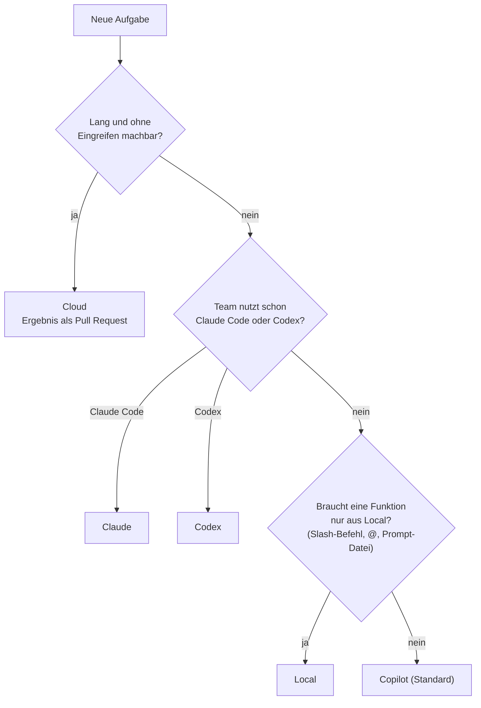

# Lab 2.2: Harnesses: Copilot, Local, Claude, Codex

**Leitfragen:**

Warum kann dasselbe Modell in zwei Werkzeugen unterschiedlich gut arbeiten?

Das Modell erzeugt nur Text. Welche Werkzeuge es aufrufen darf, welche Projektdateien es mitbekommt und wie lange die Sitzung läuft, bestimmt der Harness. Anderer Harness = anderer Kontext und andere Werkzeuge = anderes Ergebnis.

Eine Anleitung aus dem Netz nennt einen Befehl, den der eigene Chat nicht kennt: Woran kann das liegen?

Meist an Datum oder Harness: Die Anleitung stammt aus einer früheren Version oder beschreibt den Local-Harness. `/explain` oder `@terminal` gibt es zum Beispiel nur dort, nicht im Copilot-Harness.

Welche Arbeit soll weiterlaufen, wenn man den Laptop zuklappt?

Lange Aufgaben, die kein Eingreifen brauchen, etwa ein Feature mit Tests. Der Copilot-Harness überdauert das Schließen des Fensters, läuft aber auf dem eigenen Rechner; was ohne den Rechner weiterlaufen soll, gehört in die Cloud (Ergebnis als Pull Request).

- Harness = Laufzeit um das Modell: Werkzeuge, gelesene Dateien, Ort der Sitzung.
- Copilot für VS Code bietet die Harnesses Copilot (Standard), Local, Claude, Codex und Cloud als Ausführungsziel.
- Der Kurs arbeitet im Copilot-Harness; Local nur für Funktionen, die es nur dort gibt.
- Viele ältere Anleitungen beschreiben den Local-Harness und passen deshalb nicht mehr zum Standard.

## Begriffe

| Begriff | Bedeutung |
| --- | --- |
| Harness | Laufzeit um das Modell: entscheidet über Werkzeuge, gelesene Dateien (Instructions, Skills, Agents) und Ort der Sitzung |
| Session-Ziel | Auswahl in der Chat-Ansicht, in welchem Harness bzw. wo eine Sitzung läuft |
| Agent Host | Prozess in VS Code, der Harnesses wie Copilot, Claude und Codex ausführt (seit VS Code 1.129, Jul 2026) |
| Slash-Befehl | Kurzbefehl im Chat mit `/`, z. B. `/explain` |
| Chat-Teilnehmer | Spezialist im Chat mit `@`, z. B. `@terminal` |
| Prompt-Datei | gespeicherter Prompt als `.github/prompts/<name>.prompt.md` |
| Handoff | Schaltfläche, die eine Sitzung mit vorbereitetem Prompt an einen anderen Agenten übergibt |

## Was ein Harness ist

**Alltagsbild:** Das Modell ist der Motor, der Harness ist das Fahrzeug. Derselbe Motor fährt sich im Kleinwagen anders als im Transporter: Lenkung, Bremsen, Laderaum und Navi gehören zum Fahrzeug, nicht zum Motor.

_Quelle: Wikimedia Commons, „Audi EA888 engine.jpg“ (https://commons.wikimedia.org/wiki/File:Audi_EA888_engine.jpg), TTTNIS, Public Domain, abgerufen am 07.11.2026._

_Quelle: Wikimedia Commons, „2020 Volkswagen Golf Style 1.5 Front.jpg“ (https://commons.wikimedia.org/wiki/File:2020_Volkswagen_Golf_Style_1.5_Front.jpg), Vauxford, CC BY-SA 4.0, abgerufen am 07.11.2026._

Oben der Motor (Modell), unten das Fahrzeug (Harness): Erst das Fahrzeug um den Motor macht ihn nutzbar.

| Der Harness bestimmt | Beispiel |
| --- | --- |
| Werkzeuge | Datei lesen, ändern, Terminal, Suche, MCP-Server |
| gelesene Dateien | `AGENTS.md`, `CLAUDE.md`, Skills-Ordner |
| Befehle im Chat | `/explain` nur im Local-Harness |
| Ort und Lebensdauer | an das Fenster gebunden, im Agent Host oder auf GitHub |

_Quelle: VS Code Docs, „Understand agent harnesses“ (https://code.visualstudio.com/docs/agents/concepts/agent-harnesses), Microsoft, CC BY 3.0 US, abgerufen am 07.11.2026._

Das Modell schlägt Aktionen vor, der Harness führt sie aus und entscheidet, was erlaubt ist.

## Die Harnesses in Copilot für VS Code

Stand: 11/2026. Quelle: [Agent harnesses](https://code.visualstudio.com/docs/agents/run/agent-harnesses), [GitHub Changelog, 28.10.2026](https://github.blog/changelog/2026-10-28-github-copilot-in-vs-code-universe-releases/)

| Harness | Was es ist | Wann nutzen |
| --- | --- | --- |
| **Copilot** (Standard) | Copilot SDK im Agent Host; Sitzung läuft weiter, wenn das Fenster zu ist; Agents-Fenster | Standard für Alltag und alle Übungen im Kurs |
| **Local** | der bisherige eingebaute Harness von VS Code, an das Fenster gebunden, nur Chat-Ansicht | Funktionen, die es nur hier gibt (Tabelle unten), oder wenn die Firma ihn vorgibt |
| **Claude** | Claude Agent SDK von Anthropic; liest `CLAUDE.md`, `.claude/skills` | Team arbeitet bereits mit Claude Code |
| **Codex** | OpenAI Codex; liest `AGENTS.md`, `.agents/skills` | Team arbeitet bereits mit Codex |
| **Cloud** | Ausführungsziel (kein eigener Harness): Agent arbeitet auf GitHub und liefert einen Pull Request | lange Aufgaben, die nicht den eigenen Rechner blockieren sollen |

Der Copilot-Harness ist seit VS Code 1.142 (Okt 2026) Standard für neue Sitzungen. Claude und Codex sind bei verwalteten Unternehmenseinstellungen gesperrt; Firmen können per Richtlinie Local als Standard halten.

_Quelle: VS Code Release Notes 1.142 (https://code.visualstudio.com/updates/v1_142), Microsoft, CC BY 3.0 US, abgerufen am 07.11.2026._

Beim Überfahren eines Eintrags erklärt VS Code, wo der Harness läuft (Stand: VS Code 1.142, Okt 2026).

## Entscheidungshilfe

Bei Firmenlizenzen gilt zuerst die Vorgabe der Organisation.

## Nur im Local-Harness

Diese Funktionen stehen in vielen Anleitungen, laden aber im Copilot-Harness nicht. Stand: 11/2026. Quelle: [Copilot Chat cheat sheet](https://docs.github.com/en/copilot/reference/chat-cheat-sheet), [Migrate customizations](https://code.visualstudio.com/docs/agent-customization/migrate-customizations), [Prompt files](https://code.visualstudio.com/docs/agent-customization/prompt-files)

| Funktion | Wirkung | Im Copilot-Harness stattdessen |
| --- | --- | --- |
| `/explain` | markierten Code oder Datei erklären | Frage in Ask stellen, Datei als Kontext anhängen |
| `/fix` | Korrektur für ein Problem vorschlagen | Problem beschreiben, Agent ändern lassen |
| `/tests` | Tests für den markierten Code erzeugen | Auftrag an Agent; ab m05 Skill `test-writer` |
| `/fixTestFailure` | fehlschlagenden Test analysieren und reparieren | Agent Tests ausführen und reparieren lassen |
| `/new` | neues Projekt oder neue Datei anlegen | Auftrag an Agent |
| `/clear` | neue Chat-Sitzung beginnen | neue Sitzung in der Chat-Ansicht öffnen |
| `/help` | Befehle und Teilnehmer auflisten | Cheatsheet dieses Moduls |
| `@vscode` | Fragen zu VS Code und Einstellungen | Frage in Ask stellen |
| `@terminal` | Fragen zum Terminal und letzten Befehlen | Terminal-Ausgabe als Kontext anhängen |
| `@github` | Fragen zu Repos, Issues, Pull Requests auf GitHub | Cloud bzw. GitHub-Werkzeuge |
| `#file`, `#selection` | Datei bzw. Markierung in den Prompt holen | „Add Context“ oder Drag & Drop (Lab 2.4) |
| Prompt-Dateien `.github/prompts/*.prompt.md` | gespeicherte Prompts per `/<name>` | Skills (m05) |
| Handoffs | Übergabe an einen anderen Agenten per Schaltfläche | Subagents (m06) |

## Warum ältere Anleitungen oft nicht passen

| Anleitung von | beschreibt meist | Folge heute |
| --- | --- | --- |
| 2023–2024 | Chat mit Slash-Befehlen und `@workspace` | `@workspace` ist nicht mehr im Cheatsheet; Slash-Befehle nur Local |
| 2025 bis Mitte 2026 | Local-Harness als einzigen Harness | Prompt-Dateien und Handoffs laden im Copilot-Harness nicht |
| Claude-Code- oder Codex-Blogs | `CLAUDE.md`, `.claude/`, `.agents/` | gleiche Idee, aber andere Dateien als im Copilot-Harness |

Vor dem Nachbauen prüfen: Datum der Quelle, Werkzeug, Harness.

## Übung

**Dauer:** ca. 15 Minuten · **Start:** FocusList `start/` aus Lab 2.1 · **Referenz:** Tabelle „Nur im Local-Harness“

1. Prüfe in der Chat-Ansicht, welches Session-Ziel aktiv ist, und wechsle für eine neue Sitzung auf den Local-Harness.
2. Öffne `focuslist/store.py` bzw. `src/store.js` und führe `/explain` aus.
3. Wechsle für eine neue Sitzung auf den Copilot-Harness, wähle **Ask**, hänge dieselbe Datei als Kontext an und frage ohne Slash-Befehl: „Erkläre, was diese Datei macht und wann sie aufgerufen wird.“
4. Tippe im Copilot-Harness `/explain` und beobachte, was passiert.
5. Vergleiche beide Antworten nach Länge, Inhalt und Bezug zum Projekt und lege fest: „Mein Standard-Harness ist … Ich wechsle, wenn …“.

**Checkpoint:** Zwei Antworten zur selben Datei liegen vor (Local mit `/explain`, Copilot ohne); ein Standard-Harness und mindestens ein Grund zum Wechseln sind festgelegt.

Lösungsweg

- Zu 1 und 3: Das Session-Ziel wird in der Chat-Ansicht gewählt, typischerweise beim Start einer neuen Sitzung. Bezeichnung und Ort der Auswahl können sich mit VS-Code-Versionen ändern (Stand: 11/2026).
- Zu 2: Local erklärt `load_tasks()`/`save_tasks()` bzw. `loadTasks()`/`saveTasks()`: JSON lesen, fehlende Datei (Python) → leere Liste, Schreiben mit Einrückung.
- Zu 3: Copilot liefert eine vergleichbare Erklärung und nennt oft zusätzlich die Aufrufer (`create_app()` bzw. `createApp()`), weil der Agent selbst im Projekt sucht.
- Zu 4: `/explain` erscheint im Copilot-Harness nicht in der Befehlsliste und wird nicht als eingebauter Befehl ausgeführt. Im Copilot-Harness ruft `/` eigene Skills auf (m05).
- Zu 5, Beispiel: „Mein Standard-Harness ist Copilot. Ich wechsle zu Local, wenn eine Anleitung eine Prompt-Datei voraussetzt, und zu Cloud, wenn eine lange Aufgabe ohne meinen Rechner laufen soll.“

## Fazit

- Gleiches Modell, anderer Harness = andere Werkzeuge, anderer Kontext, anderes Verhalten.
- Kursstandard ist der Copilot-Harness; Local bleibt für Slash-Befehle, `@`-Teilnehmer, Prompt-Dateien und Handoffs.
- Bei jeder Anleitung zuerst Datum und Harness prüfen.
