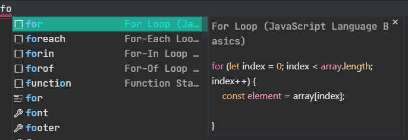
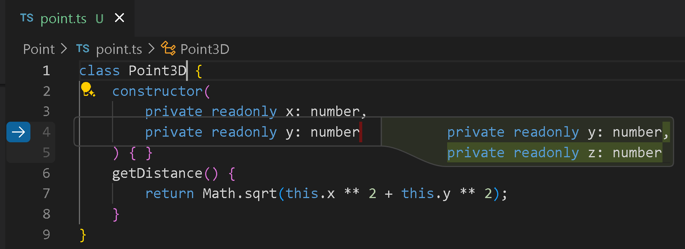
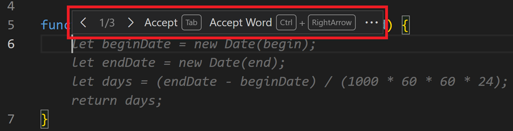
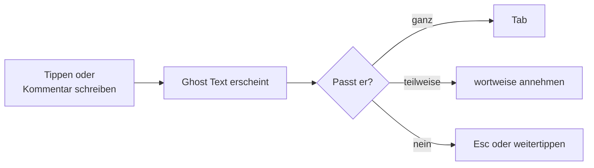
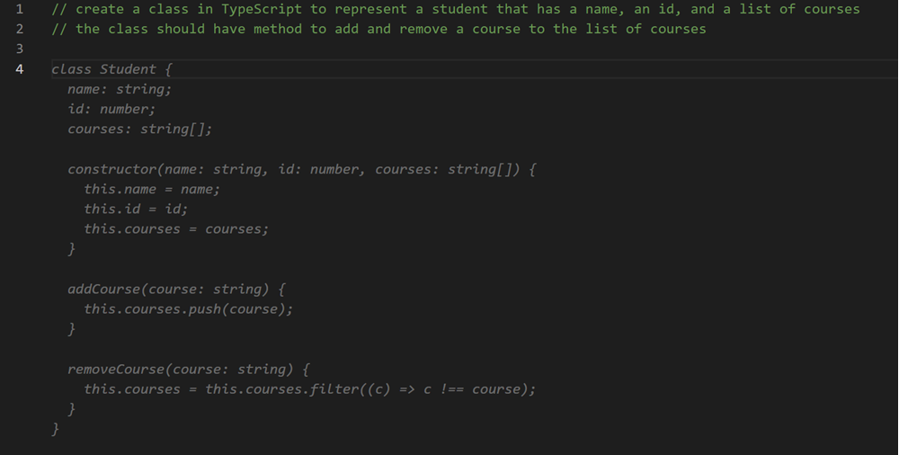
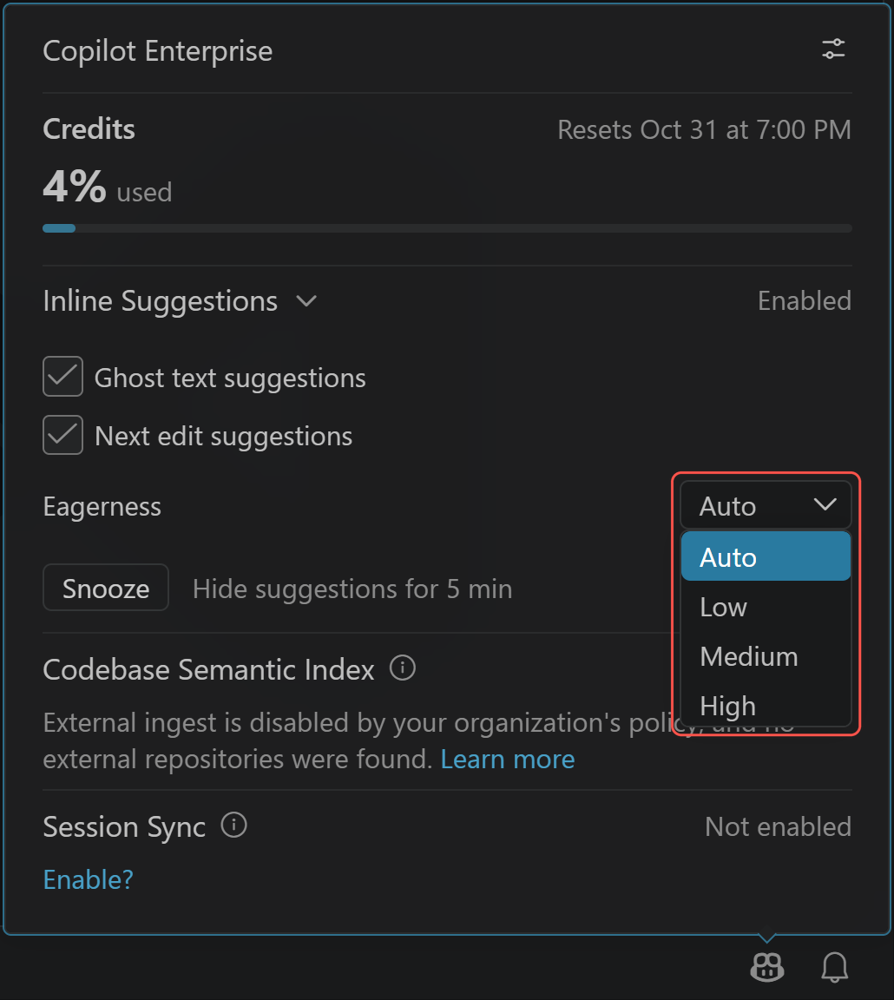

# Lab 2.3: Snippets, Ghost Text und Next Edit Suggestions

**Leitfragen:**

<details>
<summary>Wann hilft eine Vervollständigung, wann lenkt sie ab?</summary>

Eine Vervollständigung hilft bei vorhersehbarem Code: Boilerplate, Wiederholungen, bekannte Muster, Tailwind-Klassen. Sie lenkt ab, wenn man gerade nachdenkt, eine neue Lösung entwirft oder Text schreibt, und wenn man lange Vorschläge liest statt eigenen Code.

</details>

<details>
<summary>Woran erkennt man, dass ein Vorschlag nur gut aussieht?</summary>

Er passt formal, nutzt aber falsche Namen, ignoriert Grenzfälle (leere Liste, `None`) oder erfindet Felder, die es in den Daten nicht gibt. Prüffrage: Stimmen Namen und Felder mit dem Projekt überein, und was passiert im Grenzfall?

</details>

- Ohne KI: Snippets und Emmet setzen feste Textbausteine per Kürzel ein.
- Mit KI: Inline-Vorschläge erscheinen als grauer Text (Ghost Text) und werden mit Tab angenommen.
- Wortweise Annehmen übernimmt nur den passenden Teil eines Vorschlags.
- Next Edit Suggestions schlagen die nächste sinnvolle Änderung an einer anderen Stelle vor.
- Vorschläge funktionieren unabhängig vom gewählten Harness.

## Ohne KI: Snippets und Emmet

Lange bevor es KI-Vorschläge gab, hat VS Code Schreibarbeit mit festen Textbausteinen abgenommen:

| Werkzeug | Was es tut | Beispiel |
| --- | --- | --- |
| IntelliSense | Liste mit Namen, die an der Cursor-Position passen (Variablen, Funktionen, Schlüsselwörter) | `for` tippen → Liste mit passenden Einträgen |
| Snippet | fester Textbaustein mit Platzhaltern; Tab springt zum nächsten Platzhalter | `for` in JavaScript → komplette `for`-Schleife |
| Emmet | Abkürzungen für HTML und CSS, die zu ganzen Strukturen werden; in VS Code eingebaut | `!` → HTML-Grundgerüst, `ul>li*3` → Liste mit drei Einträgen |


_Quelle: VS Code Docs, „Snippets in Visual Studio Code“ (https://code.visualstudio.com/docs/editing/userdefinedsnippets), Microsoft, CC BY 3.0 US, abgerufen am 08.11.2026._

Snippets sind vorhersehbar: Derselbe Kürzel liefert immer denselben Text. Für JavaScript und HTML bringt VS Code Snippets mit, für Python kommen sie über Erweiterungen. Ghost Text dagegen wird für jede Stelle neu erzeugt und passt sich dem Code drumherum an.

## Begriffe

| Begriff | Bedeutung |
| --- | --- |
| Snippet | fester Textbaustein mit Platzhaltern, per Kürzel aus der IntelliSense-Liste eingefügt |
| Emmet | in VS Code eingebaute Abkürzungssprache für HTML und CSS |
| Inline-Vorschlag (Ghost Text) | grauer Text an der Cursor-Position, den Copilot während des Tippens anbietet |
| Next Edit Suggestion (NES) | Vorschlag für die nächste Änderung, auch an einer anderen Stelle der Datei, z. B. nach einer Umbenennung |


_Quelle: VS Code Docs, „Inline suggestions from GitHub Copilot in VS Code“ (https://code.visualstudio.com/docs/editing/ai-powered-suggestions), Microsoft, CC BY 3.0 US, abgerufen am 07.11.2026._

## Vorschläge annehmen und ablehnen

Stand: 11/2026, VS-Code-Standardbelegung. Abweichende Belegungen zeigt die Befehlspalette unter „Preferences: Open Keyboard Shortcuts“.

| Aktion | Windows / Linux | macOS |
| --- | --- | --- |
| Vorschlag annehmen | Tab | Tab |
| nächstes Wort annehmen | Ctrl+→ | Cmd+→ |
| Vorschlag ablehnen | Esc oder weitertippen | Esc oder weitertippen |
| nächste Alternative anzeigen | Alt+] | Option+] |
| vorherige Alternative anzeigen | Alt+[ | Option+[ |
| Next Edit Suggestion anspringen und annehmen | Tab | Tab |


_Quelle: VS Code Docs, „Inline suggestions from GitHub Copilot in VS Code“ (https://code.visualstudio.com/docs/editing/ai-powered-suggestions), Microsoft, CC BY 3.0 US, abgerufen am 07.11.2026._

Beim Überfahren des Ghost Texts erscheint eine Leiste mit denselben Aktionen wie in der Tabelle.



## Vorschläge gezielt auslösen

| Technik | Beispiel |
| --- | --- |
| Kommentar vor dem Code | `# Zählt offene Aufgaben` bzw. `// Zählt offene Aufgaben`, dann Funktionskopf beginnen |
| sprechende Namen | `def count_open(tasks):` liefert bessere Vorschläge als `def f(x):` |
| Muster vorgeben | erste Zeile einer Liste schreiben, Copilot ergänzt die übrigen |
| passende Datei offen | Copilot nutzt offene Dateien als Kontext, z. B. `data/tasks.json` |


_Quelle: VS Code Docs, „Inline suggestions from GitHub Copilot in VS Code“ (https://code.visualstudio.com/docs/editing/ai-powered-suggestions), Microsoft, CC BY 3.0 US, abgerufen am 07.11.2026._

## Wann Vorschläge stören

| Situation | Umgang |
| --- | --- |
| eigene Lösung entwerfen | Vorschläge vorübergehend über das Copilot-Menü in der Statusleiste pausieren |
| Markdown, Prosa, Dokumentation | Vorschläge für diese Sprache abschalten |
| sicherheitskritischer Code | jeden Vorschlag Zeile für Zeile lesen, im Zweifel ablehnen |
| Vorschlag länger als gewünscht | wortweise annehmen statt Tab |


_Quelle: VS Code Blog, „Tune GitHub Copilot Inline Suggestions with Configurable Eagerness“ (https://code.visualstudio.com/blogs/2026/10/27/configurable-eagerness), Microsoft, CC BY 3.0 US, abgerufen am 07.11.2026._

Stand: 10/2026. „Snooze“ pausiert Vorschläge kurz; die Häkchen schalten Ghost Text und Next Edit Suggestions getrennt ab.

## Typische Fehler

| Symptom | Ursache | Lösung |
| --- | --- | --- |
| kein Ghost Text | Copilot nicht angemeldet oder Vorschläge pausiert | Copilot-Symbol in der Statusleiste prüfen, anmelden bzw. „Snooze“ aufheben |
| `!` oder `ul>li*3` wird nicht erweitert | Sprachmodus der Datei ist nicht HTML (z. B. Datei noch nicht gespeichert) | Datei als `.html` speichern oder unten rechts den Sprachmodus „HTML“ wählen |

## Übung (optional)

**Dauer:** ca. 10 Minuten · **Start:** neue Spieldateien außerhalb des Projektordners; FocusList bleibt unverändert · **Referenz:** Lösungsweg unten

1. Lege außerhalb des Ordners `focuslist` eine Datei `spielwiese.html` an, tippe `!` und wähle in der Vorschlagsliste den Emmet-Eintrag.
2. Tippe im `<body>` die Abkürzung `ul>li*3` und erweitere sie mit Tab.
3. Lege `spielwiese.py` bzw. `spielwiese.js` an, schreibe den Kommentar „Zählt offene Aufgaben“ und darunter den Funktionskopf `def count_open(tasks):` bzw. `function countOpen(tasks) {`. Nimm den Ghost Text mit Tab an, wenn er passt.
4. Schreibe darunter `def count_done(tasks):` bzw. `function countDone(tasks) {` und nimm den Vorschlag nur wortweise an (Ctrl+→, macOS: Cmd+→).
5. Erzeuge einen weiteren Vorschlag, z. B. mit einer neuen Kommentarzeile, und lehne ihn mit Esc ab.

**Checkpoint:** `spielwiese.html` enthält ein HTML-Grundgerüst mit einer Liste aus drei `<li>`; in der Code-Datei stehen zwei Funktionen, eine davon wortweise übernommen; ein Vorschlag wurde abgelehnt.

<details>
<summary>Lösungsweg</summary>

**Emmet** (`!`, dann `ul>li*3` im `<body>`):

```html
<!DOCTYPE html>
<html lang="en">
<head>
    <meta charset="UTF-8">
    <meta name="viewport" content="width=device-width, initial-scale=1.0">
    <title>Document</title>
</head>
<body>
    <ul>
        <li></li>
        <li></li>
        <li></li>
    </ul>
</body>
</html>
```

**Ghost Text** (typischer korrekter Vorschlag):

```python
# Zählt offene Aufgaben
def count_open(tasks):
    return sum(1 for task in tasks if not task["done"])
```

```javascript
// Zählt offene Aufgaben
function countOpen(tasks) {
  return tasks.filter((task) => !task.done).length;
}
```

Der Snippet liefert immer denselben Text; der Ghost Text hängt vom Kontext ab und kann bei jedem Versuch anders aussehen. Prüfpunkt beim Ghost Text: Ohne Projektkontext rät Copilot den Feldnamen (`done`, `completed`, `status`); in FocusList heißt das Feld `done`.

</details>

## Fazit

- Snippets und Emmet liefern feste Bausteine, Ghost Text passt sich dem Kontext an.
- Tab für ganze Vorschläge, wortweise für Teile, Esc zum Ablehnen.
- Kommentare und sprechende Namen steuern Vorschläge besser als Warten.
- Jeder angenommene Vorschlag ist eigener Code: Namen, Felder und Grenzfälle prüfen.
