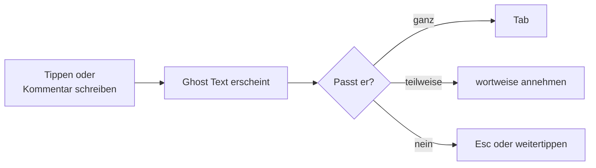

# Lab 2.3: Inline-Vorschläge und Next Edit Suggestions

**Leitfragen:**

<details>
<summary>Wann hilft eine Vervollständigung, wann lenkt sie ab?</summary>

Eine Vervollständigung hilft bei vorhersehbarem Code: Boilerplate, Wiederholungen, bekannte Muster, Tailwind-Klassen. Sie lenkt ab, wenn man gerade nachdenkt, eine neue Lösung entwirft oder Text schreibt, und wenn man lange Vorschläge liest statt eigenen Code.

</details>

<details>
<summary>Woran erkennt man, dass ein Vorschlag nur gut aussieht?</summary>

Er passt formal, nutzt aber falsche Namen, ignoriert Grenzfälle (leere Liste, `None`) oder erfindet Felder, die es in den Daten nicht gibt. Prüffrage: Stimmen Namen und Felder mit dem Projekt überein, und was passiert im Grenzfall?

</details>

- Inline-Vorschläge erscheinen als grauer Text (Ghost Text) und werden mit Tab angenommen.
- Wortweise Annehmen übernimmt nur den passenden Teil eines Vorschlags.
- Next Edit Suggestions schlagen die nächste sinnvolle Änderung an einer anderen Stelle vor.
- Vorschläge funktionieren unabhängig vom gewählten Harness.

## Begriffe

| Begriff | Bedeutung |
| --- | --- |
| Inline-Vorschlag (Ghost Text) | grauer Text an der Cursor-Position, den Copilot während des Tippens anbietet |
| Next Edit Suggestion (NES) | Vorschlag für die nächste Änderung, auch an einer anderen Stelle der Datei, z. B. nach einer Umbenennung |


_Quelle: VS Code Docs, „Inline suggestions from GitHub Copilot in VS Code“ (https://code.visualstudio.com/docs/editing/ai-powered-suggestions), Microsoft, CC BY 3.0 US, abgerufen am 07.11.2026._

## Vorschläge annehmen und ablehnen

Stand: 11/2026, VS-Code-Standardbelegung. Abweichende Belegungen zeigt die Befehlspalette unter „Preferences: Open Keyboard Shortcuts“.

| Aktion | Windows / Linux | macOS |
| --- | --- | --- |
| Vorschlag annehmen | Tab | Tab |
| nächstes Wort annehmen | Ctrl+→ | Cmd+→ |
| Vorschlag ablehnen | Esc oder weitertippen | Esc oder weitertippen |
| nächste Alternative anzeigen | Alt+] | Option+] |
| vorherige Alternative anzeigen | Alt+[ | Option+[ |
| Next Edit Suggestion anspringen und annehmen | Tab | Tab |


_Quelle: VS Code Docs, „Inline suggestions from GitHub Copilot in VS Code“ (https://code.visualstudio.com/docs/editing/ai-powered-suggestions), Microsoft, CC BY 3.0 US, abgerufen am 07.11.2026._

Beim Überfahren des Ghost Texts erscheint eine Leiste mit denselben Aktionen wie in der Tabelle.



## Vorschläge gezielt auslösen

| Technik | Beispiel |
| --- | --- |
| Kommentar vor dem Code | `# Zählt offene Aufgaben` bzw. `// Zählt offene Aufgaben`, dann Funktionskopf beginnen |
| sprechende Namen | `def count_open(tasks):` liefert bessere Vorschläge als `def f(x):` |
| Muster vorgeben | erste Zeile einer Liste schreiben, Copilot ergänzt die übrigen |
| passende Datei offen | Copilot nutzt offene Dateien als Kontext, z. B. `data/tasks.json` |


_Quelle: VS Code Docs, „Inline suggestions from GitHub Copilot in VS Code“ (https://code.visualstudio.com/docs/editing/ai-powered-suggestions), Microsoft, CC BY 3.0 US, abgerufen am 07.11.2026._

## Wann Vorschläge stören

| Situation | Umgang |
| --- | --- |
| eigene Lösung entwerfen | Vorschläge vorübergehend über das Copilot-Menü in der Statusleiste pausieren |
| Markdown, Prosa, Dokumentation | Vorschläge für diese Sprache abschalten |
| sicherheitskritischer Code | jeden Vorschlag Zeile für Zeile lesen, im Zweifel ablehnen |
| Vorschlag länger als gewünscht | wortweise annehmen statt Tab |


_Quelle: VS Code Blog, „Tune GitHub Copilot Inline Suggestions with Configurable Eagerness“ (https://code.visualstudio.com/blogs/2026/10/27/configurable-eagerness), Microsoft, CC BY 3.0 US, abgerufen am 07.11.2026._

Stand: 10/2026. „Snooze“ pausiert Vorschläge kurz; die Häkchen schalten Ghost Text und Next Edit Suggestions getrennt ab.

## Übung

**Dauer:** ca. 10 Minuten · **Start:** FocusList `start/` aus Lab 2.1 · **Referenz:** Lösungsweg unten

1. Starte `npm run css` in einem eigenen Terminal. Öffne `focuslist/templates/index.html` bzw. `src/views/index.js`, tippe im `class`-Attribut des Listeneintrags `hover:` und nimm einen passenden Vorschlag an.
2. Schreibe in `focuslist/store.py` bzw. `src/store.js` einen Kommentar „Zählt offene Aufgaben“ plus den Funktionskopf `count_open(tasks)` bzw. `countOpen(tasks)`. Nimm den Vorschlag an, wenn er korrekt ist.
3. Erzeuge einen weiteren Vorschlag (z. B. eine zweite Funktion `count_done`) und lehne ihn bewusst mit Esc ab.
4. Prüfe im Browser die Hover-Farbe und lies die angenommene Funktion Zeile für Zeile.
5. Nimm beide Änderungen im Editor mit Strg+Z (macOS: Cmd+Z) zurück und speichere, damit Lab 2.5 vom unveränderten Stand startet.

**Checkpoint:** Eine Listenzeile ändert beim Überfahren mit der Maus die Farbe; die Funktion zählt Aufgaben mit `done` gleich falsch; ein Vorschlag wurde abgelehnt; danach sind beide Dateien wieder im Ausgangszustand.

<details>
<summary>Lösungsweg</summary>

**Tailwind-Klasse**, z. B. im Python-Template:

```html
<li class="rounded-lg border border-slate-200 bg-white px-4 py-3 hover:bg-slate-100">
```

**Hilfsfunktion** (typischer korrekter Vorschlag):

```python
# Zählt offene Aufgaben
def count_open(tasks):
    return sum(1 for task in tasks if not task["done"])
```

```javascript
// Zählt offene Aufgaben
export function countOpen(tasks) {
  return tasks.filter((task) => !task.done).length;
}
```

Prüfpunkte: Feld heißt `done` (nicht `completed` oder `status`), Ergebnis für die Beispieldaten ist 2. Ein Vorschlag mit `task["status"] == "open"` sieht gut aus, passt aber nicht zu `data/tasks.json`: ablehnen.

</details>

## Fazit

- Tab für ganze Vorschläge, wortweise für Teile, Esc zum Ablehnen.
- Kommentare und sprechende Namen steuern Vorschläge besser als Warten.
- Jeder angenommene Vorschlag ist eigener Code: Namen, Felder und Grenzfälle prüfen.
