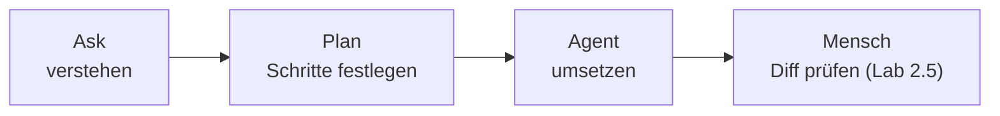

# Lab 2.4: Chat-Modi: Ask, Plan und Agent

**Leitfragen:**

Wann soll ein Werkzeug nur reden und wann handeln?

Reden (Ask, Plan), solange das Ziel unklar ist oder man den Code erst verstehen will. Handeln (Agent), wenn Ziel und Grenzen klar sind und man das Ergebnis prüfen kann.

Was gewinnt man, wenn vor dem Bauen ein Plan steht?

Falsche Annahmen werden sichtbar, bevor Code entsteht: betroffene Dateien, Reihenfolge, offene Fragen. Ein Plan lässt sich in Sekunden korrigieren, ein Diff über fünf Dateien nicht.

Welche Dateien braucht jemand, um eine Frage zu einem Formular zu beantworten?

Bei FocusList: die Routen (`focuslist/__init__.py` bzw. `src/app.js`), das Template (`index.html` bzw. `src/views/index.js`), den Store (Speichern) und `data/tasks.json` (Datenformat). Fehlen sie im Kontext, rät das Modell.

- Der Chat im Copilot-Harness hat drei eingebaute Agents: Ask (antworten), Plan (planen), Agent (ändern und ausführen).
- Kontext kommt über „Add Context“, Drag & Drop oder einen Screenshot in die Anfrage.
- Die Modellwahl beeinflusst Qualität, Geschwindigkeit und Kontingent.
- Vor dem Bauen fragen und planen; erst dann handeln lassen.

## Begriffe

| Begriff | Bedeutung |
| --- | --- |
| Chat-Ansicht | Bereich in VS Code für Gespräche mit Copilot |
| eingebauter Agent | vordefinierte Arbeitsweise im Chat: Ask, Plan oder Agent |
| Kontext | alles, was mit der Anfrage ans Modell geht: Prompt, angehängte Dateien, Verlauf, Projektregeln |
| Modellwahl | Auswahl des Sprachmodells für die Sitzung |

_Quelle: VS Code Docs, „Use the Chat view“ (https://code.visualstudio.com/docs/agents/run/chat-view), Microsoft, CC BY 3.0 US, abgerufen am 07.11.2026._

## Die drei eingebauten Agents

Stand: 11/2026. Quelle: [Copilot Chat cheat sheet](https://docs.github.com/en/copilot/reference/chat-cheat-sheet)

| Agent | Tut | Ändert Dateien? | Führt Befehle aus? | Typische Frage |
| --- | --- | --- | --- | --- |
| **Ask** | beantwortet Fragen, erklärt Code, sucht im Projekt | nein | nein | „Wo werden Aufgaben gespeichert?“ |
| **Plan** | recherchiert im Projekt und schreibt einen Umsetzungsplan | nein | nein | „Wie würde man ein Formular ergänzen?“ |
| **Agent** | ändert Dateien, führt Terminal-Befehle aus, prüft Ergebnisse (Loop aus Lab 1.1) | ja | ja, nach Freigabe | „Baue das Formular nach diesem Plan.“ |

_Quelle: VS Code Release Notes, „September 2025 (version 1.105)“ (https://code.visualstudio.com/updates/v1_105), Microsoft, CC BY 3.0 US, abgerufen am 07.11.2026._

Ansicht 2025: Plan liefert Schritte und offene Fragen, ändert aber nichts; erst „Start Implementation“ übergibt an den Agent.

Der Agent wird in der Chat-Ansicht über die Agent-Auswahl im Eingabefeld gewechselt. Chat-Ansicht öffnen: Ctrl+Alt+I (Windows/Linux), Ctrl+Cmd+I (macOS), Stand: 11/2026.

_Quelle: VS Code Docs, „Quickstart: Complete your first task with an agent“ (https://code.visualstudio.com/docs/agents/quickstart), Microsoft, CC BY 3.0 US, abgerufen am 07.11.2026._

## Kontext anhängen

| Weg | Wann |
| --- | --- |
| „Add Context“ im Eingabefeld | Dateien, Ordner oder Symbole gezielt auswählen |
| Drag & Drop | Datei aus dem Explorer in das Eingabefeld ziehen |
| Screenshot oder Bild einfügen | Darstellungsfehler im Browser zeigen |
| offene Datei / Markierung | aktueller Editor wird oft automatisch angeboten; vor dem Senden prüfen |

**Regel:** So viel Kontext wie nötig, so wenig wie möglich. Zu viel Kontext verdrängt Wichtiges aus dem Kontextfenster (Lab 1.1); falscher Kontext führt zu falschen Annahmen.

## Modellwahl

| Aspekt | Hinweis |
| --- | --- |
| Ort | Modellauswahl im Eingabefeld der Chat-Ansicht |
| Auswahl | hängt von Lizenz und Organisationsrichtlinie ab |
| Unterschiede | Qualität beim Planen, Geschwindigkeit, Verbrauch des Kontingents |
| Faustregel | kleinere, schnelle Modelle für Fragen; stärkere Modelle für Plan und mehrstufige Agent-Aufgaben |

Welche Modelle verfügbar sind, ändert sich laufend; die Liste in der eigenen Installation ist maßgeblich.

_Quelle: VS Code Docs, „AI language models in VS Code“ (https://code.visualstudio.com/docs/agent-customization/language-models), Microsoft, CC BY 3.0 US, abgerufen am 07.11.2026._

Beispielansicht 11/2026; Namen und Anzahl der Modelle weichen in der eigenen Installation ab.

## Im Local-Harness zusätzlich

> Nur im Local-Harness (Lab 2.2), nicht im Kursstandard:
>
> | Funktion | Wirkung |
> | --- | --- |
> | `/fix` | Korrektur für markierten Code vorschlagen |
> | `/tests` | Tests für markierten Code erzeugen |
> | `#file`, `#selection` | Datei oder Markierung per Text in den Prompt holen |
> | `@terminal` | Fragen zu Terminal-Ausgaben und Befehlen |
>
> Im Copilot-Harness stattdessen: Auftrag in Worten, Kontext über „Add Context“.

## Ask und Plan im Vergleich

Dieselbe Frage („Wie würde man ein Formular für neue Aufgaben ergänzen?“) mit demselben Kontext (Routen-Datei, Template, `data/tasks.json`):

| Kriterium | Ask | Plan |
| --- | --- | --- |
| Form | Erklärung mit Codebeispiel | nummerierte Schritte |
| Dateien | kann sich auf Template und Route beschränken | Route, Template, Store, Tests |
| offene Fragen | nicht vorgesehen | z. B. „Validierung des Titels? Redirect nach dem Speichern?“ |
| Umsetzung | Code zum Kopieren | nichts geändert, Plan zum Freigeben |

Beispielplan (Python; Node.js analog mit `src/app.js`, `src/views/index.js`, `test/`):

1. Template `index.html`: Formular mit Feld `title` und Auswahl `priority`, Methode `POST`, Ziel `/tasks`.
2. Route `POST /tasks` in `focuslist/__init__.py`: Formulardaten lesen, neue Aufgabe mit `id`, `title`, `priority`, `done: false` anlegen.
3. Speichern über `save_tasks()` im Store; danach Redirect auf `/`.
4. Test: `POST /tasks` legt eine Aufgabe an, `GET /` zeigt sie.
5. Offene Fragen: Validierung leerer Titel, erlaubte Prioritäten, Vergabe der `id`.
6. Grenze: keine neuen Abhängigkeiten, bestehende Struktur beibehalten.

Ein Plan lässt sich im Chat ergänzen (z. B. um eine eigene Grenze), bevor der Agent etwas umsetzt.

## Fazit

- Ask zum Verstehen, Plan zum Festlegen, Agent zum Umsetzen.
- Der richtige Kontext entscheidet mehr als die Formulierung der Frage.
- Ein Plan macht Annahmen sichtbar, bevor sie Code werden.
