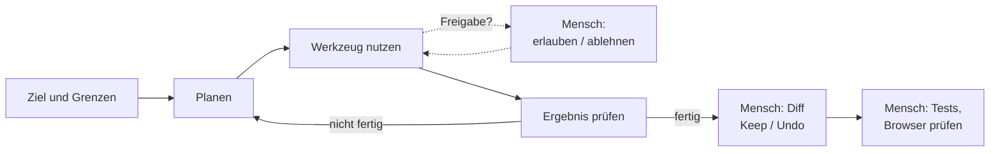
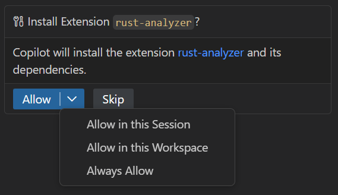
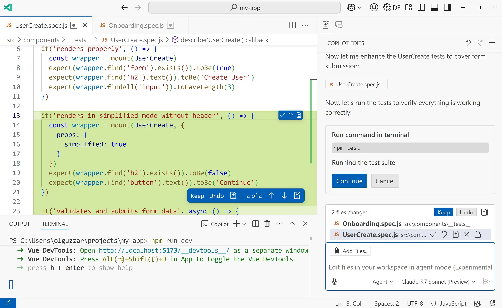
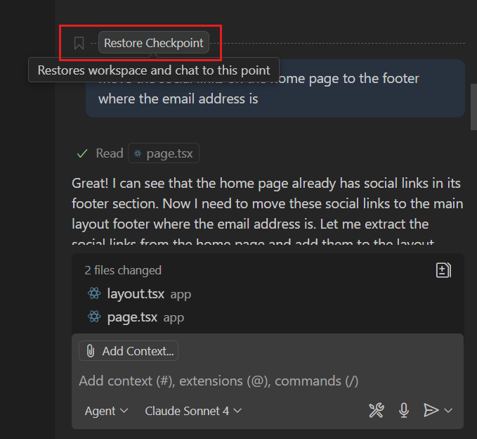

# Lab 2.5: Agent-Kontrolle: Freigaben, Diffs, Checkpoints

**Leitfragen:**

<details>
<summary>Welche Befehle soll niemand ungefragt im eigenen Terminal ausführen?</summary>

Alles, was löscht (`rm -rf`, `rm data/*`), installiert (`npm install <paket>`, `pip install`), veröffentlicht (`npm publish`, Deployments) oder auf Secrets zugreift (`cat .env`). Diese Befehle nur nach eigener Prüfung freigeben.

</details>

<details>
<summary>Wie macht man eine Änderung rückgängig, die über fünf Dateien verteilt ist?</summary>

Über den Checkpoint vor der Anfrage im Chat: „Restore Checkpoint“ setzt alle Dateien dieser Runde auf einmal zurück. Noch nicht bestätigte Änderungen lassen sich auch in der Liste der geänderten Dateien mit Undo für alle Dateien verwerfen.

</details>

<details>
<summary>Woran erkennt man, welche Dateien ein Agent geändert hat?</summary>

Am Ende der Runde zeigt der Chat die Liste der geänderten Dateien („2 files changed“), jede mit Keep/Undo. Im Editor sind die geänderten Abschnitte farbig hinterlegt. Gehört eine Datei nicht zum Auftrag, ist das ein Warnsignal.

</details>

- Der Agent fragt vor Werkzeugen und Terminal-Befehlen um Freigabe; die Freigabe ist die wichtigste Kontrollstelle.
- Jede Änderung erscheint als Diff und kann einzeln behalten oder verworfen werden.
- Checkpoints setzen den Stand vor einer Anfrage wieder her, auch über mehrere Dateien.
- Autopilot bleibt im Kurs aus, damit jede Aktion sichtbar bleibt.

## Begriffe

| Begriff | Bedeutung |
| --- | --- |
| Freigabe | Bestätigung, bevor der Agent ein Werkzeug oder einen Terminal-Befehl ausführt |
| Diff | Gegenüberstellung von altem und neuem Stand einer Datei |
| Keep / Undo | Änderung des Agenten behalten bzw. verwerfen |
| Checkpoint | gespeicherter Stand der Dateien vor einer Anfrage im Chat |
| Autopilot | Modus, in dem der Agent ohne Rückfragen weiterarbeitet und Freigaben selbst erteilt |

## Kontrollpunkte im Agenten-Loop

Der Loop aus Lab 1.1, ergänzt um die Stellen, an denen der Mensch eingreift:



## Freigaben

Stand: 11/2026; Bezeichnungen der Schaltflächen können sich mit VS-Code-Versionen ändern.

| Was | Wann Freigabe nötig | Empfehlung |
| --- | --- | --- |
| Dateien im Projekt lesen | in der Regel nicht | – |
| Dateien ändern | Änderungen erscheinen als Diff zur Prüfung | Diff immer lesen |
| Terminal-Befehle | vor der Ausführung, Befehl wird angezeigt | jeden Befehl lesen; nur bekannte, harmlose Befehle dauerhaft erlauben |
| MCP- und weitere Werkzeuge | vor der Ausführung | erst ab m07 relevant |

Typische Freigabe-Stufen: einmalig, für die Sitzung, für den Workspace, immer. Im Kurs: einmalig oder für die Sitzung, nie „immer“ für Befehle, die löschen, installieren oder pushen.


_Quelle: VS Code Docs, „Manage approvals and permissions“ (https://code.visualstudio.com/docs/agents/run/approvals), Microsoft, CC BY 3.0 US, abgerufen am 07.11.2026._

## Diff prüfen: behalten oder verwerfen

| Ebene | Wirkung |
| --- | --- |
| ganze Runde | alle Änderungen der Anfrage behalten oder verwerfen |
| einzelne Datei | Keep / Undo pro Datei in der Liste der geänderten Dateien |
| einzelne Änderung | Keep / Undo pro Abschnitt direkt im Editor |

Prüffragen vor Keep: Nur geänderte Dateien, die zum Auftrag gehören? Neue Abhängigkeiten? Tests noch grün?


_Quelle: VS Code Blog, „Introducing GitHub Copilot agent mode (preview)“ (https://code.visualstudio.com/blogs/2025/02/24/introducing-copilot-agent-mode), Microsoft, CC BY 3.0 US, abgerufen am 07.11.2026._

Ansicht 2025: Keep/Undo auf allen drei Ebenen; Anordnung und Beschriftung sind heute leicht anders.

## Checkpoints

- Vor jeder Anfrage im Chat merkt sich VS Code den Stand der Dateien.
- „Checkpoint wiederherstellen“ setzt alle Dateien auf den Stand vor dieser Anfrage zurück, auch über mehrere Dateien.
- Checkpoints gelten nur für Änderungen aus dem Chat; Terminal-Befehle (z. B. gelöschte Dateien) macht ein Checkpoint nicht zwingend rückgängig. Deshalb Freigaben für löschende Befehle ablehnen.


_Quelle: VS Code Docs, „Review and revert agent changes“ (https://code.visualstudio.com/docs/agents/run/review-code-edits), Microsoft, CC BY 3.0 US, abgerufen am 07.11.2026._

## Autopilot: im Kurs aus

| Autopilot an | Autopilot aus (Kurs) |
| --- | --- |
| Agent erteilt Freigaben selbst und arbeitet bis zum Ende | jede Freigabe sichtbar und bewusst |
| schnell für eingespielte, risikoarme Aufgaben | Fehler und Annahmen fallen sofort auf |
| riskant ohne Leitplanken (Hooks, m07) | Lernziel: Verhalten des Agenten beobachten |

Autopilot lohnt sich erst, wenn Projektregeln, Tests und Hooks den Agenten absichern. Bis dahin bleibt er aus.


_Quelle: Wikimedia Commons, „Airbus A320-214 Vueling EC-HHA cockpit (5508849819).jpg“ (https://commons.wikimedia.org/wiki/File:Airbus_A320-214_Vueling_EC-HHA_cockpit_(5508849819).jpg), Curimedia, CC BY 2.0, abgerufen am 07.11.2026._

Bild aus der Luftfahrt: Auch dort fliegt der Autopilot nur, während Instrumente und Crew ihn überwachen.

## Übung

**Dauer:** ca. 15 Minuten · **Start:** FocusList `start/` aus Lab 2.1 (unveränderter Stand) · **Referenz:** Lösungsweg unten

1. Wähle im Copilot-Harness den Agent **Agent** und sende: „Füge unter der Aufgabenliste eine Fußzeile hinzu, die anzeigt, wie viele Aufgaben es gibt und wie viele davon offen sind.“ Lies jede Freigabe-Anfrage, bevor sie bestätigt wird.
2. Prüfe den Diff. Verwirf eine Änderung mit Undo (gehört nichts Fremdes dazu: verwirf die Styling-Klasse der Fußzeile) und behalte den Rest mit Keep.
3. Sende eine zweite Anfrage: „Mach die Fußzeile rot, fett und doppelt so groß.“
4. Setze per „Restore Checkpoint“ auf den Stand vor der zweiten Anfrage zurück.
5. Führe die Tests aus und prüfe die Seite im Browser.

**Checkpoint:** Die Seite zeigt unter der Liste „3 Aufgaben, davon 2 offen“ ohne rote Schrift; die Tests sind grün.

<details>
<summary>Lösungsweg</summary>

Mögliches Ergebnis Python (`focuslist/templates/index.html`, nach `</ul>`):

```html
<footer class="mt-6 text-sm text-slate-500">
  {{ tasks|length }} Aufgaben, davon {{ tasks|rejectattr("done")|list|length }} offen
</footer>
```

Mögliches Ergebnis Node.js (`src/views/index.js`):

```javascript
const open = tasks.filter((task) => !task.done).length;
// … im body nach </ul>:
//   <footer class="mt-6 text-sm text-slate-500">${tasks.length} Aufgaben, davon ${open} offen</footer>
```

Typische Freigaben: Agent will `pytest` bzw. `npm test` ausführen → erlauben (harmlos, liest nur). Agent will ein Paket installieren → ablehnen, Fußzeile braucht keins.

Zu 2: In der Liste der geänderten Dateien steht nur `index.html` bzw. `src/views/index.js`. Steht dort mehr, gehört es nicht zum Auftrag → Undo.

Zu 4: Der Checkpoint vor der zweiten Anfrage stellt die Fußzeile ohne rote, fette Schrift wieder her.

Zu 5:

```bash
pytest                      # bzw. npm test
```

</details>

## Fazit

- Freigaben, Diff und Checkpoints sind die drei Kontrollstellen im Chat.
- Keep/Undo und Checkpoints machen jede Agent-Runde rückgängig; löschende Terminal-Befehle nicht freigeben.
- Autopilot erst, wenn Regeln, Tests und Hooks den Agenten absichern.
