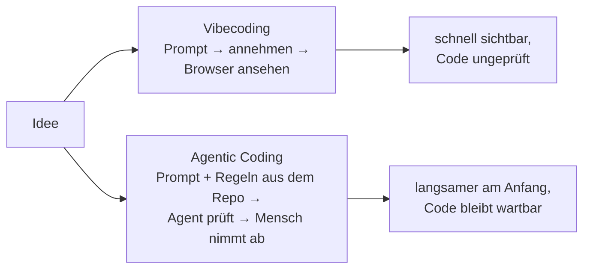
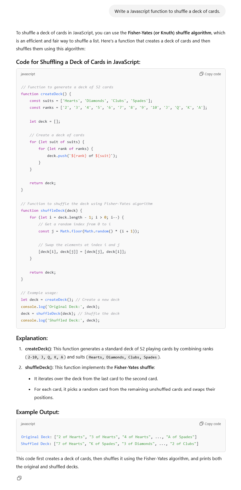
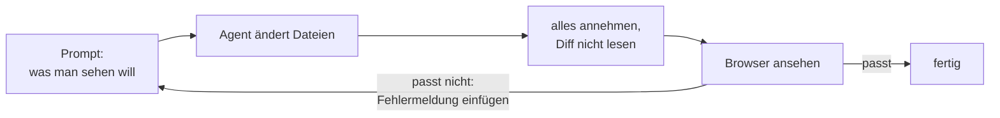
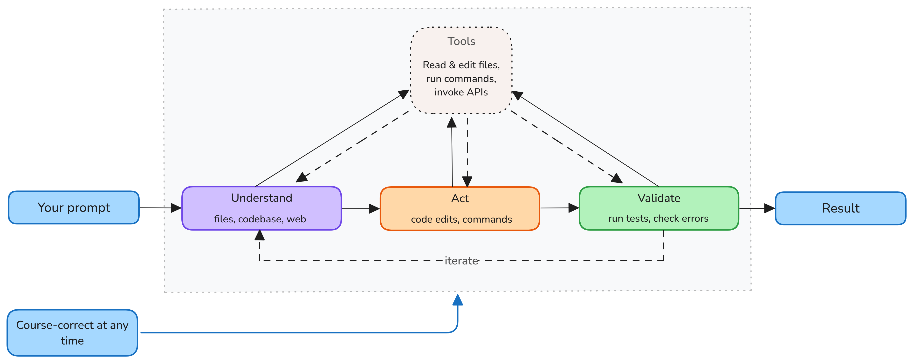
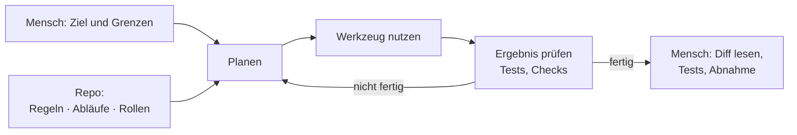

# Lab 3.1: Vibecoding und Agentic Coding im Vergleich

**Leitfragen:**

Wann reicht ein schneller Prototyp, wann nicht?

Er reicht, wenn das Ergebnis eine Idee zeigen soll und danach weggeworfen wird. Er reicht nicht, sobald der Code bleibt: andere arbeiten daran, echte Nutzer geben Daten ein, die App läuft im Internet.

Was passiert mit Code, den niemand gelesen hat, nach einem halben Jahr?

Niemand weiß, warum er so aussieht. Jede Änderung wird zum Risiko, weil unklar ist, was davon abhängt, und Fehler oder Sicherheitslücken fallen erst auf, wenn sie Schaden anrichten.

Was muss jemand wissen, um in einem fremden Projekt sauber mitzuarbeiten?

Wie das Projekt startet und getestet wird, wo was liegt, welche Regeln im Team gelten und was verboten ist. Ein Agent braucht genau dasselbe, sonst rät er.

- Es gibt zwei Arten, mit KI Software zu bauen: Vibecoding und Agentic Coding.
- Vibecoding: Ergebnis per Prompt beschreiben, jede Änderung annehmen, nur im Browser prüfen, den Code nicht lesen.
- Agentic Coding: derselbe Agent im selben Loop, aber mit Regeln, Abläufen, Rollen und Prüfungen aus dem Repo; der Mensch steuert und nimmt ab.
- Vibecoding reicht für Prototypen und Wegwerf-Code; für Team-Code, Nutzerdaten und Produktion braucht es den agentischen Weg.

## Begriffe

| Begriff | Bedeutung |
| --- | --- |
| Vibecoding | Software nur über Prompts bauen und am sichtbaren Ergebnis beurteilen, ohne den Code zu lesen (Begriff von Andrej Karpathy, Feb 2025, Lab 1.2) |
| Agentic Coding | ein Agent erledigt Entwicklungsaufgaben im Loop aus Lab 1.1, gelenkt durch Dateien im Repo und geprüft durch den Menschen |
| Prototyp | schnelle, unfertige Version, die eine Idee zeigt und danach meist weggeworfen wird |
| Leitplanken | alles, was den Agenten lenkt oder begrenzt: Projektregeln, Skills, Rollen, Hooks (Bausteine aus Lab 1.3) |
| Abnahme | der Mensch prüft das Ergebnis (Diff, Tests, Browser), bevor es übernommen wird; wie bei einer Bauabnahme |

## Zwei Wege, ein Werkzeug

Beide Wege nutzen dasselbe Werkzeug: Copilot im Agent-Modus (Lab 2.4). Der Unterschied liegt darin, was der Agent mitbekommt und wer das Ergebnis prüft.

## Vibecoding: was es ist

Andrej Karpathy (Mitgründer von OpenAI) prägte den Begriff am 02.02.2025 auf X: Man gibt sich ganz „den Vibes“ hin und vergisst, dass es den Code überhaupt gibt. Er schrieb dazu: „I ‚Accept All‘ always, I don't read the diffs anymore“ und nannte es „not too bad for throwaway weekend projects“.

- Seit März 2025 führt Merriam-Webster den Begriff als „slang & trending“; Collins English Dictionary kürte „vibe coding“ zum Wort des Jahres 2025.
- Quellen: [Karpathy auf X, 02.02.2025](https://x.com/karpathy/status/1886192184808149383), [Wikipedia: Vibe coding](https://en.wikipedia.org/wiki/Vibe_coding), abgerufen am 07.11.2026.

_Quelle: Wikimedia Commons, „ChatGPT vibe coding.png“ (https://commons.wikimedia.org/wiki/File:ChatGPT_vibe_coding.png), Public Domain, abgerufen am 07.11.2026._

Code auf Zuruf: Ein Satz genügt für lauffähigen Code; ob er zum eigenen Projekt passt, prüft dabei niemand.

## Wie Vibecoding funktioniert

- Geprüft wird nur, was man sieht: Seite lädt, Button tut etwas, Farben stimmen.
- Fehler werden per weiterem Prompt behoben, oft durch Einfügen der Fehlermeldung, nicht durch Lesen des Codes.
- Im Vergleich zum Loop mit Kontrollpunkten aus Lab 2.5 fehlen das Lesen des Diffs und die Tests.

## Grenzen: wo Vibecoding kippt

| Vibecoding reicht | Vibecoding reicht nicht |
| --- | --- |
| Prototyp, um eine Idee zu zeigen | Code, den ein Team pflegt |
| Wegwerf-Skript für eine einmalige Aufgabe | Anwendung mit Nutzerdaten oder im Internet |
| Lernen, was ein Werkzeug kann | Code mit Sicherheits- oder Datenschutzanforderungen |
| privates Hilfsprogramm ohne Risiko | alles, was länger als ein paar Tage lebt |

- **Team-Code:** Jeder Prompt erzeugt eine andere Struktur; niemand im Team kennt den Code, auch nicht die Person, die ihn „geschrieben“ hat.
- **Sicherheit:** Lücken wie ungeprüfte Eingaben sieht man im Browser nicht; sie fallen erst bei einem Angriff auf.
- **Wartung:** Je größer der Code, desto öfter repariert ein neuer Prompt eine Stelle und bricht eine andere.

Faustregel: Je länger Code lebt und je mehr Menschen ihn nutzen, desto teurer wird jede ungeprüfte Entscheidung (Lab 1.4: Verantwortung trägt die Person, die den Code übernimmt).

## Agentic Coding: was es ist

Agentic Coding nutzt den Agenten-Loop aus Lab 1.1: planen, Werkzeug nutzen, Ergebnis prüfen, wiederholen. Neu ist, dass der Agent nicht nur den Prompt bekommt, sondern das Wissen des Projekts aus Dateien im Repo.

_Quelle: VS Code Docs, „Understand AI agents“ (https://code.visualstudio.com/docs/agents/concepts/agents), Microsoft, CC BY 3.0 US, abgerufen am 07.11.2026._

Der Loop aus Lab 1.1: Beim agentischen Weg füttern Dateien aus dem Repo das „Understand“, und Prüfungen sichern das „Validate“.

| Was aus dem Repo kommt | Frage aus Lab 1.3 | Baustein |
| --- | --- | --- |
| Kontext und Regeln | Was muss der Agent immer wissen? | Instructions |
| Abläufe | Wie erledigt man eine wiederkehrende Aufgabe? | Skills |
| Rollen | Wer darf was? | Custom Agents |
| Prüfungen | Was muss immer passieren oder darf nie passieren? | Hooks |
| Werkzeuge und Auftrag | Welche Werkzeuge braucht er, was genau soll gebaut werden? | MCP, Spec |

Vergleich aus dem Teamalltag: Pair Programming. Eine Person tippt, die andere kennt die Regeln, schaut mit und greift ein. Beim agentischen Weg tippt der Agent; der Mensch steuert und nimmt ab.

## Vergleich

| | Vibecoding | Agentic Coding |
| --- | --- | --- |
| Eingabe | ein Prompt, was man sehen will | Prompt plus Regeln, Abläufe, Rollen aus dem Repo |
| Wer entscheidet Struktur, Namen, Fehlerfälle | der Agent, still | Regeln im Repo; der Agent folgt ihnen |
| Code lesen | nein | ja: Diff vor der Übernahme |
| Prüfung | Blick in den Browser | Tests, Checks, Review, Browser |
| Gleiche Aufgabe, zweiter Versuch | anderes Ergebnis | ähnliches Ergebnis, weil die Regeln gleich bleiben |
| Tempo | sehr schnell bis zum ersten Ergebnis | Aufwand am Anfang (Regeln schreiben), danach schnell |
| Geeignet für | Prototyp, Demo, Wegwerf-Skript | Team-Code, Produktion, sicherheitskritischer Code |

## Entscheidungshilfe: wann was

Vier Fragen; sobald eine mit Ja beantwortet ist, gilt der agentische Weg:

| Frage | Ja → |
| --- | --- |
| Lebt der Code länger als ein paar Tage? | agentisch |
| Arbeiten andere am Code mit oder übernehmen ihn? | agentisch |
| Verarbeitet er echte Nutzerdaten oder läuft er im Internet? | agentisch |
| Kostet ein Fehler Geld, Daten oder Vertrauen? | agentisch |
| Alle vier Nein | Vibecoding ist in Ordnung |

Auch ein Prototyp darf vibecodet sein. Wird aus ihm ein echtes Produkt, beginnt der agentische Weg: erst Regeln, dann weiterbauen.

## Sechs Situationen, zwei Wege

Die Entscheidungshilfe angewendet auf typische Alltagssituationen:

| # | Situation | Weg | Ausschlaggebend |
| --- | --- | --- | --- |
| 1 | Wochenend-Prototyp: eine Idee für eine Spiele-App ausprobieren | Vibecoding | alle vier Fragen Nein; Code wird weggeworfen |
| 2 | Team-Feature: Login-Seite für die Firmen-App, die drei Teams pflegen | agentisch | andere arbeiten mit; Nutzerdaten |
| 3 | Bugfix in Produktion: Rechnungen werden doppelt verschickt | agentisch | Fehler kostet Geld und Vertrauen; Code lebt weiter |
| 4 | Kundendemo: Klickdummy für ein Gespräch morgen früh | Vibecoding | Klickdummy ohne echte Daten, danach weg |
| 5 | Lernprojekt: ausprobieren, wie eine neue Bibliothek funktioniert | Code lesen statt vibecoden | kein Risiko, aber das Lernziel verlangt, den erzeugten Code zu verstehen |
| 6 | Sicherheitskritischer Code: Passwort-Reset per E-Mail | agentisch | Sicherheit, Nutzerdaten, Internet |

Nr. 1 und Nr. 4 kippen, sobald aus dem Prototyp oder der Demo ein Produkt werden soll („Der Kunde will genau das, bis nächsten Monat live“). Dann beginnt der agentische Weg mit Regeln, Tests und Review, statt auf dem ungeprüften Code weiterzubauen.

## Fazit

- Vibecoding und Agentic Coding nutzen denselben Agenten; der Unterschied ist, was er aus dem Repo bekommt und wer das Ergebnis prüft.
- Vibecoding ist schnell und für Prototypen legitim, aber ungeprüfte Entscheidungen landen im Code.
- Sobald Code bleibt, andere ihn pflegen oder Nutzerdaten verarbeitet werden, gilt der agentische Weg.
