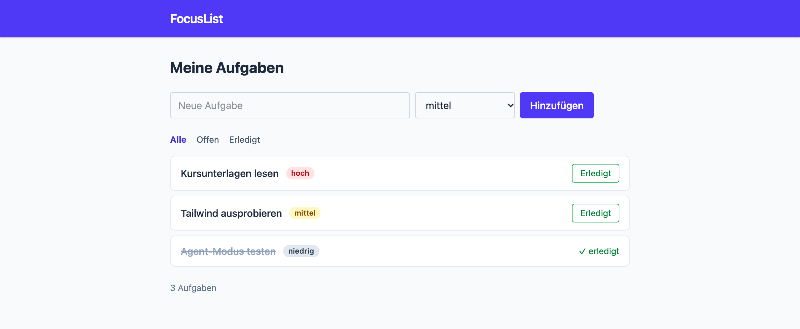

# Lab 3.2: Prototyp per One-Shot-Prompt

**Leitfragen:**

<details>
<summary>Wie viel kann ein einziger Prompt leisten?</summary>

Erstaunlich viel: Ein Prompt mit sechs Funktionen liefert in wenigen Minuten eine Seite mit Formular, Badges, Filter und API. Was der Prompt nicht sagt (Struktur, Fehlerfälle, Tests, Sicherheit), entscheidet der Agent selbst.

</details>

<details>
<summary>Woran merkt man beim Vibecoding, dass etwas „fertig“ ist?</summary>

Nur am sichtbaren Ergebnis: Die Seite lädt, die Buttons tun etwas, die Liste stimmt. Ob der Code sicher, getestet und wartbar ist, zeigt der Browser nicht.

</details>

- Ein One-Shot-Prompt beschreibt das ganze Ergebnis auf einmal: Ziel, Funktionen, Stack, „fertig, wenn“.
- Im Kurs gibt es einen festen Beispiel-Prompt: `project/focuslist/vibecoding-prompt.md`; alle senden ihn unverändert.
- Spielregeln des Vibecodings: alles annehmen, Code nicht lesen, nur im Browser prüfen, nichts nachbessern.
- Ergebnis ist FocusList v0; jede Person bekommt eine etwas andere Version.

## Begriffe

| Begriff | Bedeutung |
| --- | --- |
| One-Shot-Prompt | ein einziger Prompt, der das ganze Ergebnis auf einmal beschreibt, ohne Rückfragen und ohne Nachbessern |
| „Fertig, wenn“ | Abschnitt im Prompt, der beschreibt, woran man das fertige Ergebnis erkennt |
| Badge | kleines farbiges Etikett, hier für die Priorität |
| JSON-API | Adresse, die Daten als JSON statt als HTML-Seite liefert, z. B. für Tests ohne Browser |
| v0 | erste erweiterte Version von FocusList, per Vibecoding entstanden |

## Aufbau eines One-Shot-Prompts

| Teil | Frage | Im Beispiel-Prompt |
| --- | --- | --- |
| Ziel | Was soll am Ende entstehen? | „eine richtige kleine Aufgaben-App, alles auf einmal“ |
| Funktionen | Was soll man sehen und tun können? | sechs Punkte: Formular, Hinweis, Badges, „Erledigt“, Filter, API |
| Stack | Womit soll gebaut werden? | nur „Tailwind“; Python bzw. Node.js übernimmt der Agent aus dem Projekt |
| Fertig, wenn | Woran erkennt man das Ergebnis? | im Browser anlegen, erledigen, filtern; `/api/tasks` liefert JSON |

Der Prompt aus `project/focuslist/vibecoding-prompt.md`, unverändert zu senden:

```text
Mach aus FocusList eine richtige kleine Aufgaben-App. Bau bitte alles auf einmal ein:

1. Über der Liste ein Formular "Neue Aufgabe": Textfeld für den Titel, Auswahl für die Priorität (niedrig, mittel, hoch) und ein Button "Hinzufügen". Die neue Aufgabe wird gespeichert und erscheint sofort in der Liste.
2. Nach dem Anlegen oben ein grüner Hinweis: Aufgabe „<Titel>“ angelegt.
3. Die Priorität als farbiges Badge neben dem Titel: hoch rot, mittel gelb, niedrig grau.
4. Bei jeder offenen Aufgabe ein Button "Erledigt". Erledigte Aufgaben werden durchgestrichen angezeigt.
5. Über der Liste ein Filter mit den Links Alle, Offen und Erledigt.
6. Eine JSON-API unter /api/tasks, die alle Aufgaben als JSON liefert und mit ?status=open, ?status=done und ?status=all filtert.

Style alles mit Tailwind, modern und aufgeräumt.

Fertig ist es, wenn ich im Browser eine Aufgabe anlegen, als erledigt markieren und filtern kann und /api/tasks JSON liefert. Sag mir am Ende, wie ich die App starte.
```

So schreibt ein typischer Vibecoding-Prompt: Er sagt, was man sehen will, nicht, wie gebaut wird. Regeln zu Struktur, Tests und Sicherheit fehlen absichtlich.

## Was der Agent selbst entscheidet

Alles, was der Prompt offenlässt, entscheidet der Agent still. Was er im Beispiellauf gewählt hat (Referenzstand `steps/m03/`):

| Offene Frage | Der Prompt sagt | Gewählt im Beispiel (Python / Node.js) |
| --- | --- | --- |
| Wo liegen Routen und Logik? | nichts | alles in `focuslist/__init__.py` bzw. `src/app.js`, Anlegen im Store, Erledigen in der Route |
| Wie entsteht eine neue ID? | nichts | Anzahl der Aufgaben + 1 |
| Leerer Titel, unbekannte Priorität? | nichts | wird gespeichert |
| Wie kommt der Titel in den Hinweis? | „Aufgabe „<Titel>“ angelegt“ | über den URL-Parameter `?created=…` |
| Wird der Titel im HTML geschützt? | nichts | Python: Hinweis mit `\|safe`; Node.js: gar nicht |
| Wie startet die App? | „Sag mir, wie ich sie starte“ | Python: neue Datei `run.py`; Node.js: vorhandener Befehl |
| Tests? | nichts | keine neuen |
| Neue Pakete? | nichts | keine im Beispiel; in anderen Läufen schlägt der Agent z. B. Express vor |

Dasselbe Modell entscheidet bei jedem Lauf etwas anders (Lab 1.1). Ein eigenes Ergebnis weicht deshalb von der Tabelle ab; Lab 3.3 bewertet den Referenzstand v0.

## Beispielergebnis: FocusList v0


_Quelle: eigener Screenshot, FocusList v0, 07.11.2026._

So sieht der Referenzstand nach dem One-Shot-Prompt aus. Im Browser ist alles da, was der Prompt verlangt.

Antwort von `/api/tasks` im Referenzstand (Node.js, formatiert):

```json
[
  { "id": 1, "title": "Kursunterlagen lesen", "priority": "high", "done": false },
  { "id": 2, "title": "Tailwind ausprobieren", "priority": "medium", "done": false },
  { "id": 3, "title": "Agent-Modus testen", "priority": "low", "done": true }
]
```

`id`, `title`, `priority` (`low`, `medium`, `high`) und `done` (`true` = erledigt) sind die Felder einer Aufgabe aus Lab 2.1.

| Stack | Geänderte oder neue Dateien im Referenzstand |
| --- | --- |
| Python | `focuslist/__init__.py`, `focuslist/store.py`, `focuslist/templates/index.html`, `focuslist/templates/base.html`, neu `run.py` |
| Node.js | `src/app.js`, `src/store.js`, `src/views/index.js` |

Neue Tests: in beiden Stacks keine.

## Typische Fehler

| Symptom | Ursache | Lösung |
| --- | --- | --- |
| Agent „läuft“ endlos, Chat wartet | Agent hat den Server im eigenen Terminal gestartet; der Befehl endet nie | Ausführung abbrechen, Server im eigenen Terminal laufen lassen, Agent fertig arbeiten lassen |
| `Address already in use` | zweiter Server vom Agenten gestartet | Agent-Terminal schließen, eigenen Server weiterverwenden |
| Badges ohne Farbe | `npm run css` läuft nicht, neue Tailwind-Klassen fehlen in `static/app.css` | `npm run css` in einem zweiten Terminal starten, Seite neu laden |
| Agent fragt nach, statt zu bauen | Prompt mit eigenen Ergänzungen oder Kontext gesendet | Prompt unverändert senden; Rückfragen mit „Entscheide selbst“ beantworten |
| Agent will ein Paket installieren | eigene Annahme über den Stack | Freigabe ablehnen; der Wunsch ist ein Befund für Lab 3.3 |
| Seite zeigt nach dem Prompt einen Fehler | Agent hat etwas Unvollständiges gebaut | nicht reparieren; Fehler ist Teil des Status quo, für Modul 4 den Referenzstand nutzen |

## Übung (optional)

**Dauer:** ca. 25 Minuten · **Start:** Startgerüst `start/` · **Referenz:** `project/focuslist/<stack>/steps/m03/`

Ohne Übung: Den Referenzstand v0 holen und für Modul 4 verwenden (im Ordner der Kursunterlagen):

```bash
node project/focuslist/catch-up.mjs python m04 ~/kurs/focuslist   # bzw. node … node m04 …
```

1. Lege den Arbeitsordner mit dem Startgerüst an und richte ihn ein, wie in Lab 2.1 unter „App starten und Tests ausführen“ beschrieben.
2. Starte die App und `npm run css` in je einem eigenen Terminal und öffne die Seite im Browser.
3. Öffne eine neue Chat-Sitzung im Copilot-Harness, wähle **Agent** (Autopilot aus, kein Kontext) und sende den Prompt aus `project/focuslist/vibecoding-prompt.md` unverändert.
4. Lies jede Freigabe für Terminal-Befehle (Lab 2.5): Tests und Startbefehle erlauben, Paketinstallationen ablehnen. Nimm alle Änderungen mit Keep an, ohne den Code zu lesen.
5. Lade die Seite neu: Lege eine Aufgabe an, markiere sie als erledigt, probiere die Filter und rufe `/api/tasks` auf. Bessere nichts nach.

**Checkpoint:** Die Seite zeigt Formular, farbige Badges, Button „Erledigt“ und drei Filter-Links (oder einen Fehler, der so bleibt); `/api/tasks` liefert JSON.

<details>
<summary>Lösungsweg</summary>

Typischer Verlauf im Chat (Beispiellauf, Python):

| Schritt | Was der Agent tut |
| --- | --- |
| Verstehen | liest die vorhandenen Dateien: App, Store, Templates, Beispieldaten |
| Ändern | Formular und Hinweis im Template, Routen `POST /tasks`, `POST /tasks/<id>/complete`, `GET /api/tasks`, Filter in der Route |
| Prüfen | startet die App im Terminal, liest die Ausgabe; öffnet die Seite nicht im Browser |
| Abschluss | „Fertig“ mit Startanleitung und neuer Datei `run.py` |

Erwartung im Browser: wie im Screenshot oben. `/api/tasks` liefert die drei Beispielaufgaben plus jede neu angelegte.

Im Vergleich zum Plan aus Lab 2.4 fällt schon jetzt auf: Ein Plan nennt meist Tests und offene Fragen zur Validierung, der One-Shot-Prompt nicht. Bewertet wird das in Lab 3.3.

</details>

## Fazit

- Ein One-Shot-Prompt liefert in Minuten ein sichtbares Ergebnis: FocusList v0.
- Alles, was der Prompt offenlässt, hat der Agent still entschieden.
- „Fertig“ heißt beim Vibecoding nur: Im Browser sieht es richtig aus.

Die optionale Übung erzeugt eine eigene FocusList v0 mit dem Beispiel-Prompt; ohne Übung geht es mit dem Referenzstand v0 weiter.
