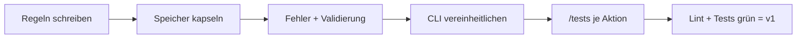

# Regeln anwenden: FocusList v0 → v1

Aus der Schwächenliste von Modul 3 werden nummerierte Regeln, und der Agent refactort den vibecodeten Stand Regel für Regel. Ergebnis ist v1: gleiche Funktionen, aber einheitliche Fehler, gekapselte Speicherung, Validierung und erste Tests.

## Leitfragen

<details>
<summary>Woher kommen die Regeln für FocusList konkret?</summary>

Aus `v0-weaknesses.md` ([02-ergebnis-reviewen.md](../m03-vibecoding/02-ergebnis-reviewen.md)): Jeder Muss-Punkt wird zu einer prüfbaren Regel.

</details>

<details>
<summary>Muss v0 komplett neu geschrieben werden, um v1 zu erreichen?</summary>

Nein. v1 entsteht durch gezieltes Refactoring Regel für Regel, nicht durch einen Neubau.

</details>

<details>
<summary>Warum eine Anfrage pro Regel statt "setze alle Regeln um"?</summary>

Kleine Diffs lassen sich gegen genau eine Regel prüfen. Ein großer Diff mischt alles und versteckt Abweichungen.

</details>

## Von der Schwächenliste zur Regel

| Muss-Punkt aus `v0-weaknesses.md` | Regel in `copilot-instructions.md` |
| --- | --- |
| 1. Fehlerbehandlung uneinheitlich | 1. Aktionen werfen `Error` / `ValueError`, nie `null`/`None` |
| 2. Speicherzugriff nicht gekapselt | 2. Nur `json-store.ts` / `storage.py` greift auf die Datei zu |
| 3. Keine Eingabeprüfung | 3. Eingabewerte über `validation.ts` / `validation.py` prüfen |
| 4. Keine Tests | 4. Erfolgs- und Fehlerfall-Test je Aktion |
| – (Vorsorge) | 5. Keine neuen Abhängigkeiten (Python: zusätzlich Type Hints) |

Kann-Punkte kommen nur in die Datei, wenn sie wenig Platz kosten.

## Refactoring in Schritten



- Eine Anfrage pro Schritt, jeweils im Agent-Modus und mit Verweis auf die Regelnummer: "Setze Regel 2 um."
- Nach jedem Schritt den Diff gegen die Regeln lesen, erst dann mit **Keep** annehmen.
- `/tests` ([Befehle und Konfiguration](../m02-copilot-core-features/03-befehle-und-konfiguration.md)) erzeugt die Tests, `tests.instructions.md` gibt Aufbau und Testhilfe vor.

## Übung

**Start:** eigener Stand aus Modul 3 oder Stand v0 erzeugen: `node <kursmaterial>/project/focuslist/catch-up.mjs <stack> m04 focuslist` ([Projektdateien](../project/README.md))
**Referenz:** [`steps/m04/`](../project/focuslist/js-ts/steps/m04/) bzw. [Python](../project/focuslist/python/steps/m04/) — nur die in Modul 4 geänderten Dateien
**Dauer:** 60 Min.

Copilot Chat im Modus **Agent**, pro Schritt ein neuer Chat. Grundlage ist `v0-weaknesses.md` aus Modul 3.

1. Erstelle `.github/copilot-instructions.md` mit Einleitungssatz, Abschnitt `## Struktur` und Abschnitt `## Regeln`. Formuliere je Muss-Punkt eine nummerierte, prüfbare Regel und ergänze "Keine neuen Abhängigkeiten ohne ausdrückliche Anfrage" (Python zusätzlich: Type Hints an öffentlichen Funktionen).
2. Lege `.github/instructions/tests.instructions.md` und die Testhilfe `tests/helpers.ts` bzw. `tests/conftest.py` an, wie in [02-instructions-dateien.md](02-instructions-dateien.md) gezeigt.
3. Schreibe: `Setze Regel 2 um. Der Dateipfad kommt aus der Umgebungsvariablen FOCUSLIST_FILE, Default tasks.json.` Prüfe im Diff: Nur `src/storage/json-store.ts` (Python: `focuslist/storage.py`) greift noch auf die Datei zu, `complete-task` nutzt `readTasks`/`writeTasks` bzw. `read_tasks`/`write_tasks`. Python zusätzlich: `ensure_ascii=False` beim Schreiben.
4. Schreibe: `Setze Regel 1 und 3 um: lege src/actions/validation.ts mit assertPriority an, erlaubte Werte als PRIORITIES im Modell, leerer Titel und unbekannte id werfen einen Error. ids per randomUUID aus node:crypto, auf 8 Zeichen gekürzt.` Python: `focuslist/actions/validation.py`, `assert_priority`, `ValueError`, ids per `uuid.uuid4().hex[:8]`.
5. Schreibe: `Vereinheitliche die CLI: Unterbefehle add-task, list-tasks [--status open|done] [--priority low|medium|high], complete-task. Bei unbekanntem Befehl USAGE ausgeben, Fehler als "Fehler: <Meldung>" mit Exit-Code 1, eine Ausgabezeile pro Task: <id>  [ ] <titel> (<priorität>).` Python zusätzlich: `argparse`.
6. Erzeuge Tests je Aktion in einem eigenen Aufruf: Öffne die Aktionsdatei, markiere die Funktion und schreibe `/tests Erfolgsfall und Fehlerfälle, Datei tests/actions/<aktion>.test.ts` (Python: `tests/actions/test_<aktion>.py`). Prüfe, dass jeder Test den Regeln aus `tests.instructions.md` folgt.
7. Führe Lint und Tests aus: `npm run lint` und `npm test` bzw. `uv run ruff check .` und `uv run pytest`.
8. Führe die CLI aus: `add-task "Milch kaufen"`, `list-tasks`, `complete-task <id>`, dann die Randfälle `add-task ""`, `add-task "Test" urgent`, `complete-task 123` mit `echo $?`.
9. Hake in `v0-weaknesses.md` jeden Muss-Punkt mit der zugehörigen Regelnummer ab.

**Checkpoint:** `copilot-instructions.md` enthält fünf nummerierte Regeln; Lint und Tests laufen grün, mindestens ein Test je Aktion prüft einen Fehlerfall; alle drei Randfälle enden mit `Fehler: …` und Exit-Code 1.

**Falls es hakt:** Setzt eine Anfrage eine Regel nicht vollständig um, die Stelle von Hand nachbessern und notieren, welche Regel nicht griff. Reicht die Zeit nicht, den Stand v1 mit `catch-up.mjs <stack> m05 focuslist --force` neu erzeugen; Modul 5 setzt genau darauf auf.

Erwartete CLI-Ausgabe (id unterscheidet sich je Lauf; JS/TS mit `npm start --silent -- …`):

```text
$ focuslist add-task "Milch kaufen"
4339d9bc  [ ] Milch kaufen (medium)

$ focuslist complete-task 4339d9bc
4339d9bc  [x] Milch kaufen (medium)

$ focuslist add-task "Test" urgent
Fehler: Ungültige Priorität "urgent". Erlaubt: low, medium, high.

$ focuslist complete-task 123
Fehler: Task mit id "123" existiert nicht.
$ echo $?
1
```

## Was sich in der Referenz geändert hat

| Datei JS/TS | Datei Python | Änderung gegenüber v0 |
| --- | --- | --- |
| `.github/copilot-instructions.md` | `.github/copilot-instructions.md` | neu, Regeln 1–5 |
| `.github/instructions/tests.instructions.md` | ebenso | neu, Testregeln mit `applyTo` |
| `src/models/task.ts` | `focuslist/models.py` | `PRIORITIES` an einer Stelle; Python: `Literal`-Typ und `to_dict()` |
| `src/storage/json-store.ts` | `focuslist/storage.py` | einziger Dateizugriff, Pfad aus `FOCUSLIST_FILE` oder `tasks.json`; Python `ensure_ascii=False` |
| `src/actions/validation.ts` | `focuslist/actions/validation.py` | neu, `assertPriority` / `assert_priority` |
| `src/actions/add-task.ts` | `focuslist/actions/add_task.py` | wirft bei leerem Titel und ungültiger Priorität, ids mit 8 Zeichen |
| `src/actions/complete-task.ts` | `focuslist/actions/complete_task.py` | nutzt `storage`, wirft `Task mit id "…" existiert nicht.` statt `false` |
| `src/actions/list-tasks.ts` | `focuslist/actions/list_tasks.py` | Filter nach Status und Priorität |
| `src/cli.ts` | `focuslist/cli.py` | `USAGE`, eine Zeile pro Task, `Fehler: …` mit Exit-Code 1; Python mit `argparse` |
| `tests/helpers.ts`, `tests/actions/*.test.ts` | `tests/conftest.py`, `tests/actions/test_*.py` | 8 Tests für die drei Aktionen |

## Fazit

- Jeder Muss-Punkt wird zu genau einer nummerierten, prüfbaren Regel.
- Refactoring Schritt für Schritt mit Verweis auf die Regelnummer, Diff jeweils gegen die Regeln prüfen.
- v1 ist erreicht, wenn Lint und Tests grün sind und die CLI ungültige Eingaben mit `Fehler: …` ablehnt.

Weiter mit Modul 5: [Was ist ein Skill?](../m05-skills/01-was-ist-ein-skill.md)
