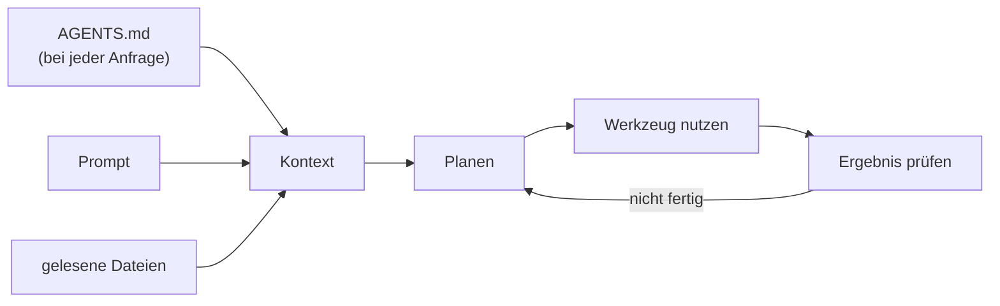
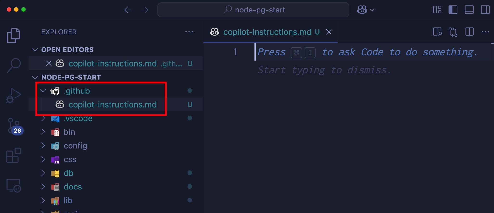
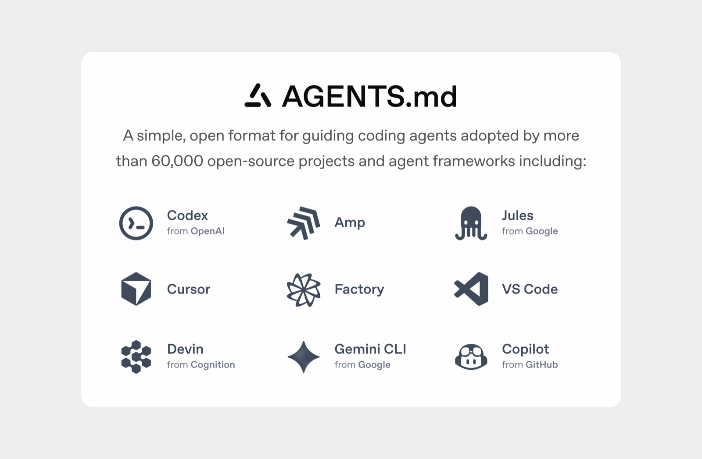
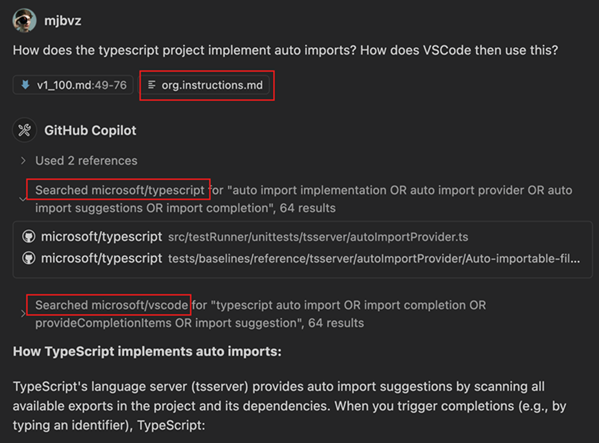

# Lab 4.1: Projektregeln für den Agenten

**Leitfragen:**

<details>
<summary>Was steht in einem guten README für neue Teammitglieder?</summary>

Wozu das Projekt da ist, wie man es startet und testet, wo was liegt, welche Konventionen gelten und was man nicht tun soll. Genau das braucht auch ein Agent, nur kürzer und als Regeln formuliert.

</details>

<details>
<summary>Welche Regeln im eigenen Team stehen nirgends geschrieben?</summary>

Typisch: wo Logik hingehört, wie IDs oder Namen gebildet werden, welches Testframework gilt, dass neue Pakete abgesprochen werden, dass Secrets nie in den Code gehören. Menschen lernen das im Review, ein Agent nur aus einer Datei.

</details>

<details>
<summary>Woran merkt man, dass eine Regel zu vage ist?</summary>

Wenn sich an den Änderungen nicht mit Ja oder Nein entscheiden lässt, ob sie eingehalten wurde. „Sauberer Code“ ist nicht prüfbar, „keine Dateizugriffe in Routen“ schon.

</details>

- Der Agent sieht nur Code und Prompt; Team-Absprachen, Zielarchitektur und Verbote kennt er nicht.
- `AGENTS.md` bzw. `.github/copilot-instructions.md` geht bei jeder Anfrage mit in den Kontext, ohne Frontmatter.
- Hinein gehören Stack, Ordner, Befehle, Konventionen, Verbote; nicht hinein gehören Romane und Selbstverständliches.
- Kurz und prüfbar halten: im Kurs höchstens 40 Zeilen.

## Begriffe

| Begriff | Bedeutung |
| --- | --- |
| Instructions | Projektregeln, die der Agent bei jeder Anfrage mitbekommt |
| `AGENTS.md` | Instructions-Datei in der Projektwurzel; offener Standard, den mehrere Agenten lesen (seit Aug 2025, Lab 1.2) |
| `.github/copilot-instructions.md` | Instructions-Datei nur für Copilot, gleiche Wirkung |
| `CLAUDE.md` | dieselbe Idee für Claude Code |
| Frontmatter | Kopfbereich einer Markdown-Datei zwischen zwei `---`-Zeilen mit Einstellungen (ab Lab 4.2 relevant) |
| Projektwurzel | oberster Ordner des Projekts, der in VS Code geöffnet ist |

## Was der Agent nicht wissen kann

Der Agent lernt aus dem, was er sieht: Prompt, geöffnete und gelesene Dateien. Alles andere rät er, wie der Status quo aus Lab 3.3 zeigt.

Wie bei einer neuen Kollegin am ersten Tag: Was niemand erklärt, muss sie aus dem vorhandenen Code erraten.

| Wissen | Beispiel FocusList | Was der Agent ohne Regel tut |
| --- | --- | --- |
| Team-Absprachen | nur `async/await`, UI-Texte Deutsch, Code Englisch | übernimmt den Stil der zuletzt gelesenen Datei, mischt Stile |
| Architektur | Route → Service → Store | legt Logik dorthin, wo gerade Platz ist |
| Fachregeln | neue ID = größte ID + 1 | zählt die Liste (`len(tasks) + 1`) |
| Befehle | Start mit `flask --app focuslist run --debug` bzw. `npm run dev` | erfindet einen eigenen Startweg (`run.py`) |
| Testpflicht | jede neue Route mit Tests | schreibt keine Tests |
| Verbote | keine neuen Pakete, `.env` nicht lesen | schlägt Express vor, liest, was er findet |

Schlechter vorhandener Code ist dabei die stärkste „Regel“: Der Agent ahmt nach, was im Projekt schon steht.

## Wie Instructions in den Kontext kommen



Die Datei greift beim Planen im Loop aus Lab 1.1 (vgl. Landkarte in Lab 1.3). Weil sie bei jeder Anfrage mitgeht, kostet jede Zeile Platz im Kontextfenster. Lange Dateien verdrängen Wichtiges, und einzelne Regeln gehen unter.

## Welche Datei wofür

Stand: 11/2026. Quellen: [Custom instructions](https://code.visualstudio.com/docs/agent-customization/custom-instructions), [Agent harnesses](https://code.visualstudio.com/docs/agents/run/agent-harnesses), [Migrate customizations](https://code.visualstudio.com/docs/agent-customization/migrate-customizations)

| Datei | Ort | Gelesen von | Frontmatter | Wann wählen |
| --- | --- | --- | --- | --- |
| `AGENTS.md` | Projektwurzel | Copilot, Codex | nein | Standard im Kurs; Team nutzt mehrere Agenten |
| `.github/copilot-instructions.md` | Ordner `.github/` | Copilot | nein | Team nutzt nur Copilot oder hat die Datei schon |
| `CLAUDE.md` | Projektwurzel | Claude Code, Claude-Harness | nein | Team arbeitet mit Claude Code |


_Quelle: VS Code Blog, Beitrag vom 26.03.2025 zu Custom Instructions (https://code.visualstudio.com/blogs/2025/03/26/custom-instructions), Microsoft, CC BY 3.0 US, abgerufen am 07.11.2026._


_Quelle: agents.md (https://agents.md/), Logos der jeweiligen Hersteller, extern eingebunden, abgerufen am 07.11.2026._

Empfehlung: eine Datei pflegen, nicht zwei mit doppeltem Inhalt. Wer zusätzlich Claude Code nutzt, kann in `CLAUDE.md` mit der Zeile `@AGENTS.md` auf dieselben Regeln verweisen.

## Was hineingehört, was nicht

| Hinein | Nicht hinein |
| --- | --- |
| Stack mit Versionen (Flask 3, Node.js 22+, Tailwind v4) | Einführung in Flask oder Node.js |
| Ordner und ihre Aufgabe, je eine Zeile | vollständiger Dateibaum |
| Befehle für Start, Tests, CSS | Installationsanleitung für Python |
| Konventionen, die der Code nicht zeigt oder die er falsch zeigt | Selbstverständliches („schreibe guten Code“) |
| Verbote mit klarer Grenze | Secrets, Passwörter, interne URLs |
| Testpflicht und Prüfbefehl | lange Begründungen, Geschichte des Projekts |

| Vage | Prüfbar |
| --- | --- |
| „Schreibe sauberen Code.“ | „Eine Schicht pro Aufgabe: Route → `tasks.py` → `store.py`. Keine Dateizugriffe in Routen.“ |
| „Achte auf Tests.“ | „Jede neue Route bekommt Tests (Normalfall und Fehlerfall). Vor jeder Übergabe `pytest`.“ |
| „IDs richtig vergeben.“ | „Neue ID immer `max(id) + 1`, nie `len(tasks) + 1`.“ |
| „Vorsicht mit Paketen.“ | „Keine neuen Abhängigkeiten ohne Rückfrage.“ |

## Referenz: AGENTS.md

Die Datei beschreibt bereits die aufgeräumte Struktur von v1 (`tasks.js`, `http.js`). Regeln dürfen den Zielzustand beschreiben; den Umbau erledigt der Agent danach (Lab 4.3).

Node.js ([`project/focuslist/node/steps/m04/AGENTS.md`](../project/focuslist/node/steps/m04/AGENTS.md)):

```markdown
# FocusList – Regeln für Agenten

Kleine Aufgabenliste (Web-App). Kursprojekt, Code soll für Einsteiger lesbar bleiben.

## Stack
- Node.js 22+, ES-Module (`import`), nur eingebaute Module (`node:http`, `node:fs/promises`, `node:path`, `node:url`, `node:test`)
- HTML aus Template-Funktionen in `src/views/`, Styling mit Tailwind CSS v4
- Daten in `data/tasks.json`, Task = `{ id, title, priority, done }`, priority = `low` | `medium` | `high`

## Ordner
- `src/app.js` – nur Routing: Request lesen, Service aufrufen, Antwort senden
- `src/tasks.js` – Aufgabenlogik (filtern, anlegen, erledigen, löschen)
- `src/store.js` – nur Lesen und Schreiben der JSON-Datei
- `src/http.js` – Helfer für Body, HTML, JSON, Redirect
- `src/views/` – HTML-Template-Funktionen, keine Logik außer Darstellung
- `test/` – Tests mit `node:test`, Helfer in `test/helpers.js`

## Befehle
- Start: `npm run dev` (http://localhost:3000)
- Tests: `npm test` (führt `test/**/*.test.js` aus)
- CSS: `npm run css` (beobachten) bzw. `npm run build:css` (einmal bauen)

## Konventionen
- Nur `async/await`, keine Callbacks
- Neue ID = größte vorhandene ID + 1 (`nextId()`)
- Formulare senden POST und leiten danach auf `/` um
- UI-Texte auf Deutsch, Code-Bezeichner auf Englisch, Kommentare kurz und deutsch
- Jede neue Route bekommt Tests (Normalfall und Fehlerfall)
- Nach jeder Änderung `npm test` ausführen, erst bei Grün fertig melden

## Verbote
- Keine npm-Pakete für die Laufzeit (kein Express, kein Template-Framework)
- `static/app.css` und `node_modules/` nicht bearbeiten oder einchecken
- `data/tasks.json` nicht in Tests verändern, Tests arbeiten mit einer Kopie
- Keine Befehle ausführen, die Dateien außerhalb des Projekts ändern
```

Python ([`project/focuslist/python/steps/m04/AGENTS.md`](../project/focuslist/python/steps/m04/AGENTS.md)): gleicher Aufbau mit Flask 3 + Jinja2, Ordnern `routes.py` → `tasks.py` → `store.py` und Befehlen `flask --app focuslist run --debug` bzw. `pytest`. Zusätzlich: Hinweise per `flash()` (Flask merkt sich eine Meldung für die nächste Seite, z. B. „Aufgabe angelegt“), unbekannte ID → `abort(404)`, `.env` und Secrets tabu. Die Routen liegen in einem Blueprint (`bp`): einer Gruppe von Routen, die `create_app()` registriert.

Die Node.js-Datei nennt Datenmodell und erlaubte Module ausdrücklich, weil ohne Framework mehr Freiheit besteht. Regeln für bestimmte Dateien (Templates, Tests) fehlen bewusst; sie folgen in Lab 4.2.

## Prüfen, ob der Agent die Regeln kennt

Stand: 11/2026; Bezeichnungen in der Chat-Ansicht können sich mit VS-Code-Versionen ändern.

| Weg | So geht es | Aussagekraft |
| --- | --- | --- |
| Referenzen in der Antwort | Unter einer Antwort lässt sich die Liste der verwendeten Referenzen aufklappen; steht dort `AGENTS.md`, wurde die Datei mitgeschickt | gut, zeigt das Laden |
| Nachfragen (Ask) | „Welche Projektregeln gelten hier? Nenne die Datei und drei Verbote.“ | mittel: Der Agent kann die Datei auch erst auf die Frage hin lesen |
| Verhaltenstest (Plan) | Auftrag, der gegen eine Regel verstößt, z. B. „Plane, wie wir Express für das Routing einführen.“ | am besten: Der Plan sollte auf das Verbot hinweisen |


_Quelle: VS Code Release Notes 1.100 (https://code.visualstudio.com/updates/v1_100), Microsoft, CC BY 3.0 US, abgerufen am 07.11.2026._

Ansicht 2025: Die Liste „Used … references“ unter der Antwort zeigt, welche Dateien mitgeschickt wurden.

## Typische Fehler

| Symptom | Ursache | Lösung |
| --- | --- | --- |
| `AGENTS.md` taucht nie in den Referenzen auf | Datei liegt nicht in der Projektwurzel, z. B. weil der übergeordnete Ordner `$HOME/kurs` geöffnet ist | Ordner `focuslist` selbst öffnen, Datei in dessen Wurzel legen |
| Agent ignoriert eine neue Regel | alte Chat-Sitzung mit früherem Kontext | neue Chat-Sitzung öffnen |
| Agent hält sich nur teilweise daran | Regel zu vage oder Widerspruch zum vorhandenen Code | Regel prüfbar formulieren, Zielzustand ausdrücklich nennen |
| Regeln widersprechen sich | `AGENTS.md` und `.github/copilot-instructions.md` parallel gepflegt | eine Datei behalten |
| Datei wächst auf 100+ Zeilen | jede Erfahrung landet als neue Regel | kürzen; Regeln für bestimmte Dateien auslagern (Lab 4.2) |

## Übung

**Dauer:** ca. 20 Minuten · **Start:** Stand v0: eigene FocusList aus m03 (`$HOME/kurs/focuslist`) oder Referenz per `node project/focuslist/catch-up.mjs <python|node> m04 $HOME/kurs/focuslist-m04`, danach in diesem Ordner weiterarbeiten · **Referenz:** `project/focuslist/<stack>/steps/m04/AGENTS.md`

Weicht der eigene v0 stark von der Referenz ab (andere Dateien, App startet nicht), mit dem Referenzstand weiterarbeiten.

1. Öffne den Projektordner (nicht `$HOME/kurs`) in VS Code. Nimm die Zeilen mit Baustein „Instructions“ aus der Status-quo-Liste (Lab 3.3: Nr. 4 und 5) als Grundlage.
2. Erstelle `AGENTS.md` in der Projektwurzel mit den Abschnitten Stack, Ordner, Befehle, Konventionen, Verbote. Formuliere aus jeder dieser Zeilen eine prüfbare Regel und ergänze Start-, Test- und CSS-Befehl.
3. Kürze auf höchstens 40 Zeilen. Prüfe jede Regel mit der Frage: Lässt sich an den Änderungen des Agenten mit Ja oder Nein entscheiden, ob sie eingehalten wurde?
4. Öffne eine neue Chat-Sitzung, wähle **Ask** und frage: „Welche Projektregeln gelten in diesem Projekt? Nenne die Datei, aus der sie stammen, und drei Verbote.“ Prüfe die Referenzen der Antwort.
5. Wechsle auf **Plan** und stelle einen Auftrag, der gegen ein Verbot verstößt (Node.js: Express einführen; Python: ein neues Paket für Formulare einführen).

**Checkpoint:** `AGENTS.md` liegt in der Projektwurzel und hat höchstens 40 Zeilen; die Antwort aus Schritt 4 nennt `AGENTS.md` und drei Verbote aus der Datei; der Plan aus Schritt 5 weist auf das Verbot hin.

<details>
<summary>Lösungsweg</summary>

Zuordnung Status-quo-Liste → Regel (Auszug, Python; Node.js analog):

| Mangel aus der Status-quo-Liste | Regel in `AGENTS.md` |
| --- | --- |
| ID per `len(tasks) + 1` | „Neue ID immer `max(id) + 1` über `tasks.next_id()`, nie `len(tasks) + 1`.“ |
| Logik mal in der Route, mal im Store | „Eine Schicht pro Aufgabe: Route → `tasks.py` → `store.py`.“ |
| unbekannte ID still ignoriert | „Unbekannte ID → `abort(404)`.“ |
| `run.py` als zweiter Startweg | „Start: `flask --app focuslist run --debug`“ |
| keine Tests | „Jede neue oder geänderte Route bekommt Tests (Normalfall und Fehlerfall).“ |
| Paketvorschlag, z. B. Express (Node.js) | „Keine npm-Pakete für die Laufzeit (kein Express, kein Template-Framework)“ |
| Callbacks und `async/await` gemischt (Node.js) | „Nur `async/await`, keine Callbacks“ |

Erwartete Antwort auf Schritt 4 (sinngemäß): „Die Regeln stammen aus `AGENTS.md`. Verbote: keine neuen Abhängigkeiten ohne Rückfrage, `.env` nicht lesen oder ändern, `data/tasks.json` nicht in Tests verändern.“

Erwarteter Plan zu Schritt 5 (sinngemäß): „Laut `AGENTS.md` sind keine Laufzeit-Pakete erlaubt. Vorschlag: Routing mit eingebauten Modulen aufteilen, oder die Regel vorher im Team ändern.“

Fehlt der Hinweis auf das Verbot: neue Sitzung öffnen, Ort der Datei prüfen, Verbot eindeutiger formulieren und erneut testen.

</details>

## Fazit

- Instructions schreiben auf, was im Team sonst mündlich weitergegeben wird.
- Prüfbare Regeln wirken, vage Regeln nicht.
- Ob der Agent die Datei kennt, zeigt am besten sein Verhalten, nicht seine Selbstauskunft.
