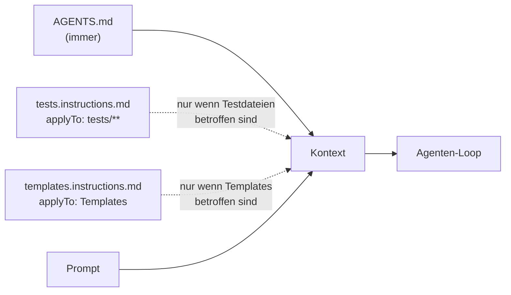
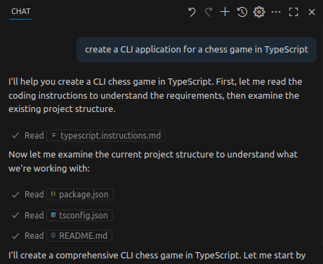
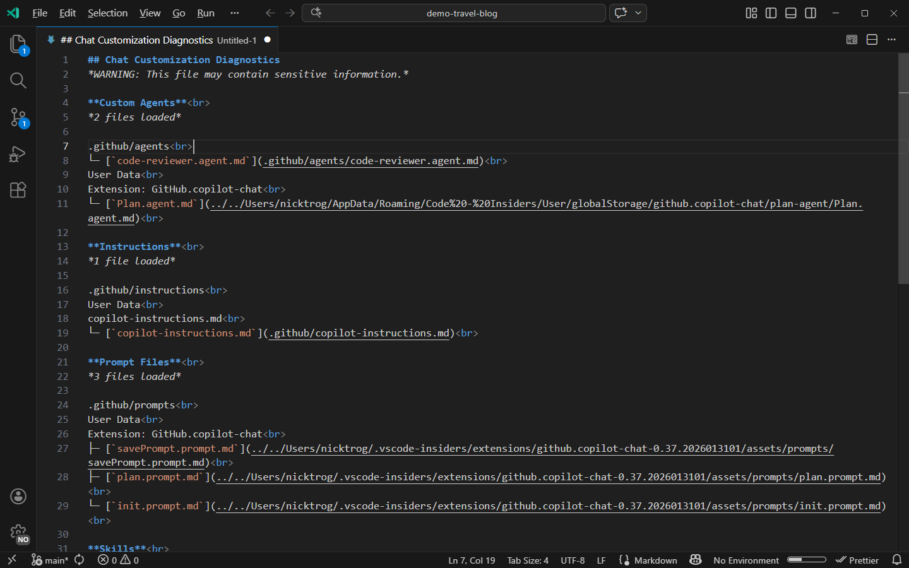

# Lab 4.2: Regeln für bestimmte Dateien

**Leitfragen:**

<details>
<summary>Gelten für Testcode dieselben Regeln wie für Produktcode?</summary>

Teilweise. Sprache, Stil und Verbote gelten überall. Tests haben eigene Regeln (Fixtures, Kopie der Daten, Testnamen, keine Wartezeiten), Templates ebenfalls (Escaping, Tailwind-Klassen, deutsche Texte). Diese Regeln gehören zu den Dateien, für die sie gelten.

</details>

<details>
<summary>Was passiert, wenn eine Datei mit allen Regeln für alles immer länger wird?</summary>

Die Datei geht bei jeder Anfrage komplett mit, auch wenn nur eine CSS-Klasse geändert wird. Das füllt das Kontextfenster, einzelne Regeln gehen unter, Widersprüche fallen nicht mehr auf. Abhilfe: Regeln nach Dateien aufteilen.

</details>

- `.github/instructions/<name>.instructions.md` enthält Regeln für eine Gruppe von Dateien.
- Das Frontmatter-Feld `applyTo` legt per Glob-Muster fest, für welche Dateien die Regeln gelten.
- `AGENTS.md` bleibt für das, was immer gilt; Detailregeln wandern in die passende Datei.
- Im Kurs: eine Datei für Tests, eine für Templates.

## Begriffe

| Begriff | Bedeutung |
| --- | --- |
| Scoped Instructions | Regeln, die nur für bestimmte Dateien gelten |
| `applyTo` | Frontmatter-Feld mit einem Glob-Muster, relativ zur Projektwurzel |
| Glob-Muster | Platzhalter-Schreibweise für Pfade: `*` = beliebige Zeichen im Namen, `**` = beliebig viele Ordner |
| View | Template-Funktion im Node.js-Stack (`src/views/`), die HTML zurückgibt |

## Aufbau einer Datei

```markdown
---
applyTo: "tests/**"
---

# Regeln für Tests

- Regel 1
- Regel 2
```

| Teil | Pflicht | Hinweis |
| --- | --- | --- |
| Ordner `.github/instructions/` | ja | Standardort im Projekt |
| Endung `.instructions.md` | ja | z. B. `tests.instructions.md` |
| Frontmatter mit `applyTo` | ja, für automatische Anwendung | ohne `applyTo` wird die Datei nicht automatisch angewendet |
| Regeln als Liste | empfohlen | kurz, prüfbar, wie in Lab 4.1 |

Stand: 11/2026. Quelle: [Custom instructions](https://code.visualstudio.com/docs/agent-customization/custom-instructions). Im Local-Harness gibt es zusätzlich das Feld `description`; im Kurs nicht verwendet.

## Wann welche Regeln gelten



| Situation | Was mitgeht |
| --- | --- |
| Agent ändert nur `tasks.py` bzw. `src/tasks.js` | `AGENTS.md` |
| Agent schreibt einen neuen Test | `AGENTS.md` + `tests.instructions.md` |
| Agent ändert Route, Template und Test | `AGENTS.md` + beide Dateien |


_Quelle: VS Code Release Notes 1.102 (https://code.visualstudio.com/updates/v1_102), Microsoft, CC BY 3.0 US, abgerufen am 07.11.2026._

Im Chat-Verlauf ist sichtbar, wann eine Instructions-Datei für passende Dateien gelesen wird (hier eine Datei für TypeScript).

Beide Ebenen ergänzen sich; eine feste Rangfolge bei Widersprüchen gibt es nicht. Deshalb: allgemeine Regel einmal in `AGENTS.md`, Detail in der Datei für den Bereich, nie dieselbe Regel an zwei Stellen anders.

## Glob-Beispiele

| `applyTo` | Gilt für |
| --- | --- |
| `"tests/**"` | alle Dateien unter `tests/` (Python) |
| `"test/**"` | alle Dateien unter `test/` (Node.js) |
| `"focuslist/templates/**"` | Jinja2-Templates (Python) |
| `"src/views/**"` | View-Funktionen (Node.js) |
| `"**/*.py"` | alle Python-Dateien im Projekt |
| `"**/*.test.js"` | alle Testdateien, egal in welchem Ordner |
| `"src/**/*.js,test/**/*.js"` | mehrere Muster, durch Komma getrennt |
| `"**"` | alle Dateien; dann gehört die Regel besser in `AGENTS.md` |

## Referenz: Python

`project/focuslist/python/steps/m04/.github/instructions/tests.instructions.md`:

```markdown
---
applyTo: "tests/**"
---

# Regeln für Tests

- Tests mit pytest, eine Datei pro Thema: `tests/test_<thema>.py`.
- Immer die Fixtures `client` bzw. `app` aus `tests/conftest.py` nutzen. Sie arbeiten auf einer Kopie von `data/tasks.json` in `tmp_path`; die echte Datei bleibt unverändert.
- Testnamen beschreiben das Verhalten auf Deutsch: `test_loeschen_entfernt_aufgabe`, `test_unbekannte_id_liefert_404`.
- Aufbau: vorbereiten → ausführen → prüfen, mit je einer Leerzeile dazwischen.
- Pro neue Route mindestens: ein Normalfall und ein Fehlerfall (z. B. unbekannte ID → 404).
- Prüfen, was sichtbar ist: Statuscode, Redirect-Ziel, Text im HTML, JSON der API. Nicht nur `status_code == 200`.
- Gespeicherte Daten über `/api/tasks` oder `load_tasks(app.config["DATA_PATH"])` prüfen.
- Keine Netzwerkzugriffe, kein `sleep`, keine Abhängigkeit von der Reihenfolge der Tests.
- Nach dem Schreiben `pytest` ausführen; ein roter Test wird repariert, nicht gelöscht oder übersprungen.
```

`project/focuslist/python/steps/m04/.github/instructions/templates.instructions.md`:

```markdown
---
applyTo: "focuslist/templates/**"
---

# Regeln für Templates

- Jede Seite erweitert `base.html` (``) und füllt nur ``.
- Ausgabe immer über `{{ … }}` mit dem automatischen Escaping von Jinja2. Nie `|safe` oder `Markup` für Werte, die aus Formularen, URL-Parametern oder `data/tasks.json` stammen.
- Keine Logik im Template außer Schleifen, Bedingungen und Anzeige-Zuordnungen (z. B. Priorität → Farbe).
- Styling nur mit Tailwind-Utility-Klassen. Kein `style="…"`, keine `<style>`-Blöcke, keine neuen CSS-Dateien.
- Farben für Priorität: hoch `bg-red-100 text-red-700`, mittel `bg-yellow-100 text-yellow-800`, niedrig `bg-slate-200 text-slate-700`.
- Formulare mit `method="post"` und Ziel per `url_for(...)`; Buttons mit sichtbarem deutschem Text.
- Jedes Eingabefeld hat ein `<label>` oder ein `aria-label`.
- Sichtbare Texte auf Deutsch.
```

## Referenz: Node.js

Gleicher Aufbau, Dateien: [`tests.instructions.md`](../project/focuslist/node/steps/m04/.github/instructions/tests.instructions.md) mit `applyTo: "test/**"` und [`templates.instructions.md`](../project/focuslist/node/steps/m04/.github/instructions/templates.instructions.md) mit `applyTo: "src/views/**"`.

- Tests: `node:test` mit `node:assert/strict`, Server über `startTestServer()` aus `test/helpers.js` (freier Port, Kopie von `data/tasks.json`), Formulare mit `app.postForm()`, Zustand mit `app.readTasks()` prüfen.
- Views: Funktionen, die HTML zurückgeben, mit `layout({ title, body })`; keine Dateizugriffe; jeder dynamische Wert über `escapeHtml()` aus `src/views/escape.js` (wird angelegt, falls sie fehlt), nie rohes `${task.title}`; Tailwind-Klassen immer vollständig ausschreiben (`bg-${farbe}-100` findet Tailwind nicht).

`test/helpers.js` entsteht erst in v1 (Lab 4.3); im eigenen v0 das vorhandene Muster aus `test/index.test.js` beschreiben.

## Typische Fehler

| Symptom | Ursache | Lösung |
| --- | --- | --- |
| Regeln greifen nie | `applyTo` passt nicht, z. B. `"templates/**"` statt `"focuslist/templates/**"` | Pfad relativ zur Projektwurzel schreiben, mit einem echten Dateipfad vergleichen |
| Datei wird gar nicht erkannt | falsche Endung (`tests.md`) oder falscher Ordner (`.github/instruction/`) | `.github/instructions/<name>.instructions.md` |
| Frontmatter wird als Text gelesen | `---` fehlt oder steht nicht in der ersten Zeile | Frontmatter ganz oben, zwischen zwei `---`-Zeilen |
| Agent kennt die Testregeln bei einer allgemeinen Frage nicht | keine passende Datei betroffen, Regeln gehen nicht mit | Testdatei als Kontext anhängen oder Auftrag stellen, der Tests ändert |
| Agent folgt zwei widersprüchlichen Regeln abwechselnd | gleiche Regel in `AGENTS.md` und Scoped-Datei verschieden | Regel nur an einer Stelle |


_Quelle: VS Code Release Notes 1.109 (https://code.visualstudio.com/updates/v1_109), Microsoft, CC BY 3.0 US, abgerufen am 07.11.2026._

Bei „Regeln greifen nie“ hilft die Diagnoseansicht von VS Code. Die Ansicht listet, welche Instructions-Dateien erkannt wurden.

## Übung

**Dauer:** ca. 15 Minuten · **Start:** Stand v0 mit `AGENTS.md` aus Lab 4.1 · **Referenz:** `project/focuslist/<stack>/steps/m04/.github/instructions/`

1. Erstelle in der Projektwurzel `.github/instructions/tests.instructions.md` mit `applyTo: "tests/**"` (Python) bzw. `applyTo: "test/**"` (Node.js). Beschreibe Testframework, Dateinamen, Umgang mit den Beispieldaten, Testnamen, Pflicht zu Normal- und Fehlerfall.
2. Erstelle daneben `templates.instructions.md` mit `applyTo: "focuslist/templates/**"` bzw. `applyTo: "src/views/**"`. Beschreibe Layout, Ausgabe von Werten (Escaping), Tailwind-Regeln, Farben der Badges, deutsche Texte.
3. Verschiebe Regeln aus `AGENTS.md`, die nur Tests oder Templates betreffen, in die neuen Dateien. `AGENTS.md` behält einen Satz wie „Jede neue Route bekommt Tests“.
4. Öffne eine neue Chat-Sitzung, wähle **Agent** und sende: „Schreibe einen Test für das Erledigen einer Aufgabe.“ Prüfe die Referenzen der Antwort und den neuen Test gegen die eigenen Regeln.
5. Führe die Tests aus. Übernimm den Test mit **Keep** oder verwirf ihn mit **Undo**.

**Checkpoint:** Zwei Dateien mit `applyTo` liegen in `.github/instructions/`; die Referenzen zur Antwort aus Schritt 4 nennen `tests.instructions.md`; der neue Test trägt einen deutschen Namen und nutzt die vorhandenen Fixtures bzw. Testhelfer.

<details>
<summary>Lösungsweg</summary>

Prüfung der Pfade (Projektwurzel):

```bash
ls focuslist/templates/     # Python: base.html  index.html  → passt zu "focuslist/templates/**"
ls src/views/               # Node.js: index.js  layout.js   → passt zu "src/views/**"
ls .github/instructions/    # templates.instructions.md  tests.instructions.md
```

Erwartetes Ergebnis von Schritt 4, Python (Datei z. B. `tests/test_complete.py`): Test `test_erledigen_markiert_aufgabe` mit Fixture `client`, Aufbau vorbereiten → ausführen → prüfen; dazu ein Fehlerfall `test_erledigen_unbekannte_id_liefert_404`. Im v0 leitet die Route bei unbekannter ID still um; der Fehlerfall schlägt also fehl. Nach der Regel „ein roter Test wird repariert, nicht gelöscht“ passt der Agent die Route an oder fragt nach. Beides ist ein Zeichen, dass die Regeln wirken.

Erwartetes Ergebnis, Node.js (Datei z. B. `test/complete.test.js`): `node:test` mit `node:assert/strict`, eigener Testserver mit Kopie von `data/tasks.json` wie in `test/index.test.js`, deutscher Testname als Satz, z. B. „POST /tasks/:id/complete markiert die Aufgabe als erledigt“.

Fehlt `tests.instructions.md` in den Referenzen: `applyTo` und Dateiort prüfen, neue Sitzung öffnen.

</details>

## Fazit

- `applyTo` bringt Regeln genau dann in den Kontext, wenn passende Dateien betroffen sind.
- `AGENTS.md` bleibt kurz; Details liegen bei den Dateien, für die sie gelten.
- Jede Regel steht an genau einer Stelle.
