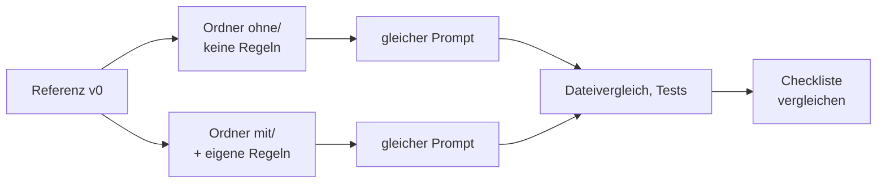
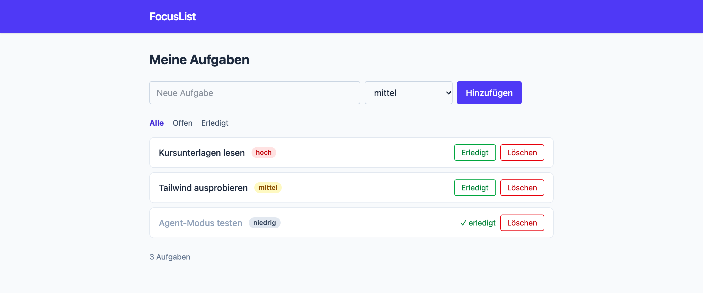

# Lab 4.3: Vorher und nachher

**Leitfragen:**

<details>
<summary>Wie beweist man, dass eine Regel etwas bewirkt?</summary>

Mit einem fairen Vergleich: gleicher Startstand, gleicher Prompt, einmal ohne und einmal mit Regeln, Ergebnis gegen eine feste Checkliste prüfen. Ein einzelner Lauf ist ein Hinweis, kein Beweis; das Modell antwortet jedes Mal etwas anders (Lab 1.1). Wer sicher sein will, wiederholt den Vergleich.

</details>

<details>
<summary>Welche Probleme aus der Liste bleiben trotz Regeln offen?</summary>

Alles, was im vorhandenen Code steckt und der Agent nicht anfasst (z. B. `|safe`, Path Traversal), alles, was keine Regel nennt, und alles, was erzwungen statt erbeten werden muss. Regeln sind Bitten an das Modell, keine Prüfung.

</details>

- Wirkung messen statt glauben: gleiche Aufgabe, gleicher Startstand, mit und ohne Regeln.
- Zwei Ordner mit demselben v0 machen den Vergleich fair; der Dateivergleich in VS Code zeigt den Unterschied.
- Regeln verbessern neuen Code deutlich, alten Code reparieren sie nicht von allein.
- Was keine Regel nennt, entscheidet weiterhin der Agent.

## Begriffe

| Begriff | Bedeutung |
| --- | --- |
| Vorher-Nachher-Vergleich | gleiche Aufgabe unter zwei Bedingungen, nur eine Größe ändert sich (hier: Regeln ja/nein) |
| Checkliste | feste Kriterien, an denen beide Ergebnisse gemessen werden |
| v1 | FocusList nach m04: Regeln, aufgeräumte Struktur, Feature „Aufgabe löschen“ mit Tests |

## Methode



| Regel für einen fairen Vergleich | Warum |
| --- | --- |
| beide Ordner aus demselben Stand (`catch-up.mjs`) | gleicher Ausgangscode |
| jeder Ordner in einem eigenen VS-Code-Fenster | Regeln des einen Ordners gelangen nicht in den anderen |
| je eine neue Chat-Sitzung, gleicher Agent, gleiches Modell | kein Verlauf aus früheren Anfragen |
| wörtlich derselbe Prompt | nur die Regeln unterscheiden sich |
| Änderungen nicht von Hand nachbessern | Ergebnis des Agenten wird gemessen, nicht das eigene |

## Checkliste für „Aufgabe löschen“

| Kriterium | Woran im Code erkennbar |
| --- | --- |
| Route `POST /tasks/<id>/delete` vorhanden, Button „Löschen“ in der Liste | Route und Formular im Template bzw. in der View |
| Logik im Service, nicht in der Route | Python `tasks.py`, Node.js `src/tasks.js` |
| neue IDs über größte ID + 1 | `next_id()` bzw. `nextId()` statt `len(tasks) + 1` |
| unbekannte ID mit festgelegtem Verhalten | Python `abort(404)`; Node.js laut eigener Regel |
| Tests für Löschen (Normalfall und Fehlerfall) | neue Testdatei, Tests grün |
| keine neuen Abhängigkeiten | `requirements.txt`, `package.json` unverändert |
| Projektstil eingehalten | nur `async/await` (Node.js), Tailwind-Klassen, deutsche Texte |

## Referenz v1: Löschen mit Regeln

Ausschnitte aus [`project/focuslist/python/steps/m04/`](../project/focuslist/python/steps/m04/). Zusätzlich zum Löschen ist der Code nach `AGENTS.md` aufgeräumt (eine Schicht, `max(id) + 1`).


_Quelle: eigener Screenshot, FocusList v1, 07.11.2026._

`focuslist/routes.py` (Ausschnitt):

```python
@bp.post("/tasks/<int:task_id>/delete")
def delete(task_id):
    if not service.delete_task(data_path(), task_id):
        abort(404)
    flash("Aufgabe gelöscht.")
    return redirect(url_for("tasks.index"))
```

`focuslist/tasks.py` (Ausschnitt):

```python
def next_id(tasks):
    return max((t["id"] for t in tasks), default=0) + 1
```

`tests/test_delete.py` (Ausschnitt, insgesamt vier Tests):

```python
def test_loeschen_unbekannte_id_liefert_404(client):
    response = client.post("/tasks/999/delete")

    assert response.status_code == 404
```

Node.js ([`project/focuslist/node/steps/m04/`](../project/focuslist/node/steps/m04/)): gleiche Aufteilung mit `deleteTask()` und `nextId()` in `src/tasks.js`, Route `POST /tasks/:id/delete` in `src/app.js`, Tests in `test/tasks.test.js`. Neu in v1 sind außerdem `src/http.js`, `src/static.js` und `test/helpers.js`.

Unterschied der Stacks: Die Python-Regeln verlangen `abort(404)` für unbekannte IDs, die Node.js-Regeln nennen den Fall nicht. Ergebnis: Python antwortet mit 404, Node.js leitet still um. Was keine Regel nennt, entscheidet der Agent.

## Was trotz Regeln bleibt

In v1 stecken weiterhin die Sicherheitslücken aus v0: Python `|safe` im Hinweis, `app.secret_key = "dev"`, `run.py` mit fest verdrahtetem `debug=True`, keine Validierung; Node.js Ausgabe ohne Escaping, `join(staticDir, req.url.replace("/static/", ""))` in `src/static.js`, `readBody()` ohne Limit, keine Validierung. Die Template-Regeln verbieten ungeschützte Ausgabe (Python `|safe`, Node.js Werte ohne `escapeHtml()`), trotzdem stehen die alten Zeilen noch da: Regeln lenken neuen Code, sie prüfen keinen bestehenden. Die gezielte Sicherheitsprüfung folgt in Modul 5.

## Typische Fehler

| Symptom | Ursache | Lösung |
| --- | --- | --- |
| Ordner `ohne/` liefert trotzdem regelkonformen Code | beide Ordner im selben Fenster bzw. Workspace geöffnet | jeden Ordner in einem eigenen Fenster öffnen, neue Sitzung |
| Ergebnisse nicht vergleichbar | unterschiedliche Prompts oder Modelle | Prompt kopieren, Modell in beiden Fenstern gleich wählen |
| „Compare with Selected“ fehlt im Kontextmenü | vorher keine Datei mit „Select for Compare“ gewählt | erst die Datei aus `ohne/` wählen, dann die aus `mit/` |
| `catch-up.mjs` bricht ab: Zielordner nicht leer | Ordner existiert schon | neuen Ordnernamen wählen oder `--force` anhängen |
| `pytest: command not found` in `ohne/` oder `mit/` | `venv` im Terminal dieses Fensters nicht aktiv | `venv` aus dem Arbeitsordner aktivieren (siehe Übung) |
| beide Ergebnisse fast gleich | einzelner Lauf, Zufall des Modells | Vergleich wiederholen; mehrere Läufe zählen |

## Übung

**Dauer:** ca. 20 Minuten · **Start:** zweimal Stand v0 per `catch-up.mjs` plus eigene Regeln aus Lab 4.1 und 4.2 (eigener Arbeitsordner) · **Referenz:** `project/focuslist/<stack>/steps/m04/` (Löschen, Tests, aufgeräumte Struktur)

1. Erstelle die Vergleichsordner (im Ordner der Kursunterlagen ausführen) und kopiere `AGENTS.md` und `.github/` aus dem eigenen Arbeitsordner (Lab 4.1/4.2) nur nach `mit/`; Beispiel Python mit Arbeitsordner `$HOME/kurs/focuslist` (wer Lab 3.2 ausgelassen hat: `$HOME/kurs/focuslist-m04`):

   ```bash
   node project/focuslist/catch-up.mjs python m04 $HOME/kurs/vergleich/ohne
   node project/focuslist/catch-up.mjs python m04 $HOME/kurs/vergleich/mit
   cp $HOME/kurs/focuslist/AGENTS.md $HOME/kurs/vergleich/mit/
   cp -r $HOME/kurs/focuslist/.github $HOME/kurs/vergleich/mit/
   ```

2. Öffne `ohne/` und `mit/` in je einem Fenster, wähle in beiden **Agent** und dasselbe Modell und sende wörtlich: „Füge einen Button "Löschen" hinzu, der eine Aufgabe entfernt.“ Übernimm das Ergebnis mit **Keep**, bessere nichts von Hand nach, führe die Tests aus.
3. Öffne `$HOME/kurs/vergleich` in einem dritten Fenster und vergleiche die geänderten Dateien: Rechtsklick auf die Datei in `ohne/` → „Select for Compare“, dann auf dieselbe Datei in `mit/` → „Compare with Selected“. Prüfe je Kriterium der Checkliste: erfüllt `ohne/` oder `mit/` es?
4. (optional) Sende im Fenster von `mit/`: „Bringe den bestehenden Code in Einklang mit AGENTS.md, ohne das Verhalten zu ändern. Führe danach die Tests aus.“ Prüfe die Änderungen und übernimm sie mit **Keep**. `mit/` ist jetzt FocusList v1. Tag 2 startet für alle mit `catch-up.mjs … m05` (= v1) im neuen Arbeitsordner `$HOME/kurs/focuslist-m05`.

Python: Für die Tests reicht die `venv` aus dem Arbeitsordner, kein neues `pip install`. Im Terminal des jeweiligen Fensters aktivieren: `source $HOME/kurs/focuslist/.venv/bin/activate` (Windows: `& "$HOME/kurs/focuslist/.venv/Scripts/Activate.ps1"`), dann `pytest`. Node.js: `npm test` läuft ohne `npm install`.


_Quelle: VS Code Docs, Agents Quickstart (https://code.visualstudio.com/docs/agents/quickstart), Microsoft, CC BY 3.0 US, abgerufen am 07.11.2026._

Der Reiter „Changes“ der Agent-Sitzung zeigt in jedem Fenster, welche Dateien der Agent geändert hat; diese Dateien gehören in den Vergleich.

**Checkpoint:** `mit/` erfüllt mehr Kriterien der Checkliste als `ohne/`; in `mit/` laufen die Tests grün, darunter mindestens ein neuer Test fürs Löschen.

<details>
<summary>Lösungsweg</summary>

Typisches Ergebnis (Python; Node.js sinngemäß):

| Kriterium | ohne | mit |
| --- | --- | --- |
| Route und Button „Löschen“ | ja | ja |
| Logik im Service | nein, Schleife direkt in der Route | ja, `delete_task()` in `tasks.py` |
| größte ID + 1 | nein, `len(tasks) + 1` bleibt | ja, `next_id()` |
| unbekannte ID | still Redirect | `abort(404)` |
| Tests fürs Löschen | keine | Normalfall, Fehlerfall, neue ID nach dem Löschen |
| neue Abhängigkeiten | keine (oder Vorschlag) | keine |

Behoben in v1 (Funde aus Lab 3.3, Abschnitt „Mängel im Referenzstand v0“): ID-Kollision, Logik verstreut, Filter doppelt (damit auch `/api/tasks?status=all` in Python), unbekannte ID (Python), Callbacks gemischt (Node.js), fehlende Tests für neue Routen, zweiter Startweg nur als Regel (die Datei `run.py` liegt in der Referenz weiterhin im Projekt).

Offen: XSS, Secret im Code, fest verdrahteter Debug-Modus, Validierung, Path Traversal, Body-Limit (Skill, m05); unabhängige Prüfung (Custom Agent, m06); Tests werden nur erbeten, nicht erzwungen, und der Agent sieht die App nicht (Hook und MCP, m07); Fußzeile zählt nur gefilterte Aufgaben (Python), fachlich ungeklärt (Spec, m08); feste Formularbreiten (MCP, m07).

Eigenes Ergebnis weicht ab oder Tests sind rot: kein Problem, Tag 2 startet ohnehin mit dem Referenzstand v1: `node project/focuslist/catch-up.mjs python m05 $HOME/kurs/focuslist-m05`, danach Setup laut `README.md` des Stands (venv und `pip install -r requirements.txt` bei Python, `npm install`, `npm run build:css`) und dort weiterarbeiten.

</details>

## Fazit

- Ein fairer Vergleich zeigt die Wirkung von Regeln im Code, nicht im Bauchgefühl.
- Mit Regeln entsteht neuer Code in der gewünschten Struktur und mit Tests.
- Regeln reparieren keinen alten Code und erzwingen nichts; dafür braucht es weitere Bausteine.
