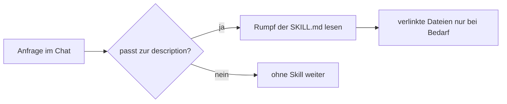

# Was ist eine Skill?

Eine Skill ist ein gespeicherter Ablauf im Repo, den Copilot selbst lädt, sobald eine passende Aufgabe ansteht. Sie ergänzt die Dauerregeln aus Modul 4 um Rezepte für wiederkehrende Aufgaben.

## Leitfragen

<details>
<summary>Ein Team erklärt Copilot jede Woche neu, wie ein neuer Endpoint oder eine neue Prüfregel angelegt wird. Wo sollte dieses Wissen stehen?</summary>

In einer Datei im Repo, die Copilot selbst findet, sobald genau diese Aufgabe ansteht. Genau das ist eine Skill: ein gespeicherter Ablauf, den Copilot bei Bedarf lädt.

</details>

<details>
<summary>Warum nicht einfach jeden Ablauf in <code>copilot-instructions.md</code> schreiben?</summary>

`copilot-instructions.md` wird bei jeder Anfrage mitgeschickt. Lange Abläufe kosten dann Kontext bei Fragen, die nichts damit zu tun haben, und verwässern die Dauerregeln.

</details>

<details>
<summary>Wann lohnt es sich nicht, einen Ablauf aufzuschreiben?</summary>

Bei Einmalaufgaben oder Abläufen ohne feste Reihenfolge. Die Pflege der Datei kostet dann mehr, als sie spart.

</details>

## Was eine Skill ist und was nicht

| Eine Skill ist … | Eine Skill ist nicht … |
| --- | --- |
| ein Ordner mit einer `SKILL.md`: Kopf mit `name` und `description`, darunter ein Ablauf | eine Regelliste, die immer gilt (das sind Instructions, Modul 4) |
| ein Rezept für eine wiederkehrende Aufgabe mit mehreren Schritten | eine einzelne, gespeicherte Chat-Anfrage (das sind Prompt-Dateien, Modul 6) |
| nur aktiv, wenn die Anfrage zur `description` passt | eine Garantie: eine anders formulierte Anfrage kann die Skill verfehlen |
| projektspezifisch: echte Pfade, Muster, Prüfbefehle | allgemeines Wissen, das Copilot ohnehin hat |

## Instructions, Skill oder Prompt-Datei?

| | Instructions (Modul 4) | Skill (dieses Modul) | Prompt-Datei (Modul 6) |
| --- | --- | --- | --- |
| Datei | `.github/copilot-instructions.md`, `*.instructions.md` | `.github/skills/<name>/SKILL.md` | `.github/prompts/<name>.prompt.md` |
| Inhalt | Dauerregeln: Stil, Struktur, Verbote | Rezept: Schritte für eine bestimmte Aufgabe | eine Anfrage mit festem Antwortformat |
| Form | Regelliste | nummerierte Schritte in fester Reihenfolge | Auftragstext mit Variablen |
| Geladen | bei jeder Anfrage (bzw. per `applyTo` für passende Pfade) | nur, wenn die Anfrage zur `description` passt | nur beim Aufruf |
| Wer löst aus | automatisch | Copilot per `description` oder Mensch per `/name` | Mensch per `/name` |
| Beispiel | "Prüffunktionen geben eine Liste deutscher Fehlermeldungen zurück." | "Neuer Validator: Funktion anlegen, Test anlegen, Lint und Tests ausführen." | "Erkläre die markierte Stelle in drei Sätzen." |

Alle wirken zusammen: Die Regeln aus den Instructions gelten auch, während Copilot einer Skill folgt.

## Wann sich eine Skill lohnt

| Kriterium | Lohnt sich | Lohnt sich nicht |
| --- | --- | --- |
| Häufigkeit | kommt regelmäßig wieder (jede neue Aktion, jeder neue Validator) | einmalige Migration |
| Schritte | mehrere Schritte, Reihenfolge zählt | ein einzelner Handgriff |
| Wissen | projektspezifisch: Pfade, Muster, Prüfbefehle | allgemeines Wissen |
| Fehlerbild ohne Skill | mal mit, mal ohne Test; jedes Mal andere Dateiaufteilung | kein wiederkehrender Fehler |

## Eine minimale Skill

Ort und Aufbau, am Beispiel des Fremdprojekts [`sample-project/`](../project/sample-project/):

```text
sample-project/
└── .github/skills/
    └── add-ticket-validator/      # Ordnername = name im Kopf
        └── SKILL.md               # Dateiname exakt in Großbuchstaben
```

```markdown
---
name: add-ticket-validator          # Pflicht: a-z, 0-9, "-"; gleich dem Ordnernamen
description: Legt eine neue Prüffunktion für Ticket-Eingaben samt Test an.
  Verwenden, wenn ein Feld eines Tickets validiert werden soll.   # Pflicht: was + wann
---

# Neuen Ticket-Validator anlegen

1. Funktion `validate<Feld>(value): string[]` in `src/validators.ts` ergänzen.
2. ...
```

Die Kommentare `# …` im Kopf dienen hier nur der Erklärung und gehören nicht in die echte Datei.

| Teil | Regel |
| --- | --- |
| Speicherort | Projekt: `.github/skills/<name>/SKILL.md` (auch `.claude/skills/`, `.agents/skills/`); persönlich: `~/.copilot/skills/` |
| `name` | nur Kleinbuchstaben, Ziffern, Bindestriche, max. 64 Zeichen; muss dem Ordnernamen entsprechen, sonst lädt die Skill ohne Fehlermeldung nicht |
| `description` | was die Skill tut **und** wann sie greift, max. 1024 Zeichen |
| Rumpf | Markdown; nummerierte Schritte mit echten Pfaden und Befehlen |

Weitere, optionale Felder folgen in [Eine eigene Skill schreiben](./02-skill-schreiben.md).

_Stand: 10/2026, Quelle: [VS Code – Agent Skills](https://code.visualstudio.com/docs/copilot/customization/agent-skills)._

## Wie Copilot eine Skill findet und lädt



- Copilot kennt zunächst nur `name` und `description` aller Skills; der Rumpf kostet erst Kontext, wenn er gebraucht wird.
- Skills wirken im Agent-Modus (Modul 2, [Chat und Kontext](../m02-copilot-core-features/02-chat-und-kontext.md)), weil Copilot dort selbst Dateien liest und Befehle ausführt.
- Gefunden: `/` im Chat zeigt Skills zur Auswahl, `/skills` öffnet das Menü "Configure Skills".
- Geladen: Die aufgeklappten Tool-Aufrufe einer Antwort zeigen einen Lesezugriff auf `SKILL.md`.
- Manueller Aufruf: `/add-ticket-validator Titel`.

## Selbst ausprobieren

Im Fremdprojekt [`sample-project/`](../project/sample-project/) (JS/TS) bzw. [`sample-project-python/`](../project/sample-project-python/) (Python), als eigener Ordner in VS Code geöffnet, `npm install` bzw. `uv sync` gelaufen, Chat im Agent-Modus. Wiederkehrende Aufgabe dort: neue Prüfregeln für Felder eines Tickets.

1. Lies `src/validators.ts` und `src/models.ts` (Python: `sample/validators.py`, `sample/models.py`) und notiere, wo eine neue Prüffunktion und ihr Test hingehören.
2. Erstelle `.github/skills/add-ticket-validator/SKILL.md` mit vier Schritten: Funktion, Test, Prüfbefehle, Ergebnis melden (Vorlage unten).
3. Tippe `/` in den Chat und prüfe, ob `add-ticket-validator` in der Liste erscheint.
4. Schreibe, ohne die Skill zu nennen: "Prüfe den Titel eines Tickets: 3 bis 80 Zeichen, nicht nur Leerzeichen." Klappe die Tool-Aufrufe auf.
5. Starte einen neuen Chat und schreibe: "Prüfe das Feld assignee: optional, falls gesetzt eine E-Mail-Adresse."
6. Vergleiche beide Ergebnisse: Ort der Funktion, Rückgabetyp, Tests, ausgeführte Prüfbefehle. Führe danach `npm run lint` und `npm test` aus (Python: `uv run ruff check .`, `uv run pytest`).

<details>
<summary>Vorlage: SKILL.md für beide Stacks</summary>

**JS/TS:** `sample-project/.github/skills/add-ticket-validator/SKILL.md`

```markdown
---
name: add-ticket-validator
description: Legt eine neue Prüffunktion für ein Feld eines Tickets samt Test an, z. B. für Titel, Bearbeiter oder Priorität. Verwenden, wenn ein Ticket-Feld validiert oder eine Eingabe eines Tickets geprüft werden soll.
---

# Neuen Ticket-Validator anlegen

1. **Funktion:** In `src/validators.ts` eine exportierte Funktion `validate<Feld>(value): string[]` ergänzen. Typen aus `src/models.ts` verwenden. Leere Liste = gültig, sonst je Fehler eine deutsche Meldung.
2. **Test:** In `src/validators.test.ts` je Funktion einen Erfolgsfall und einen Fehlerfall mit `node:test` und `node:assert/strict`.
3. **Prüfen:** `npm run lint` und `npm test` ausführen. Erst fertig melden, wenn beides grün ist.
4. **Ergebnis:** Geänderte Dateien und die neuen Funktionsnamen nennen.
```

**Python:** `sample-project-python/.github/skills/add-ticket-validator/SKILL.md`, gleicher Kopf, andere Schritte:

```markdown
1. **Funktion:** In `sample/validators.py` eine Funktion `validate_<feld>(value) -> list[str]` mit Type Hints und Docstring ergänzen. Leere Liste = gültig, sonst je Fehler eine deutsche Meldung.
2. **Test:** In `tests/test_validators.py` je Funktion einen Erfolgsfall und einen Fehlerfall mit `pytest`.
3. **Prüfen:** `uv run ruff check .` und `uv run pytest` ausführen. Erst fertig melden, wenn beides grün ist.
4. **Ergebnis:** Geänderte Dateien und die neuen Funktionsnamen nennen.
```

</details>

<details>
<summary>Erwartete Beobachtung</summary>

- `/` listet `add-ticket-validator` mit der Beschreibung. Fehlt der Eintrag: Ordnername ≠ `name`, Datei heißt nicht exakt `SKILL.md`, der `---`-Block ist nicht geschlossen, oder der geöffnete Workspace-Ordner liegt eine Ebene über `sample-project`.
- Schritt 4 zeigt in den Tool-Aufrufen einen Lesezugriff auf `.github/skills/add-ticket-validator/SKILL.md`, danach Änderungen an Validator- und Testdatei und einen Terminal-Aufruf von Lint und Tests.
- Beide Validatoren folgen derselben Struktur, obwohl sie in getrennten Chats entstanden sind:

| Merkmal | `validateTitle` / `validate_title` | `validateAssignee` / `validate_assignee` |
| --- | --- | --- |
| Ort der Funktion | Validator-Datei | Validator-Datei |
| Rückgabe | `string[]` / `list[str]`, leer = gültig | `string[]` / `list[str]`, leer = gültig |
| Tests | 1 Erfolgsfall, 1 Fehlerfall | 1 Erfolgsfall, 1 Fehlerfall, in derselben Testdatei |
| Prüfbefehle | Lint + Tests ausgeführt | Lint + Tests ausgeführt |

- Prüfbefehle danach: `npm test` → `ℹ tests 5`, `ℹ pass 5`; `uv run pytest -q` → `5 passed` (vorhandener Test plus vier neue). Meldungen und Testnamen unterscheiden sich je Lauf; entscheidend ist die gleiche Struktur.
- Lädt Copilot die Skill nicht automatisch: direkt mit `/add-ticket-validator Titel 3 bis 80 Zeichen` aufrufen. Damit ist der Ablauf testbar, die automatische Auswahl über die `description` aber nicht.
- Gegenprobe: Ordner vorübergehend in `_add-ticket-validator` umbenennen und im neuen Chat einen dritten Validator anfordern. Das Ergebnis weicht typischerweise in mindestens einem Merkmal ab (Rückgabe `boolean`, `throw` statt Fehlerliste, kein Test). Danach den Namen wiederherstellen.

</details>

## Fazit

- Instructions sind Dauerregeln, eine Skill ist ein Rezept für eine wiederkehrende Aufgabe mit festen Schritten.
- Eine Skill liegt als Ordner unter `.github/skills/`; `name` entspricht dem Ordnernamen, `description` sagt was und wann.
- Ob eine Skill greift, zeigen das `/`-Menü und der Lesezugriff auf `SKILL.md` in den Tool-Aufrufen.

Als Nächstes bekommt FocusList eine eigene Skill für neue Aktionen: [Eine eigene Skill schreiben](./02-skill-schreiben.md).
