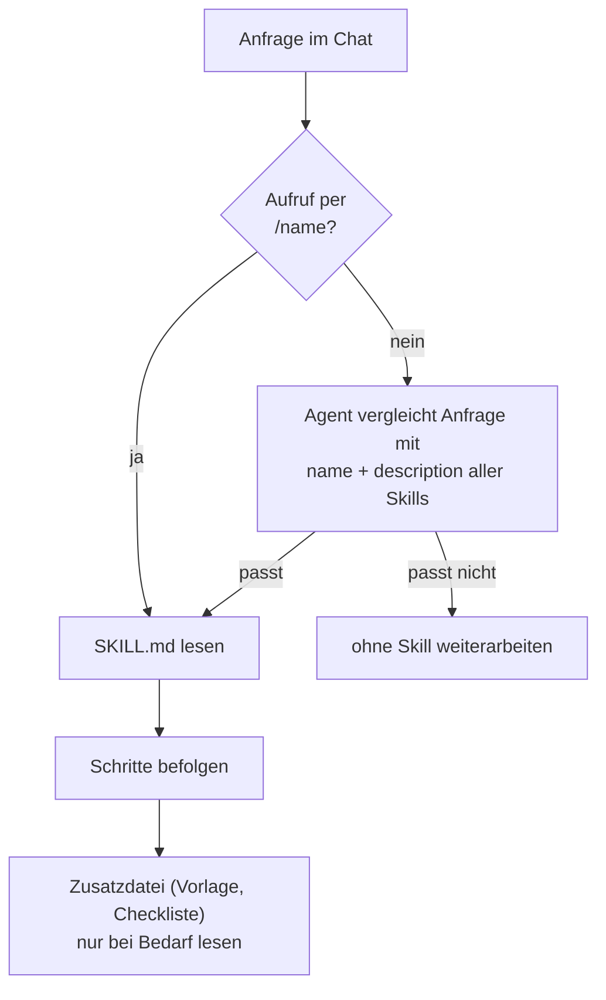

# Lab 5.1: Was ist ein Skill

**Leitfragen:**

<details>
<summary>Welche Aufgaben erledigt man im Projekt jede Woche auf dieselbe Art?</summary>

Tests für neuen Code schreiben, Sicherheit vor dem Merge prüfen, PR-Beschreibungen formulieren, Abhängigkeiten prüfen. Genau diese Abläufe gehören in Skills.

</details>

<details>
<summary>Warum nicht alles in die Instructions schreiben?</summary>

Instructions werden bei jeder Anfrage mitgeschickt. Eine 80-zeilige Testanleitung belegt dann auch beim Ändern einer Tailwind-Klasse Platz im Kontextfenster und verwässert die wichtigen Regeln. Ein Skill lädt nur, wenn er gebraucht wird.

</details>

<details>
<summary>Woran soll ein Agent erkennen, dass eine Anleitung gerade passt?</summary>

An der `description` im Frontmatter: Diese sagt, was der Skill tut und wann er einzusetzen ist. Der Agent vergleicht den Text mit der Anfrage. Alternativ ruft man den Skill direkt mit `/<name>` auf.

</details>

- Skill = Ordner mit `SKILL.md` und optionalen Zusatzdateien (Vorlagen, Checklisten, Skripte).
- Instructions sind immer im Kontext, ein Skill nur bei Bedarf: automatisch über die `description` oder per `/<name>`.
- Im Copilot-Harness übernehmen Skills die Rolle der Prompt-Dateien, die nur noch im Local-Harness laden (Lab 2.2).
- Das Format ist ein offener Standard: dieselbe `SKILL.md` funktioniert in Copilot, Claude Code und Codex.

## Begriffe

| Begriff | Bedeutung |
| --- | --- |
| Skill | Ordner mit einer Anleitung (`SKILL.md`) für eine wiederkehrende Aufgabe, die der Agent bei Bedarf lädt |
| `SKILL.md` | Hauptdatei eines Skills: Frontmatter (`name`, `description` …) plus Anleitung in Markdown |
| Frontmatter | Block zwischen `---`-Zeilen am Dateianfang mit Feldern im YAML-Format |
| Zusatzdatei | Vorlage, Checkliste oder Skript im Skill-Ordner, per relativem Link aus `SKILL.md` erreichbar |
| Laden bei Bedarf | Agent kennt zunächst nur `name` und `description` aller Skills und liest `SKILL.md` erst, wenn sie passt |

## Das Bild: Rezeptkarte statt Kochbuch

Instructions (Lab 4.1) sind die Hausordnung der Küche: hängt immer an der Wand, gilt für alles. Ein Skill ist eine Rezeptkarte im Kasten: Auf dem Kartenrücken steht nur der Titel und wofür das Rezept gut ist. Erst wenn jemand „Kuchen backen“ will, wird genau diese Karte gezogen und Schritt für Schritt befolgt.

| | Instructions (`AGENTS.md`, `*.instructions.md`) | Skill (`.github/skills/<name>/`) |
| --- | --- | --- |
| Inhalt | Regeln: Stack, Struktur, Konventionen, Verbote | Ablauf: Schritte, Vorlage, Abnahmekriterium |
| Geladen | bei jeder Anfrage (bzw. per `applyTo` für passende Dateien) | nur wenn `description` passt oder per `/<name>` |
| Umfang | kurz, max. ca. 40 Zeilen | darf länger sein, plus Zusatzdateien |
| Frage | Was muss der Agent immer wissen? | Wie erledigt man diese Aufgabe? |
| Beispiel | „Tests mit pytest, Fixtures aus `conftest.py`“ | „Tests schreiben: Code lesen → Fälle ableiten → Vorlage → ausführen → reparieren“ |

## Aufbau eines Skills

```text
.github/skills/
└── test-writer/              # Ordnername = name im Frontmatter
    ├── SKILL.md              # Pflicht: Frontmatter + Anleitung
    └── test-template.py      # optional: Vorlage, per Link eingebunden
```

Minimales `SKILL.md`:

```markdown
---
name: test-writer
description: Schreibt pytest-Tests für FocusList nach fester Vorlage mit Normalfall, Grenzfall und Fehlerfall und führt sie aus. Verwenden, wenn Tests geschrieben, ergänzt oder repariert werden sollen.
---

# Skill: test-writer

1. Code lesen ...
2. Fälle ableiten ...
3. Test nach [Vorlage](./test-template.py) schreiben ...
```

## Frontmatter

Stand: 11/2026. Quelle: [Agent skills](https://code.visualstudio.com/docs/agent-customization/agent-skills)

| Feld | Pflicht | Bedeutung |
| --- | --- | --- |
| `name` | ja | Kleinbuchstaben, Ziffern, Bindestrich (`a-z0-9-`), max. 64 Zeichen, **gleich dem Ordnernamen** |
| `description` | ja | max. 1024 Zeichen: **was** der Skill tut und **wann** er einzusetzen ist; Grundlage für das automatische Laden |
| `argument-hint` | nein | Hinweis im Eingabefeld beim Aufruf per `/<name>`, z. B. `"[Route oder Datei]"` |
| `user-invocable` | nein | Default `true`; `false` blendet den Skill im `/`-Menü aus, der Agent kann ihn weiter automatisch laden |
| `disable-model-invocation` | nein | Default `false`; `true` verhindert das automatische Laden, nur noch Aufruf per `/<name>` |

## Wie ein Skill geladen wird



| Aufruf | Wann sinnvoll |
| --- | --- |
| `/test-writer GET /api/tasks` | Skill soll sicher laufen, Argument direkt mitgeben |
| „Schreib Tests für das Löschen“ | Alltag: Agent erkennt über die `description`, dass `test-writer` passt |


_Quelle: VS Code Release Notes 1.107 (https://code.visualstudio.com/updates/v1_107), Microsoft, CC BY 3.0 US, abgerufen am 07.11.2026._

Automatisches Laden im Chat-Verlauf: Der Agent begründet, warum der Skill passt, und liest erst dann `SKILL.md`.

Im Copilot-Harness zeigt `/` im Eingabefeld die verfügbaren Skills.

## Wo Skills liegen

Stand: 11/2026. Quellen: [Agent skills](https://code.visualstudio.com/docs/agent-customization/agent-skills), [Agent harnesses](https://code.visualstudio.com/docs/agents/run/agent-harnesses)

| Werkzeug | Projekt (mit dem Repo geteilt) | persönlich (alle Projekte) |
| --- | --- | --- |
| GitHub Copilot | `.github/skills/<name>/SKILL.md` | `~/.copilot/skills/<name>/SKILL.md` |
| Claude Code | `.claude/skills/<name>/SKILL.md` | – (im Kurs nicht behandelt) |
| OpenAI Codex | `.agents/skills/<name>/SKILL.md` | – (im Kurs nicht behandelt) |


_Quelle: VS Code Docs, Agent skills (https://code.visualstudio.com/docs/agent-customization/agent-skills), Microsoft, CC BY 3.0 US, abgerufen am 07.11.2026._

Projekt-Skills erscheinen in VS Code unter **Workspace**, persönliche unter **User**.

Gleiche Idee, andere Ordner, wie in der Landkarte aus Lab 1.3. Projekt-Skills gehören ins Repo, damit das ganze Team denselben Ablauf nutzt. Persönliche Skills eignen sich für eigene Gewohnheiten, die nicht ins Team-Repo sollen.

## Offener Standard und Prompt-Dateien

- Anthropic führte Agent Skills im Okt 2025 ein; seit Dez 2025 ist das Format ein offener Standard ([agentskills.io](https://agentskills.io)). Andere Werkzeuge haben es übernommen, deshalb unterscheiden sich vor allem die Ordner.
- Prompt-Dateien (`.github/prompts/*.prompt.md`) laden nur im Local-Harness (Lab 2.2). Im Copilot-Harness übernimmt ein Skill ihre Rolle; zur Migration bietet VS Code „Convert Prompt to Skills“ ([Migrate customizations](https://code.visualstudio.com/docs/agent-customization/migrate-customizations), Stand: 11/2026).

## Regel oder Ablauf? Die Python-Funde aus Lab 3.3 sortiert

Hinter den Zeilen der Status-quo-Liste stehen Einzelfunde (Lab 3.3, „Mängel im Referenzstand v0“). Sie sind Regeln, Abläufe oder etwas anderes. Zuordnung der Python-Funde:

| # | Eintrag (kurz) | Art | Wohin |
| --- | --- | --- | --- |
| 1 | leerer Titel, Priorität ungeprüft | Ablauf (Prüfung) | `security-checker` |
| 2 | ID per `len(tasks) + 1` | Regel | `AGENTS.md` (erledigt in m04) |
| 3 | `?created=` mit `\|safe` | Ablauf (Prüfung) | `security-checker` |
| 4 | Logik mal in Route, mal im Store | Regel | `AGENTS.md` (erledigt in m04) |
| 5 | `secret_key = "dev"` | Ablauf (Prüfung) | `security-checker` |
| 6 | unbekannte ID → stiller Redirect statt 404 | Regel | `AGENTS.md` (erledigt in m04) |
| 7 | Filter doppelt und unterschiedlich | Regel | `AGENTS.md` (erledigt in m04) |
| 8 | `?status=all` liefert in der API nur offene | Regel (eine Filterfunktion) | `AGENTS.md` (erledigt in m04) |
| 9 | `app.run(debug=True)` | Ablauf (Prüfung) | `security-checker` |
| 10 | Farben und Namen getrennt | Regel | `templates.instructions.md` |
| 11 | feste Breiten, nicht auf Handybreite | anderes | Browser-Prüfung (m07) |
| 12 | Fußzeile zählt nur gefilterte Aufgaben | anderes (fachlich offen) | Spec (m08) |
| 13 | keine neuen Tests | Ablauf | `test-writer` |

Daraus entstehen zwei Skill-Kandidaten:

| Name | `description` |
| --- | --- |
| `test-writer` | Schreibt Tests nach fester Vorlage mit Normalfall, Grenzfall und Fehlerfall und führt sie aus. Verwenden, wenn Tests geschrieben, ergänzt oder repariert werden sollen oder eine neue Route ohne Tests entstanden ist. |
| `security-checker` | Prüft die App anhand einer Checkliste auf XSS, fehlende Validierung, Secrets im Code, Debug-Modus und Pfade aus Nutzereingaben und liefert einen Bericht. Ändert keinen Code. Verwenden vor einem Merge oder bei Fragen zur Sicherheit. |

Beide Skills entstehen in Lab 5.2 und 5.3. Zeilen wie „Tests laufen lassen“ sind Regeln oder später Hooks, keine Skills: Es gibt dort keinen mehrstufigen Ablauf.

## Fazit

- Regeln gehören in Instructions, Abläufe in Skills.
- Die `description` entscheidet, ob ein Skill automatisch greift: „was“ und „wann“ konkret benennen.
- Projekt-Skills liegen in `.github/skills/<name>/SKILL.md`, Ordnername = `name`.
