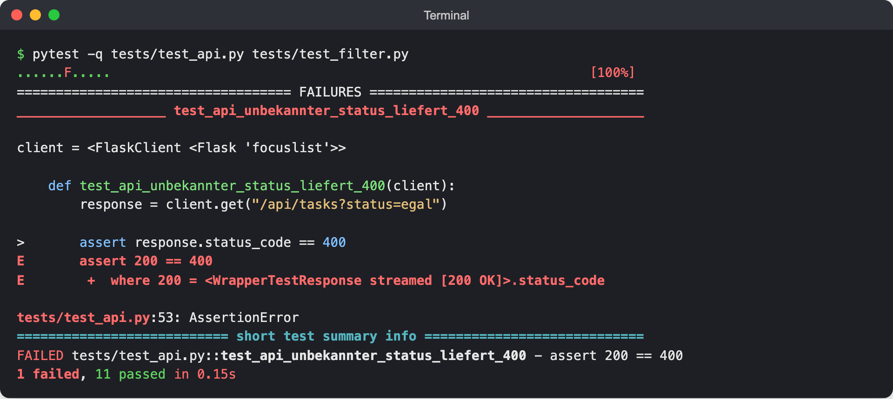
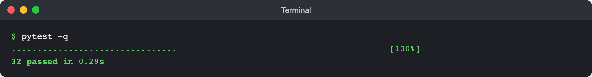

# Lab 5.2: Skill `test-writer`

**Leitfragen:**

<details>
<summary>Was unterscheidet einen nützlichen Test von einem, der nur grün ist?</summary>

Ein nützlicher Test wird rot, wenn das geprüfte Verhalten kaputtgeht. `assert response.status_code == 200` bleibt auch grün, wenn die Seite die falschen Aufgaben zeigt; erst die Prüfung von Text, JSON oder gespeicherten Daten macht den Test wertvoll.

</details>

<details>
<summary>Welche Fälle vergisst man beim Testen am häufigsten?</summary>

Grenzfälle (genau 100 Zeichen, leere Liste, letzte Aufgabe) und Fehlerfälle (leerer Titel, unbekannte ID, unbekannter Filter). Getestet wird meist nur der Normalfall, der beim Entwickeln ohnehin funktioniert hat.

</details>

<details>
<summary>Wie kann man prüfen, ob ein Test überhaupt etwas prüft?</summary>

Mit der Gegenprobe: die geprüfte Zeile im Code kurz ändern oder auskommentieren. Bleibt der Test grün, prüft er nichts und muss geschärft werden.

</details>

- Ein guter Skill hat drei Teile: **wann einsetzen**, **Schritte**, **Abnahmekriterium**.
- `test-writer` folgt immer demselben Ablauf: Code lesen → Fälle ableiten (Normal, Grenz, Fehler) → Test nach Vorlage → ausführen → bei Rot reparieren.
- Die Vorlage liegt als Zusatzdatei im Skill-Ordner und wird per relativem Link eingebunden.
- Ein Test, der einen echten Fehler im Code findet, wird nicht passend gemacht, sondern gemeldet.

## Begriffe

| Begriff | Bedeutung |
| --- | --- |
| Normalfall | gültige, typische Eingabe mit erwartetem Ergebnis |
| Grenzfall | Eingabe genau am Rand einer Regel (1 und 100 Zeichen, leere Liste, Filter `all`) |
| Fehlerfall | ungültige Eingabe oder unbekannte ID; erwartet: Fehlercode und nichts gespeichert |
| Gegenprobe | Code absichtlich ändern und prüfen, ob der Test rot wird |
| Abnahmekriterium | beobachtbare Bedingung, wann der Skill seine Aufgabe erfüllt hat |

## Was einen guten Skill ausmacht

| Teil | Zweck | Schlecht | Gut |
| --- | --- | --- | --- |
| `description` | Agent erkennt, wann der Skill passt | „Hilft bei Tests.“ | „Schreibt pytest-Tests … Verwenden, wenn Tests geschrieben, ergänzt oder repariert werden sollen …“ |
| Wann einsetzen | Grenzen klar machen | fehlt | Liste der Anlässe plus „nicht einsetzen für …“ |
| Schritte | jedes Mal gleicher Ablauf | „Schreib gute Tests.“ | nummeriert, mit Dateien, Befehlen, Entscheidungsregeln |
| Vorlage | gleiches Aussehen aller Tests | im Text beschrieben | eigene Datei, per Link eingebunden |
| Abnahmekriterium | wann fertig | „alles grün“ | Fälle vollständig, mehr als Statuscode geprüft, Daten unverändert |
| Bericht | Ergebnis vergleichbar machen | freier Text | festes Format |

## Die echte Datei: Python

Gekürzter Auszug aus `project/focuslist/python/steps/m05/.github/skills/test-writer/SKILL.md` (vollständig dort, samt „Wann einsetzen“ und „Bericht“):

````markdown
---
name: test-writer
description: Schreibt pytest-Tests für FocusList (Routen, API, Filter, Fachlogik in focuslist/tasks.py) nach fester Vorlage mit Normalfall, Grenzfall und Fehlerfall und führt sie aus. Verwenden, wenn Tests geschrieben, ergänzt oder repariert werden sollen oder eine neue Route ohne Tests entstanden ist.
argument-hint: "[Route, Datei oder Funktion, z. B. /api/tasks]"
---

## Schritte
1. **Code lesen.** Route in `focuslist/routes.py`, Funktion in `focuslist/tasks.py`: Eingaben, Ausgaben, Seiteneffekte.
2. **Fälle ableiten.** Normalfall, Grenzfall (1 und 100 Zeichen, leere Liste), Fehlerfall (leerer Titel → 400, ID 999 → 404). Vorher als Liste ausgeben.
3. **Test nach Vorlage schreiben.** Aufbau aus [test-template.py](./test-template.py), Fixtures `client` und `app` aus `tests/conftest.py`.
4. **Ausführen.** `pytest -q` im Projektordner.
5. **Bei Rot reparieren.** Test falsch → korrigieren. Code falsch → Test NICHT anpassen, Fehler im Bericht melden.
6. **Berichten.** Format unten.

## Abnahmekriterium
- Jede betroffene Route hat Normal-, Grenz- und Fehlerfall.
- Jeder Test prüft mehr als nur den Statuscode (Text, JSON oder gespeicherte Daten).
- `pytest -q` ist komplett grün, `data/tasks.json` ist unverändert.
````

Die Vorlage `test-template.py` im selben Ordner zeigt je ein Beispiel pro Fall im Aufbau „vorbereiten → ausführen → prüfen“, hier der Fehlerfall:

```python
# Fehlerfall: ungültige Eingabe oder unbekannte ID
def test_unbekannte_id_liefert_404(client):
    response = client.post("/tasks/999/complete")

    assert response.status_code == 404
```

## Node.js: Unterschiede

`project/focuslist/node/steps/m05/.github/skills/test-writer/` hat denselben Aufbau mit `SKILL.md` und `test-template.js`.

| Stelle | Python | Node.js |
| --- | --- | --- |
| Testwerkzeug | pytest | `node:test` |
| Code lesen | `focuslist/routes.py`, `focuslist/tasks.py` | `src/`, zusätzlich vorhandene Tests in `test/` |
| Testdatei | `tests/test_<thema>.py` | `test/<bereich>.test.js`, bestehende Datei ergänzen |
| Testdaten | Fixtures aus `tests/conftest.py` | `startTestServer()` aus `test/helpers.js` (eigene Datenkopie, `postForm()`, `readTasks()`) |
| Ausführen | `pytest -q` | `npm test` |

## Typische Fehler

| Symptom | Ursache | Lösung |
| --- | --- | --- |
| `/test-writer` erscheint nicht im `/`-Menü | `name` im Frontmatter ≠ Ordnername, Datei heißt nicht exakt `SKILL.md` oder liegt nicht in `.github/skills/<name>/` | Ordner und `name` angleichen, Dateinamen prüfen, neue Chat-Sitzung starten |
| Skill greift ohne `/` nie | `description` zu vage („Hilft bei Tests“), kein „wann“ | Anlässe in die `description` schreiben: „Verwenden, wenn Tests geschrieben, ergänzt oder repariert werden sollen …“ |
| Vorlage wird ignoriert | Link fehlt oder ist absolut | relativer Link `[test-template.py](./test-template.py)` im Schritt, in dem sie gebraucht wird |
| Tests grün, prüfen aber nichts | nur `status_code == 200` | Abnahmekriterium „mehr als Statuscode“, Gegenprobe machen |
| roter Test wird „repariert“, indem die Erwartung an den falschen Code angepasst wird | Skill sagt nicht, was bei Rot passiert | Schritt „Bei Rot reparieren“ mit Regel: Code falsch → melden, Test bleibt |
| `data/tasks.json` hat nach dem Testlauf neue Einträge | Test schreibt in die echte Datei | Fixtures `app`/`client` bzw. `startTestServer()` nutzen |

## Übung

**Dauer:** ca. 35 Minuten · **Start:** Arbeitsordner für Tag 2 anlegen: v1 mit `node project/focuslist/catch-up.mjs <python|node> m05 $HOME/kurs/focuslist-m05`, danach Setup laut `README.md` des Stands (venv und `pip install -r requirements.txt` bei Python, `npm install`, `npm run build:css`) und dort weiterarbeiten · **Referenz:** `project/focuslist/<stack>/steps/m05/.github/skills/test-writer/`

1. Lege `.github/skills/test-writer/SKILL.md` an: Frontmatter (`name`, `description` mit „was“ und „wann“, `argument-hint`) und die Abschnitte „Wann einsetzen“, „Schritte“, „Abnahmekriterium“, „Bericht“.
2. Schreibe daneben die Vorlage `test-template.py` bzw. `test-template.js` mit je einem Beispiel für Normal-, Grenz- und Fehlerfall und verlinke sie relativ in Schritt 3 der Anleitung.
3. Öffne eine neue Chat-Sitzung, wähle **Agent** und rufe `/test-writer GET /api/tasks und Filter ?status= für / und /api/tasks` auf. Lies die Fall-Liste, bevor Tests entstehen.
4. Prüfe die geänderten Dateien (nur unter `tests/` bzw. `test/`) und nimm sie mit **Keep** an.
5. Öffne eine weitere neue Sitzung und sende ohne `/`: „Schreib Tests für das Löschen von Aufgaben.“ Beobachte, ob der Skill automatisch greift.

**Checkpoint:** `test-writer` steht im `/`-Menü; neue Testdateien für API und Filter existieren; der Bericht nennt Normal-, Grenz- und Fehlerfälle; in der Sitzung ohne `/` erscheint derselbe Bericht im Skill-Format.

<details>
<summary>Lösungsweg</summary>

**Zu 3, erwartete Fall-Liste (Python, gekürzt):**

```text
GET /api/tasks
- Normal: ohne Filter alle 3 Aufgaben mit Feldern id, title, priority, done
- Normal: ?status=open → IDs 1, 2 · ?status=done → ID 3
- Grenz: ?status=all = alle · leere Liste → []
- Fehler: ?status=egal → 400 mit Fehlermeldung
GET /?status=
- Normal: open zeigt nur offene · Grenz: done ohne Treffer → „Keine Aufgaben vorhanden.“
```

Ergebnis aus der Referenz (`tests/test_api.py`, Auszug; Node.js analog in `test/api.test.js`):

```python
def test_api_filter_open(client):
    response = client.get("/api/tasks?status=open")

    tasks = response.get_json()
    assert [t["id"] for t in tasks] == [1, 2]
    assert all(t["done"] is False for t in tasks)


def test_api_unbekannter_status_liefert_400(client):
    response = client.get("/api/tasks?status=egal")

    assert response.status_code == 400
    assert "error" in response.get_json()
```

**Erwartete Ausgabe auf v1:** Der Fehlerfall „unbekannter Status → 400“ ist rot, weil v1 stillschweigend alle Aufgaben liefert. Der Skill passt den Test nicht an, sondern meldet:


_Quelle: eigener Screenshot, FocusList v1, 07.11.2026._

```text
Tests für: GET /api/tasks, GET /?status=
Neue Tests: 12 in tests/test_api.py, tests/test_filter.py
Fälle: Normal 5 · Grenz 4 · Fehler 3
pytest: 1 failed, 16 passed
Gefundene Fehler im Code: focuslist/routes.py:46 – unbekannter Status wird nicht abgelehnt
```

Zahlen weichen je nach Lauf ab. In der Referenz `steps/m05` ist der Fund bereits behoben (Lab 5.3), dort laufen alle Tests grün (Python `32 passed`, Node.js `tests 23 · pass 23`).


_Quelle: eigener Screenshot, FocusList v2, 07.11.2026._

**Zu 5:** Im Chat-Verlauf ist zu sehen, dass der Agent `SKILL.md` von `test-writer` liest (Darstellung je nach VS-Code-Version, Stand: 11/2026). Er ergänzt Tests für das Löschen (z. B. letzte Aufgabe löschen, unbekannte ID) und schließt mit dem Bericht im festen Format. Greift der Skill nicht: `description` um „Verwenden, wenn Tests geschrieben … werden sollen“ ergänzen und eine neue Sitzung starten.

</details>

## Fazit

- Ein Skill wirkt, wenn `description`, Schritte und Abnahmekriterium konkret sind.
- Normal-, Grenz- und Fehlerfall plus Gegenprobe machen aus grünen Tests nützliche Tests.
- Ein roter Test, der einen echten Fehler zeigt, ist ein Fund und wird gemeldet, nicht angepasst.
