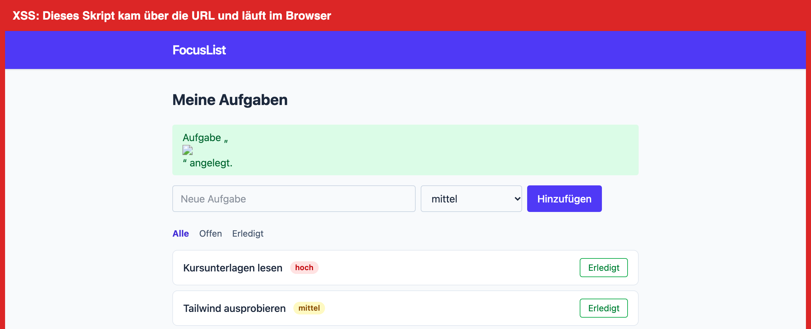
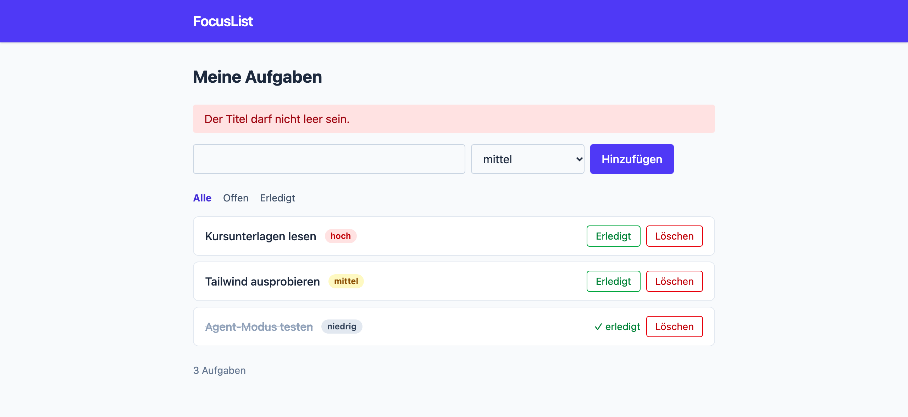

# Lab 5.3: Skill `security-checker`

**Leitfragen:**

<details>
<summary>Was kann passieren, wenn jemand <code>&lt;script&gt;</code> als Aufgabentitel einträgt?</summary>

Wird der Titel ungeschützt ins HTML geschrieben, führt der Browser das Skript bei jedem Aufruf der Liste aus (Stored XSS). Es kann Inhalte verändern, Eingaben mitlesen oder Anfragen im Namen der Person abschicken. Escaping macht daraus harmlosen Text `&lt;script&gt;`.

</details>

<details>
<summary>Welche Sicherheitsfragen stellt man in einem Code-Review?</summary>

Wird jede Ausgabe escaped? Wird jede Eingabe im Server geprüft? Stehen Secrets im Code? Entsteht ein Dateipfad aus Nutzereingaben? Gibt es Größenlimits? Kommen neue Abhängigkeiten dazu? Die Checkliste des Skills hält genau diese Fragen fest.

</details>

<details>
<summary>Warum soll ein Prüf-Skill lieber berichten als selbst ändern?</summary>

Jede Korrektur soll bewusst entschieden, einzeln geprüft und mit einem Test abgesichert werden. Ein Prüfer, der nebenbei repariert, vermischt Befund und Änderung; niemand sieht mehr, was gefunden und was geändert wurde.

</details>

- Der Skill arbeitet eine feste Checkliste ab, eine Auswahl aus den OWASP Top 10 für kleine Web-Apps.
- Ergebnis ist ein Bericht mit Befund, Datei und Zeile, Schwere und Status; der Skill ändert keinen Code.
- Behoben wird danach in eigenen Schritten, jeder Fix bekommt einen Test (Skill `test-writer` aus Lab 5.2).
- Die Technik ist dieselbe wie bei `test-writer`: `description`, Schritte, Zusatzdatei, festes Ausgabeformat.

## Begriffe

| Begriff | Bedeutung |
| --- | --- |
| OWASP Top 10 | Liste der zehn häufigsten Risikoklassen in Web-Apps, gepflegt vom Open Worldwide Application Security Project; aktuelle Ausgabe 2025 ([owasp.org/Top10](https://owasp.org/Top10/)) |
| XSS (Cross-Site Scripting) | eingeschleustes JavaScript, das im Browser anderer läuft; stored (aus gespeicherten Daten, z. B. `data/tasks.json`) oder reflected (aus der URL) |
| Escaping | Sonderzeichen wie `<`, `>`, `"` in HTML-Entities umwandeln, damit sie als Text erscheinen |
| Validierung | Eingaben im Server gegen feste Regeln prüfen (Länge, erlaubte Werte), sonst ablehnen |
| Whitelist | Liste der erlaubten Werte; alles andere wird abgelehnt |
| Path Traversal | Zugriff auf Dateien außerhalb eines Ordners über Pfade wie `../` |
| Body-Limit | maximale Größe einer Anfrage; größere Anfragen werden mit 413 abgelehnt |
| CSRF | fremde Seite schickt Formulare im Namen eingeloggter Nutzer ab |


_Quelle: Wikimedia Commons, „Cross-Site Scripting (XSS).png“ (https://commons.wikimedia.org/wiki/File:Cross-Site_Scripting_(XSS).png), Batka savemazaalai, CC BY-SA 4.0, abgerufen am 07.11.2026._

Stored XSS: Das Skript liegt in den gespeicherten Daten und läuft bei jedem, der die Seite öffnet. In FocusList entspricht der Kommentar einem Aufgabentitel in `data/tasks.json`.

## Die Checkliste

| Punkt | OWASP-Klasse | Frage | FocusList-Beispiel |
| --- | --- | --- | --- |
| Ausgabe escapen | A05 Injection | Landet ein Nutzerwert roh im HTML? | Python: `\|safe`; Node.js: `${task.title}` |
| Eingaben validieren | A05, A06 Insecure Design | Prüft der Server Länge und erlaubte Werte? | leerer Titel, `priority=urgent` |
| Keine Secrets im Code | A04, A02 Security Misconfiguration | Stehen Schlüssel oder Passwörter im Code? | `app.secret_key = "dev"` |
| Debug und Konfiguration | A02 | Ist ein Debug-Modus fest eingeschaltet? | `app.run(debug=True)` |
| Pfade nicht aus Nutzereingaben | A01 Broken Access Control | Entsteht ein Dateipfad aus der URL? | Node.js: `/static/../package.json` |
| Größenlimits | A06 | Wird der Body unbegrenzt gelesen? | Node.js: `readBody()` ohne Limit |
| Abhängigkeiten | A03 Software Supply Chain Failures | Nur nötige Pakete, regelmäßig geprüft? | `pip-audit`, `npm audit` empfehlen |
| CSRF (Hinweis) | A01 | Ändern Formulare Daten ohne Token? | ohne Login: bewusst offen |

Nummern nach OWASP Top 10:2025. Ältere Quellen nutzen die Ausgabe 2021 mit anderer Nummerierung:


_Quelle: OWASP Top 10:2025, Introduction (https://top10.owasp.org/2025/0x00_2025-Introduction/), OWASP Top 10 Team, CC BY 3.0, abgerufen am 07.11.2026._

## Die echte Datei: Python

Gekürzter Auszug aus `project/focuslist/python/steps/m05/.github/skills/security-checker/SKILL.md` (vollständig dort, samt Berichtsformat):

````markdown
---
name: security-checker
description: Prüft FocusList auf typische Sicherheitslücken in Web-Apps (XSS, fehlende Validierung, Secrets im Code, Debug-Modus, Pfade aus Nutzereingaben, Abhängigkeiten, CSRF) anhand einer Checkliste und liefert einen Bericht. Ändert keinen Code. Verwenden für Sicherheits-Reviews, vor einem Merge oder wenn nach Sicherheitsproblemen gefragt wird.
argument-hint: "[Datei, Ordner oder leer für das ganze Projekt]"
---

Findet Sicherheitsprobleme und berichtet sie. **Ändert keine Datei.**

## Schritte
1. **Umfang klären.** Ohne Argument: `focuslist/`, `tests/`, Projektdateien im Wurzelordner.
2. **Checkliste abarbeiten.** Jeden Punkt aus [checklist.md](./checklist.md) im Code nachsehen, nicht aus dem Gedächtnis urteilen.
3. **Befunde belegen.** Datei und Zeile, kurzes Zitat, warum es ein Problem ist.
4. **Schwere festlegen.** hoch: direkt ausnutzbar · mittel: unter Bedingungen · niedrig: Härtung
5. **Bericht ausgeben:** Tabelle Befund · Datei · Schwere · Status (im ersten Bericht immer `offen`).

## Was der Skill nicht tut
- Keine Änderungen am Code, auch keine „kleinen“ Reparaturen nebenbei. Keine Secrets ausgeben.
````

`checklist.md` im selben Ordner, Abschnitt 1:

```markdown
## 1. Ausgabe escapen (XSS)

- [ ] Jinja2-Autoescaping ist aktiv (Templates enden auf `.html`, kein ``).
- [ ] Kein `|safe`, kein `Markup(...)`, kein `render_template_string` mit Nutzerdaten.
- [ ] Probe: Titel `<script>alert(1)</script>` anlegen; im HTML muss `&lt;script&gt;` stehen.
```

## Node.js: Unterschiede

`project/focuslist/node/steps/m05/.github/skills/security-checker/` hat denselben Aufbau.

| Stelle | Python | Node.js |
| --- | --- | --- |
| zusätzlicher Schritt | – | „Datenfluss verfolgen“: für jede Route in `src/app.js` Herkunft und Ziel der Eingaben |
| typische Funde | Reflected XSS über `?created=`, Secret, Debug-Modus, Validierung | Stored und Reflected XSS, Path Traversal, Validierung, Body-Limit |
| Reparaturen | `flash()`, `FOCUSLIST_SECRET`, `run.py` entfernt, `validate()` | `escapeHtml()`, `safePath()`, `validateTask()`, `readBody()` mit 10 KB |
| Tests | `tests/test_security.py` | `test/security.test.js` |


_Quelle: Wikimedia Commons, „Directory traversal.png“ (https://commons.wikimedia.org/wiki/File:Directory_traversal.png), hacktips.it, CC BY-SA 4.0, abgerufen am 07.11.2026._

Path Traversal (Beschriftung italienisch: „Eingabe der Zeichen ../ im Pfad, um den Wurzelordner zu erreichen“). In FocusList (Node.js) ist `static/` der erlaubte Ordner, das Ziel etwa `data/tasks.json`.

## Beispielbericht

Auszug aus `project/focuslist/python/steps/m05/docs/security-report.md`, erstellt mit `/security-checker` auf v1, Status nach der Reparatur ergänzt (Node.js: `project/focuslist/node/steps/m05/docs/security-report.md`):

| Befund | Datei | Schwere | Status |
| --- | --- | --- | --- |
| Reflected XSS: `?created=` aus der URL wird mit `\|safe` ins HTML geschrieben. | `focuslist/templates/index.html:14` | hoch | behoben: Hinweis per `flash()` (`test_titel_wird_escaped`, absichtlich schwach: prüft nur `GET /`; das findet der Reviewer in Lab 6.2) |
| Secret im Code: `app.secret_key = "dev"`. | `focuslist/__init__.py:13` | hoch | behoben: `FOCUSLIST_SECRET` aus der Umgebung (`test_secret_kommt_aus_umgebung`) |
| Debug-Modus im Code: `app.run(debug=True)`. | `run.py:6` | hoch | behoben: `run.py` entfernt (`test_debug_ist_standardmaessig_aus`) |
| Keine Validierung des Titels: leere und beliebig lange Titel werden gespeichert. | `focuslist/routes.py:22` | mittel | behoben: `tasks.validate()`, 1–100 Zeichen, 400 (`test_ungueltiger_titel_liefert_400`) |
| Kein CSRF-Schutz für die POST-Formulare. | `focuslist/templates/index.html` | mittel | offen (bewusst): kein Login in FocusList |
| Abhängigkeiten nicht geprüft. | `requirements.txt` | niedrig | offen: `pip-audit` regelmäßig ausführen |


_Quelle: eigener Screenshot, FocusList v0, 07.11.2026._

Der erste Befund im Browser: Das Skript aus `?created=` läuft (Aufnahme auf v0; in v1 steht dieselbe Zeile mit `|safe` noch im Template).


_Quelle: eigener Screenshot, FocusList v2, 07.11.2026._

Nach der Reparatur: Ein Titel nur aus Leerzeichen kommt am HTML-Attribut `required` vorbei, `validate()` lehnt ihn im Server nach `strip()` ab. Den Code aller Reparaturen enthält `project/focuslist/<stack>/steps/m05/`.

## Typische Fehler

| Symptom | Ursache | Lösung |
| --- | --- | --- |
| Skill repariert „nebenbei“ | Verbot fehlt oder steht nur am Ende | „Ändert keine Datei“ fett nach oben, eigener Abschnitt „Was der Skill nicht tut“ |
| Befunde ohne Zeilenangabe, teils erfunden | Schritt „belegen“ fehlt | jeden Punkt im Code nachsehen lassen, Datei und Zeile Pflicht |
| Jinja-Autoescaping als XSS gemeldet | Checkliste unterscheidet nicht | Punkt „Autoescaping aktiv“ unter „Ohne Befund“ ausweisen lassen |
| Test für den XSS-Fix bleibt auf v1 grün | Test prüft nur `GET /`, die Liste escaped Jinja2 ohnehin | Test ruft `/?created=…` auf oder folgt dem Redirect |
| Bericht zeigt den Wert eines Secrets | keine Regel zum Maskieren | „Keine Secrets ausgeben, Wert maskieren“ |
| alle Funde in einer Agent-Runde behoben, Änderungen unübersichtlich | Prüfen und Reparieren vermischt | ein Fund pro Anfrage, danach Test und Keep |

## Übung

**Dauer:** ca. 20 Minuten · **Start:** Arbeitsordner (Tag 2: `$HOME/kurs/focuslist-m05`) nach Lab 5.2 · **Variante zu zweit:** eine Person schreibt `SKILL.md`, die andere `checklist.md` · **Referenz:** `project/focuslist/<stack>/steps/m05/.github/skills/security-checker/`, `docs/security-report.md`

1. Lege `.github/skills/security-checker/SKILL.md` nach dem Muster aus Lab 5.2 an: `description` mit „was“, „wann“ und „ändert keinen Code“, Schritte, Schwere-Stufen, festes Berichtsformat.
2. Schreibe daneben `checklist.md` mit mindestens fünf Punkten aus der Tabelle „Die Checkliste“, je mit einer Probe-Eingabe, und verlinke sie relativ aus `SKILL.md`.
3. Rufe in einer neuen Sitzung (**Agent**) `/security-checker` ohne Argument auf. Prüfe: keine geänderte Datei, jeder Befund mit Datei und Zeile.
4. Speichere den Bericht als `docs/security-report.md`.
5. Lass einen Fund (z. B. „Keine Validierung des Titels“) in einer eigenen Anfrage beheben und mit `/test-writer` absichern. Führe die Tests aus, nimm die Änderungen mit **Keep** an und setze im Bericht den Status auf `behoben (<Testname>)`.

**Checkpoint:** `/security-checker` liefert einen Bericht ohne Dateiänderung; `docs/security-report.md` existiert; mindestens ein Fund steht auf `behoben` mit Testname; die Tests sind grün.

<details>
<summary>Lösungsweg</summary>

**Zu 3:** Der Agent liest und sucht nur; der Chat zeigt keine Liste geänderter Dateien. Fragt er eine Freigabe für eine Dateiänderung an: ablehnen und im Skill den Abschnitt „Was der Skill nicht tut“ schärfen.

**Zu 5, Prompt (je Fund eine Anfrage):**

```text
Behebe den Befund „Keine Validierung des Titels“ aus docs/security-report.md.
Ändere nur, was dafür nötig ist. Danach /test-writer für einen Test, der den Fund absichert.
```

Erwarteter Test aus der Referenz: `test_ungueltiger_titel_liefert_400` in `tests/test_security.py` prüft leeren Titel, nur Leerzeichen und 101 Zeichen auf Status 400, Meldung und unveränderte Daten. Auf v1 schlagen alle drei Fälle fehl (Status 302, Aufgabe gespeichert), nach dem Fix laufen sie grün. Kontrolle im Browser für den XSS-Fund: Python `/?created=<b>fett</b>` bzw. Node.js Titel `<b>fett</b>` zeigt vor dem Fix fett gedruckten Text, danach `<b>fett</b>` als Text.

Nach allen Fixes (Referenz v2): Python `32 passed`, Node.js `tests 23 · pass 23 · fail 0`.

</details>

## Fazit

- Eine Checkliste macht Sicherheitsprüfungen wiederholbar: jedes Mal dieselben Punkte, belegt mit Datei und Zeile.
- Prüfen und Reparieren bleiben getrennt; jeder Fix bekommt eine eigene Anfrage und einen Test.
- FocusList v2 ist validiert, escaped und ohne Secrets im Code, abgesichert durch Tests.
