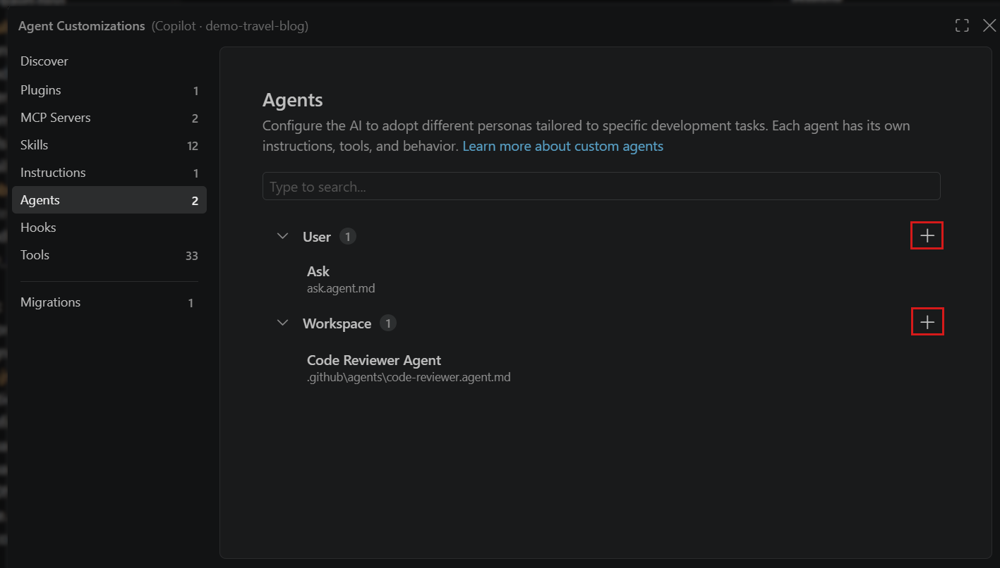
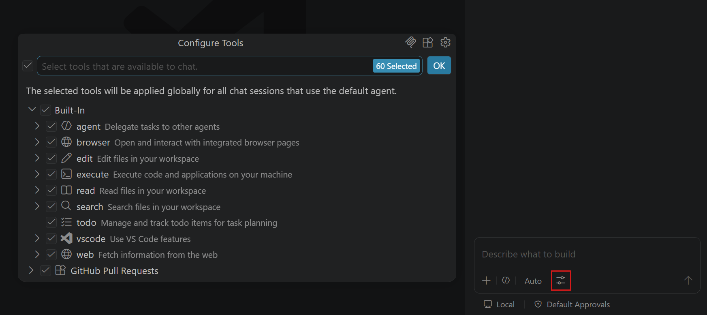
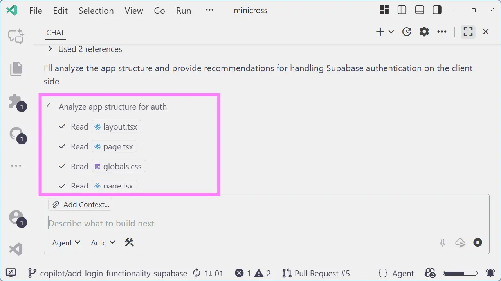
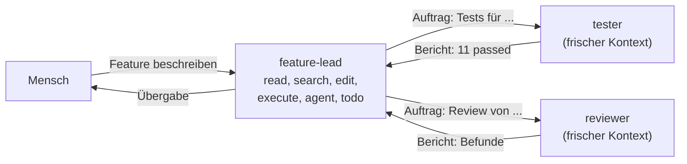

# Lab 6.1: Agents und Subagents

**Leitfragen:**

<details>
<summary>Warum prüft im Team nicht dieselbe Person den eigenen Code?</summary>

Wer den Code geschrieben hat, kennt die eigene Absicht und liest darüber hinweg, was fehlt. Eine zweite Person ohne diese Vorannahmen sieht Lücken. Ein Agent, der den eigenen Chat-Verlauf prüft, hat dasselbe Problem.

</details>

<details>
<summary>Welche Rolle braucht nur Leserechte?</summary>

Der Reviewer: Er liest, sucht und bewertet. Änderungen schlägt er vor, umsetzen darf sie jemand anderes. So repariert niemand unbemerkt „nebenbei“.

</details>

<details>
<summary>Was geht verloren, wenn ein Chat stundenlang alles macht?</summary>

Übersicht und Qualität: Das Kontextfenster füllt sich mit alten Versuchen, frühe Anweisungen geraten aus dem Blick, und niemand prüft unabhängig. Getrennte Rollen mit frischem Kontext halten jede Teilaufgabe klein und überprüfbar.

</details>

- Custom Agent = eigene Rolle mit Auftrag (Markdown-Text), erlaubten Werkzeugen (`tools`) und optional eigenem Modell.
- Datei: `.github/agents/<name>.agent.md`; der Agent erscheint im Chat neben Ask, Plan und Agent.
- Subagent: Ein Agent startet einen anderen für eine Teilaufgabe mit frischem Kontext und bekommt nur das Ergebnis zurück.
- Abgrenzung: Instructions = Regeln, Skill = Ablauf, Custom Agent = Rolle mit Rechten.

## Begriffe

| Begriff | Bedeutung |
| --- | --- |
| Custom Agent | selbst definierte Rolle mit Auftrag, Werkzeugliste und optional Modell, gespeichert als `.agent.md` |
| `tools` | Liste der Werkzeuge, die der Agent nutzen darf; alles andere fehlt ihm |
| Tool-Alias | Kurzname für eine Gruppe von Werkzeugen, z. B. `read`, `edit`, `execute` |
| Subagent | Agent, den ein anderer Agent für eine Teilaufgabe startet; arbeitet mit eigenem, frischem Kontext |
| Agent-Auswahl | Auswahl im Chat-Eingabefeld, in der Ask, Plan, Agent und die Custom Agents stehen |

## Das Bild: Rollen im Team

Ein Team bestimmt nicht nur, **wie** gearbeitet wird (Regeln, Abläufe), sondern auch, **wer** was darf: Die Entwicklerin baut, der Tester schreibt Tests, die Reviewerin liest und gibt frei. Custom Agents übertragen genau das auf den Agenten.

| Baustein | Frage | Beispiel FocusList | Datei |
| --- | --- | --- | --- |
| Instructions (m04) | Was muss der Agent immer wissen? | „Route → `tasks.py` → `store.py`“ | `AGENTS.md`, `*.instructions.md` |
| Skill (m05) | Wie erledigt man eine Aufgabe? | `test-writer`: Fälle ableiten, Vorlage, ausführen | `.github/skills/<name>/SKILL.md` |
| Custom Agent (m06) | Wer darf was? | `reviewer`: nur lesen und suchen, nutzt `security-checker` | `.github/agents/<name>.agent.md` |

Ein Custom Agent nutzt die beiden anderen: Er liest die Instructions wie jeder Agent und wendet Skills an, die im Auftrag genannt sind.

## Aufbau einer Agent-Datei

```markdown
---
name: reviewer
description: Prüft Änderungen an FocusList ... und liefert einen Review-Bericht als Tabelle. Ändert keine Dateien.
tools: ['read', 'search']
---

# Rolle: Reviewer

Auftrag, Ablauf, Grenzen und Ausgabeformat in Markdown ...
```



_Quelle: VS Code Docs, Custom agents (https://code.visualstudio.com/docs/agent-customization/custom-agents), Microsoft, CC BY 3.0 US, abgerufen am 07.11.2026._

VS Code listet alle Agent-Dateien im Customizations-Editor; Agents des Projekts liegen in `.github/agents/`.

## Frontmatter

Stand: 11/2026. Quelle: [Custom agents](https://code.visualstudio.com/docs/agent-customization/custom-agents)

| Feld | Pflicht | Bedeutung |
| --- | --- | --- |
| `name` | ja | Name in der Agent-Auswahl und beim Aufruf als Subagent |
| `description` | ja | was der Agent tut und wann; Grundlage, damit ein anderer Agent ihn als Subagent wählt |
| `tools` | nein | erlaubte Werkzeuge als Liste von Aliasen; was fehlt, kann der Agent nicht nutzen |
| `model` | nein | eigenes Modell für diese Rolle; ohne Angabe gilt das im Chat gewählte Modell |
| `user-invocable` | nein | Default `true`; `false` blendet den Agenten in der Agent-Auswahl aus, er läuft nur als Subagent |
| `disable-model-invocation` | nein | Default `false`; `true` verhindert, dass andere Agents ihn als Subagent starten |

## Tool-Aliase im Copilot-Harness

| Alias | erlaubt | Beispiel |
| --- | --- | --- |
| `read` | Dateien lesen | `AGENTS.md`, `routes.py` öffnen |
| `search` | im Projekt suchen (Dateinamen, Text) | alle Stellen mit `\|safe` finden |
| `edit` | Dateien anlegen und ändern | Test in `tests/` schreiben |
| `execute` | Terminal-Befehle ausführen (mit Freigabe) | `pytest -q`, `npm test` |
| `agent` | andere Agents als Subagent starten | `feature-lead` startet `tester` |
| `web` | Webseiten abrufen | Doku einer Bibliothek lesen |
| `todo` | Todo-Liste für den Plan führen | Schritte des Features abhaken |
| `*` | alle Werkzeuge | nur für Vollzugriff-Rollen |
| `<server>/*` | alle Werkzeuge eines MCP-Servers | ab m07, z. B. `playwright/*` |



_Quelle: VS Code Docs, Tools (https://code.visualstudio.com/docs/agents/run/tools), Microsoft, CC BY 3.0 US, abgerufen am 07.11.2026._

Dieselben Namen zeigt der Chat unter „Configure Tools“. Dort gilt die Auswahl für den Standard-Agenten; in einer Agent-Datei legt das Feld `tools` sie fest.

`tools` begrenzt **Werkzeuge**, nicht **Pfade**: Wer `edit` hat, kann technisch jede Datei ändern. „Nur unter `tests/` schreiben“ steht deshalb als Regel im Auftrag; erzwingen lässt es sich erst mit einem Hook (m07).

## Subagents

Ein Agent mit dem Werkzeug `agent` kann andere Agents als Subagent starten. Im Copilot-Harness heißt das interne Werkzeug dafür `task` (im Local-Harness `runSubagent`). Der Subagent bekommt nur den Auftrag, den der Aufrufer formuliert, nicht den ganzen Chat-Verlauf.



_Quelle: VS Code Blog, A unified agent experience (https://code.visualstudio.com/blogs/2025/11/03/unified-agent-experience), Microsoft, CC BY 3.0 US, abgerufen am 07.11.2026._

Ein laufender Subagent erscheint im Chat als eigener Block mit seinen Werkzeugaufrufen (Ansicht 2025).



| Vorteil | Preis |
| --- | --- |
| frischer Kontext: Prüfer sieht nur Code und Auftrag, nicht die Begründungen des Bauenden | jeder Subagent ist eine eigene Modell-Sitzung: mehr Anfragen und Laufzeit |
| Hauptchat bleibt kurz, nur Ergebnisse kommen zurück | Subagent weiß nur, was im Auftrag steht |
| jede Rolle hat nur die Werkzeuge, die sie braucht | mehr Dateien zu pflegen |

**Nur im Local-Harness** (Lab 2.2): das Feld `agents:` (Liste erlaubter Subagents) und `handoffs` (Übergabe per Schaltfläche). Im Copilot-Harness diese Felder nicht verwenden; stattdessen im Auftrag namentlich nennen, welche Agents gestartet werden („Den Agenten **tester** als Subagent starten“). Stand: 11/2026, Quelle: [Migrate customizations](https://code.visualstudio.com/docs/agent-customization/migrate-customizations).

## Gleiche Idee, andere Ordner

Ergänzt die Landkarte aus Lab 1.3:

| Werkzeug | Custom Agents |
| --- | --- |
| GitHub Copilot | `.github/agents/<name>.agent.md` |
| Claude Code | `.claude/agents/` |
| OpenAI Codex | eigene Konfiguration (im Kurs nicht behandelt) |

## Selbst ausprobieren

**Dauer:** ca. 10 Minuten · **Form:** einzeln oder im Plenum · **Start:** kein Projekt nötig · **Referenz:** Lösungsweg unten

1. Lege eine Tabelle an: Zeilen = Rollen **Feature-Lead** (baut), **Tester**, **Reviewer**; Spalten = Dateien lesen, suchen, Produktcode ändern, Tests ändern, Terminal, andere Rollen beauftragen, Todo-Liste, Pakete installieren.
2. Trage für jede Zelle ein: ja, nein oder „ja, nur …“.
3. Übersetze jede Zeile in eine `tools`-Liste aus den Aliasen oben.
4. Markiere alle Zellen, die sich **nicht** über `tools` ausdrücken lassen und deshalb als Regel in den Auftrag müssen.

**Checkpoint:** Eine Rechte-Matrix mit drei Rollen liegt vor, jede Rolle hat eine `tools`-Liste, und mindestens zwei Regeln sind als „nur im Auftrag“ markiert.

<details>
<summary>Lösungsweg</summary>

| Recht | Feature-Lead | Tester | Reviewer |
| --- | --- | --- | --- |
| Dateien lesen | ja | ja | ja |
| suchen | ja | ja | ja |
| Produktcode ändern | ja | nein* | nein |
| Tests ändern | nein* (macht der Tester) | ja, nur `tests/` bzw. `test/`* | nein |
| Terminal | ja (Tests) | ja, nur `pytest` bzw. `npm test`* | nein |
| andere Rollen beauftragen | ja: `tester`, `reviewer`* | nein | nein |
| Todo-Liste | ja | nein | nein |
| Pakete installieren | nein* (nur nach Rückfrage) | nein* | nein |
| **`tools`** | `['read', 'search', 'edit', 'execute', 'agent', 'todo']` | `['read', 'search', 'edit', 'execute']` | `['read', 'search']` |

\* lässt sich nicht über `tools` ausdrücken (Pfad, Befehl oder Name des Subagents) und steht deshalb als Regel im Auftrag. Genau so sind die echten Dateien in `project/focuslist/<stack>/steps/m06/.github/agents/` gebaut (Lab 6.2 und 6.3).

Der Reviewer ist die einzige Rolle, deren Grenze vollständig über `tools` gilt: ohne `edit` und `execute` kann er nichts ändern.

</details>

## Fazit

- Custom Agents beantworten „Wer darf was?“: Auftrag plus `tools` plus optional `model`.
- Subagents arbeiten mit frischem Kontext; der Aufrufer bekommt nur ihr Ergebnis.
- `tools` begrenzt Werkzeuge, nicht Pfade; Pfad- und Befehlsgrenzen stehen im Auftrag.
- Im Copilot-Harness Subagents im Auftrag namentlich nennen, nicht über `agents:` oder `handoffs`.
