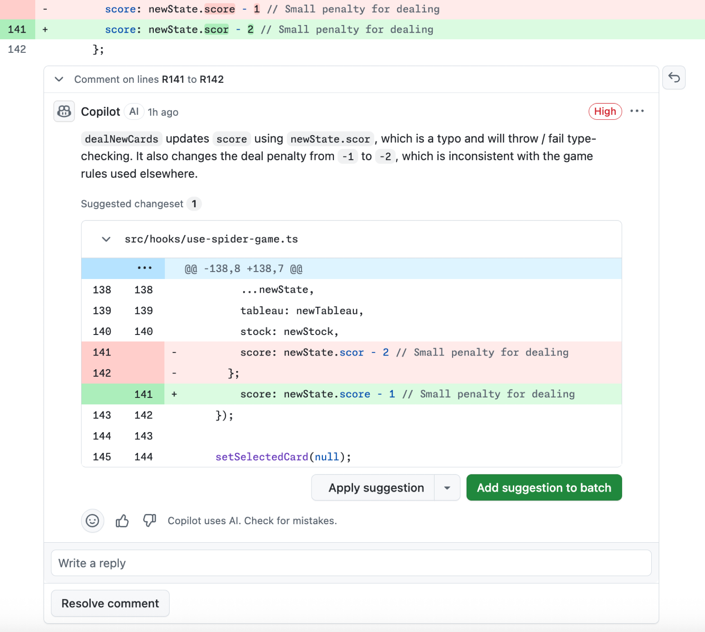
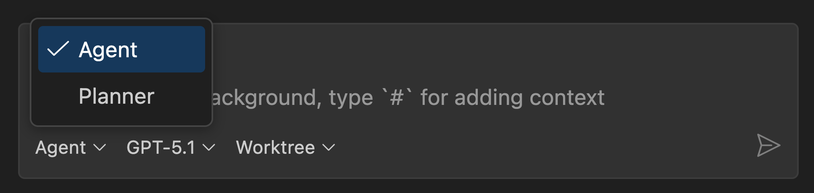

# Lab 6.2: Agent `reviewer`

**Leitfragen:**

<details>
<summary>Was macht ein Code-Review nützlich statt nervig?</summary>

Konkrete Befunde mit Datei und Zeile, eine klare Schwere und ein umsetzbarer Vorschlag pro Befund. Nervig sind vage Kommentare, Stilfragen ohne Regel dahinter und lange Einleitungen. Ein festes Ausgabeformat zwingt zu Ersterem.

</details>

<details>
<summary>Wie stellt man sicher, dass ein Prüfer nichts „nebenbei“ repariert?</summary>

Indem er die Werkzeuge dafür gar nicht hat: `tools: ['read', 'search']`. Ohne `edit` und `execute` kann der Agent keine Datei ändern und keinen Befehl ausführen, egal, wie die Anfrage lautet.

</details>

- Der `reviewer` ist ein Lese-Agent: `tools` nur `read` und `search`.
- Grundlage sind `AGENTS.md`, die Instructions und der Skill `security-checker` aus Lab 5.3.
- Ausgabe immer im selben Format: Befund, Datei, Schwere, Vorschlag, dazu ein Review-Fazit.
- Der Reviewer sieht den Chat-Verlauf früherer Sitzungen nicht: Welche Dateien geprüft werden, nennt der Auftrag.

## Begriffe

| Begriff | Bedeutung |
| --- | --- |
| Lese-Agent | Custom Agent ohne Werkzeuge zum Ändern oder Ausführen |
| Befund | konkrete Abweichung mit Beleg (Datei und Zeile) |
| Schwere | hoch / mittel / niedrig; bestimmt, was vor dem Merge behoben sein muss |
| Review-Fazit | Ergebnis des Reviews: freigeben, nach Korrektur freigeben, nicht freigeben |

Analogie: Der Schiedsrichter bewertet und zeigt auf die Stelle, spielt aber nicht selbst mit. Genauso benennt der Reviewer Befunde und ändert keinen Code.

## Die echte Datei: Python

`project/focuslist/python/steps/m06/.github/agents/reviewer.agent.md` (gekürzter Auszug, vollständig dort):

````markdown
---
name: reviewer
description: Prüft Änderungen an FocusList (… oder genannte Dateien) auf Fehler, Verstöße gegen AGENTS.md und die Instructions sowie Sicherheitslücken und liefert einen Review-Bericht als Tabelle. Ändert keine Dateien.
tools: ['read', 'search']
---

# Rolle: Reviewer

Prüft Code wie ein erfahrenes Teammitglied im Code-Review. Liest, sucht, bewertet. **Ändert nichts**, auch keine Kleinigkeiten nebenbei. Der Reviewer hat dafür bewusst keine Werkzeuge zum Bearbeiten oder für das Terminal.

## Grundlage

- `AGENTS.md` und die passenden Dateien in `.github/instructions/` (Tests, Templates)
- Skill `security-checker` mit seiner Checkliste für den Sicherheitsteil

## Ablauf

1. **Umfang feststellen.** Was soll geprüft werden: genannte Dateien, ein Feature oder die Dateien, die der aufrufende Agent nennt. Ohne Angabe nachfragen, nicht raten.
2. **Code lesen.** Jede geänderte Datei vollständig lesen, dazu die direkt betroffenen Nachbarn (Route → `tasks.py` → Template → Test).
3. **Prüfen**, in dieser Reihenfolge: Korrektheit (Randfälle) → Projektregeln (Schichten, `abort(404)`, Tailwind) → Sicherheit (Skill `security-checker`) → Tests (Normal-, Grenz-, Fehlerfall).
4. **Bericht ausgeben** im festen Format. Nur Befunde mit Beleg (Datei und Zeile), keine Vermutungen ohne Stelle im Code.

## Ausgabeformat (immer genau so)

```markdown
## Review: <Feature oder geprüfte Dateien>

| Befund | Datei | Schwere | Vorschlag |
| --- | --- | --- | --- |
| <was ist falsch und warum> | `<datei>:<zeile>` | hoch / mittel / niedrig | <konkrete Änderung in einem Satz> |

**Ohne Befund geprüft:** <Punkte, die in Ordnung sind>
**Fazit:** freigeben / nach Korrektur freigeben / nicht freigeben
```

Schwere: **hoch** = Fehler oder Sicherheitslücke, muss vor dem Merge behoben werden · **mittel** = Regelverstoß oder fehlender Test · **niedrig** = Lesbarkeit, Benennung, Stil.
````

## Die echte Datei: Node.js

`project/focuslist/node/steps/m06/.github/agents/reviewer.agent.md` hat dasselbe Frontmatter-Muster (`name: reviewer`, `tools: ['read', 'search']`, „Ändert keine Dateien.“).

| Stelle | Python | Node.js |
| --- | --- | --- |
| Umfang ohne Angabe | nachfragen | zuletzt geänderte Dateien bzw. im Auftrag genannte |
| Regeln laden | im Abschnitt „Grundlage“ | eigener Schritt „Regeln laden“: jede Regel ist ein Prüfpunkt |
| Schwere hoch | Fehler oder Sicherheitslücke | zusätzlich: fehlende Tests für neue Routen |
| Fazit | freigeben / nach Korrektur / nicht | freigegeben / mit Anmerkungen / nicht freigegeben; „nicht“, sobald ein Befund hoch offen ist |

## Warum genau diese Bausteine

| Teil | Wirkung |
| --- | --- |
| `tools: ['read', 'search']` | technische Grenze: kein Bearbeiten, kein Terminal |
| „Ändert nichts“ im Text | erklärt die Rolle; der Agent schlägt vor, statt zu versuchen |
| Grundlage `AGENTS.md`, Instructions | Review prüft gegen Team-Regeln statt gegen Geschmack |
| Skill `security-checker` | Sicherheitsteil folgt der Checkliste aus Lab 5.3 |
| Reihenfolge der Prüfung | Korrektheit vor Stil |
| festes Format | Berichte sind vergleichbar und lassen sich abarbeiten |



_Quelle: GitHub Docs, Using GitHub Copilot code review (https://docs.github.com/en/copilot/how-tos/use-copilot-agents/use-code-review), GitHub, CC BY 4.0, abgerufen am 07.11.2026._

Dasselbe Muster bei Copilot Code Review auf GitHub: Befund an einer Zeile, Schwere, konkreter Änderungsvorschlag.

## Den Agenten auswählen

Stand: 11/2026; Bezeichnungen und Ort der Auswahl können sich mit VS-Code-Versionen ändern. Quelle: [Custom agents](https://code.visualstudio.com/docs/agent-customization/custom-agents)

- Liegt `reviewer.agent.md` in `.github/agents/`, erscheint `reviewer` in der Agent-Auswahl der Chat-Ansicht neben Ask, Plan und Agent.
- Für eine neue Datei eine neue Chat-Sitzung starten, damit die Auswahl neu eingelesen wird.
- Mit `user-invocable: false` stünde der Agent nicht in der Auswahl und liefe nur als Subagent (Lab 6.3).



_Quelle: VS Code Release Notes v1.107 (https://code.visualstudio.com/updates/v1_107), Microsoft, CC BY 3.0 US, abgerufen am 07.11.2026._

Ein Custom Agent erscheint mit seinem `name` in der Agent-Auswahl, hier „Planner“ (Ansicht Dez. 2025).

## Typische Fehler

| Symptom | Ursache | Lösung |
| --- | --- | --- |
| `reviewer` fehlt in der Agent-Auswahl | Datei endet nicht auf `.agent.md` oder liegt nicht in `.github/agents/` | Dateinamen und Ordner prüfen, neue Sitzung starten |
| Reviewer ändert doch Dateien | `tools` fehlt, dann gelten die Standardwerkzeuge inkl. Bearbeiten | `tools: ['read', 'search']` explizit setzen |
| Reviewer fragt nach, was er prüfen soll | Auftrag nennt keine Dateien; ohne `execute` ermittelt er Änderungen nicht selbst | geänderte Dateien im Auftrag nennen (siehe Übung) |
| Befunde ohne Zeile, teils Vermutungen | Regel „nur mit Beleg“ fehlt | Ablauf Schritt 4: nur Befunde mit Datei und Zeile |
| langer Fließtext statt Tabelle | Format nicht verbindlich | „Ausgabeformat (immer genau so)“ mit Vorlage im Codeblock |

## Übung

**Dauer:** ca. 25 Minuten · **Start:** eigener Stand nach Lab 5.3 oder v2 mit `node project/focuslist/catch-up.mjs <python|node> m06 <zielordner>` · **Referenz:** `project/focuslist/<stack>/steps/m06/.github/agents/reviewer.agent.md`

1. Lege `.github/agents/reviewer.agent.md` an: Frontmatter mit `name`, `description` (was, wann, „ändert keine Dateien“), `tools: ['read', 'search']`; darunter Rolle, Grundlage, Ablauf, Ausgabeformat.
2. Starte eine neue Chat-Sitzung, wähle `reviewer` in der Agent-Auswahl und beauftrage ihn mit den Dateien, die in Lab 5.3 geändert wurden (Prompt im Lösungsweg).
3. Prüfe den Bericht: Tabelle im festen Format, jeder Befund mit Datei und Zeile, Review-Fazit. Speichere ihn als `docs/review-security.md` (Ausgabe kopieren).
4. Bitte den Reviewer im selben Chat, den ersten Befund direkt zu beheben.
5. Prüfe, dass keine Datei geändert wurde: Unter der Antwort erscheint keine Liste geänderter Dateien mit Keep/Undo.

**Checkpoint:** `reviewer` steht in der Agent-Auswahl; der Bericht hat die Spalten Befund, Datei, Schwere, Vorschlag und ein Fazit; nach der Bitte um Reparatur hat der Reviewer keine Datei geändert.

<details>
<summary>Lösungsweg</summary>

**Zu 2, Prompt (Python):**

```text
Prüfe die Sicherheits-Fixes aus Lab 5.3.
Geänderte Dateien: focuslist/__init__.py, focuslist/routes.py, focuslist/tasks.py,
focuslist/templates/index.html, tests/test_security.py, requirements.txt, .env.example
```

Die Liste entspricht der Referenz `steps/m05` (alle Fixes). Wer in Lab 5.3 nur einen Fund behoben hat, nennt die Dateien aus der Liste der geänderten Dateien im damaligen Chat. Node.js analog mit `src/views/escape.js`, `src/views/index.js`, `src/static.js`, `src/http.js`, `src/tasks.js`, `src/app.js`, `test/security.test.js`.

**Zu 3, möglicher Bericht (Python, auf v2):**

```markdown
## Review: Sicherheits-Fixes aus Lab 5.3

| Befund | Datei | Schwere | Vorschlag |
| --- | --- | --- | --- |
| `test_titel_wird_escaped` prüft nur `GET /`; die Liste war schon vorher durch Jinja2 escaped. Der behobene Fund (Hinweis „Aufgabe … angelegt“) ist nicht abgesichert. | `tests/test_security.py:7` | mittel | Nach dem Anlegen dem Redirect folgen (`follow_redirects=True`) und `&lt;script&gt;` im Hinweis prüfen. |
| Neue Abhängigkeit `python-dotenv`; laut `AGENTS.md` nur nach Rückfrage. | `requirements.txt:2` | niedrig | Rückfrage in `docs/security-report.md` dokumentieren. |

**Ohne Befund geprüft:** Validierung in `tasks.validate()` mit 400, Secret aus `FOCUSLIST_SECRET`, kein `debug=True`, kein `|safe`, Schichten Route → `tasks.py` → `store.py`.
**Fazit:** nach Korrektur freigeben
```

Befunde weichen je nach Lauf ab. Ein Bericht ohne Datei und Zeile oder ohne Fazit verfehlt das Format: Abschnitt „Ausgabeformat“ schärfen.

**Zu 4, Prompt:** „Behebe den ersten Befund direkt.“

**Zu 5:** Der Reviewer antwortet, dass er keine Dateien ändern kann, und beschreibt die Änderung als Vorschlag, oft mit Codeausschnitt im Chat. Es erscheint keine Liste geänderter Dateien, keine Freigabe-Anfrage für Bearbeiten oder Terminal. Ändert er doch etwas: `tools` im Frontmatter prüfen (Schreibweise, Liste in eckigen Klammern) und in der Agent-Auswahl kontrollieren, dass wirklich `reviewer` aktiv war; die Änderung mit Undo verwerfen.

</details>

## Fazit

- Ein Lese-Agent bekommt nur `read` und `search`; die Grenze gilt technisch, nicht nur als Bitte.
- Das Review prüft gegen `AGENTS.md`, Instructions und den `security-checker`, nicht gegen Geschmack.
- Festes Format mit Datei, Zeile, Schwere und Vorschlag macht Befunde abarbeitbar.
