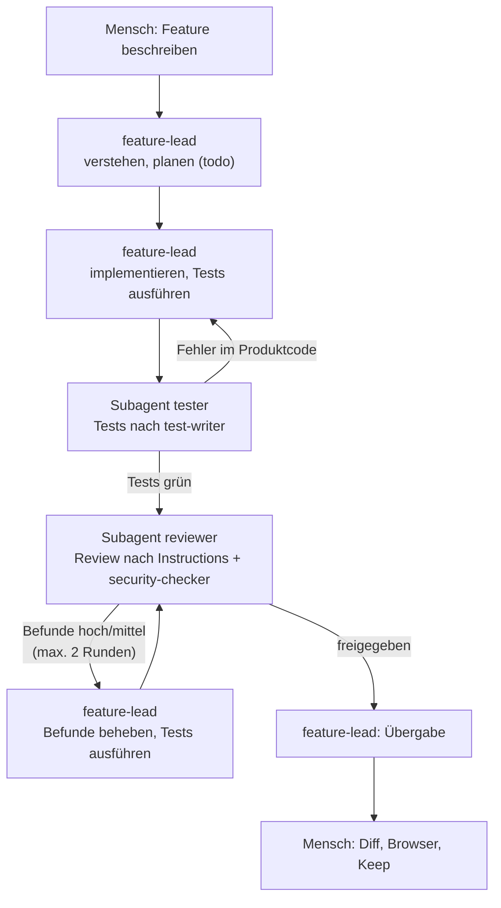
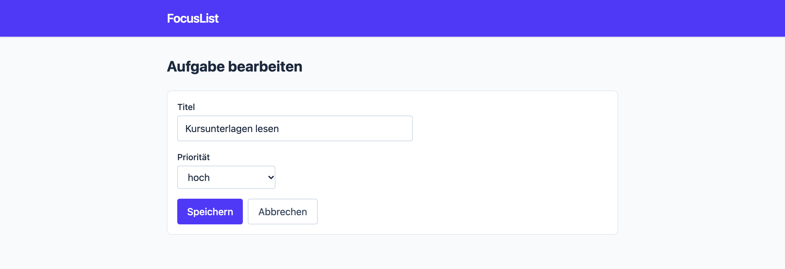

# Lab 6.3: Agenten-Team

**Leitfragen:**

<details>
<summary>In welcher Reihenfolge arbeitet ein Team an einem Feature?</summary>

Verstehen und planen → bauen → testen → reviewen → Befunde abarbeiten → erneut prüfen → übergeben. Der `feature-lead` bildet genau diese Reihenfolge ab und holt `tester` und `reviewer` an den passenden Stellen dazu.

</details>

<details>
<summary>Woran erkennt man, dass ein Feature „fertig“ ist?</summary>

Am beobachtbaren Ergebnis, nicht am Gefühl: die vorher festgelegten Bedingungen für „fertig“ (Akzeptanzkriterien) erfüllt, Tests mit Normal-, Grenz- und Fehlerfall grün, Review ohne offenen Befund mit Schwere hoch, Diff gelesen, im Browser geprüft. Erst dann übernimmt ein Mensch die Änderungen mit Keep.

</details>

<details>
<summary>Wann ist ein ganzes Team für eine Änderung zu viel?</summary>

Bei kleinen, risikoarmen Änderungen: Tippfehler, eine Tailwind-Klasse, ein Text. Drei Agents kosten mehr Anfragen und Minuten, als die Änderung wert ist. Faustregel: Team ab einer neuen Route oder mehreren Dateien mit Logik.

</details>

- `tester` schreibt nur Tests (Regel: nur unter `tests/` bzw. `test/`) und arbeitet nach dem Skill `test-writer`.
- `feature-lead` plant, implementiert selbst und startet `tester` und `reviewer` als Subagents; Befunde arbeitet er ab, höchstens zwei Review-Runden.
- Diff lesen, im Browser prüfen und die Änderungen mit Keep übernehmen bleibt beim Menschen.
- Ein Team kostet Anfragen und Zeit; es lohnt sich für Features, nicht für Kleinigkeiten.

## Begriffe

| Begriff | Bedeutung |
| --- | --- |
| Agenten-Team | mehrere Custom Agents mit getrennten Rollen, die über Subagents zusammenarbeiten |
| Auftrag an den Subagent | Text, den der Aufrufer formuliert; das Einzige, was der Subagent über die Aufgabe weiß |
| Review-Runde | ein Durchlauf des `reviewer` über die geänderten Dateien |
| Übergabe | Abschlussbericht des `feature-lead` an den Menschen |

## Ablauf im Team

Vorbild ist ein echtes Team: Eine Person baut, andere prüfen, bevor der Code übernommen wird.




_Quelle: VS Code Release Notes v1.109 (https://code.visualstudio.com/updates/v1_109), Microsoft, CC BY 3.0 US, abgerufen am 07.11.2026._

Dasselbe Muster als Beispiel in den VS-Code-Release-Notes: Ein leitender Agent („Conductor“) verteilt Planen, Umsetzen und Prüfen auf Subagents; der Mensch gibt Plan und Ergebnis frei.

## Die echten Dateien (Python)

Gekürzte Auszüge, vollständig in `project/focuslist/python/steps/m06/.github/agents/`. `tester.agent.md`:

````markdown
---
name: tester
description: Schreibt und repariert pytest-Tests für FocusList mit dem Skill test-writer und führt sie aus. Schreibt ausschließlich unter tests/. Verwenden, wenn ein Feature Tests braucht oder Tests rot sind.
tools: ['read', 'search', 'edit', 'execute']
---

## Grenzen
- **Schreibt nur Dateien unter `tests/`.** Produktcode wird gelesen, nie geändert.
- Findet ein Test einen echten Fehler im Produktcode, bleibt der Test rot und der Fehler kommt in den Bericht.
- Terminal nur für `pytest`. Keine Installationen.
````

`feature-lead.agent.md`:

````markdown
---
name: feature-lead
description: Setzt ein Feature in FocusList vollständig um. Plant, implementiert nach AGENTS.md, lässt Tests vom Agenten tester schreiben und den Code vom Agenten reviewer prüfen und arbeitet deren Befunde ab. …
tools: ['read', 'search', 'edit', 'execute', 'agent', 'todo']
---

## Ablauf
1. **Verstehen.** 2. **Planen** (Todo-Liste). 3. **Implementieren**, danach `pytest -q`.
4. **Tests delegieren.** Den Agenten **tester** als Subagent starten. Übergeben: Feature, Routen, Dateien, Akzeptanzkriterien.
5. **Review delegieren.** Den Agenten **reviewer** als Subagent starten. Übergeben: geänderte Dateien und Ziel des Features.
6. **Befunde abarbeiten.** Hoch und mittel beheben, höchstens zwei Review-Runden.
7. **Übergeben.** Zusammenfassung mit geänderten Dateien, Tests und Befunden ausgeben.
````

## Node.js: Unterschiede

Dateien in `project/focuslist/node/steps/m06/.github/agents/`, gleiche `tools`-Listen, gleicher Ablauf. In beiden Stacks gilt: `tools` begrenzt keine Pfade, deshalb steht „nur `tests/`“ als Regel im Auftrag.

| Stelle | Python | Node.js |
| --- | --- | --- |
| tester: Schreibbereich | nur `tests/` | nur `test/`; ausdrücklich nicht `src/`, `data/`, `static/`, `package.json`, `.github/` |
| tester: Terminal | nur `pytest` | nur `npm test` bzw. `node --test …` |
| feature-lead: Implementieren | danach `pytest -q` | kleine Schritte, nach jedem `npm test` |

## Beispiel: Review-Bericht „Aufgabe bearbeiten“

Auszug aus `project/focuslist/python/steps/m06/docs/review-edit-task.md` (zweite Runde, Befunde aus Runde 1 vom `feature-lead` behoben; Node.js: `project/focuslist/node/steps/m06/docs/review-edit-task.md`):

| Befund | Datei | Schwere | Vorschlag |
| --- | --- | --- | --- |
| Erste Runde: `update_task()` setzte `done` aus dem Formular, ein fehlendes Feld machte erledigte Aufgaben wieder offen. | `focuslist/tasks.py:47` | hoch | Behoben: nur `title` und `priority` ändern (`test_bearbeiten_behaelt_status_erledigt`). |
| Erste Runde: POST auf eine unbekannte ID lieferte 400 statt 404. | `focuslist/routes.py:39` | mittel | Behoben: Aufgabe zuerst laden, sonst `abort(404)`. |
| Eingabefeld mit fester Breite `w-96` ist auf Handybreite breiter als der Bildschirm. | `focuslist/templates/edit.html:21` | mittel | `w-full sm:w-96` verwenden. |

**Fazit:** nach Korrektur freigeben. Der offene Befund (mittel) betrifft die Darstellung auf Handybreite; ihn behebt Lab 7.4.

## Kosten und Grenzen

| Thema | Beobachtung | Umgang |
| --- | --- | --- |
| Anfragen und Laufzeit | jeder Subagent ist eine eigene Modell-Sitzung; ein Feature mit zwei Review-Runden braucht ein Vielfaches einer Einzelanfrage | Team für Features, Einzelagent für Kleinigkeiten |
| Grenzen der Rollen | Pfad- und Befehlsregeln sind Bitten | erzwingen per Hook (m07) |

## Typische Fehler

| Symptom | Ursache | Lösung |
| --- | --- | --- |
| `feature-lead` schreibt alles selbst, kein Subagent startet | `agent` fehlt in `tools` oder Subagents nicht namentlich genannt | `tools` um `agent` ergänzen, im Ablauf „Den Agenten **tester** als Subagent starten“ |
| Subagent findet die Dateien nicht oder testet das Falsche | Auftrag an den Subagent zu knapp | Feature, Routen, Dateien und Kriterien übergeben lassen (Schritt 4/5) |
| Tester ändert Produktcode | Regel „nur `tests/`“ fehlt oder ist schwach formuliert | Abschnitt „Grenzen“ fett, Diff prüfen |
| Endlosschleife Review → Fix → Review | keine Obergrenze | „höchstens zwei Review-Runden“ |
| `agents:` oder `handoffs` im Frontmatter ohne Wirkung | gelten nur im Local-Harness | entfernen, Subagents im Text nennen |

## Übung

**Dauer:** ca. 40 Minuten · **Start:** Arbeitsordner (Tag 2: `$HOME/kurs/focuslist-m05`) nach Lab 6.2 · **Referenz:** `project/focuslist/<stack>/steps/m06/` (Agents, `tests/test_edit.py` bzw. `test/edit.test.js`, `docs/review-edit-task.md`)

1. Lege `.github/agents/tester.agent.md` an: `tools: ['read', 'search', 'edit', 'execute']`, Regel „nur unter `tests/` bzw. `test/`“, Skill `test-writer`, Berichtsformat.
2. Lege `.github/agents/feature-lead.agent.md` an: `tools: ['read', 'search', 'edit', 'execute', 'agent', 'todo']`, Ablauf mit `tester` und `reviewer` namentlich als Subagents, höchstens zwei Review-Runden, Übergabe.
3. Starte eine neue Chat-Sitzung, wähle `feature-lead` und beschreibe das Feature „Aufgabe bearbeiten“ (Prompt im Lösungsweg). Lies den Plan in der Todo-Liste und bestätige ihn.
4. Lies jede Freigabe, auch die der Subagents. Speichere nach der Übergabe den Review-Bericht als `docs/review-edit-task.md`.
5. Prüfe das Feature im Browser (Aufgabe bearbeiten, leeren Titel speichern, erledigte Aufgabe bearbeiten), führe die Tests aus und nimm die Änderungen mit **Keep** an.

**Checkpoint nach 20 Minuten:** Beide Agents stehen in der Agent-Auswahl, der Plan steht, und der Chat zeigt mindestens einen gestarteten Subagent.

**Checkpoint:** Die Liste zeigt einen Link „Bearbeiten“; `GET` und `POST /tasks/<id>/edit` funktionieren mit Validierung und 404; neue Tests in `tests/test_edit.py` bzw. `test/edit.test.js` sind grün; `docs/review-edit-task.md` existiert. Debrief: Was hat der Reviewer gefunden, was wäre selbst übersehen worden?


_Quelle: eigener Screenshot, FocusList v3, 07.11.2026._

<details>
<summary>Lösungsweg</summary>

**Zu 3, Prompt an `feature-lead`:**

```text
Neues Feature „Aufgabe bearbeiten“:
- Jede Aufgabe in der Liste bekommt einen Link „Bearbeiten“.
- GET /tasks/<id>/edit zeigt ein Formular mit Titel und Priorität, vorausgefüllt.
- POST /tasks/<id>/edit speichert nach denselben Regeln wie beim Anlegen
  (Titel 1–100 Zeichen, Priorität low/medium/high), sonst 400 mit Meldung im Formular.
- Der Status „erledigt“ bleibt beim Bearbeiten unverändert.
- Unbekannte ID → 404, bei GET und POST.
- Danach zurück zur Liste.
```

Erwarteter Plan (gekürzt): Logik `get_task()`/`update_task()` in `tasks.py` bzw. `getTask()`/`updateTask()` in `src/tasks.js` → Route → Template `edit.html` bzw. View `src/views/edit.js` → Link in der Liste → `tester` → `reviewer` → Befunde.

**Subagent erkennen:** Im Chat erscheint ein eigener Abschnitt für den gestarteten Subagent mit seinem Namen und seinen Schritten; der `feature-lead` erhält am Ende dessen Bericht (Darstellung je nach VS-Code-Version, Stand: 11/2026, Quelle: [Custom agents](https://code.visualstudio.com/docs/agent-customization/custom-agents)). Startet kein Subagent: `agent` in `tools` prüfen und die Namen exakt wie in `name:` schreiben.

**Zu 5:** Code der Referenz in `focuslist/routes.py` (Route `edit`) bzw. `src/app.js`. Erwartete Tests (Referenz v3): Python `43 passed` (davon 11 in `tests/test_edit.py`), Node.js `tests 32 · pass 32` (davon 9 in `test/edit.test.js`).

**Typische Funde im Debrief:** erledigte Aufgabe wird beim Bearbeiten wieder offen (`done` aus dem Formular), 400 statt 404 bzw. 302 statt 404 bei unbekannter ID, fehlendes Escaping im Fehlerfall (Node.js), kopierte View-Bausteine, feste Breite `w-96` auf Handybreite. Den letzten Fund behebt Lab 7.4 mit dem Browser.

</details>

## Fazit

- Ein Team aus `feature-lead`, `tester` und `reviewer` bildet den Ablauf echter Teams ab: bauen, testen, unabhängig prüfen, nachbessern.
- Subagents bekommen nur ihren Auftrag; ein vollständiger Auftrag ist die halbe Qualität.
- Diff, Browser-Prüfung, Keep und Entscheidung über offene Befunde bleiben beim Menschen.
- Für kleine Änderungen ist ein Einzelagent schneller und günstiger.
