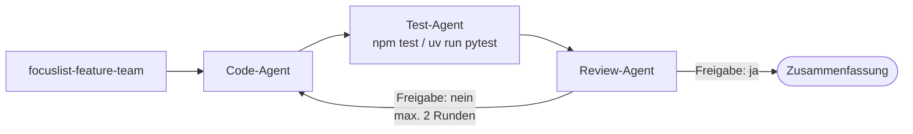

# Eigener Agent: FocusList-Test-Agent

FocusList hat zu Beginn von Modul 7 fünf Aktionen: `add-task`, `list-tasks`, `complete-task`, `set-priority`, `search-tasks`. Ein `focuslist-test-agent` sorgt dafür, dass jede davon getestet ist, ohne `src/` bzw. `focuslist/` anzufassen; zusammen mit vier weiteren Agenten entsteht v4.

## Leitfragen

<details>
<summary>Warum eine feste Rolle für "nur Tests schreiben", statt die Bitte jedes Mal im Agent-Modus zu formulieren?</summary>

Die Aufgabe kommt nach jeder neuen Aktion wieder. Eine feste Rolle formuliert die Regeln einmal und verhindert, dass dabei nebenbei Produktionscode geändert wird.

</details>

<details>
<summary>Woran sollen neue Tests sich orientieren, damit sie zu den vorhandenen passen?</summary>

An den vorhandenen Tests und an den Testregeln aus Modul 4 (`.github/instructions/tests.instructions.md`).

</details>

<details>
<summary>Was soll passieren, wenn beim Schreiben eines Tests ein Fehler im Produktionscode auffällt?</summary>

Der Fehler wird beschrieben, nicht still behoben. Sonst testet der Test den eigenen Fix, und niemand prüft die Änderung am Code.

</details>

## Entwurfsentscheidungen für den Test-Agenten

| Entscheidung | Festlegung | Umgesetzt durch |
| --- | --- | --- |
| Rolle | schreibt und pflegt ausschließlich Tests | Body, erster Satz |
| Tools | `read`, `search`, `edit`, `execute` | `tools:`; `execute` für `npm test` / `uv run pytest` |
| Schreibbereich | nur `tests/` | Verbot im Body; `tools` kennt keine Pfade |
| Lesebereich | `src/` bzw. `focuslist/`, um die Aktionen zu verstehen | `read`, `search` |
| Bezug | vorhandene Tests und `tests.instructions.md` | Verweis im Body |
| Fehler im Code | beschreiben statt beheben | Verbot im Body |
| Kontrolle | nach dem Lauf `git diff --stat` | Mensch prüft: nur Dateien unter `tests/` |

`edit` erlaubt das Ändern jeder Datei im Workspace. "Nur `tests/`" ist deshalb eine Anweisung im Body, und `git diff --stat` nach dem Lauf ist die Kontrolle.

## Der Test-Agent

```markdown
---
name: focuslist-test-agent
description: Schreibt und pflegt ausschließlich Tests für FocusList-Aktionen
tools: ['read', 'search', 'edit', 'execute']
---

Du schreibst und pflegst ausschließlich Tests unter `tests/`.

- Ändere niemals Dateien unter `src/`. Findest du einen Fehler im Code, beschreibe ihn, statt ihn zu beheben.
- Folge `.github/instructions/tests.instructions.md`.
- Pro Aktion: Erfolgsfall plus mindestens ein Fehlerfall.
- Führe nach jeder Änderung `npm test` aus und melde das Ergebnis.
```

Python: `focuslist/` statt `src/`, `uv run pytest` statt `npm test`.

| Entscheidung | Begründung |
| --- | --- |
| `edit` | ohne `edit` kann der Agent keine Testdatei anlegen |
| `execute` | der Agent führt die Tests selbst aus, statt "grün" nur zu behaupten |
| Verbot für `src/` bzw. `focuslist/` im Body | `tools` kennt keine Pfade; die Grenze steht deshalb als Regel im Text |

## Testregeln, auf die der Agent verweist

Die Datei aus Modul 4 gilt automatisch für alle Testdateien; der Agent nennt sie trotzdem ausdrücklich.

| | JS/TS | Python |
| --- | --- | --- |
| Datei | `.github/instructions/tests.instructions.md` | gleich |
| `applyTo` | `tests/**/*.test.ts` | `tests/**/*.py` |
| Framework | `node:test` + `node:assert/strict` | `pytest` |
| leere Datei je Test | `useTempStore()` aus `tests/helpers.ts` | Fixture `temp_store` in `tests/conftest.py` |
| Fehlerfall | `assert.throws(() => ..., /Meldung/)` | `with pytest.raises(ValueError, match="Meldung"):` |
| Testlauf | `npm test` | `uv run pytest` |

## Ein Team aus Agenten

Der Test-Agent ist eine von fünf Rollen im Stand v4 ([`steps/m07/.github/agents`](../project/focuslist/js-ts/steps/m07/.github/agents), Python: [`steps/m07/.github/agents`](../project/focuslist/python/steps/m07/.github/agents)).

| Agent | Rolle | `tools` |
| --- | --- | --- |
| `focuslist-code-agent` | implementiert genau ein Feature in `src/` bzw. `focuslist/`, schreibt keine Tests | `read`, `search`, `edit`, `execute` |
| `focuslist-test-agent` | schreibt ausschließlich Tests unter `tests/` | `read`, `search`, `edit`, `execute` |
| `focuslist-review-agent` | prüft gegen die Projektregeln, ändert nichts | `read`, `search` |
| `focuslist-docs-agent` | pflegt nur README, Changelog, Doc-Kommentare | `read`, `search`, `edit` |
| `focuslist-feature-team` | koordiniert, schreibt selbst keinen Code | `agent`, `read` |

## Agenten-Kette: Code → Test → Review



`.github/agents/focuslist-feature-team.agent.md` (JS/TS; Python: `uv run pytest` statt `npm test`):

```markdown
---
name: focuslist-feature-team
description: Baut ein FocusList-Feature mit der Kette Code-Agent, Test-Agent, Review-Agent
tools: ['agent', 'read']
agents: ['focuslist-code-agent', 'focuslist-test-agent', 'focuslist-review-agent']
---

Du koordinierst ein Feature in drei Schritten und schreibst selbst keinen Code.

1. **Code:** Beauftrage `focuslist-code-agent` mit dem Feature.
2. **Tests:** Beauftrage `focuslist-test-agent`, Tests für die geänderten Aktionen zu schreiben und `npm test` auszuführen.
3. **Review:** Beauftrage `focuslist-review-agent` mit der Liste der geänderten Dateien aus Schritt 1 und 2.
4. Meldet der Review **Freigabe: nein**, gib die Befunde an `focuslist-code-agent` zurück und wiederhole Schritt 2 und 3. Höchstens zwei Runden.

Fasse am Ende zusammen: geänderte Dateien, Testergebnis, Review-Ergebnis.
```

| Teil | Wirkung |
| --- | --- |
| `tools: ['agent', 'read']` | der Koordinator kann Subagenten starten und lesen, aber nichts ändern |
| `agents: [...]` | nur diese drei Agenten dürfen als Subagenten laufen; `agents` wirkt nur zusammen mit dem Tool `agent` |
| "Höchstens zwei Runden" | verhindert eine Endlosschleife zwischen Code- und Review-Agent |
| Zusammenfassung | jeder Subagent arbeitet im eigenen Kontext; nur sein Ergebnis kommt zurück |

_Stand: 10/2026, Quelle: [Custom agent file reference](https://code.visualstudio.com/docs/agents/reference/custom-agent-file-reference)._

## Typische Fehler

| Problem | Ursache | Abhilfe |
| --- | --- | --- |
| Agent ändert eine Datei unter `src/` | `edit` gilt für den ganzen Workspace | Änderung verwerfen, Verbot im Body schärfen, Lauf wiederholen |
| neue Tests passen nicht zum Projekt | Agent kennt die Testregeln nicht | `tests.instructions.md` im Body nennen |
| Agent meldet "fertig" ohne Testlauf | `execute` fehlt oder Testlauf steht nicht im Body | `execute` ergänzen, "führe nach jeder Änderung die Tests aus" in den Body |
| Test-Agent bewertet die Fachlogik | Rolle zu weit gefasst | er prüft nur, dass getestet ist; die Fachlogik prüft der Review-Agent |

## Übung

**Start:** eigener Stand aus Modul 6 oder Stand v3 erzeugen: `node <kursmaterial>/project/focuslist/catch-up.mjs <stack> m07 focuslist` ([Projektdateien](../project/README.md))
**Referenz:** [`steps/m07/`](../project/focuslist/js-ts/steps/m07/) bzw. [Python](../project/focuslist/python/steps/m07/) — nur die in Modul 7 geänderten Dateien
**Dauer:** 35 Min.

Der Arbeitsordner ist ein Git-Repository (sonst `git init`, `git add -A`, `git commit -m "v3"`), und `npm run lint && npm test` bzw. `uv run ruff check . && uv run pytest` läuft grün.

1. Prüfe mit `ls tests/actions/`, welche Aktionen eine Testdatei haben. Verschiebe `tests/actions/search-tasks.test.ts` bzw. `tests/actions/test_search_tasks.py` in einen Ordner außerhalb des Projekts, um eine Lücke zu erzeugen:

   ```bash
   mkdir -p ../ablage && mv tests/actions/search-tasks.test.ts ../ablage/   # Python: tests/actions/test_search_tasks.py
   ```

2. Erstelle `.github/agents/focuslist-test-agent.agent.md` mit `name`, `description`, den Tools `read`, `search`, `edit`, `execute` und einem Body mit diesen Regeln: nur Tests unter `tests/`, nie Dateien unter `src/` bzw. `focuslist/` ändern, Fehler im Code beschreiben statt beheben, `tests.instructions.md` folgen, pro Aktion Erfolgsfall plus mindestens ein Fehlerfall, nach jeder Änderung die Tests ausführen.
3. Committe den Stand: `git add -A` und `git commit -m "v3 mit Test-Agent"`.
4. Wähle `focuslist-test-agent` im Agent-Dropdown und schreibe: "Prüfe alle fünf Aktionen auf fehlende Tests (Erfolgsfall und mindestens ein Fehlerfall) und ergänze, was fehlt."
5. Führe `git status --short` und `git diff --stat` aus und prüfe, dass nur Dateien unter `tests/` geändert oder neu sind.
6. Führe `npm run lint && npm test` bzw. `uv run ruff check . && uv run pytest` aus.
7. Kopiere die übrigen vier Agenten aus der Referenz nach `.github/agents/`: `focuslist-code-agent`, `focuslist-review-agent`, `focuslist-docs-agent`, `focuslist-feature-team`. Prüfe, dass alle fünf im Agent-Dropdown erscheinen, und committe den Stand als v4.

   ```bash
   # Pfad zum Kursmaterial anpassen; Python: focuslist/python/steps/m07/
   cp <kursmaterial>/project/focuslist/js-ts/steps/m07/.github/agents/focuslist-{code,review,docs}-agent.agent.md .github/agents/
   cp <kursmaterial>/project/focuslist/js-ts/steps/m07/.github/agents/focuslist-feature-team.agent.md .github/agents/
   git add -A && git commit -m "v4: Test-Agent und Agenten-Team"
   ```

**Checkpoint:** `git status --short` nach Schritt 4 zeigt nur `?? tests/actions/search-tasks.test.ts` bzw. `?? tests/actions/test_search_tasks.py` (oder Änderungen unter `tests/actions/`). Lint und Tests laufen grün (`fail 0` bzw. keine `F`-Einträge). Das Agent-Dropdown zeigt fünf `focuslist-*`-Agenten.

**Falls es hakt:** Ändert der Agent eine Datei unter `src/` bzw. `focuslist/`: `git restore src/` bzw. `git restore focuslist/`, das Verbot im Body als ersten Satz formulieren und den Lauf wiederholen. Erzeugt der Agent keinen lauffähigen Test oder erscheint ein Agent nicht im Dropdown: Stand v4 mit `catch-up.mjs <stack> m08 focuslist --force` neu erzeugen und dort weitermachen.

**Erweiterung:** Bitte den Test-Agenten: "In `complete-task` fehlt eine Prüfung auf leere id, bau sie ein." Prüfe, ob der Agent die Änderung beschreibt statt sie in `src/` bzw. `focuslist/` vorzunehmen.

### Was sich in der Referenz geändert hat

| Datei | Änderung gegenüber v3 |
| --- | --- |
| `.github/agents/focuslist-test-agent.agent.md` | neu, Inhalt wie oben |
| `.github/agents/focuslist-{code,review,docs}-agent.agent.md`, `focuslist-feature-team.agent.md` | neu, Agenten-Team |
| `tests/actions/search-tasks.test.ts` bzw. `test_search_tasks.py` | unverändert: In der Übung neu geschrieben, Vergleich mit der Fassung aus `steps/m06/` (Erfolgsfall ohne Groß-/Kleinschreibung, Fehlerfall leerer Suchbegriff mit "darf nicht leer sein") |

Der Code-Agent nennt bereits den Skill `bulk-priority-update`; er entsteht erst in Modul 8 und wird bis dahin nicht gefunden.

## Fazit

- Der Test-Agent bekommt `edit` und `execute`; die Grenze "nur `tests/`" steht im Body und wird mit `git diff --stat` geprüft.
- Testregeln aus Modul 4 halten neue Tests einheitlich.
- Ein Koordinator mit `agent`-Tool und `agents:`-Liste verbindet Code-, Test- und Review-Agent zu einer Kette.

Modul 8 automatisiert die Prüfungen, die bisher von Hand laufen: Tasks, Hooks und MCP.
