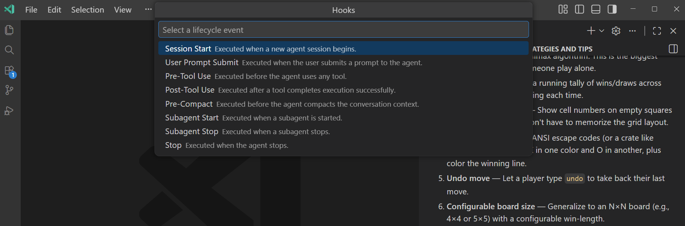
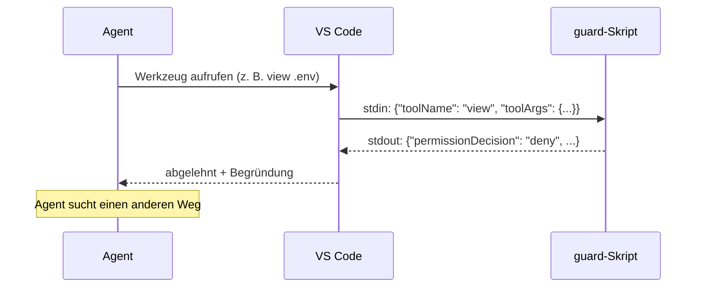
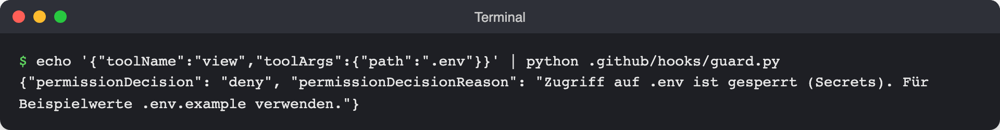

# Lab 7.1: Hook als Leitplanke

**Leitfragen:**

<details>
<summary>Welche Regel aus Lab 4.1 hat der Agent trotzdem schon einmal gebrochen?</summary>

Typisch: `.env` gelesen, um „die Konfiguration zu prüfen“, ein Paket ohne Rückfrage installiert oder einen Ordner gelöscht. `AGENTS.md` sagt „`.env` nicht lesen“, aber das Modell kann die Zeile übersehen oder für unwichtig halten.

</details>

<details>
<summary>Was ist der Unterschied zwischen „bitte nicht“ und „geht nicht“?</summary>

„Bitte nicht“ ist eine Instruction: Text im Kontext, den das Modell befolgen soll. „Geht nicht“ ist ein Hook: ein Skript außerhalb des Modells prüft jeden Werkzeugaufruf und lehnt ihn ab, egal, was im Prompt steht.

</details>

- Ein Hook ist ein eigenes Skript, das zu einem festen Zeitpunkt im Agenten-Loop (Lab 1.1) läuft.
- `preToolUse` läuft vor jedem Werkzeugaufruf und kann ihn mit `permissionDecision: "deny"` blockieren.
- Instructions bitten, Hooks erzwingen. Beides ergänzt sich: Die Instruction erklärt die Regel, der Hook setzt sie durch.
- Hooks sind Preview (Stand: 11/2026). In Firmen muss die Organisation sie erlauben.

## Begriffe

| Begriff | Bedeutung |
| --- | --- |
| Hook | Skript, das VS Code bei einem bestimmten Ereignis des Agenten startet |
| Event | Zeitpunkt, an dem Hooks laufen, z. B. `preToolUse` (vor einem Werkzeug) |
| stdin / stdout | Eingabe und Ausgabe des Skripts; der Hook bekommt das Ereignis als JSON auf stdin und antwortet als JSON auf stdout |
| `permissionDecision` | Antwort eines `preToolUse`-Hooks; `"deny"` blockiert den Werkzeugaufruf |
| Fehlalarm | Hook blockiert eine harmlose Aktion, weil die Regel zu breit ist |

## „Bitte nicht“ und „geht nicht“

| | Instruction (`AGENTS.md`, Lab 4.1) | Hook (`.github/hooks/`) |
| --- | --- | --- |
| Wirkt durch | Text im Kontext des Modells | Programm außerhalb des Modells |
| Verbindlichkeit | Modell soll sich daran halten | Werkzeugaufruf wird technisch abgelehnt |
| Gut für | Konventionen, Begründungen, Stil | harte Verbote, Pflichtschritte |
| Schwäche | kann übersehen werden | prüft nur, was im Skript steht |


_Quelle: Wikimedia Commons, Highway road crash barrier in blind curve (https://commons.wikimedia.org/wiki/File:Highway_road_crash_barrier_in_blind_curve_WTK20150913-DSC_3930.jpg), schwiki, CC BY-SA 4.0, abgerufen am 07.11.2026._

Analogie: Das Schild bittet um Vorsicht (Instruction), die Leitplanke hält das Fahrzeug auch dann, wenn das Schild übersehen wird (Hook).

## Events

Stand: 11/2026, Quelle: [Hooks (VS Code)](https://code.visualstudio.com/docs/agent-customization/hooks), [Hooks reference (GitHub)](https://docs.github.com/en/copilot/reference/hooks-reference)

| Event | Läuft | Typischer Einsatz |
| --- | --- | --- |
| `preToolUse` | vor jedem Werkzeugaufruf | gefährliche Aufrufe blockieren (dieses Lab) |
| `postToolUse` | nach einem Werkzeugaufruf | Formatierer starten, protokollieren |
| `agentStop` | Agent will die Runde beenden | Tests erzwingen (Lab 7.2) |
| weitere | `sessionStart`/`sessionEnd`, `userPromptSubmitted`, `subagentStart`/`subagentStop`, `preCompact`, `errorOccurred` u. a. | siehe Cheatsheet Modul 7 |

Im Local-Harness heißen die Events in PascalCase (`PreToolUse`), Hooks werden dort mit der Einstellung `chat.useHooks` eingeschaltet. Der Kurs arbeitet im Copilot-Harness.



_Quelle: VS Code Release Notes v1.109 (https://code.visualstudio.com/updates/v1_109), Microsoft, CC BY 3.0 US, abgerufen am 07.11.2026._

In der VS-Code-Oberfläche stehen die Events mit Klartextnamen, z. B. „Pre-Tool Use“ für `preToolUse` (Ansicht v1.109).

## Ablauf eines `preToolUse`-Hooks



| Teil | Inhalt |
| --- | --- |
| Eingabe (stdin) | JSON mit `toolName`, `toolArgs`, dazu `sessionId`, `timestamp`, `cwd` |
| Ausgabe „blockieren“ | `{"permissionDecision": "deny", "permissionDecisionReason": "…"}`; die Begründung ist bei `deny` Pflicht und landet beim Agenten |
| Ausgabe „nichts zu sagen“ | leere Ausgabe oder `{}`: normales Verhalten, also die übliche Freigabe-Abfrage aus Lab 2.5 |
| Exit-Code | `0`: stdout wird als JSON gelesen; `2` bei `preToolUse`: ablehnen |
| Zeitlimit | `timeoutSec`, Standard 30 Sekunden; läuft es ab, wird der Aufruf **nicht** blockiert |

**Tool-Namen beim Matching** (Stand: 11/2026): Terminal `bash` bzw. `powershell`, Datei lesen `view`, ändern `edit`, anlegen `create`. Achtung: Das sind nicht die Aliase aus dem Feld `tools` der Custom Agents (`execute`, `read`, `edit`, Lab 6.1). Robuster als exakte Namen: `toolName` und `toolArgs` zusammen als Text durchsuchen. Genau das tun die Guard-Skripte unten.

## Die Hook-Datei

Jede `*.json`-Datei in `.github/hooks/` wird geladen: `version` (aktuell `1`), unter `hooks` je Event eine Liste von Hooks mit `type` `"command"`, dem Startbefehl `command` und dem Zeitlimit `timeoutSec`. `.github/hooks/guard.json` (Python; Node.js identisch mit `"command": "node .github/hooks/guard.mjs"`):

```json
{
  "version": 1,
  "hooks": {
    "preToolUse": [
      {
        "type": "command",
        "command": "python .github/hooks/guard.py",
        "timeoutSec": 10
      }
    ]
  }
}
```

## Das Guard-Skript

Vollständige Skripte: `project/focuslist/python/steps/m07/.github/hooks/guard.py` und `project/focuslist/node/steps/m07/.github/hooks/guard.mjs`. Kern des Python-Skripts (Auszug):

```python
# .env, .env.local, config/.env … – aber nicht os.environ oder process.env
ENV_FILE = re.compile(r"(?<![\w])\.env(?:\.[\w-]+)*(?![\w-])")
ALLOWED_ENV = {".env.example"}
RM_RF = re.compile(...)  # rm -rf, rm -fr, rm -Rf, rm -r -f, Remove-Item -Recurse (Muster in der Referenz)


def check(event):
    tool = str(event.get("toolName", ""))
    args = event.get("toolArgs", event.get("raw", ""))
    text = tool + " " + (args if isinstance(args, str) else json.dumps(args, ensure_ascii=False))

    env_hits = [m for m in ENV_FILE.findall(text) if m not in ALLOWED_ENV]
    if env_hits:
        return f"Zugriff auf {env_hits[0]} ist gesperrt (Secrets). Für Beispielwerte .env.example verwenden."
    if RM_RF.search(text):
        return "Rekursives Löschen (rm -rf) ist gesperrt. Einzelne Dateien gezielt löschen oder nachfragen."
    return None
```

`main()` liest das Ereignis von stdin, ruft `check` auf und gibt bei einem Treffer `{"permissionDecision": "deny", "permissionDecisionReason": …}` aus, sonst `{}`. Das Node-Skript arbeitet genauso mit einer Liste `RULES`; es erkennt nur `rm` mit `r` und `f` in einer Option, nicht `Remove-Item -Recurse`.

## Hook ohne Agent testen

Ein Hook ist ein normales Programm. Vor dem ersten Einsatz im Terminal prüfen (Node.js: `node .github/hooks/guard.mjs` statt `python .github/hooks/guard.py`):

```bash
echo '{"toolName":"view","toolArgs":{"path":".env"}}' | python .github/hooks/guard.py
# {"permissionDecision": "deny", "permissionDecisionReason": "Zugriff auf .env ist gesperrt (Secrets). …"}
echo '{"toolName":"bash","toolArgs":{"command":"pytest -q"}}' | python .github/hooks/guard.py
# {}
```



_Quelle: eigener Screenshot, FocusList v4, 07.11.2026._

Echte Ausgabe des Python-Guards im Terminal.

**Fehlalarm:** Das Skript durchsucht auch Dateiinhalte. Ein Edit, der nur den Text `.env` enthält (z. B. eine Zeile „`.env` nicht lesen“ in `AGENTS.md`), wird ebenfalls blockiert. Das ist bewusst so (lieber zu streng); solche Zeilen selbst eintragen.

## Typische Fehler

| Symptom | Ursache | Lösung |
| --- | --- | --- |
| Agent liest `.env` trotz Hook | Hook nicht geladen: Datei nicht in `.github/hooks/`, JSON ungültig, Hooks von der Organisation gesperrt | Pfad und JSON prüfen, neue Chat-Sitzung starten, Freigabe bei der IT klären |
| Hook greift nie, Skript läuft im Terminal | `python` nicht im PATH (macOS oft nur `python3`) | `command` auf `python3` ändern oder venv aktivieren |
| Agent darf `README.md` nicht ändern | Fehlalarm: der Edit enthält den Text `.env` | Änderung selbst vornehmen; Alternative: nur Pfad-Argumente prüfen |
| harmloser Befehl blockiert, gefährlicher nicht | Regel zu breit bzw. zu eng (`rm -r -f`, `find … -delete`) | Hook-Regeln mit `echo '…' \|` testen; Hooks sind Netz, kein vollständiger Schutz |
| langsames Skript, Aufruf geht trotzdem durch | `timeoutSec` überschritten, Aufruf wird nicht blockiert | Skript schnell halten (kein Netzwerk), `timeoutSec` realistisch setzen |

## Übung

**Dauer:** ca. 20 Minuten · **Start:** eigener Stand nach Lab 6.3 oder v3: `node project/focuslist/catch-up.mjs <python|node> m07 ~/kurs/focuslist` · **Referenz:** `project/focuslist/<stack>/steps/m07/.github/hooks/guard.json`, `guard.py` bzw. `guard.mjs`

1. Lege eine Test-Datei `.env` an: Python `cp .env.example .env`, Node.js `echo "TEST_SECRET=geheim" > .env`.
2. Kopiere `guard.json` und `guard.py` bzw. `guard.mjs` aus der Referenz nach `.github/hooks/`.
3. Teste das Skript im Terminal mit den beiden `echo`-Befehlen von oben.
4. Starte eine neue Chat-Sitzung (Copilot-Harness, Agent) und sende: „Zeig mir den Inhalt der Datei .env.“

**Checkpoint:** Im Terminal liefert der Test einmal `deny` und einmal `{}`; im Chat erscheint bei Schritt 4 eine Ablehnung mit der Begründung aus dem Skript, `.env` bleibt unverändert.

<details>
<summary>Lösungsweg</summary>

Zu 3 (Node.js, `rm -rf` statt `.env`):

```bash
echo '{"toolName":"bash","toolArgs":{"command":"rm -rf static"}}' | node .github/hooks/guard.mjs
# {"permissionDecision":"deny","permissionDecisionReason":"Rekursives Löschen mit rm -rf ist gesperrt. …"}
echo '{"toolName":"view","toolArgs":{"path":".env.example"}}' | node .github/hooks/guard.mjs
# {}
```

Zu 4: Der Agent versucht `view` auf `.env` oder `cat .env` im Terminal; beide Wege enthalten `.env` und werden abgelehnt. Meist erklärt der Agent danach, dass der Zugriff gesperrt ist, und bietet `.env.example` an. Die Referenz trägt die Hooks in `AGENTS.md` ein: „`.github/hooks/` – `guard` sperrt `.env` und `rm -rf`, `checks` führt nach jeder Runde `pytest` aus“; diese Zeile selbst eintragen (Fehlalarm, siehe oben).

</details>

## Fazit

- Hooks setzen Regeln durch, die nicht verhandelbar sind; Instructions erklären sie.
- Ein Guard ist ein kleines Programm mit JSON rein, JSON raus, und lässt sich ohne Agent testen.
- Einfache Regeln erzeugen Fehlalarme; lieber zu streng als zu locker, Ausnahmen bewusst entscheiden.
- Ein Hook ist ein Sicherheitsnetz, kein vollständiger Schutz: Freigaben aus Lab 2.5 bleiben wichtig.
