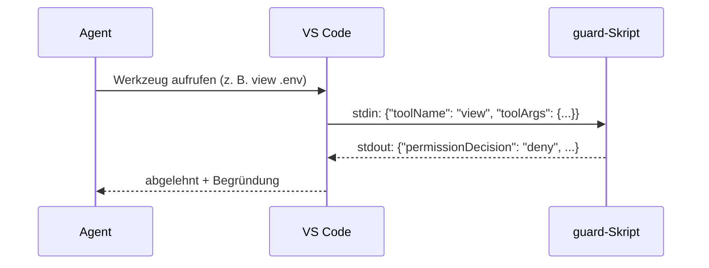

# Lab 7.1: Hook als Leitplanke

**Leitfragen:**

<details>
<summary>Welche Regel aus Lab 4.1 hat der Agent trotzdem schon einmal gebrochen?</summary>

Typisch: `.env` gelesen, um „die Konfiguration zu prüfen“, ein Paket ohne Rückfrage installiert oder einen Ordner gelöscht. `AGENTS.md` sagt „`.env` nicht lesen“, aber das Modell kann die Zeile übersehen oder für unwichtig halten.

</details>

<details>
<summary>Was ist der Unterschied zwischen „bitte nicht“ und „geht nicht“?</summary>

„Bitte nicht“ ist eine Instruction: Text im Kontext, den das Modell befolgen soll. „Geht nicht“ ist ein Hook: ein Skript außerhalb des Modells prüft jeden Werkzeugaufruf und lehnt ihn ab, egal, was im Prompt steht.

</details>

- Ein Hook ist ein eigenes Skript, das zu einem festen Zeitpunkt im Agenten-Loop (Lab 1.1) läuft.
- Im Copilot-Harness genügt eine JSON-Datei in `.github/hooks/`; eine Einstellung ist nicht nötig.
- `preToolUse` läuft vor jedem Werkzeugaufruf: mitschreiben (Beispiel `audit`) oder mit `permissionDecision: "deny"` blockieren (Guard).
- Instructions bitten, Hooks erzwingen. Hooks sind Preview (Stand: 11/2026).

## Begriffe

| Begriff | Bedeutung |
| --- | --- |
| Hook | Skript, das VS Code bei einem bestimmten Ereignis des Agenten startet |
| Event | Zeitpunkt, an dem Hooks laufen, z. B. `preToolUse` (vor einem Werkzeug) |
| Hook-Datei | JSON-Datei in `.github/hooks/`, die sagt, welches Skript bei welchem Event startet |
| stdin / stdout | Eingabe und Ausgabe des Skripts; der Hook bekommt das Ereignis als JSON auf stdin und antwortet als JSON auf stdout |
| `permissionDecision` | Antwort eines `preToolUse`-Hooks; `"deny"` blockiert den Werkzeugaufruf |

## Wo Hooks aktiviert werden

Stand: 11/2026, Quellen: [Hooks (VS Code)](https://code.visualstudio.com/docs/agent-customization/hooks), [Agent Debug Logs (VS Code)](https://code.visualstudio.com/docs/agents/agent-troubleshooting/chat-debug-view)

| | Copilot-Harness (Kurs) | Local-Harness |
| --- | --- | --- |
| Aktivierung | keine Einstellung; Session-Ziel „Copilot“ wählen und eine **neue** Sitzung starten | Einstellung `chat.useHooks` (Standard: an) und vertrauenswürdiger Workspace |
| Dateiort | `.github/hooks/*.json` in der Projektwurzel, wird automatisch gefunden | `.github/hooks/*.json`; weitere Orte über `chat.hookFilesLocations` (gilt nicht für Copilot) |
| Prüfen, ob geladen | Chat-Ansicht → „Open Customizations“ → Reiter „Hooks“ (Agents-Fenster: „Customizations“ → „Hooks“) oder `/hooks` im Chat-Eingabefeld | ebenso |
| Läufe ansehen | „…“-Menü der Chat-Ansicht → „Show Agent Debug Logs“; vorher die experimentelle Einstellung `chat.agentHost.agentDebugLog.enabled` einschalten | „Show Agent Debug Logs“ |
| Erstellen per UI | Reiter „Hooks“ → „New Hook“ (Plus neben Workspace oder User) → Event, z. B. „Pre-Tool Use“ → „Create new hook config file...“ | ebenso, dazu `/create-hook` und „Chat: Generate Hook“ |

- Hooks sind Preview; die Organisation kann einschränken, welche Hooks laufen dürfen.
- Eine eigene Chat-Meldung pro Hook-Lauf gibt es im Copilot-Harness nicht. Ein blockierter Aufruf zeigt sich daran, dass der Agent die Begründung der Ablehnung meldet.


_Quelle: VS Code Docs, Agent Debug Logs (https://code.visualstudio.com/docs/agents/agent-troubleshooting/chat-debug-view), Microsoft, CC BY 3.0 US, abgerufen am 08.11.2026._

Die Debug Logs zeigen beim Start, wie viele Hooks geladen wurden („Load Hooks“), danach jeden Werkzeugaufruf der Sitzung.

## Erster Hook zum Ausprobieren: jeden Werkzeugaufruf mitschreiben

Fertiges Beispiel: `m07-hooks-mcp/samples/audit/` (offizielles VS-Code-Beispiel „Create your first Copilot hook“, Microsoft, CC BY 3.0 US). Es blockiert nichts und schreibt nur den Namen jedes Werkzeugs in eine Datei. Braucht Node.js, das in beiden Stacks installiert ist.

```text
Agent will ein Werkzeug nutzen → VS Code startet: node .github/hooks/log-tool-use.cjs
  → stdin:  {"toolName": "view", "toolArgs": {...}, ...}
  → Skript hängt "view" an .github/hooks/tool-use.log an
  → stdout: {}   (keine Entscheidung, normale Freigabe läuft weiter)
```

`.github/hooks/audit.json`:

```json
{
  "version": 1,
  "hooks": {
    "preToolUse": [
      { "type": "command", "command": "node .github/hooks/log-tool-use.cjs", "timeoutSec": 10 }
    ]
  }
}
```

`.github/hooks/log-tool-use.cjs` (Kern, vollständig mit Kommentaren im Beispielordner):

```js
const event = JSON.parse(fs.readFileSync(0, 'utf8'));          // Ereignis von stdin
fs.appendFileSync(path.join(__dirname, 'tool-use.log'),        // eine Zeile pro Aufruf
  `${JSON.stringify(event.toolName)}\n`);
process.stdout.write('{}');                                     // keine Entscheidung
```

- `command` startet relativ zur Projektwurzel und gilt für macOS, Linux und Windows; `timeoutSec` ist das Zeitlimit (Standard 30).
- `{}` heißt „nichts zu sagen“: Der Aufruf wird **nicht** automatisch erlaubt, die Freigabe-Abfrage aus Lab 2.5 bleibt.

Nach einer Aufgabe wie „Zeige die Dateien im Ordner data“ stehen in `.github/hooks/tool-use.log` Zeilen wie `"view"` oder `"bash"`, je nachdem, welches Werkzeug der Agent wählt. Die Datei lässt sich jederzeit löschen; sie entsteht beim nächsten Aufruf neu.

## „Bitte nicht“ und „geht nicht“

| | Instruction (`AGENTS.md`, Lab 4.1) | Hook (`.github/hooks/`) |
| --- | --- | --- |
| Wirkt durch | Text im Kontext des Modells | Programm außerhalb des Modells |
| Verbindlichkeit | Modell soll sich daran halten | Werkzeugaufruf wird technisch abgelehnt |
| Gut für | Konventionen, Begründungen, Stil | harte Verbote, Pflichtschritte |

Das Schild bittet um Vorsicht (Instruction), die Leitplanke hält auch dann, wenn das Schild übersehen wird (Hook).

## Events

| Event | Läuft | Typischer Einsatz |
| --- | --- | --- |
| `preToolUse` | vor jedem Werkzeugaufruf | mitschreiben (`audit`), blockieren (Guard) |
| `postToolUse` | nach einem Werkzeugaufruf | Formatierer starten |
| `agentStop` | Agent will die Runde beenden | Tests erzwingen (Lab 7.2) |
| weitere | `sessionStart`, `userPromptSubmitted`, `subagentStart`, `preCompact` u. a. | siehe Cheatsheet Modul 7 |


_Quelle: VS Code Release Notes v1.109 (https://code.visualstudio.com/updates/v1_109), Microsoft, CC BY 3.0 US, abgerufen am 07.11.2026._

Die Oberfläche zeigt Klartextnamen, z. B. „Pre-Tool Use“ für `preToolUse`. Im Local-Harness heißen die Events in PascalCase (`PreToolUse`).

## Guard: Werkzeugaufrufe ablehnen



| Teil | Inhalt |
| --- | --- |
| Eingabe (stdin) | `toolName`, `toolArgs`, dazu `sessionId`, `timestamp`, `cwd` |
| Ausgabe „blockieren“ | `{"permissionDecision": "deny", "permissionDecisionReason": "…"}`; die Begründung ist Pflicht und landet beim Agenten |
| Zeitlimit abgelaufen | Aufruf wird **nicht** blockiert |

**Tool-Namen** (Stand: 11/2026): Terminal `bash` bzw. `powershell`, lesen `view`, ändern `edit`, anlegen `create`; nicht die Aliase `execute`, `read` aus Lab 6.1. Robuster: `toolName` und `toolArgs` zusammen als Text durchsuchen.

`guard.json` sieht aus wie `audit.json`, nur mit `"command": "node .github/hooks/guard.mjs"` (Node.js) bzw. zwei Feldern für Python: `"bash": "python3 .github/hooks/guard.py"` (macOS/Linux) und `"powershell": "python .github/hooks/guard.py"` (Windows). Ein Feld `command` gilt für alle Systeme; `bash` und `powershell` haben Vorrang, wenn sie gesetzt sind (Quelle: [GitHub Docs, Hooks reference](https://docs.github.com/en/copilot/reference/hooks-reference), abgerufen am 08.11.2026). Kern von `guard.py` (vereinfacht; vollständig in `project/focuslist/<stack>/steps/m07/.github/hooks/`):

```python
ENV_FILE = re.compile(r"(?<![\w])\.env(?:\.[\w-]+)*(?![\w-])")   # .env, .env.local, nicht os.environ

def check(event):
    text = str(event.get("toolName", "")) + " " + json.dumps(event.get("toolArgs", ""))
    hits = [m for m in ENV_FILE.findall(text) if m != ".env.example"]
    if hits:
        return f"Zugriff auf {hits[0]} ist gesperrt (Secrets). Für Beispielwerte .env.example verwenden."
    if RM_RF.search(text):                 # RM_RF: regulärer Ausdruck für rm -rf und Varianten
        return "Rekursives Löschen (rm -rf) ist gesperrt. …"
```

Bei einem Treffer gibt `main()` `deny` mit dieser Begründung aus, sonst `{}`. Das Node-Skript arbeitet gleich, erkennt aber `Remove-Item -Recurse` nicht.

**Fehlalarm** (harmlose Aktion blockiert): Das Skript durchsucht auch Dateiinhalte, ein Edit mit dem Text `.env` (z. B. in `AGENTS.md`) wird ebenfalls blockiert. Lieber zu streng; solche Zeilen selbst eintragen.

## Hook ohne Agent testen

Zum Nachlesen, nicht Teil der Übung; hilft, wenn im Chat nichts passiert: Ein Hook ist ein normales Programm, das sich im Terminal (Projektordner) mit einem Beispiel-Ereignis starten lässt.

```bash
echo '{"toolName":"view","toolArgs":{"path":"data/tasks.json"}}' | node .github/hooks/log-tool-use.cjs
# {}        und in .github/hooks/tool-use.log steht "view"
echo '{"toolName":"view","toolArgs":{"path":".env"}}' | python3 .github/hooks/guard.py   # Windows: python
# {"permissionDecision": "deny", "permissionDecisionReason": "Zugriff auf .env ist gesperrt (Secrets). …"}
```


_Quelle: eigener Screenshot, FocusList Stand m07, 07.11.2026._

## Typische Fehler

| Symptom | Ursache | Lösung |
| --- | --- | --- |
| Hook fehlt im Reiter „Hooks“ bzw. bei `/hooks` | Datei nicht in `.github/hooks/` der Projektwurzel (z. B. übergeordneter Ordner in VS Code geöffnet) oder JSON ungültig | Ordner `focuslist` direkt öffnen, Pfad `.github/hooks/audit.json` und JSON prüfen |
| `tool-use.log` entsteht nicht | Sitzung lief schon vor dem Kopieren, Session-Ziel „Local“ statt „Copilot“, Organisation sperrt Hooks | neue Copilot-Sitzung starten; Freigabe bei der IT klären |
| Pipe-Test meldet `node` bzw. `python3` nicht gefunden | Programm nicht im PATH | Node.js bzw. Python laut Setup installieren, VS Code neu starten; auf Windows heißt der Befehl `python` |
| Hook läuft nicht, Pipe-Test im Terminal klappt | Hook startet ohne aktive venv und ohne den Befehl aus dem Terminal; Feld `bash` bzw. `powershell` passt nicht zum installierten Python | in einem neuen Terminal ohne venv `python3 --version` (Windows: `python --version`) prüfen und den Befehl in `guard.json` anpassen |
| Agent liest `.env` trotz Guard | `guard.json` fehlt oder Guard-Skript nicht mitkopiert | beide Dateien nach `.github/hooks/`, neue Sitzung |

## Übung

**Dauer:** ca. 20 Minuten · **Start:** Arbeitsordner (Tag 2: `$HOME/kurs/focuslist-m05`) nach Lab 6.3; Neueinstieg mit v3: `node project/focuslist/catch-up.mjs <python|node> m07 $HOME/kurs/focuslist-m07`, danach Setup laut `README.md` des Stands (venv und `pip install -r requirements.txt` bei Python, `npm install`, `npm run build:css`) und dort weiterarbeiten; dann in den Befehlen unten `focuslist-m07` statt `focuslist-m05` · **Referenz:** `m07-hooks-mcp/samples/audit/`, `project/focuslist/<stack>/steps/m07/.github/hooks/`

1. Kopiere das Beispiel in FocusList (Terminal im Ordner `output/`): `cp -r m07-hooks-mcp/samples/audit/.github $HOME/kurs/focuslist-m05/`.
2. Wähle in der Chat-Ansicht das Session-Ziel „Copilot“ und prüfe unter „Open Customizations“ → „Hooks“ oder mit `/hooks`, ob `audit.json` erscheint.
3. Starte eine neue Copilot-Sitzung (Agent), sende „Zeige die Dateien im Ordner data“ und öffne danach `.github/hooks/tool-use.log`.
4. Kopiere `guard.json` und `guard.py` bzw. `guard.mjs` aus `project/focuslist/<stack>/steps/m07/.github/hooks/` nach `$HOME/kurs/focuslist-m05/.github/hooks/` und lege im Arbeitsordner eine Test-Datei `.env` an, falls sie fehlt: in VS Code „Neue Datei“, Name `.env`, Inhalt `TEST_SECRET=geheim`, speichern.
5. Starte eine neue Copilot-Sitzung und sende: „Zeig mir den Inhalt der Datei .env.“

**Checkpoint:** Der Reiter „Hooks“ listet `audit.json` (nach Schritt 4 auch `guard.json`); `tool-use.log` enthält nach Schritt 3 mindestens eine Zeile; der Agent meldet in Schritt 5 eine Ablehnung mit der Begründung aus dem Guard, `.env` bleibt unverändert.

<details>
<summary>Lösungsweg</summary>

Zu 1 und 3: `audit.json` und `log-tool-use.cjs` liegen in `$HOME/kurs/focuslist-m05/.github/hooks/` (bzw. im Catch-up-Ordner); `tool-use.log` enthält z. B. `"view"` oder `"bash"`, eine Zeile pro Werkzeugaufruf. Bleibt die Datei leer: Pipe-Test aus „Hook ohne Agent testen“ ausführen, dann die Tabelle „Typische Fehler“.

Zu 5: Der Agent versucht `view` auf `.env` oder `cat .env` im Terminal; beide Wege enthalten `.env` und werden abgelehnt. Meist erklärt der Agent danach, dass der Zugriff gesperrt ist, und bietet `.env.example` an. Der Versuch steht trotzdem in `tool-use.log`: Beide Hooks laufen bei `preToolUse`, `audit` schreibt mit, der Guard lehnt ab.

</details>

## Fazit

- Im Copilot-Harness ist ein Hook aktiv, sobald seine Datei in `.github/hooks/` liegt und eine neue Copilot-Sitzung startet.
- „Hooks“-Reiter bzw. `/hooks` zeigen, was geladen ist; `tool-use.log` und die Debug Logs zeigen, dass er läuft.
- Ein Hook ist ein kleines Programm mit JSON rein, JSON raus, und lässt sich ohne Agent testen.
- Hooks setzen Regeln durch; Freigaben aus Lab 2.5 bleiben trotzdem wichtig.
