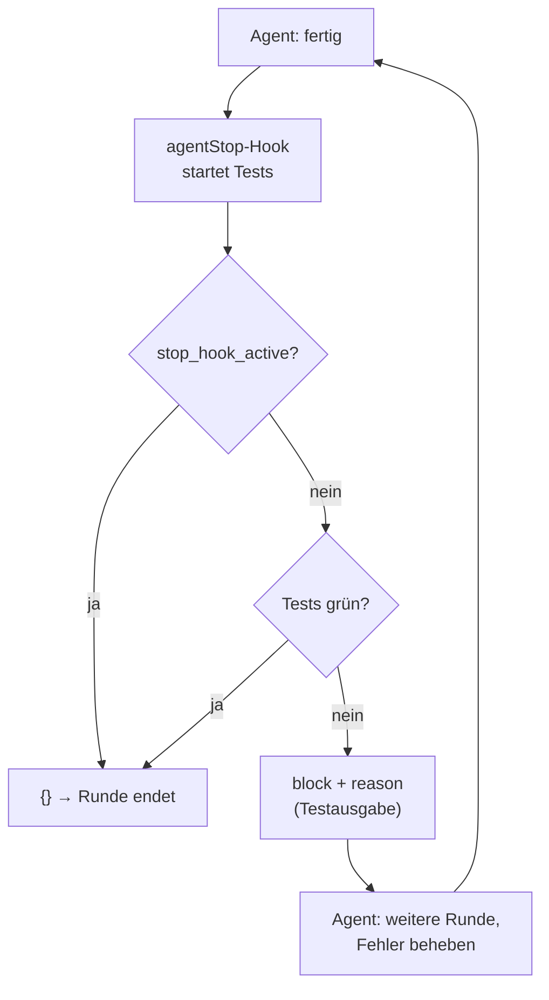
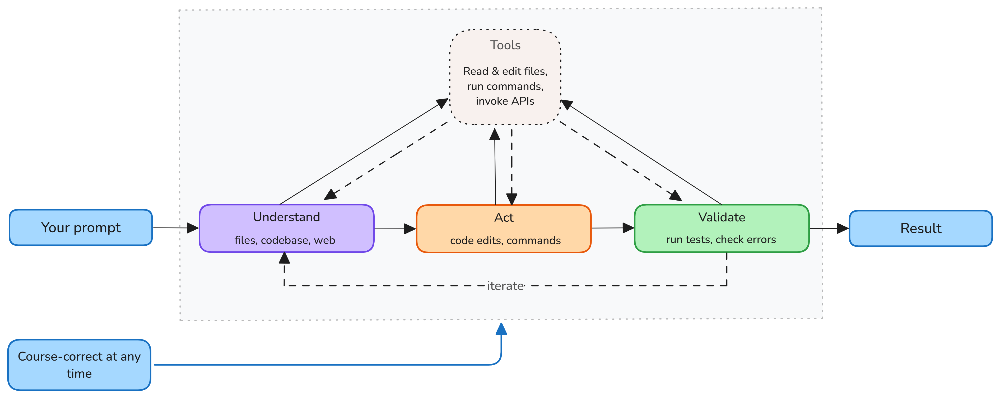
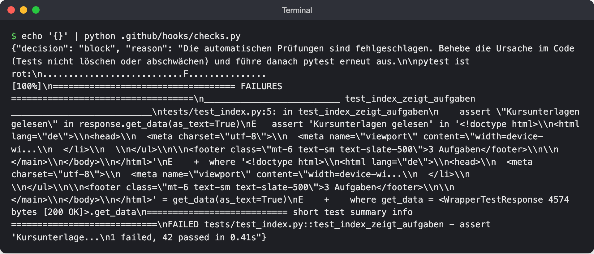

# Lab 7.2: Hook als Prüfschritt

**Leitfragen:**

<details>
<summary>Wie oft vergisst man selbst, die Tests laufen zu lassen?</summary>

Öfter als gedacht, vor allem bei „kleinen“ Änderungen an Templates oder Texten. Der Agent vergisst es genauso (Status-quo-Liste aus Lab 3.3: „keine neuen Tests“). Ein `agentStop`-Hook macht den Testlauf zur Pflicht, ohne dass jemand daran denken muss.

</details>

<details>
<summary>Was darf ein automatischer Prüfschritt maximal dauern?</summary>

So kurz, dass niemand ihn abschalten will: einige Sekunden, höchstens etwa eine Minute. Lange Suiten (End-to-End, Lasttests) gehören in CI, nicht in einen Hook, der nach jeder Agent-Runde läuft.

</details>

- `agentStop` läuft, wenn der Agent seine Runde beenden will.
- Der Hook kann mit `{"decision": "block", "reason": "…"}` eine weitere Runde erzwingen; `reason` wird der nächste Auftrag an den Agenten.
- Schutz vor Endlosschleifen: Ist `stop_hook_active` gesetzt, nicht erneut blockieren. Nach 8 Blockaden in Folge endet die Runde ohnehin.
- Prüfschritte müssen schnell und zuverlässig sein, sonst bremsen sie jede Runde.

## Begriffe

| Begriff | Bedeutung |
| --- | --- |
| `agentStop` | Event, wenn der Agent mit der Antwort fertig ist und die Runde beenden will |
| `decision: "block"` | Antwort eines `agentStop`-Hooks: Agent darf noch nicht aufhören |
| `reason` | Text, den der Agent als neuen Auftrag bekommt |
| `stop_hook_active` | Feld in der Eingabe: `true`, wenn die laufende Runde schon durch einen Stop-Hook erzwungen wurde |
| `timeoutSec` | Zeitlimit für den Hook in Sekunden, Standard 30 |

## Ablauf





_Quelle: VS Code Docs, Agents (https://code.visualstudio.com/docs/agents/concepts/agents), Microsoft, CC BY 3.0 US, abgerufen am 07.11.2026._

Im Agent-Loop setzt `agentStop` dort an, wo der Agent zum Ergebnis übergehen will; bei roten Tests geht es zurück in die Schleife.

Stand: 11/2026, Quelle: [Hooks (VS Code)](https://code.visualstudio.com/docs/agent-customization/hooks), [Hooks reference (GitHub)](https://docs.github.com/en/copilot/reference/hooks-reference)

| Eingabe / Ausgabe | Inhalt |
| --- | --- |
| stdin | JSON, u. a. `stop_hook_active` und `cwd` |
| stdout `{}` | Runde endet normal |
| stdout `{"decision": "block", "reason": "…"}` | Agent bekommt eine weitere Runde, `reason` ist der Prompt |
| Grenze | nach 8 Blockaden in Folge endet die Runde trotzdem |

## Die Hook-Datei

Aktivieren und prüfen wie in [Lab 7.1, „Wo Hooks aktiviert werden“](l01-guard-hook.md#wo-hooks-aktiviert-werden). `.github/hooks/checks.json` (Python; Node.js identisch mit einem einzigen Feld `"command": "node .github/hooks/checks.mjs"`). Python braucht zwei Felder, weil der Befehl auf macOS/Linux meist `python3` und auf Windows `python` heißt: `bash` gilt für macOS/Linux, `powershell` für Windows.

```json
{
  "version": 1,
  "hooks": {
    "agentStop": [
      {
        "type": "command",
        "bash": "python3 .github/hooks/checks.py",
        "powershell": "python .github/hooks/checks.py",
        "timeoutSec": 60
      }
    ]
  }
}
```

`timeoutSec: 60` statt Standard 30: Testlauf plus CSS-Build brauchen etwas Luft. Mehr als eine Minute wäre ein Zeichen, dass der Prüfschritt zu groß ist.

## Das Prüfskript

Vollständige Skripte: `project/focuslist/python/steps/m07/.github/hooks/checks.py` und `project/focuslist/node/steps/m07/.github/hooks/checks.mjs`.

| | Python `checks.py` | Node.js `checks.mjs` |
| --- | --- | --- |
| Tests | `pytest -q` mit dem Python aus `.venv`, falls vorhanden | `node --test` auf `test/**/*.test.js` |
| CSS | zusätzlich `npm run build:css`, wenn `node_modules/` existiert | kein CSS-Build |
| Bei Rot | `block` mit den letzten 25 Zeilen der Ausgabe | `block` mit den letzten 30 Zeilen |

Kern von `checks.py` (Auszug; `read_event`, `run` und `python_exe` lesen stdin, starten einen Befehl im Projektordner und wählen das Python aus `.venv`):

```python
def main():
    event = read_event()
    if event.get("stop_hook_active"):
        print("{}")
        return

    problems = []
    code, output = run([python_exe(), "-m", "pytest", "-q", "--no-header", "--tb=short", "-p", "no:cacheprovider"])
    if code != 0:
        tail = "\n".join(output.splitlines()[-25:])
        problems.append(f"pytest ist rot:\n{tail}")

    if (ROOT / "node_modules").is_dir():
        code, output = run(["npm", "run", "build:css", "--silent"])
        if code != 0:
            problems.append(f"Tailwind-Build fehlgeschlagen:\n{output[-1500:]}")

    if problems:
        reason = ("Die automatischen Prüfungen sind fehlgeschlagen. Behebe die Ursache im Code "
                  "(Tests nicht löschen oder abschwächen) und führe danach pytest erneut aus.\n\n"
                  + "\n\n".join(problems))
        print(json.dumps({"decision": "block", "reason": reason}, ensure_ascii=False))
    else:
        print("{}")
```

Der `reason`-Text ist ein Prompt: Er verbietet ausdrücklich, Tests zu löschen oder abzuschwächen. Ohne diesen Satz „repariert“ ein Agent rote Tests gern, indem er die Erwartung ändert.



_Quelle: eigener Screenshot, FocusList v4 mit absichtlich rotem Test, 07.11.2026._

Echte Ausgabe bei einem absichtlich gebrochenen Test (Übung, Schritt 3): Auftrag und Testausgabe stehen zusammen im `reason`.

## Warum Hooks schnell bleiben müssen

| Faustregel | Grund |
| --- | --- |
| nur Unit- und Routen-Tests, keine End-to-End-Suite | läuft nach jeder Agent-Runde, auch nach einer Frage ohne Änderung |
| kein Netzwerk, keine Installation | langsam und unzuverlässig; Timeout lässt den Agenten ohne Prüfung weiterarbeiten |
| Ausgabe kürzen (letzte 25–30 Zeilen) | `reason` landet im Kontext des Agenten, lange Logs verdrängen Wichtiges |
| `stop_hook_active` beachten | sonst Schleife bis zur Grenze von 8 Blockaden |

## Typische Fehler

| Symptom | Ursache | Lösung |
| --- | --- | --- |
| Agent hört nicht auf, Runde um Runde | `stop_hook_active` wird ignoriert | Feld am Anfang prüfen und `{}` ausgeben |
| Agent ändert den Test statt den Code | `reason` ohne klare Anweisung | Satz „Tests nicht löschen oder abschwächen“ im `reason`; Änderungen im Chat prüfen, bei Bedarf „Undo“ |
| Hook meldet „pytest nicht gefunden“ | kein `.venv` und System-Python ohne pytest | venv im Projektordner anlegen (`.venv`), Abhängigkeiten installieren |
| Runde dauert spürbar länger | Testlauf oder CSS-Build zu langsam | Testauswahl verkleinern, `timeoutSec` nicht höher setzen als nötig |
| Hook läuft auch nach reinen Fragen (Ask) | `agentStop` kennt keinen Unterschied | in Kauf nehmen, solange der Lauf schnell ist |

## Übung

**Dauer:** ca. 15 Minuten · **Start:** Arbeitsordner (Tag 2: `$HOME/kurs/focuslist-m05`) nach Lab 7.1 · **Referenz:** `project/focuslist/<stack>/steps/m07/.github/hooks/checks.json`, `checks.py` bzw. `checks.mjs`

1. Kopiere `checks.json` und `checks.py` bzw. `checks.mjs` aus der Referenz nach `.github/hooks/`.
2. Teste das Skript im Terminal: `echo '{}' | python3 .github/hooks/checks.py` (Windows: `python`) bzw. `echo '{}' | node .github/hooks/checks.mjs`. Bei grünen Tests ist die Ausgabe `{}`.
3. Brich einen Test absichtlich: Ändere im Beispieltest (`tests/test_index.py` bzw. `test/index.test.js`) den erwarteten Titel „Kursunterlagen lesen“ in „Kursunterlagen gelesen“. Wiederhole Schritt 2.
4. Starte eine neue Copilot-Sitzung (Agent), damit `checks.json` geladen wird, und sende: „Ändere die Überschrift der Startseite in ‚Meine Aufgaben heute‘.“ Beobachte, was nach der ersten Antwort passiert, und lies die Änderungen im Chat.
5. Setze den Test von Hand auf „Kursunterlagen lesen“ zurück und wiederhole Schritt 2.

**Checkpoint:** Schritt 3 liefert `{"decision": "block", …}` mit der Testausgabe; im Chat folgt auf die erste Antwort eine weitere Runde, in der der Agent den roten Test untersucht; nach Schritt 5 gibt das Skript wieder `{}` aus.

<details>
<summary>Lösungsweg</summary>

Zu 3, Ausgabe (Node.js, gekürzt):

```text
{"decision":"block","reason":"npm test ist rot. Behebe die fehlschlagenden Tests, ohne Tests zu löschen oder abzuschwächen, und führe danach npm test erneut aus.\n\n …"}
```

Python liefert analog `"reason": "Die automatischen Prüfungen sind fehlgeschlagen. … pytest ist rot: …"`.

Zu 4: Nach der Überschrift-Änderung meldet der Agent „fertig“, der Hook blockiert, der Agent startet eine weitere Runde mit der Testausgabe als Auftrag. Er findet heraus, dass der Test einen Titel erwartet, den es in `data/tasks.json` nicht gibt. Gute Reaktion: Er meldet den Widerspruch und fragt nach, statt Test oder Daten anzupassen. Schlechte Reaktion: Er ändert die Beispieldaten, damit der Test passt; dann im Chat „Undo“ wählen. Am Ende der zweiten Runde enthält die Eingabe `stop_hook_active: true`; der Hook blockiert dann nicht erneut, auch wenn der Test noch rot ist.

Zu 5: Hat der Agent Test oder Beispieldaten trotzdem geändert, die Änderung im Chat mit „Undo“ verwerfen und dann den Test zurücksetzen. Danach laufen `pytest` bzw. `npm test` grün.

</details>

## Fazit

- `agentStop` macht „Tests laufen lassen“ zur Pflicht statt zur Bitte.
- `reason` ist ein Prompt: klar sagen, was der Agent tun und was er nicht tun darf.
- `stop_hook_active` und ein knappes `timeoutSec` halten den Hook sicher und schnell.
