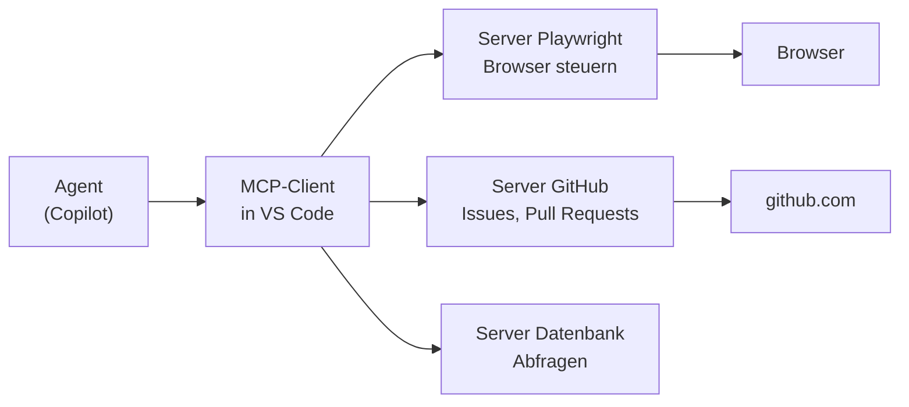
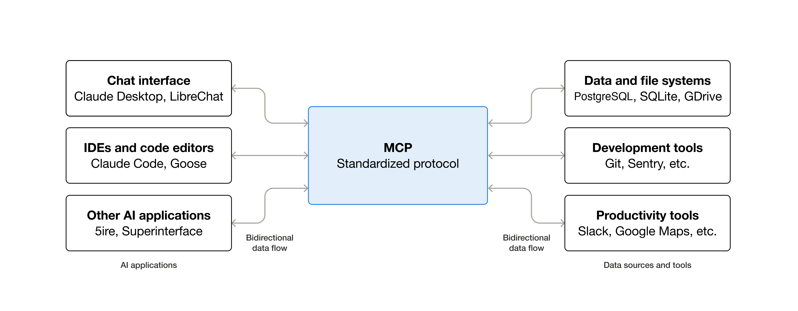
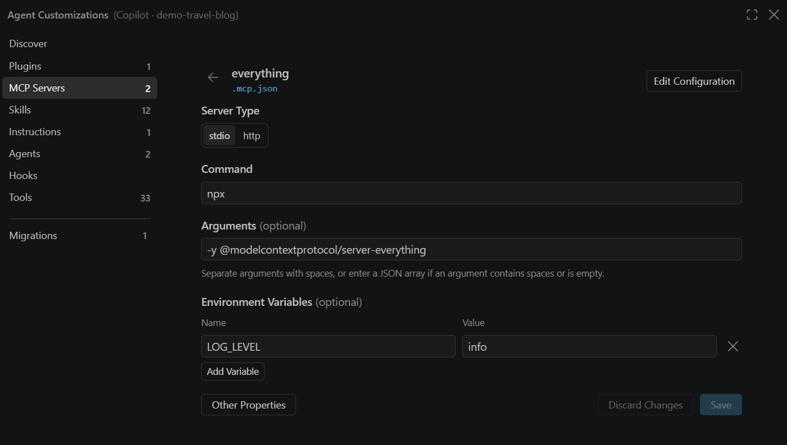

# Lab 7.3: Was ist MCP

**Leitfragen:**

<details>
<summary>Was kann der Agent bisher nicht sehen, was man selbst im Browser sieht?</summary>

Die gerenderte Seite: Layout, Farben, Umbrüche auf Handybreite, ob ein Klick wirklich etwas tut. Bisher liest der Agent nur Code und Terminal-Ausgaben (Status quo aus Lab 3.3: Der Agent hat die Seite nie im Browser gesehen).

</details>

<details>
<summary>Wem würde man Zugriff auf das eigene Firmenkonto geben?</summary>

Nur jemandem, den man kennt und dem man vertraut, mit so wenig Rechten wie nötig. Für MCP-Server gilt dasselbe: Ein Server läuft mit den Rechten des eigenen Rechners bzw. des hinterlegten Tokens.

</details>

- MCP (Model Context Protocol) ist ein offener Standard, über den ein Agent zusätzliche Werkzeuge bekommt: Browser, GitHub, Datenbank, Ticketsystem.
- Ein MCP-Server stellt Tools bereit, der Editor (VS Code) verbindet den Agenten damit. Ein Server funktioniert in jedem Werkzeug, das MCP spricht.
- Konfiguration im Projekt: `.mcp.json` mit `mcpServers`.
- Nur geprüfte Server einbinden; Freigaben für Werkzeugaufrufe (Lab 2.5) bleiben aktiv.

## Begriffe

| Begriff | Bedeutung |
| --- | --- |
| MCP | Model Context Protocol: offener Standard für die Verbindung zwischen Agent und externen Werkzeugen |
| MCP-Server | Programm, das Tools anbietet, z. B. „Seite öffnen“, „Issue anlegen“ |
| MCP-Client | Teil des Editors, der die Server startet und ihre Tools dem Agenten anbietet |
| Tool | einzelne Funktion eines Servers mit Name, Beschreibung und Parametern |
| lokaler Server | läuft als Prozess auf dem eigenen Rechner, gestartet per `command` |
| entfernter Server | läuft bei einem Anbieter, erreichbar über eine URL |

## Das Bild: ein USB-Anschluss für Agenten

Vor MCP brauchte jedes Werkzeug für jeden Dienst eine eigene Integration. MCP legt einen gemeinsamen Stecker fest: Ein Server für „Browser“ funktioniert in Copilot, Claude Code, Codex und anderen Clients.

Analogie: Ein Stecker-Standard passt an viele Geräte. MCP ist der gemeinsame Anschluss zwischen Agent und Werkzeugen.



Der Agent sieht nur Tool-Namen und Beschreibungen. Welche Tools er nutzt, entscheidet er im Loop wie bei Datei- und Terminal-Werkzeugen.



_Quelle: Model Context Protocol Docs, Introduction (https://modelcontextprotocol.io/docs/getting-started/intro), Model Context Protocol, CC BY 4.0, abgerufen am 07.11.2026._

Ein Protokoll zwischen vielen KI-Anwendungen und vielen Datenquellen und Werkzeugen.

## Herkunft

| Zeit | Ereignis |
| --- | --- |
| Nov 2024 | Anthropic veröffentlicht MCP als offenen Standard |
| Dez 2025 | Agentic AI Foundation (Linux Foundation) übernimmt MCP |

Quelle: [Linux Foundation: AAIF (09.12.2025)](https://www.linuxfoundation.org/press/linux-foundation-announces-the-formation-of-the-agentic-ai-foundation)

## Konfiguration in VS Code

Stand: 11/2026, Quelle: [MCP servers (VS Code)](https://code.visualstudio.com/docs/agent-customization/mcp-servers)

| Datei | Schlüssel | Harness |
| --- | --- | --- |
| `.mcp.json` im Projektordner | `mcpServers` | Copilot (Kursstandard), auch von anderen Werkzeugen gelesen |
| `.vscode/mcp.json` | `servers` | Local (älteres Format) |

Aufbau eines lokalen Servers in `.mcp.json`:

```json
{
  "mcpServers": {
    "playwright": {
      "command": "npx",
      "args": ["@playwright/mcp@latest"]
    }
  }
}
```

| Feld | Bedeutung |
| --- | --- |
| `playwright` | frei wählbarer Name des Servers; erscheint in der Werkzeugliste |
| `command` | Programm, das den Server startet (`npx` lädt das npm-Paket) |
| `args` | Argumente, hier das Paket `@playwright/mcp` in der neuesten Version |



_Quelle: VS Code Docs, Manage MCP servers (https://code.visualstudio.com/docs/agents/run/manage-mcp-servers), Microsoft, CC BY 3.0 US, abgerufen am 07.11.2026._

VS Code zeigt einen Server aus `.mcp.json` auch als Formular: `command` und `args` erscheinen als „Command“ und „Arguments“ (Beispielserver der VS-Code-Doku).

In Custom Agents (Lab 6.1) lassen sich MCP-Tools über das Feld `tools` freigeben, z. B. `playwright/*` für alle Tools des Servers.

## Typische Server

| Server | Tools (Auswahl) | Braucht |
| --- | --- | --- |
| Playwright (`@playwright/mcp`) | Seite öffnen, klicken, Formular ausfüllen, Screenshot | Node 18+, Browser-Download |
| GitHub | Issues lesen und anlegen, Pull Requests | GitHub-Token |
| Datenbank | Schema lesen, Abfragen ausführen | Zugangsdaten |

## Vertrauen und Sicherheit

| Risiko | Gegenmaßnahme |
| --- | --- |
| Server führt beliebigen Code auf dem Rechner aus | nur Server aus bekannter Quelle (offizielle Hersteller, geprüfte Repos) |
| Token mit zu vielen Rechten | eigenes Token mit minimalen Rechten, nie in `.mcp.json` eintragen (die Datei wird mit dem Projekt geteilt) |
| Server liest Inhalte, die Anweisungen enthalten (z. B. eine Webseite mit „ignoriere alle Regeln“) | Freigaben für Werkzeugaufrufe aktiv lassen, Ergebnisse prüfen |
| zu viele Tools verwirren den Agenten | nur Server einbinden, die das Projekt wirklich braucht |
| Firmenrichtlinie | MCP kann von der Organisation gesperrt sein; vorher klären |

VS Code fragt beim ersten Start eines Servers aus dem Workspace nach, ob dem Server vertraut wird (Stand: 11/2026).

## Welches Werkzeug fehlt FocusList?

Aus der Status-quo-Liste aus Lab 3.3 bleiben Zeilen offen, für die der Agent etwas außerhalb von Code und Terminal sehen oder tun müsste:

| Fehlendes Werkzeug | Aufgabe | Rechte / Risiko |
| --- | --- | --- |
| Browser (Playwright) | Formular ausfüllen, Darstellung auf Handybreite prüfen (Status-quo-Liste, Zeile 7: feste Breiten `w-96`) | nur lokaler Browser, keine Konten; niedriges Risiko |
| GitHub | Issue „Fälligkeitsdatum“ lesen, Pull Request vorbereiten | Token mit Repo-Rechten; Risiko: falsches Repo, ungewollter PR |
| Datenbank | – (FocusList nutzt eine JSON-Datei) | entfällt |

Auswahl für Lab 7.4: Browser über Playwright. Grund: sichtbarer Mehrwert bei einer Web-App, keine Zugangsdaten nötig.

## Fazit

- MCP gibt dem Agenten Werkzeuge außerhalb des Editors über einen gemeinsamen Standard.
- Die Konfiguration steht im Projekt (`.mcp.json`), damit das ganze Team dieselben Server nutzt.
- Jeder Server ist Code mit Rechten: nur geprüfte Server, minimale Rechte, Freigaben an.
