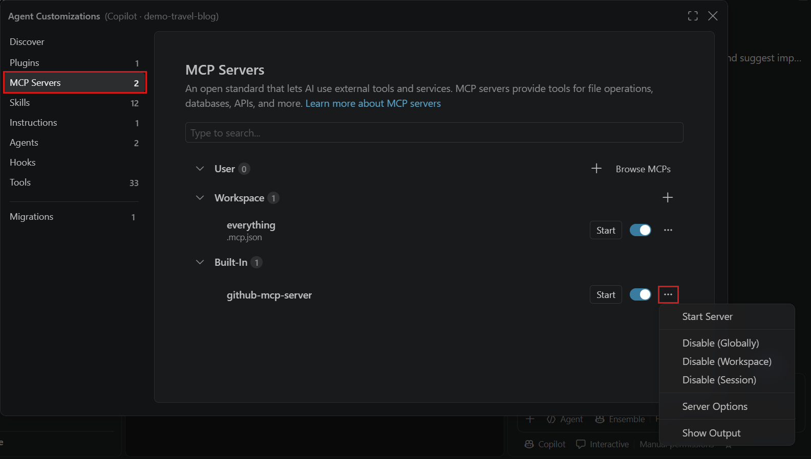
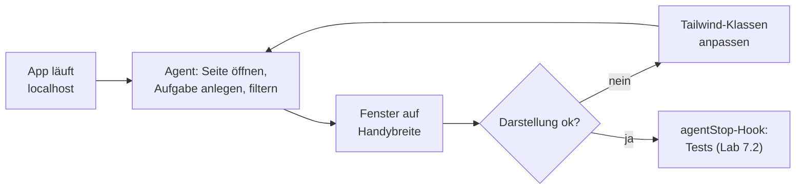
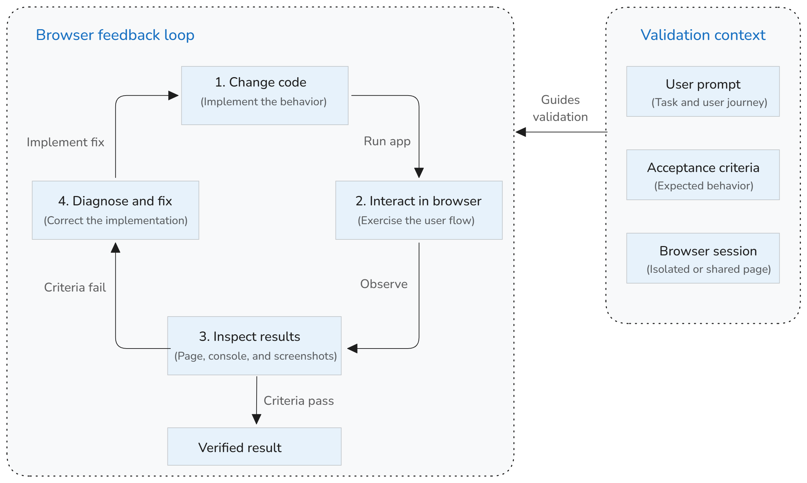
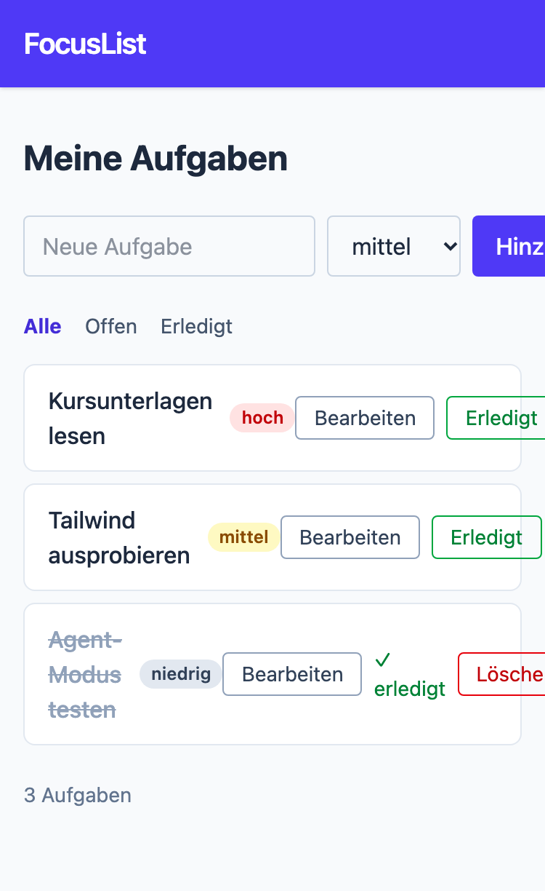
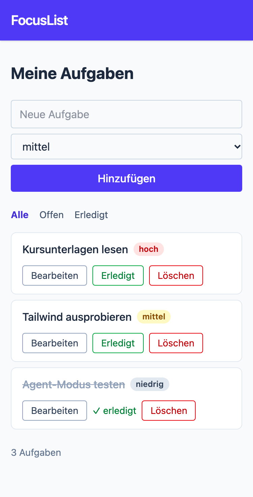

# Lab 7.4: Agent mit Browser

**Leitfragen:**

<details>
<summary>Wie testet man heute, ob ein Formular auf dem Handy funktioniert?</summary>

Meist von Hand: Browser-Entwicklertools auf Gerätebreite stellen oder das eigene Handy nehmen, klicken, schauen. Das kostet Zeit und wird bei kleinen Änderungen gern übersprungen.

</details>

<details>
<summary>Was müsste ein Agent können, um einen UI-Bug selbst zu finden?</summary>

Die laufende App öffnen, wie ein Mensch bedienen (tippen, klicken), die Fenstergröße ändern und das Ergebnis sehen: als Struktur der Seite und als Screenshot. Genau diese Werkzeuge liefert der Playwright-MCP-Server.

</details>

- Der Playwright-MCP-Server gibt dem Agenten einen echten Browser: Seite öffnen, klicken, Formular ausfüllen, Fenstergröße ändern, Screenshot.
- Damit schließt sich der Loop für UI-Arbeit: ändern, im Browser prüfen, nachbessern.
- Einsatz: UI-Prüfung nach einer Änderung, Bug reproduzieren, Formularabläufe durchklicken.
- Die App muss laufen; der Agent bedient sie wie ein Mensch über `localhost`.

## Begriffe

| Begriff | Bedeutung |
| --- | --- |
| Playwright | Open-Source-Bibliothek von Microsoft zur Browser-Automatisierung |
| Playwright MCP | MCP-Server, der Playwright-Funktionen als Tools anbietet (Paket `@playwright/mcp`) |
| Snapshot | Textabbild der Seite (Elemente, Beschriftungen, Rollen); der Agent arbeitet damit statt mit Pixeln |
| Viewport | sichtbarer Bereich des Browsers; Handybreite z. B. 375 Pixel |
| responsiv | Layout passt sich an die Bildschirmbreite an; in Tailwind mit Präfixen wie `sm:` (ab 640 Pixel) |

## Konfiguration

Stand: 11/2026, Quelle: [Playwright MCP (GitHub)](https://github.com/microsoft/playwright-mcp), [MCP servers (VS Code)](https://code.visualstudio.com/docs/agent-customization/mcp-servers)

`.mcp.json` im Projektordner (beide Stacks identisch):

```json
{
  "mcpServers": {
    "playwright": {
      "command": "npx",
      "args": ["@playwright/mcp@latest"]
    }
  }
}
```

| Option (in `args` ergänzen) | Wirkung |
| --- | --- |
| `--headless` | Browser ohne sichtbares Fenster |
| `--isolated` | frisches Browserprofil pro Sitzung, keine gespeicherten Logins |
| `--browser <name>` | anderen Browser wählen, z. B. `firefox` |

Beispiel: `"args": ["@playwright/mcp@latest", "--isolated"]`. Voraussetzung: Node 18+, beim ersten Start lädt Playwright ggf. einen Browser herunter.



_Quelle: VS Code Docs, Manage MCP servers (https://code.visualstudio.com/docs/agents/run/manage-mcp-servers), Microsoft, CC BY 3.0 US, abgerufen am 07.11.2026._

Eingetragene Server erscheinen in VS Code mit Start-Button; das Menü startet oder deaktiviert einen Server und zeigt seine Ausgabe (Beispiel der VS-Code-Doku).

## Tools (Auswahl)

| Tool | Zweck |
| --- | --- |
| `browser_navigate` | URL öffnen |
| `browser_snapshot` | Struktur der Seite als Text lesen |
| `browser_click`, `browser_type`, `browser_fill_form` | klicken, tippen, Formular ausfüllen |
| `browser_resize` | Fenstergröße ändern, z. B. 375 × 812 |
| `browser_take_screenshot` | Bildschirmfoto der Seite |

Die genaue Liste zeigt die Werkzeugauswahl im Chat, sobald der Server läuft (Stand: 11/2026).

## Ablauf: UI-Fehler finden und beheben





_Quelle: VS Code Docs, Browser tools (https://code.visualstudio.com/docs/agents/run/browser-tools), Microsoft, CC BY 3.0 US, abgerufen am 07.11.2026._

Dieselbe Schleife in der VS-Code-Doku: ändern, im Browser bedienen, Ergebnis prüfen, nachbessern, bis die Kriterien erfüllt sind.

## Der Fehler in FocusList v3

Die Status-quo-Liste aus Lab 3.3 hat ihn schon notiert (Beispiel-Liste, Zeile 7): Das Formular nutzt feste Breiten in einer Zeile. Auf 375 Pixel läuft es über den Rand.

| Stelle | v3 (fest) | v4 (responsiv) |
| --- | --- | --- |
| Formular | `flex gap-2` | `flex flex-col gap-2 sm:flex-row` |
| Titelfeld | `w-96` | `w-full … sm:flex-1` |
| Prioritätsauswahl | `w-40` (Node.js `w-32`) | `w-full … sm:w-40` (Node.js `sm:w-32`) |
| Listeneintrag | `flex items-center justify-between` | `flex flex-col gap-… sm:flex-row sm:items-center sm:justify-between` |
| Button-Gruppe | `flex items-center gap-2` | `flex flex-wrap items-center gap-2` |

Regel „mobil zuerst“: Klassen ohne Präfix gelten für alle Breiten (hier: untereinander, volle Breite); `sm:`-Klassen gelten ab 640 Pixel (nebeneinander).

<table>
<tr><th>v3: feste Breiten</th><th>v4: responsiv</th></tr>
<tr>
<td></td>
<td></td>
</tr>
</table>

_Quelle: eigener Screenshot, FocusList v3 und v4, Handybreite, 07.11.2026._

## Typische Fehler

| Symptom | Ursache | Lösung |
| --- | --- | --- |
| Agent nutzt keinen Browser | Server nicht gestartet oder Tools nicht ausgewählt | Server starten (siehe Übung), in der Werkzeugauswahl des Chats prüfen |
| `npx` hängt oder bricht ab | Firmen-Proxy, npm-Registry gesperrt | Proxy für npm setzen; Fallback unten |
| Browser-Download schlägt fehl | Download von Playwright blockiert | `--browser` auf einen installierten Browser setzen (z. B. `chrome`) oder Fallback |
| „Connection refused“ | App läuft nicht oder anderer Port | App in einem eigenen Terminal starten, URL im Prompt nennen |
| Seite ohne Styling | `static/app.css` nicht gebaut | `npm run build:css` oder `npm run css` |
| `data/tasks.json` enthält Testaufgaben | Agent hat beim Prüfen echte Aufgaben angelegt | Testaufgaben in der App mit „Löschen“ entfernen |

## Übung

**Dauer:** ca. 30 Minuten · **Start:** eigener Stand nach Lab 7.2 · **Referenz:** `project/focuslist/<stack>/steps/m07/.mcp.json` und der responsive Fix in `steps/m07/focuslist/templates/index.html`, `edit.html` (Python) bzw. `steps/m07/src/views/index.js` (Node.js)

1. Lege `.mcp.json` im Projektordner an (Inhalt siehe oben) und starte den Server: Befehlspalette → „MCP: List Servers“ → `playwright` → Start. Bestätige die Vertrauensabfrage (Stand: 11/2026).
2. Baue das CSS und starte die App in einem eigenen Terminal (Python `flask --app focuslist run --debug`, Node.js `npm run dev`).
3. Sende im Agent-Chat Prompt Teil 1 aus dem Lösungsweg. Lies jede Freigabe-Anfrage für Browser-Tools, bevor sie bestätigt wird, und notiere die gemeldeten Darstellungsfehler.
4. Sende Prompt Teil 2: Der Agent behebt die Fehler und prüft erneut im Browser.
5. Prüfe selbst im Browser mit den Entwicklertools auf 375 Pixel Breite und lösche danach die Testaufgabe in der App.

**Checkpoint:** Der Chat zeigt Aufrufe von Browser-Tools und mindestens einen Screenshot auf Handybreite; auf 375 Pixel stehen Titelfeld, Priorität und Button untereinander in voller Breite, ab 640 Pixel nebeneinander; die Tests sind grün (der Check-Hook blockiert nicht). Das ist FocusList v4.

<details>
<summary>Lösungsweg</summary>

Prompt Teil 1 (URL je nach Stack `http://127.0.0.1:5000` oder `http://localhost:3000`):

```text
Öffne http://127.0.0.1:5000 mit dem Playwright-Browser.
Lege die Aufgabe „Handy-Test mit einem etwas längeren Titel“ mit Priorität hoch an,
filtere danach nach „Offen“ und mache einen Screenshot.
Stelle das Fenster auf 375 × 812 Pixel und mache noch einen Screenshot.
Beschreibe alle Darstellungsfehler auf Handybreite. Ändere noch keinen Code.
```

Typischer Befund: Titelfeld mit fester Breite ragt über den Rand, Formular in einer Zeile, Buttons der Listeneinträge gequetscht.

Prompt Teil 2:

```text
Behebe die Darstellungsfehler nur mit Tailwind-Klassen in den Templates,
mobil zuerst: auf kleinen Bildschirmen untereinander und volle Breite, ab sm: nebeneinander.
Prüfe danach im Browser bei 375 und bei 1280 Pixel Breite und zeige beide Screenshots.
```

Ergebnis Python (`focuslist/templates/index.html`, Referenz `steps/m07`):

```html
<form action="{{ url_for('tasks.create') }}" method="post" class="mb-6 flex flex-col gap-2 sm:flex-row">
  <input name="title" placeholder="Neue Aufgabe" aria-label="Titel" maxlength="100" required
         value="{{ form.get('title', '') }}" class="w-full rounded border border-slate-300 px-3 py-2 sm:flex-1">
  <select name="priority" aria-label="Priorität" class="w-full rounded border border-slate-300 px-3 py-2 sm:w-40">
```

```html
  <li class="flex flex-col gap-3 rounded-lg border border-slate-200 bg-white px-4 py-3 sm:flex-row sm:items-center sm:justify-between">
    <div class="flex min-w-0 flex-wrap items-center gap-2 sm:gap-3">
      <span class="font-medium break-words {{ 'text-slate-400 line-through' if task.done }}">{{ task.title }}</span>
```

Dazu in `edit.html`: Titelfeld `w-full … sm:w-96`, Auswahl `w-full … sm:w-40`.

Node.js (`src/views/index.js`, Referenz `steps/m07`): dieselben Klassen; Formular `flex flex-col gap-2 sm:flex-row`, Titelfeld `w-full … sm:flex-1`, Auswahl `w-full … sm:w-32`, Button `w-full … sm:w-auto`, Listeneintrag `flex flex-col gap-2 … sm:flex-row sm:items-center sm:justify-between`, Titel mit `break-words`, Button-Gruppe mit `flex-wrap`.

Die Referenz ergänzt außerdem in `AGENTS.md` (Python) die Konvention: „Styling nur mit Tailwind-Klassen im Template, mobil zuerst (`w-full`, ab `sm:` nebeneinander).“ So bleibt die Regel für künftige Änderungen erhalten.

**Fallback, wenn MCP gesperrt ist:** Seite im eigenen Browser öffnen, Entwicklertools auf Gerätebreite 375 Pixel stellen, Screenshot machen und per „Add Context“ bzw. Drag & Drop an den Chat hängen (Lab 2.4), dann Prompt Teil 2 ohne den letzten Satz senden. Der Fix ist derselbe, nur die Prüfung bleibt Handarbeit.

</details>

## Fazit

- Mit Playwright-MCP sieht der Agent die laufende App und kann UI-Fehler selbst finden und nachprüfen.
- Gute Prompts nennen URL, Ablauf und Bildschirmbreite und trennen „prüfen“ von „ändern“.
- Browser-Tools ändern echte Daten der lokalen App: Testaufgaben danach wieder löschen.
- Zusammen mit Guard- und Check-Hook ist FocusList v4 abgesichert: Verbote, Tests, Sichtprüfung.
