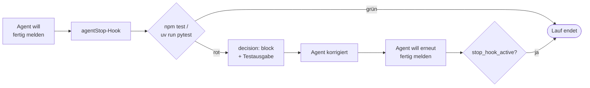

# Agent Hooks: Tests nach jedem Agentenlauf

Ein Agent Hook ist ein Befehl, den VS Code bei einem Ereignis im Agentenlauf automatisch ausführt, zum Beispiel wenn der Agent seine Antwort beenden will. FocusList bekommt einen Hook auf `agentStop`: Er führt die Tests aus und blockiert das Beenden, solange sie rot sind.

## Leitfragen

<details>
<summary>Wie lässt sich verhindern, dass ein Agent "fertig" meldet, obwohl Tests fehlschlagen?</summary>

Durch eine Prüfung, die automatisch läuft, sobald der Agent beenden will, und ihn bei roten Tests mit der Fehlerausgabe zurückschickt. Genau das ist ein Agent Hook auf das Stopp-Ereignis.

</details>

<details>
<summary>Warum Tests direkt im Agentenlauf statt erst in der CI?</summary>

Der Agent sieht den Fehler sofort und behebt ihn im selben Lauf. In der CI fällt er erst nach dem Push auf, und jemand muss den Agenten neu beauftragen.

</details>

<details>
<summary>Was passiert, wenn eine automatische Prüfung den Agenten immer wieder zurückschickt?</summary>

Ohne Gegenmaßnahme entsteht eine Endlosschleife. Das Prüfskript erkennt deshalb, ob es den Agenten schon einmal zurückgeschickt hat, und lässt ihn beim zweiten Mal beenden.

</details>

## Task, Agent Hook, CI

| | VS Code Task ([01](01-vscode-tasks.md)) | Agent Hook | CI |
| --- | --- | --- | --- |
| Auslöser | Mensch, per Command Palette | Ereignis im Agentenlauf, z. B. `agentStop` | Push oder Pull Request |
| Ablage | `.vscode/tasks.json` | `.github/hooks/*.json` | Pipeline-Datei |
| Rückmeldung an | Terminal, Problems-Panel | den Agenten selbst | Team, Pull Request |
| Stärke | ein Befehl für alle | Agent kann nicht "fertig" melden, solange Tests rot sind | serverseitige Absicherung für alle Änderungen |

Ein Hook ersetzt die CI nicht. Er holt den Fehler nur früher in den Agentenlauf.

## Ereignisse

| Ereignis (camelCase) | Alias (PascalCase) | Läuft |
| --- | --- | --- |
| `sessionStart` | `SessionStart` | zu Beginn einer Chat-Sitzung |
| `userPromptSubmitted` | `UserPromptSubmit` | nach dem Absenden einer Anfrage |
| `preToolUse` | `PreToolUse` | vor jedem Tool-Aufruf; kann ihn verbieten |
| `postToolUse` | `PostToolUse` | nach jedem Tool-Aufruf |
| `subagentStart` / `subagentStop` | `SubagentStart` / `SubagentStop` | beim Start und Ende eines Subagenten |
| `agentStop` | `Stop` | wenn der Agent seine Antwort beenden will; kann das blockieren |

Die aktuelle Copilot-Dokumentation verwendet camelCase. `Stop` und die anderen PascalCase-Namen bleiben als kompatible Aliase gültig; sie liefern die Eingabefelder in snake_case, wie bei Claude-Code-Hooks.

## Ablage

| Ort | Gilt für |
| --- | --- |
| `.github/hooks/*.json` | dieses Repository, versioniert |
| `~/.copilot/hooks/` | alle eigenen Projekte |
| Feld `hooks` im Frontmatter einer `.agent.md` | nur diesen Agenten |

## Hook-Konfiguration

**JS/TS:** `.github/hooks/run-tests.json` ([Referenz](../project/focuslist/js-ts/steps/m08/.github/hooks/run-tests.json))

```json
{
  "version": 1,
  "hooks": {
    "agentStop": [
      {
        "type": "command",
        "command": "node .github/hooks/run-tests.mjs",
        "timeoutSec": 120
      }
    ]
  }
}
```

**Python:** `.github/hooks/run-tests.json` ([Referenz](../project/focuslist/python/steps/m08/.github/hooks/run-tests.json)), nur `command` ist anders:

```json
"command": "uv run python .github/hooks/run_tests.py",
```

| Feld | Bedeutung |
| --- | --- |
| `version` | Format der Datei, aktuell `1` |
| `hooks.agentStop` | Liste von Befehlen für dieses Ereignis |
| `type` | `"command"`: ein Shell-Befehl |
| `command` | läuft im Workspace-Ordner, für alle Betriebssysteme; alternativ getrennt `bash` und `powershell` |
| `timeoutSec` | Abbruch nach Sekunden, Standard 30; `timeout` ist ein Alias. Ein Testlauf braucht mehr als 30 Sekunden Puffer |
| `cwd`, `env` | optional: anderes Arbeitsverzeichnis, zusätzliche Umgebungsvariablen |

## Ein- und Ausgabe des Hook-Skripts

| Richtung | Inhalt |
| --- | --- |
| Eingabe (stdin) | JSON mit u. a. `cwd`, `stopReason` und `stop_hook_active` |
| `stop_hook_active` | `true`, wenn der Agent nur weiterarbeitet, weil ein Hook ihn schon einmal blockiert hat |
| keine Ausgabe, Exit-Code 0 | der Agent darf beenden |
| Ausgabe `{"decision": "block", "reason": "..."}` | der Agent arbeitet weiter; `reason` wird zu seiner nächsten Anweisung |
| Fehler oder Timeout im Skript | wird protokolliert, der Lauf geht weiter (fail-open) |

## Das Hook-Skript

**JS/TS:** `.github/hooks/run-tests.mjs`

```js
// agentStop-Hook: Der Agent darf erst fertig melden, wenn die Tests grün sind.
import { spawnSync } from "node:child_process";

let input = "";
process.stdin.setEncoding("utf8");
process.stdin.on("data", (chunk) => (input += chunk));
process.stdin.on("end", () => {
  const event = JSON.parse(input || "{}");
  if (event.stop_hook_active) return; // schon einmal blockiert: keine Endlosschleife

  const result = spawnSync("npm", ["test"], { encoding: "utf8", shell: process.platform === "win32" });
  if (result.status === 0) return; // grün: keine Ausgabe, der Agent darf beenden

  const output = `${result.stdout}\n${result.stderr}`.split("\n").slice(-30).join("\n");
  const reason = `npm test schlägt fehl. Behebe die Fehler, bevor du fertig meldest:\n${output}`;
  console.log(
    JSON.stringify({
      decision: "block", // Copilot-Harness liest decision/reason auf oberster Ebene
      reason,
      hookSpecificOutput: { hookEventName: "Stop", decision: "block", reason }, // lokaler VS-Code-Harness
    }),
  );
});
```

**Python:** `.github/hooks/run_tests.py`

```python
"""agentStop-Hook: Der Agent darf erst fertig melden, wenn die Tests grün sind."""

import json
import subprocess
import sys

event = json.loads(sys.stdin.read() or "{}")
if not event.get("stop_hook_active"):  # schon einmal blockiert: keine Endlosschleife
    result = subprocess.run(["uv", "run", "pytest", "-q"], capture_output=True, text=True)
    if result.returncode != 0:  # grün: keine Ausgabe, der Agent darf beenden
        output = "\n".join((result.stdout + result.stderr).splitlines()[-30:])
        reason = f"pytest schlägt fehl. Behebe die Fehler, bevor du fertig meldest:\n{output}"
        print(
            json.dumps(
                {
                    # Copilot-Harness liest decision/reason auf oberster Ebene
                    "decision": "block",
                    "reason": reason,
                    # lokaler VS-Code-Harness
                    "hookSpecificOutput": {
                        "hookEventName": "Stop",
                        "decision": "block",
                        "reason": reason,
                    },
                }
            )
        )
```

| Teil | Wirkung |
| --- | --- |
| `stop_hook_active` prüfen | blockiert höchstens einmal pro Anfrage; danach darf der Agent auch mit roten Tests beenden und meldet den Stand |
| letzte 30 Zeilen der Testausgabe | der Agent sieht die konkrete Fehlermeldung, ohne dass der Kontext überläuft |
| `decision` + `hookSpecificOutput` | VS Code kennt zwei Ausführungsumgebungen (Copilot-Harness und lokaler Harness); jede liest ihr Feld und ignoriert das andere |

## Ablauf: Agent meldet fertig



## Hook ohne Agent testen

Das Skript lässt sich im Terminal mit einer selbst geschriebenen Eingabe prüfen:

```bash
echo '{}' | node .github/hooks/run-tests.mjs                     # Python: uv run python .github/hooks/run_tests.py
echo '{"stop_hook_active": true}' | node .github/hooks/run-tests.mjs
```

| Testzustand | Ausgabe |
| --- | --- |
| grün | keine, Exit-Code 0 |
| rot | eine Zeile JSON mit `"decision":"block"` und der Testausgabe |
| rot, `stop_hook_active: true` | keine |

## Voraussetzungen und Status

- Agent Hooks sind in VS Code **Preview**. Sie laufen in Agent-Sitzungen mit dem Ziel **Copilot** (Auswahl **Session Target** im Chat). Für die ältere lokale Ausführung muss die Einstellung `chat.useHooks` aktiv sein.
- Hooks führen Befehle mit den Rechten des eigenen Benutzers aus. Hook-Dateien aus fremden Repositories vor dem Öffnen lesen; Organisationen können Hooks per Richtlinie sperren.
- Neue Hooks zuerst ohne `decision: "block"` beobachten (nur protokollieren), bevor sie Läufe blockieren.

_Stand: 10/2026, Quellen: [Hooks in VS Code](https://code.visualstudio.com/docs/copilot/customization/hooks), [Copilot hooks reference](https://docs.github.com/en/copilot/reference/hooks-reference), [VS Code hooks reference](https://code.visualstudio.com/docs/agents/reference/hooks-reference)._

## Übung

**Start:** eigener Stand aus Modul 7 oder Stand v4 erzeugen: `node <kursmaterial>/project/focuslist/catch-up.mjs <stack> m08 focuslist` ([Projektdateien](../project/README.md)), mit der Task aus [01-vscode-tasks.md](01-vscode-tasks.md)
**Referenz:** [`steps/m08/.github/hooks/`](../project/focuslist/js-ts/steps/m08/.github/hooks/) bzw. [Python](../project/focuslist/python/steps/m08/.github/hooks/) — nur die in Modul 8 geänderten Dateien
**Dauer:** 25 Min.

Im Chat ist das Session Target **Copilot** und der Agent-Modus gewählt; der Stand ist committet.

1. Lege `.github/hooks/run-tests.json` mit `version: 1` und einem Eintrag für `agentStop` an, der `node .github/hooks/run-tests.mjs` bzw. `uv run python .github/hooks/run_tests.py` mit `timeoutSec: 120` startet.
2. Schreibe das Skript `.github/hooks/run-tests.mjs` bzw. `.github/hooks/run_tests.py`: Eingabe von stdin lesen, bei `stop_hook_active` sofort beenden, Tests ausführen, bei Fehlschlag `decision: "block"` mit den letzten 30 Zeilen der Testausgabe als `reason` ausgeben.
3. Teste das Skript ohne Agent: `echo '{}' | node .github/hooks/run-tests.mjs` bzw. `echo '{}' | uv run python .github/hooks/run_tests.py`, danach `echo $?`.
4. Committe den Stand. Baue dann einen fehlschlagenden Test ein: Ändere in `tests/actions/search-tasks.test.ts` bzw. `tests/actions/test_search_tasks.py` den erwarteten Titel `"Steuererklärung abgeben"` in `"Steuer"`. Wiederhole Schritt 3.
5. Gib dem Agenten eine kleine Aufgabe, die den Test nicht erwähnt: "Ergänze in `README.md` ein Beispiel für `search-tasks`." Beobachte den Lauf bis zum Ende.
6. Prüfe mit `git diff --stat`, was der Agent geändert hat, starte **Tasks: Run Test Task** und committe den Stand: `git commit -am "v5: Task und Stop-Hook"`.

**Checkpoint:**

- Schritt 3: keine Ausgabe, `echo $?` zeigt `0`.
- Schritt 4: eine Zeile JSON, die mit `{"decision":"block","reason":"npm test schlägt fehl. Behebe die Fehler, bevor du fertig meldest:` beginnt (Python: `{"decision": "block", "reason": "pytest schlägt fehl. …`) und die fehlschlagende Testzeile enthält.
- Schritt 5: Der Agent ergänzt die README, will beenden, erhält die Testausgabe (erwartet `["Steuer"]`, erhalten `["Steuererklärung abgeben"]`), passt die Erwartung im Test an und beendet nach grünen Tests.
- Schritt 6: `git diff --stat` zeigt `README.md` und die Testdatei, nicht `search-tasks` selbst; die Task läuft grün.

**Falls es hakt:** Läuft der Hook im Agentenlauf nicht (Preview-Funktion deaktiviert, Unternehmensrichtlinie, anderes Session Target): Session Target **Copilot** prüfen bzw. für die lokale Ausführung `chat.useHooks` aktivieren. Bleibt er aus, gelten Schritt 3 und 4 als Nachweis: Das Skript liefert genau die Entscheidung, die VS Code an den Agenten weitergeben würde. Fehlerhafte Dateien durch `.github/hooks/` aus der Referenz ersetzen.

**Erweiterung:** Ergänze in `run-tests.json` einen zweiten Hook auf `postToolUse`, der nur protokolliert, und trage `tool-log.txt` in `.gitignore` ein:

```json
"postToolUse": [
  { "type": "command", "bash": "echo \"$(date) Tool benutzt\" >> .github/hooks/tool-log.txt", "timeoutSec": 5 }
]
```

`bash` statt `command`, weil der Befehl Shell-Syntax nutzt, die unter PowerShell anders lautet.

### Was sich in der Referenz geändert hat

| Datei | Änderung gegenüber v4 |
| --- | --- |
| `.github/hooks/run-tests.json` | neu, `agentStop` mit `timeoutSec: 120` |
| `.github/hooks/run-tests.mjs` bzw. `run_tests.py` | neu, Skript wie oben |

## Fazit

- Ein Agent Hook läuft automatisch bei einem Ereignis im Agentenlauf; `agentStop` (Alias `Stop`) läuft, bevor der Agent beendet.
- Das Skript gibt bei roten Tests `decision: "block"` mit der Testausgabe zurück; bei grünen Tests gibt es nichts aus.
- `stop_hook_active` verhindert eine Endlosschleife.

Tasks und Hooks arbeiten im Projekt. Für Daten außerhalb des Projekts braucht der Agent einen MCP-Server: [03-mcp.md](03-mcp.md).
