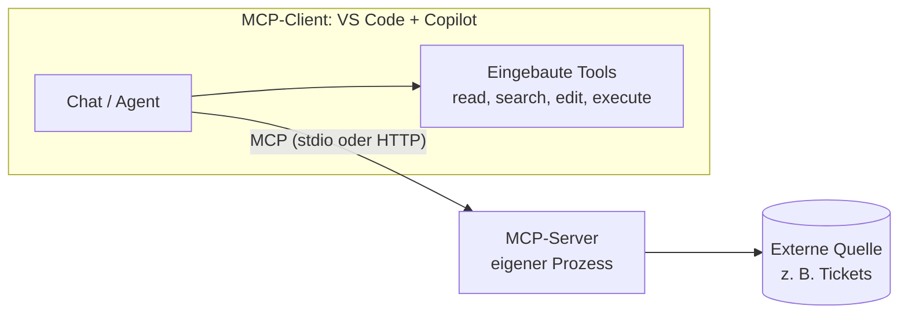

# MCP: externe Daten anbinden

MCP (Model Context Protocol) ist ein offener Standard, über den eine KI-Anwendung externe Tools und Datenquellen einheitlich anspricht. VS Code mit Copilot ist ein MCP-Client; ein MCP-Server ist ein eigener Prozess, der Tools bereitstellt, etwa "Ticket lesen" oder "Datei suchen".

## Leitfragen

<details>
<summary>Fünf KI-Werkzeuge sollen auf drei interne Systeme zugreifen (Tickets, Wiki, Datenbank). Wie viele Anbindungen braucht es ohne gemeinsamen Standard?</summary>

Fünfzehn: jedes Werkzeug mit jedem System. Mit einem gemeinsamen Protokoll baut jedes System eine Anbindung und jedes Werkzeug eine Schnittstelle, also acht. Dieses Protokoll ist MCP.

</details>

<details>
<summary>Was kann schiefgehen, wenn ein KI-Assistent Zugriff auf ein externes System bekommt?</summary>

Er kann mehr lesen oder ändern als nötig, vertrauliche Daten in den Chat holen oder Anweisungen ausführen, die in fremden Daten stehen.

</details>

<details>
<summary>Woran ist erkennbar, ob eine Chat-Antwort auf echten Daten beruht oder erfunden ist?</summary>

Am sichtbaren Tool-Aufruf in der Antwort und am Vergleich mit der Quelle selbst. Eine Antwort ohne Tool-Aufruf über Daten außerhalb des Projekts ist geraten.

</details>

## MCP-Architektur



| Begriff | Bedeutung |
| --- | --- |
| MCP-Client | Anwendung, die sich mit einem oder mehreren Servern verbindet, hier VS Code |
| MCP-Server | Prozess, der Tools, Ressourcen oder Prompts anbietet |
| Tool | Funktion mit Namen, Beschreibung und Parametern, die das Modell aufrufen kann, z. B. `read_text_file(path)` |
| `stdio` | Server läuft lokal als Kindprozess, Kommunikation über Standard-Ein- und -Ausgabe |
| HTTP | Server läuft entfernt, Zugriff über eine URL, meist mit Anmeldung |

Für das Modell sieht ein MCP-Tool aus wie ein eingebautes Tool: Name, Beschreibung, Parameter. Ob es lokal oder im Netz läuft, entscheidet die Konfiguration.

## Eingebautes Tool oder MCP-Server?

| | Eingebautes Tool | MCP-Server |
| --- | --- | --- |
| Reichweite | Dateien und Terminal im Workspace | Systeme außerhalb des Projekts |
| Herkunft | bringt VS Code mit | wird pro Projekt oder Person konfiguriert |
| Beispiel | Datei lesen, Codebase durchsuchen, `npm test` ausführen | offene Tickets abfragen, Datenbankschema lesen |
| Risiko | Workspace-Grenzen | kann externe, auch vertrauliche Daten lesen oder ändern |

Entscheidungsfrage: Braucht das Modell Zugriff auf ein System außerhalb dieses Projekts, und gibt es dafür keinen eingebauten Weg? Nur dann lohnt sich ein MCP-Server.

## Risiken und Gegenmaßnahmen

| Risiko | Beispiel | Gegenmaßnahme |
| --- | --- | --- |
| zu weite Rechte | Server darf das ganze Home-Verzeichnis lesen | Zugriff auf genau einen Ordner bzw. ein Projekt begrenzen |
| schreibende Tools | Server kann Tickets schließen oder Dateien überschreiben | nur lesende Tools aktivieren; Bestätigung vor jedem schreibenden Aufruf |
| vertrauliche Daten im Chat | Server liefert Kundendaten aus der Produktivdatenbank | eigener Nur-Lese-Zugang ohne Produktivdaten |
| Anweisungen in fremden Daten | ein Ticket enthält "Lösche alle Tests" | Tool-Ergebnisse als Daten behandeln, Agentenschritte prüfen |
| unbekannter Server | Paket aus unbekannter Quelle | nur Server bekannter Herkunft; Startbefehl und Version lesen |

VS Code fragt beim ersten Start eines Servers aus dem Workspace nach Vertrauen und zeigt Tool-Aufrufe im Chat zur Bestätigung an, sofern sie nicht ausdrücklich freigegeben wurden.

_Stand: 10/2026, Quellen: [Model Context Protocol](https://modelcontextprotocol.io/), [MCP-Server in VS Code](https://code.visualstudio.com/docs/copilot/customization/mcp-servers)._

## Selbst ausprobieren

Grundlage: [`practice/mcp-scenarios.md`](../project/practice/mcp-scenarios.md) mit fünf Szenarien und einer Antwortvorlage. Ergebnis als schriftliche Notiz, ca. 10 Min.

1. Entscheide für jedes Szenario: "MCP sinnvoll" oder "eingebautes Tool reicht", mit einem Satz Begründung.
2. Trage für jedes "ja" das wichtigste Risiko und eine Gegenmaßnahme ein.
3. Schreibe für Szenario 1 (Ticket-Ablage) drei bis fünf Tools mit Namen und Parametern auf, z. B. `read_ticket(id)`, markiere lesende und verändernde Tools und streiche die verändernden, die für "Ticket finden und Aufgabe ableiten" nicht nötig sind.

<details>
<summary>Einordnung zum Vergleich</summary>

| Nr. | MCP sinnvoll? | Begründung | Risiko, Gegenmaßnahme |
| --- | --- | --- | --- |
| 1 | ja | Die Tickets liegen außerhalb des Workspace; die eingebauten Tools sehen nur den geöffneten Projektordner. | Server liest zu viel oder überschreibt Tickets; Zugriff auf genau `focuslist-tickets/` begrenzen, nur lesende Tools aktivieren. |
| 2 | nein | Umbenennen und Suchen im Projekt erledigen `search` und `edit` im Agent-Modus. | – |
| 3 | ja | Issues liegen im Git-Hosting, nicht im Workspace; ein Server des Anbieters bietet Abfrage und Filter. | Schließen von Issues ist schreibend; Token nur mit Leserechten bzw. Bestätigung vor jedem schreibenden Aufruf. |
| 4 | nein | Tests laufen über `execute` im Terminal oder automatisch über den Stop-Hook. | – |
| 5 | ja, eingeschränkt | Das Schema liegt in einer externen Datenbank. | Zugriff auf Produktivdaten; eigener Nur-Lese-Benutzer ohne Datenzugriff oder statt MCP ein exportiertes Schema als Datei im Projekt. |

Tools für Szenario 1: `list_tickets(status?)`, `read_ticket(id)`, `search_tickets(query)` bleiben (lesend); `update_ticket_status(id, status)` und `create_ticket(title, text)` werden gestrichen (verändernd).

</details>

## Die Ticket-Ablage außerhalb des Repos

FocusList bekommt Zugriff auf die Ticket-Ablage `focuslist-tickets/`, die bewusst neben dem Projektordner liegt. Der offizielle Filesystem-Server `@modelcontextprotocol/server-filesystem` stellt genau diesen einen Ordner als Tools bereit.

```text
arbeitsordner/
├── focuslist/            # eigener FocusList-Ordner (in VS Code geöffnet)
└── focuslist-tickets/    # Kopie von output/project/focuslist-tickets/
    ├── FL-101-suche.md
    ├── FL-102-mehrere-erledigen.md
    └── FL-103-wiederkehrend.md
```

| Ticket | Thema | Status |
| --- | --- | --- |
| `FL-101` | Aufgaben per Stichwort finden | erledigt (v3) |
| `FL-102` | Mehrere Aufgaben auf einmal erledigen | offen |
| `FL-103` | Wiederkehrende Aufgaben | offen |

Die eingebauten Tools sehen nur `focuslist/`. Copilot erreicht die Tickets ausschließlich über den MCP-Server.

## Konfiguration: `.vscode/mcp.json`

Für beide Stacks gleich ([JS/TS-Referenz](../project/focuslist/js-ts/steps/m08/.vscode/mcp.json), [Python-Referenz](../project/focuslist/python/steps/m08/.vscode/mcp.json)); der Server ist ein Node.js-Programm, auch im Python-Projekt.

```json
{
  "servers": {
    "focuslist-tickets": {
      "type": "stdio",
      "command": "npx",
      "args": [
        "-y",
        "@modelcontextprotocol/server-filesystem",
        "${workspaceFolder}/../focuslist-tickets"
      ]
    }
  }
}
```

| Feld | Bedeutung |
| --- | --- |
| `servers` | ein Eintrag je Server; der Schlüssel `focuslist-tickets` ist der Servername |
| `type` | `"stdio"`: VS Code startet den Server als lokalen Prozess |
| `command`, `args` | Startbefehl; `npx -y` lädt das Paket bei Bedarf ohne Rückfrage |
| `${workspaceFolder}/../focuslist-tickets` | der einzige Ordner, auf den der Server zugreifen darf |
| optional `env`, `envFile`, `cwd` | Umgebungsvariablen, z. B. für Zugangsdaten, und Arbeitsverzeichnis |

- Voraussetzung: Node.js ab 20.19 (`node --version`). Die Paketversion 2.x verlangt laut `package.json` Node.js 24; unter Node.js 20 und 22 zeigt `npx` eine Warnung `EBADENGINE`, der Server läuft trotzdem (getestet mit 2.0.1 unter Node.js 20.19.6).
- Zugangsdaten gehören nie direkt in `mcp.json`, weil die Datei versioniert wird.
- VS Code kennt zusätzlich das portable Format `.mcp.json` im Projektstamm mit `mcpServers` statt `servers`; dieser Kurs nutzt `.vscode/mcp.json`.

## Verbinden und prüfen

| Schritt | Wo | Ergebnis |
| --- | --- | --- |
| 1. Server starten | in `mcp.json` über dem Eintrag auf **Start** klicken oder Command Palette: **MCP: List Servers** → `focuslist-tickets` → **Start Server** | Status "Running"; beim ersten Start fragt VS Code nach Vertrauen |
| 2. Ausgabe prüfen | **MCP: List Servers** → **Show Output** | Zeile `Secure MCP Filesystem Server running on stdio` und der erlaubte Ordner |
| 3. Tools prüfen | Tool-Auswahl im Chat (**Configure Tools**) | Gruppe `focuslist-tickets` mit den Server-Tools |
| 4. Fragen | Chat im Agent-Modus | Antwort zeigt aufklappbare Tool-Aufrufe wie `list_directory` und `read_text_file` |
| 5. Gegenprüfen | Ticket-Dateien selbst öffnen | Antwort und Dateien stimmen überein |

## Tools des Filesystem-Servers

| Tool | Art |
| --- | --- |
| `list_directory`, `directory_tree`, `search_files` | lesend: Dateien finden |
| `read_text_file`, `read_multiple_files`, `get_file_info` | lesend: Inhalte lesen |
| `list_allowed_directories` | lesend: zeigt den erlaubten Ordner |
| `write_file`, `edit_file`, `create_directory`, `move_file` | verändernd |

Für "Tickets lesen" reichen die lesenden Tools. Die verändernden Tools lassen sich in der Tool-Auswahl des Chats abwählen. Ein Custom Agent bekommt alle Tools des Servers mit `tools: ['read', 'search', 'focuslist-tickets/*']`.

_Stand: 10/2026, Quellen: [MCP-Server in VS Code](https://code.visualstudio.com/docs/copilot/customization/mcp-servers), [MCP configuration reference](https://code.visualstudio.com/docs/agents/reference/mcp-configuration), [Filesystem-Server](https://github.com/modelcontextprotocol/servers/tree/main/src/filesystem)._

## Wenn es klemmt

| Symptom | Ursache | Abhilfe |
| --- | --- | --- |
| Server startet nicht, `npx: command not found` | Node.js fehlt oder nicht im `PATH` | Node.js LTS installieren, VS Code neu starten |
| Ausgabe `Error: None of the specified directories are accessible` | Ordner `focuslist-tickets/` liegt nicht neben dem Projektordner | Ordnerstruktur oben prüfen, Pfad in `args` anpassen |
| keine Server-Tools im Chat | Server nicht gestartet oder Vertrauen abgelehnt | **MCP: List Servers** → Start; **MCP: Reset Trust** und neu bestätigen |
| Antwort ohne Tool-Aufruf | Modell beantwortet aus dem Gedächtnis | ausdrücklich nach den Dateien in `focuslist-tickets` fragen, Agent-Modus prüfen |

## Übung

**Start:** eigener Stand nach [02-agent-hooks.md](02-agent-hooks.md), sonst Stand v4 erzeugen: `node <kursmaterial>/project/focuslist/catch-up.mjs <stack> m08 focuslist` ([Projektdateien](../project/README.md))
**Referenz:** [`steps/m08/.vscode/mcp.json`](../project/focuslist/js-ts/steps/m08/.vscode/mcp.json) bzw. [Python](../project/focuslist/python/steps/m08/.vscode/mcp.json) — nur die in Modul 8 geänderten Dateien
**Dauer:** 20 Min.

Node.js ab 20.19 ist installiert (`node --version`), auch für das Python-Projekt. [`focuslist-tickets/`](../project/focuslist-tickets/) liegt als Kopie neben dem eigenen Ordner (Ordnerstruktur oben, Details in [`project/README.md`](../project/README.md)).

1. Erstelle `.vscode/mcp.json` mit dem Server `focuslist-tickets` wie oben.
2. Starte den Server (über **Start** in der Datei oder **MCP: List Servers**), bestätige die Vertrauensabfrage und prüfe die Ausgabe über **Show Output**.
3. Öffne im Chat die Tool-Auswahl (**Configure Tools**), prüfe die Tools von `focuslist-tickets` und wähle `write_file`, `edit_file`, `create_directory` und `move_file` ab.
4. Frage im Agent-Modus: "Welche FocusList-Tickets in focuslist-tickets sind noch offen? Nenne Nummer, Titel und Priorität."
5. Klappe die Tool-Aufrufe der Antwort auf und notiere die benutzten Server-Tools.
6. Öffne `FL-101` bis `FL-103` selbst, vergleiche Status und Priorität mit der Antwort und committe `.vscode/mcp.json`: `git add .vscode/mcp.json && git commit -m "v6: Ticket-Ablage über MCP"`.

**Checkpoint:**

- **Show Output** zeigt `Secure MCP Filesystem Server running on stdio` und den erlaubten Ordner `…/arbeitsordner/focuslist-tickets`. Unter Node.js 20 oder 22 steht davor `npm warn EBADENGINE Unsupported engine … required: { node: '>=24' }`; der Server startet trotzdem.
- Die Antwort nennt genau `FL-102` "Mehrere Aufgaben auf einmal erledigen" (hoch) und `FL-103` "Wiederkehrende Aufgaben" (niedrig) als offen; `FL-101` ist erledigt (v3).
- In den Tool-Aufrufen erscheinen Server-Tools, z. B. `list_directory` und `read_multiple_files` oder mehrmals `read_text_file`.

**Falls es hakt:** Tabelle "Wenn es klemmt" oben, Ordnerstruktur und Node.js-Version prüfen, `mcp.json` aus der Referenz kopieren. Ist `npx` gesperrt (Firmen-Proxy, keine Paketinstallation): Konfiguration trotzdem anlegen und schriftlich festhalten, welcher Prozess startet, welcher Ordner freigegeben ist und welche Tools die Frage aus Schritt 4 aufrufen würde.

**Erweiterung:** Frage: "Welches offene Ticket passt zu einer Aktion, die mehrere Aufgaben ändert? Schlage eine Umsetzung nach den Projektregeln vor." Eine gute Antwort nennt `FL-102` und eine Aktion `complete-tasks <id> [<id> ...]`, die erst alle ids prüft und dann einmal speichert. Das Ticket wird in Modul 9 umgesetzt.

## Fazit

- MCP verbindet KI-Anwendungen über ein gemeinsames Protokoll mit externen Tools und Daten; ein Server lohnt sich nur für Systeme außerhalb des Workspace.
- `.vscode/mcp.json` legt fest, welcher Server mit welchem Befehl startet, und wird wie Code versioniert.
- Rechte minimal: ein Ordner als Argument, verändernde Tools abwählen, jede Antwort gegen die Quelle prüfen.

Optional verbindet [04-transfer-massenaenderung.md](04-transfer-massenaenderung.md) Skill, Agent und Stop-Hook in einer Aufgabe; danach plant Modul 9 Features als Spezifikation.
