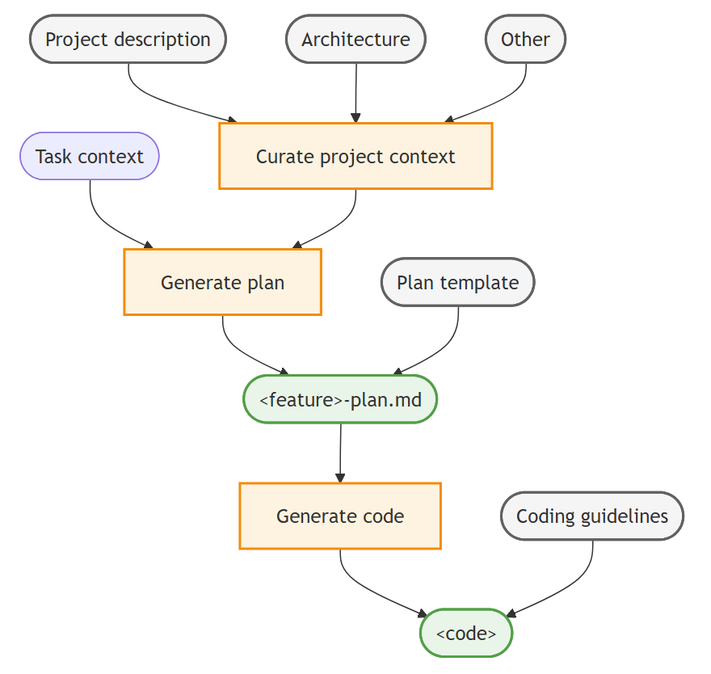
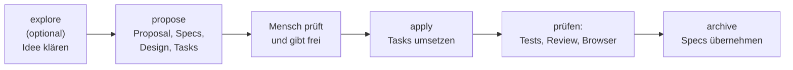
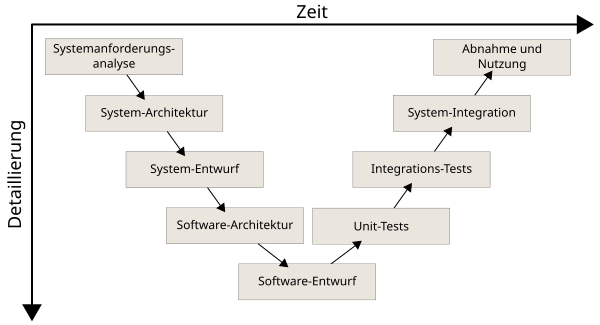

# Lab 8.1: Erst Spec, dann Code

**Leitfragen:**

<details>
<summary>Was passiert, wenn zwei Leute „Fälligkeitsdatum“ unterschiedlich verstehen?</summary>

Die eine baut ein Datum mit Uhrzeit und Erinnerung, der andere ein einfaches Datum ohne Markierung. Beide halten ihr Ergebnis für richtig. Ein Agent rät genauso: Was nicht gesagt ist, entscheidet er selbst (Vibecoding, Modul 3).

</details>

<details>
<summary>Wie würde man prüfen, ob ein Feature fertig ist, bevor es gebaut ist?</summary>

Mit Akzeptanzkriterien: konkrete Situationen mit erwartetem Ergebnis, z. B. „Wenn eine offene Aufgabe gestern fällig war, zeigt die Liste ‚überfällig‘.“ Jedes Kriterium wird später ein Test.

</details>

- Bei größeren Features rät der Agent Anforderungen, die niemand genannt hat. Ein längerer Prompt löst das nicht zuverlässig.
- Eine Spec ist die vereinbarte Beschreibung von Verhalten und Akzeptanzkriterien, bevor Code entsteht.
- Spec-Driven Development: erst Spec schreiben und freigeben, dann bauen lassen, dann die Spec als gültigen Stand ablegen.
- OpenSpec setzt das mit Dateien im Repo um: propose → apply → archive.

## Begriffe

| Begriff | Bedeutung |
| --- | --- |
| Spec | Beschreibung, was ein System tun soll, mit überprüfbaren Anforderungen |
| Akzeptanzkriterium | konkrete Situation mit erwartetem Ergebnis; erfüllt oder nicht erfüllt |
| Szenario | Akzeptanzkriterium im Format WHEN (Situation) → THEN (Ergebnis) |
| Spec-Driven Development | Vorgehen: Spec vor dem Code vereinbaren, Code gegen die Spec prüfen |
| OpenSpec | Open-Source-Werkzeug für Spec-Driven Development mit Agenten (CLI + Skills) |
| Change | ein Änderungsvorhaben in OpenSpec: Ordner mit Proposal, Design, Tasks und Spec-Änderungen |
| Capability | fachlicher Bereich mit eigener Spec, z. B. `tasks` (Aufgabenverwaltung) |
| Delta | Spec-Änderung eines Change: was hinzukommt, sich ändert oder wegfällt |

## Das Problem großer Prompts

| Prompt „Füge ein Fälligkeitsdatum hinzu“ | Was der Agent entscheiden muss |
| --- | --- |
| Format | Datum oder Datum mit Uhrzeit? Speicherung als Text oder Zeitstempel? |
| Pflicht | muss jede Aufgabe ein Datum haben? |
| Anzeige | wie formatiert, wo in der Liste? |
| Überfällig | ab wann? Ist „heute“ schon überfällig? Erledigte auch? |
| Sortierung | ändert sich die Reihenfolge? Wohin mit Aufgaben ohne Datum? |
| Fehler | was passiert bei „30.02.“? |

Jede offene Zeile ist eine Stelle, an der das Ergebnis vom Gewollten abweichen kann. Die Spec beantwortet sie vorher, schriftlich und prüfbar.

Analogie: Ein Bauplan legt fest, was gebaut wird, bevor jemand mauert. Eine Spec tut dasselbe für ein Feature.

## Spec, Instructions, Skill

| | Instructions (m04) | Skill (m05) | Spec (m08) |
| --- | --- | --- | --- |
| Beschreibt | Regeln, die immer gelten | wie eine Aufgabe abläuft | was ein bestimmtes Feature tun soll |
| Lebensdauer | dauerhaft | dauerhaft | Change bis zur Umsetzung, danach als gültige Spec im Projekt |
| Wer schreibt | Team | Team | Agent schlägt vor, Mensch prüft und gibt frei |



_Quelle: VS Code Docs, Context engineering guide (https://code.visualstudio.com/docs/agents/guides/context-engineering-guide), Microsoft, CC BY 3.0 US, abgerufen am 07.11.2026._

Gleiche Idee in der VS-Code-Doku: Erst entsteht ein Plan als Datei im Repo, dann der Code. Projektkontext und Coding-Richtlinien fließen dabei ein.

## Der OpenSpec-Ablauf

Stand: 11/2026 (OpenSpec 1.x), Quelle: [OpenSpec (GitHub)](https://github.com/Fission-AI/OpenSpec), [OpenSpec FAQ](https://github.com/Fission-AI/OpenSpec/blob/main/docs/faq.md)



| Schritt | Ergebnis |
| --- | --- |
| propose | Ordner `openspec/changes/<name>/` mit `proposal.md` (warum, was), `design.md` (wie), `tasks.md` (Checkliste), `specs/<capability>/spec.md` (Delta) |
| apply | Agent arbeitet `tasks.md` ab und hakt erledigte Punkte ab |
| archive | Change wandert nach `openspec/changes/archive/JJJJ-MM-TT-<name>/`, das Delta wird in `openspec/specs/` übernommen |

Nach dem Archivieren beschreibt `openspec/specs/` das aktuelle Verhalten der App. Der nächste Change baut darauf auf.

## Gute Akzeptanzkriterien

| Merkmal | Schwach | Stark |
| --- | --- | --- |
| konkret | „Datum wird gut angezeigt“ | „Die Liste zeigt ‚fällig 20.11.2026‘“ |
| mit Beispielwerten | „falsches Datum wird abgelehnt“ | „`2026-02-30` → Status 400, nichts gespeichert“ |
| Grenzfall benannt | „überfällige Aufgaben markieren“ | „heute fällig = nicht überfällig“ |
| prüfbar ohne Code-Kenntnis | „`is_overdue()` liefert True“ | „Badge ‚überfällig‘ erscheint“ |



_Quelle: Wikimedia Commons, V-Modell (https://commons.wikimedia.org/wiki/File:V-Modell.svg), Michael Pätzold, S. Seyfert, CC BY-SA 3.0, abgerufen am 07.11.2026._

Die Idee ist nicht neu: Im klassischen V-Modell steht jeder Stufe der Anforderungen eine Prüfung gegenüber; ganz oben werden die Anforderungen bei der Abnahme geprüft.

Format in OpenSpec:

```markdown
#### Scenario: Heute fällig
- **WHEN** eine offene Aufgabe das heutige Datum als Fälligkeit hat
- **THEN** zeigt die Liste kein Badge „überfällig“
```

## Akzeptanzkriterien für das Fälligkeitsdatum

Feature: „Fälligkeitsdatum mit Überfällig-Markierung“ für FocusList. Diese Kriterien gehen in Lab 8.2 in den OpenSpec-Change ein (so stehen sie sinngemäß in der Referenz-Spec):

| # | WHEN | THEN |
| --- | --- | --- |
| 1 | eine offene Aufgabe hat das Fälligkeitsdatum von gestern | die Liste zeigt ein rotes Badge „überfällig“ |
| 2 | eine offene Aufgabe ist heute fällig (Grenzfall) | die Liste zeigt **kein** Badge „überfällig“ |
| 3 | als Datum wird `2026-02-30` gesendet (Fehlerfall) | Status 400 mit Meldung zum Fälligkeitsdatum, es wird nichts gespeichert |
| 4 | eine erledigte Aufgabe hat ein altes Datum | kein Badge „überfällig“ |
| 5 | offene Aufgaben mit `2026-12-01`, `2026-11-15` und ohne Datum sowie eine erledigte Aufgabe | Reihenfolge `2026-11-15`, `2026-12-01`, ohne Datum, erledigte Aufgaben am Ende |

Nicht im Umfang: Uhrzeiten, Erinnerungen, wiederkehrende Aufgaben, Filter „nur überfällige“.

Typische Lücken, wenn Kriterien fehlen: Grenzfall „heute“ fehlt; unklar, ob erledigte Aufgaben markiert werden; keine Aussage zu Aufgaben ohne Datum.

## Fazit

- Eine Spec beantwortet die Fragen, die ein Agent sonst still selbst entscheidet.
- Akzeptanzkriterien mit Beispielwerten und Grenzfällen werden direkt zu Tests.
- OpenSpec legt Specs als Dateien im Repo ab: vorschlagen, freigeben, umsetzen, archivieren.
