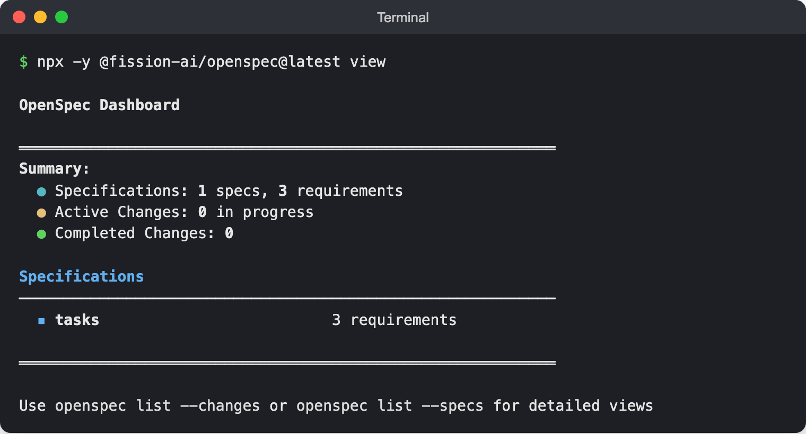
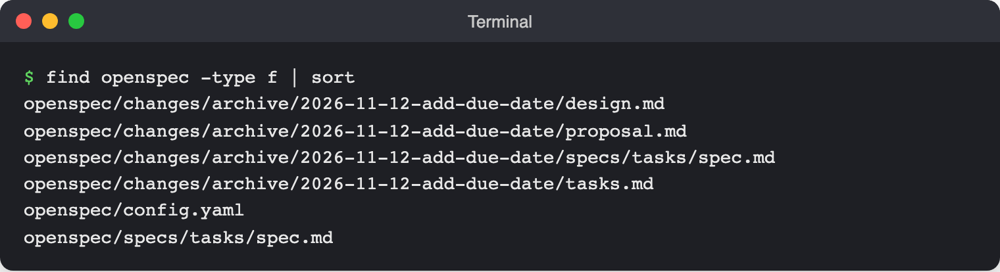
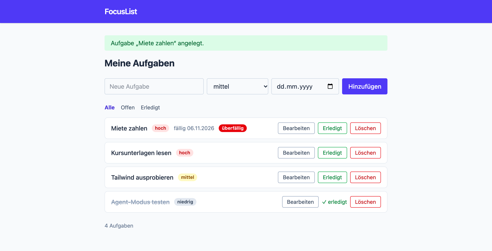

# Lab 8.2: OpenSpec mit dem Agenten-Team

**Leitfragen:**

<details>
<summary>Wer sollte eine Spec freigeben, bevor gebaut wird?</summary>

Die Person, die das Feature fachlich verantwortet (Product Owner, Fachbereich), zusammen mit jemandem aus der Entwicklung, der die technische Seite (`design.md`) beurteilt. Im eigenen Projekt: man selbst, aber bewusst als eigener Schritt vor `apply`, nicht nebenbei.

</details>

<details>
<summary>Welche der bisherigen Werkzeuge helfen beim Umsetzen einer Spec?</summary>

Alle: `AGENTS.md` (Regeln), `test-writer` und `security-checker` (Abläufe), `feature-lead` mit `tester` und `reviewer` (Rollen), Guard- und Check-Hook (Verbote, Tests nach jeder Runde), Playwright-MCP (Prüfung im Browser). Die Spec sagt *was*, die anderen Bausteine sorgen für das *wie*.

</details>

- `openspec init --tools github-copilot` legt den Ordner `openspec/` und OpenSpec-Skills unter `.github/skills/` an.
- Ein Change ist ein Ordner mit `proposal.md`, `design.md`, `tasks.md` und einem Spec-Delta; er wird gelesen und angepasst, bevor Code entsteht.
- `apply` übernimmt der `feature-lead` aus Lab 6.3; Hooks und Reviewer prüfen wie gewohnt.
- `archive` verschiebt den Change ins Archiv und übernimmt das Delta in `openspec/specs/`.

## Begriffe

| Begriff | Bedeutung |
| --- | --- |
| `openspec/specs/` | gültige Specs des Projekts, eine Datei pro Capability |
| `openspec/changes/<name>/` | laufender Change |
| `config.yaml` | Projektkontext und Regeln, die OpenSpec bei jedem Artefakt mitgibt |
| Requirement | eine Anforderung, Überschrift `### Requirement:`, mit mindestens einem Szenario |
| `validate --strict` | prüft Format und Pflichtteile eines Change |
| Archiv | `openspec/changes/archive/JJJJ-MM-TT-<name>/`, abgeschlossene Changes |

## Einrichten

Stand: 11/2026 (OpenSpec CLI 1.3.1), Quelle: [OpenSpec (GitHub)](https://github.com/Fission-AI/OpenSpec), [CLI](https://openspec.dev/docs/cli), [Supported tools](https://openspec.dev/docs/supported-tools)

```bash
openspec --version                            # 1.3.1, installiert im Setup
openspec init --tools github-copilot          # im Projektordner
ls .github/skills                             # genaue Namen der OpenSpec-Skills ablesen
```

| `init` legt an | Wofür | Harness |
| --- | --- | --- |
| `openspec/specs/`, `openspec/changes/`, `openspec/config.yaml` | Specs und Changes | alle |
| `.github/skills/openspec-*/SKILL.md` | Skills für den Ablauf, z. B. `/openspec-apply-change` | Copilot (Kursstandard) |
| `.github/prompts/opsx-*.prompt.md` | Befehle wie `/opsx-propose` | nur Local (Prompt-Dateien, Lab 2.2) |

Im Copilot-Harness laufen also die Skills. Wer nur Skills will: `openspec config set delivery skills` vor `openspec init` ausführen (globale Einstellung für alle Projekte; Standard ist `both`, geprüft mit OpenSpec CLI 1.3.1 am 08.11.2026). Die Prompt-Dateien stören sonst nicht, sie laden im Copilot-Harness nur nicht.

## Projektkontext: `config.yaml`

Python (`openspec/config.yaml` aus der Referenz, Auszug):

```yaml
schema: spec-driven

context: |
  FocusList ist eine kleine Web-App für persönliche Aufgaben.
  Stack: Python 3.12+, Flask 3 mit Jinja2-Templates, Tailwind CSS v4 (@tailwindcss/cli), Daten in data/tasks.json, Tests mit pytest.
  Umsetzung mit dem Agenten feature-lead (ruft tester und reviewer als Subagents).

rules:
  specs:
    - Jede Anforderung hat mindestens ein Szenario mit WHEN und THEN.
    - Grenzfälle (leere Eingabe, Datum heute, unbekannte ID) als eigene Szenarien.
  tasks:
    - Letzte Aufgaben immer: Tests (tester), Review (reviewer), pytest grün.
```

Die Referenz nennt außerdem Schichten und Projektregeln im `context` sowie Regeln für `proposal` (Deutsch, maximal eine Seite, unter „Impact“ alle betroffenen Routen und Templates) und `design` (keine neuen Abhängigkeiten ohne Begründung). Node.js: gleicher Aufbau; `context` nennt `node:http`, `src/app.js → src/tasks.js → src/store.js` und `npm test`, `rules.tasks` verlangt zusätzlich „Prüfung im Browser“.

## Der Change `add-due-date`

```text
openspec/changes/add-due-date/
├── proposal.md            # warum, was ändert sich, Impact
├── design.md              # Entscheidungen, Risiken
├── tasks.md               # Checkliste für apply
└── specs/tasks/spec.md    # Delta für die Capability "tasks"
```

`proposal.md` (Python, Referenz, Auszug; davor steht unter `## Why` die Begründung):

```markdown
## What Changes

- Neues optionales Feld `due` (ISO-Datum `JJJJ-MM-TT` oder `null`) für jede Aufgabe.
- Formular „Neue Aufgabe“ und Seite „Aufgabe bearbeiten“ bekommen ein Datumsfeld; leer bedeutet „kein Datum“.
- Die Liste zeigt das Datum deutsch formatiert („fällig 20.11.2026“) und ein rotes Badge „überfällig“, wenn das Datum vor heute liegt und die Aufgabe offen ist.
- Offene Aufgaben werden nach Fälligkeit sortiert, Aufgaben ohne Datum zuletzt, erledigte am Ende.
- `GET /api/tasks` liefert `due` mit, in derselben Reihenfolge wie die Liste.
```

Delta `specs/tasks/spec.md` (Python, Auszug):

```markdown
## ADDED Requirements

### Requirement: Markierung überfällig
Das System SHALL offene Aufgaben, deren Fälligkeitsdatum vor dem heutigen Datum liegt, mit einem roten Badge „überfällig“ markieren.

#### Scenario: Gestern fällig und offen
- **WHEN** eine offene Aufgabe das Fälligkeitsdatum von gestern hat
- **THEN** zeigt die Liste das Badge „überfällig“
```

Das Szenario „Heute fällig“ (kein Badge) steht im selben Requirement, Format wie in Lab 8.1.

| Formatregel | Detail |
| --- | --- |
| Abschnitte im Delta | `## ADDED Requirements`, außerdem `MODIFIED`, `REMOVED`, `RENAMED` |
| Anforderung | `### Requirement: <Name>`, Text enthält **SHALL** oder **MUST** |
| Szenario | `#### Scenario: <Name>` mit `- **WHEN** …` und `- **THEN** …` (optional `- **AND** …`) |
| Deutsche Specs | Schlüsselwort englisch im deutschen Satz: „Das System SHALL …“ (Python-Referenz) oder „Eine Aufgabe MUST …“ (Node.js-Referenz); „MUSS“ fällt bei `validate --strict` durch |

`tasks.md` ist eine Checkliste mit nummerierten Punkten (`- [ ] 3.1 …`), gruppiert z. B. in Umsetzung, Tests und Abschluss; die letzten Punkte der Referenz: Tests grün, Review durch den Agent `reviewer`, Prüfung im Browser per Playwright-MCP. Bei `apply` hakt der Agent erledigte Punkte ab (`- [x]`).

## Zusammenspiel mit dem Agenten-Team

| Baustein | Rolle beim Change |
| --- | --- |
| `feature-lead` | liest `proposal.md`, `design.md`, `specs/` als Anforderungen und `tasks.md` als Plan |
| `tester` / `reviewer` | Tests je Szenario / Prüfung gegen die Szenarien |
| Guard- und Check-Hook | sperren `.env` und `rm -rf`, Tests nach jeder Runde |
| Playwright-MCP | Sichtprüfung im Browser, danach `archive` |

Damit `tasks.md` abgehakt wird, ergänzt die Referenz in `AGENTS.md` die Zeile „`openspec/` – Specs und Changes; ein Feature mit Change folgt dessen `tasks.md`“ (Node.js: „neue Features zuerst als Change“), in der Python-Referenz zusätzlich einen passenden Satz im Schritt „Verstehen“ von `feature-lead.agent.md`.

## CLI

| Befehl | Wirkung |
| --- | --- |
| `openspec list` | laufende Changes |
| `openspec show <name>` | Change anzeigen |
| `openspec view` | Dashboard im Terminal |
| `openspec validate <name> --strict` | Format prüfen |
| `openspec archive <name> -y` | archivieren ohne Rückfrage |



_Quelle: eigener Screenshot, FocusList v5, 07.11.2026._

`openspec view` in FocusList nach dem Archivieren (Python-Referenz): Die Spec `tasks` hat 3 Requirements, in der Node.js-Referenz 4. Die Zahl hängt davon ab, wie der Agent die Anforderungen schneidet. Archivierte Changes zählt das Dashboard nicht mit, daher „Completed Changes: 0“.

## Typische Fehler

| Symptom | Ursache | Lösung |
| --- | --- | --- |
| `openspec: command not found` | globale Installation fehlt oder npm-Pfad nicht im PATH | Setup Schritt 3a: `npm install -g @fission-ai/openspec@1.3.1`, Terminal neu öffnen; gesperrt: `npx -y @fission-ai/openspec@1.3.1` statt `openspec` |
| Installation bricht ab | Node.js älter als 22.12 | `node --version` prüfen, Node.js aktualisieren |
| `/opsx-propose` unbekannt | Prompt-Dateien laden nur im Local-Harness | OpenSpec-Skills aus `.github/skills/` nutzen |
| `validate --strict` meldet fehlendes SHALL/MUST | Anforderung auf Deutsch mit „MUSS“ | „SHALL“ oder „MUST“ in den deutschen Satz schreiben |
| Agent baut sofort, ohne Proposal | Prompt verlangt Umsetzung | erst nur „vorschlagen“, Change prüfen, dann `apply` |
| `tasks.md` bleibt ohne Häkchen | Agent kennt die Regel nicht | Zeile in `AGENTS.md` bzw. `feature-lead` ergänzen (siehe oben) |
| Agent darf `AGENTS.md` nicht ändern, Guard-Hook lehnt ab | `AGENTS.md` enthält die Zeichenfolge `.env`; der Guard aus Lab 7.1 blockiert jede Aktion damit | Zeile in `AGENTS.md` von Hand ergänzen (wie in Lab 7.1) |

## Übung

**Dauer:** ca. 45 Minuten · **Start:** Arbeitsordner (Tag 2: `$HOME/kurs/focuslist-m05`) nach Lab 7.4; Neueinstieg mit v4: `node project/focuslist/catch-up.mjs <python|node> m08 $HOME/kurs/focuslist-m08`, danach Setup laut `README.md` des Stands (venv und `pip install -r requirements.txt` bei Python, `npm install`, `npm run build:css`) und dort weiterarbeiten · **Referenz:** `project/focuslist/<stack>/steps/m08/openspec/` sowie `tests/test_due.py` bzw. `test/due.test.js`

1. Prüfe `openspec --version` (1.3.1, aus dem Setup) und führe im Arbeitsordner `openspec init --tools github-copilot` aus. Übernimm `openspec/config.yaml` aus der Referenz.
2. Lass im Agent-Chat einen Change `add-due-date` vorschlagen und gib die Akzeptanzkriterien aus Lab 8.1 mit (Tabelle „Akzeptanzkriterien für das Fälligkeitsdatum“, Prompt im Lösungsweg).
3. Lies `proposal.md`, `design.md`, `tasks.md` und das Delta. Prüfe, dass alle fünf Kriterien aus Lab 8.1 als Szenarien im Delta stehen, ergänze fehlende und führe `openspec validate add-due-date --strict` aus, bis keine Fehler mehr kommen.
4. Wähle den Agent `feature-lead` und lass den Change umsetzen (Prompt im Lösungsweg). Beobachte die Subagents `tester` und `reviewer` und den Check-Hook nach der Runde.
5. Lass das Ergebnis per Playwright-MCP prüfen (Prompt im Lösungsweg), archiviere mit `openspec archive add-due-date -y` und lösche die Testaufgaben in der App.

**Checkpoint nach 15 Minuten:** `openspec list` zeigt `add-due-date`; die Validierung ist fehlerfrei; das Delta enthält das Szenario „heute fällig = nicht überfällig“.

**Checkpoint nach 30 Minuten:** Ist `apply` noch nicht fertig, die Sitzung stoppen, den Endstand mit `node project/focuslist/catch-up.mjs <python|node> final $HOME/kurs/focuslist-final` holen, Setup laut `README.md` des Stands, und dort den archivierten Change und die App ansehen.

**Checkpoint:** `openspec/changes/archive/<datum>-add-due-date/` existiert; `openspec/specs/tasks/spec.md` enthält die neuen Anforderungen; die Liste zeigt „fällig TT.MM.JJJJ“ und das rote Badge „überfällig“ nur für vergangene Daten offener Aufgaben; alle Tests sind grün. Das ist FocusList v5.



_Quelle: eigener Screenshot, FocusList v5, 07.11.2026._

Dateien nach `archive` (Referenzstand): Change im Archiv, gültige Spec unter `openspec/specs/`.



_Quelle: eigener Screenshot, FocusList v5, 07.11.2026._

Ergebnis im Browser: Eine offene, gestern fällige Aufgabe trägt das Badge „überfällig“.

<details>
<summary>Lösungsweg</summary>

Zu 2, Prompt (Agent, Copilot-Harness; der Propose-Skill greift über seine `description` oder per `/` mit dem Namen aus `.github/skills/`):

```text
Schlage mit OpenSpec einen neuen Change "add-due-date" vor. Noch keinen Code ändern.
Feature: optionales Fälligkeitsdatum für Aufgaben (JJJJ-MM-TT oder leer),
im Formular "Neue Aufgabe" und auf der Seite "Aufgabe bearbeiten".
Akzeptanzkriterien (WHEN → THEN):
1. eine offene Aufgabe hat das Fälligkeitsdatum von gestern → die Liste zeigt ein rotes Badge "überfällig"
2. eine offene Aufgabe ist heute fällig → die Liste zeigt kein Badge "überfällig"
3. als Datum wird 2026-02-30 gesendet → Status 400 mit Meldung zum Fälligkeitsdatum, es wird nichts gespeichert
4. eine erledigte Aufgabe hat ein altes Datum → kein Badge "überfällig"
5. offene Aufgaben mit 2026-12-01, 2026-11-15 und ohne Datum sowie eine erledigte Aufgabe → Reihenfolge 2026-11-15, 2026-12-01, ohne Datum, erledigte Aufgaben am Ende
Nicht im Umfang: Uhrzeiten, Erinnerungen, wiederkehrende Aufgaben, Filter "nur überfällige".
Anforderungen auf Deutsch, aber mit dem Schlüsselwort SHALL.
```

Zu 4, Prompt im Agent `feature-lead` (alternativ den Apply-Skill aufrufen, z. B. `/openspec-apply-change add-due-date`):

```text
Setze den OpenSpec-Change add-due-date um.
Anforderungen: proposal.md, design.md und specs/ in openspec/changes/add-due-date/.
Plan: tasks.md, erledigte Punkte abhaken.
Tests über den tester, Review über den reviewer gegen die Szenarien der Spec.
```

Erwartet: Fachlogik (`validate_due`, `is_overdue`, `sort_tasks` in `focuslist/tasks.py` bzw. `isValidDate`, `isOverdue`, `sortTasks` in `src/tasks.js`), Datumsfeld in beiden Formularen, neue Testdatei `tests/test_due.py` bzw. `test/due.test.js`. Der Check-Hook führt am Ende die Tests aus; der Guard-Hook bleibt still, solange niemand `.env` anfasst.

Kernregel der Referenz (`is_overdue` bzw. `isOverdue`): offen, Datum gesetzt und `due` vor dem heutigen Datum; heute fällig ist nicht überfällig.

Zu 5, Prompt:

```text
Öffne FocusList im Playwright-Browser. Lege "Gestern fällig" mit dem Datum von gestern
und "Heute fällig" mit dem heutigen Datum an. Prüfe, dass nur die erste Aufgabe
das Badge "überfällig" zeigt, und prüfe die Darstellung bei 375 Pixel Breite.
Ändere keinen Code.
```

Danach `openspec archive add-due-date -y`; der Ordner erscheint unter `openspec/changes/archive/` mit dem Tag des Archivierens im Namen (Referenz: `2026-11-12-add-due-date`, ein Beispieldatum; im eigenen Lauf steht dort das Datum des Archivierens). Die Testaufgaben aus dem Browser-Prompt in der App löschen. `data/tasks.json` behält dabei das neue Feld `"due": null` der Beispieldaten, das der Change eingetragen hat (Task 2.4 bzw. 1.5).

</details>

## Fazit

- OpenSpec macht die Spec zur Datei im Projekt: vorschlagen, prüfen, umsetzen, archivieren.
- Die Freigabe des Change ist ein eigener Schritt, bevor der Agent Code schreibt.
- Das Agenten-Team, die Hooks und MCP arbeiten unverändert weiter; die Spec liefert den Prüfmaßstab.
- Nach `archive` beschreibt `openspec/specs/` den aktuellen Stand der App.
