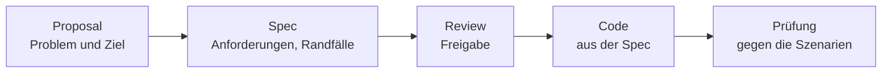

# Spec-Driven Development: erst Spec, dann Code

Spec-Driven Development dreht die Reihenfolge um: Erst entsteht eine prüfbare Beschreibung (Proposal und Spec), sie wird freigegeben, dann entsteht der Code. Die Spec wird zum Maßstab für Code, Tests und Review.

## Leitfragen

<details>
<summary>Die Anfrage lautet "Sortiere die Aufgaben nach Datum." Welche Fragen sind offen, bevor Code entsteht?</summary>

Was passiert mit Aufgaben ohne Datum? Auf- oder absteigend? Wird die gespeicherte Reihenfolge geändert oder nur die Ausgabe? Jede Antwort ändert den Code.

</details>

<details>
<summary>Warum fallen fehlende Randfälle bei Chat-Anfragen oft erst nach der Umsetzung auf?</summary>

Das Modell füllt Lücken mit einer plausiblen Annahme und setzt sie sofort um. Die Annahme wird erst sichtbar, wenn jemand den fertigen Code prüft oder ein Fehler auftritt.

</details>

<details>
<summary>Lohnt sich eine schriftliche Beschreibung vor jeder Änderung?</summary>

Nein. Bei kleinen, eindeutigen Änderungen kostet sie mehr, als sie spart. Sie lohnt sich bei mehrdeutigen oder folgenreichen Features.

</details>

## Vibe Coding und Spec-Driven Development

| | Vibe Coding / Code-First ([Modul 3](../m03-vibecoding/01-vibecoding.md)) | Spec-Driven Development |
| --- | --- | --- |
| Startpunkt | spontane Anfrage im Chat | Proposal: Problem und Ziel |
| Randfälle | fallen nach der Umsetzung auf | stehen vorher in der Spec |
| Review | nur am fertigen Code | an Spec **und** Code |
| Nachvollziehbarkeit | Chatverlauf, schnell verloren | versionierte Dateien im Repo |
| Passt für | kleine, eindeutige Änderungen | mehrdeutige, folgenreiche Features |

## Der Ablauf



| Dokument | Inhalt | Umfang |
| --- | --- | --- |
| Proposal | warum (Problem), was sich ändert, was betroffen ist | wenige Sätze |
| Spec | Anforderungen mit prüfbaren Szenarien | je Anforderung ein bis drei Szenarien |
| Tasks | Umsetzungsschritte als Checkliste | ein Schritt = eine überprüfbare Änderung |

## Wie eine Anforderung aussieht

Eine Anforderung sagt, was das System tun muss. Jedes Szenario macht sie prüfbar: Ausgangslage (**WHEN**) und erwartetes Ergebnis (**THEN**).

```markdown
### Requirement: Aufgaben ohne Datum am Ende
Das System SHALL Aufgaben ohne Fälligkeitsdatum nach allen Aufgaben mit Datum ausgeben.

#### Scenario: Gemischte Liste
- **WHEN** eine Aufgabe ohne Datum vor einer Aufgabe mit Datum angelegt wurde
- **THEN** steht die Aufgabe ohne Datum in der sortierten Ausgabe am Ende
```

| Element | Regel |
| --- | --- |
| `SHALL` / `MUST` | verbindliche Anforderung; `SHOULD` nur für Empfehlungen |
| ein Verhalten pro Requirement | sonst lässt sich nicht prüfen, was genau fehlt |
| Szenario mit konkreten Werten | "2026-11-01 vor 2026-12-01" statt "richtig sortiert" |
| Randfälle als eigene Szenarien | leere Eingabe, fehlender Wert, unbekannte id |

Ein Szenario lässt sich fast wörtlich in einen Test übersetzen: **WHEN** wird zur Testvorbereitung, **THEN** zur Prüfung.

## Beispiel: Was die Spec aufdeckt

| Frage aus der Spec | Code-First-Annahme eines Modells | Festlegung in der Spec |
| --- | --- | --- |
| Aufgaben ohne Datum? | stehen vorne, weil leerer Wert kleiner ist, oder Absturz | stehen am Ende |
| Sortierrichtung? | aufsteigend | aufsteigend: früheste Fälligkeit zuerst |
| gespeicherte Reihenfolge? | Datei wird sortiert zurückgeschrieben | nur die Ausgabe wird sortiert |

> **Merksatz:** Eine Spec ersetzt kein Code-Review. Sie senkt das Risiko, dass Code und Erwartung grundlegend auseinanderliegen.

## Selbst ausprobieren

Fremdbeispiel aus einem Blog-Projekt: Kommentare zu einem Blogpost. Leerer Übungsordner `kommentare/` außerhalb des FocusList-Projekts, ca. 20 Min.

1. Schreibe `proposal.md` mit `## Why` (Problem in ein bis zwei Sätzen) und `## What Changes` (zwei bis drei Punkte).
2. Schreibe `spec.md` mit einem Datenmodell `Comment` (`id`, `postId`, `author`, `text`, `createdAt`) und mindestens drei Requirements mit `SHALL`/`MUST` und je einem `#### Scenario:` mit **WHEN**/**THEN**, zwei davon Randfälle: Text nur aus Leerzeichen und Text über 1000 Zeichen.
3. Lass im Agent-Modus implementieren: "Implementiere `spec.md` als eine Funktion in `comments.ts` (bzw. `comments.py`), ohne Datenbank, Kommentare in einer Liste im Speicher, und schreibe zu jedem Scenario einen Test." Führe die Tests aus: `npx tsx --test comments.test.ts` bzw. `uv run --with pytest pytest`.
4. Stelle dieselbe Anfrage in einem neuen Chat ohne Spec: "Baue eine Funktion, mit der man Kommentare zu Blogposts hinzufügen kann." Vergleiche die Randfälle.

**Beobachtung:** Mit Spec entsteht zu jedem Scenario ein Test (`ℹ pass 4`, `ℹ fail 0` bzw. `4 passed`), inklusive Grenzfall "genau 1000 Zeichen", falls er als eigenes Scenario in der Spec steht. Ohne Spec prüft die Funktion meist höchstens einen leeren Text; eine Längengrenze fehlt oder liegt bei einem anderen Wert (z. B. 500 oder 5000), und `"   "` wird als gültiger Kommentar gespeichert. Behandelt die Implementierung mit Spec einen Randfall nicht: das Scenario mit konkreteren Werten formulieren und neu erzeugen lassen, statt den Code von Hand zu flicken.

<details>
<summary>Beispiel-Spec zum Vergleich</summary>

```markdown
# Spec: Kommentare

## Datenmodell

`Comment`: `id`, `postId`, `author`, `text`, `createdAt` (ISO-Zeitstempel)

## Requirements

### Requirement: Kommentar speichern
Das System SHALL einen gültigen Kommentar dem angegebenen Post zuordnen und speichern.

#### Scenario: Gültiger Kommentar
- **WHEN** zu `post-1` der Kommentar "Danke für den Artikel!" von "Ana" hinzugefügt wird
- **THEN** liefert der Abruf für `post-1` genau einen Kommentar

### Requirement: Leerer Kommentar
Das System MUST einen Kommentar ablehnen, dessen Text nach Entfernen von Leerzeichen leer ist.

#### Scenario: Nur Leerzeichen
- **WHEN** der Text `"   "` übergeben wird
- **THEN** meldet das System "Kommentar darf nicht leer sein." und speichert nichts

### Requirement: Maximale Länge
Das System MUST Kommentare mit mehr als 1000 Zeichen ablehnen.

#### Scenario: 1001 Zeichen
- **WHEN** ein Text mit 1001 Zeichen übergeben wird
- **THEN** meldet das System "Kommentar darf höchstens 1000 Zeichen haben."

#### Scenario: Genau 1000 Zeichen
- **WHEN** ein Text mit genau 1000 Zeichen übergeben wird
- **THEN** wird der Kommentar gespeichert
```

Das Szenario "Genau 1000 Zeichen" klärt die Grenze, die "mehr als 1000" offen ließe.

</details>

## Fazit

- Spec-Driven Development klärt Randfälle vor dem Code, nicht danach.
- Proposal beschreibt das Warum, die Spec das Was mit prüfbaren Szenarien.
- Für kleine, eindeutige Änderungen reicht weiter eine direkte Anfrage.

Als Nächstes gibt OpenSpec diesem Ablauf feste Ordner, Befehle und ein Dashboard: [02-openspec-workflow.md](02-openspec-workflow.md).
