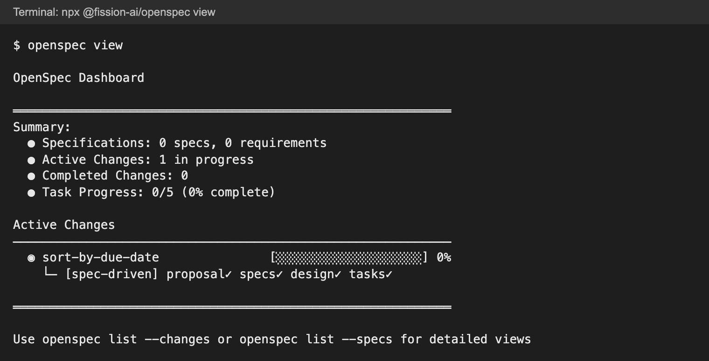
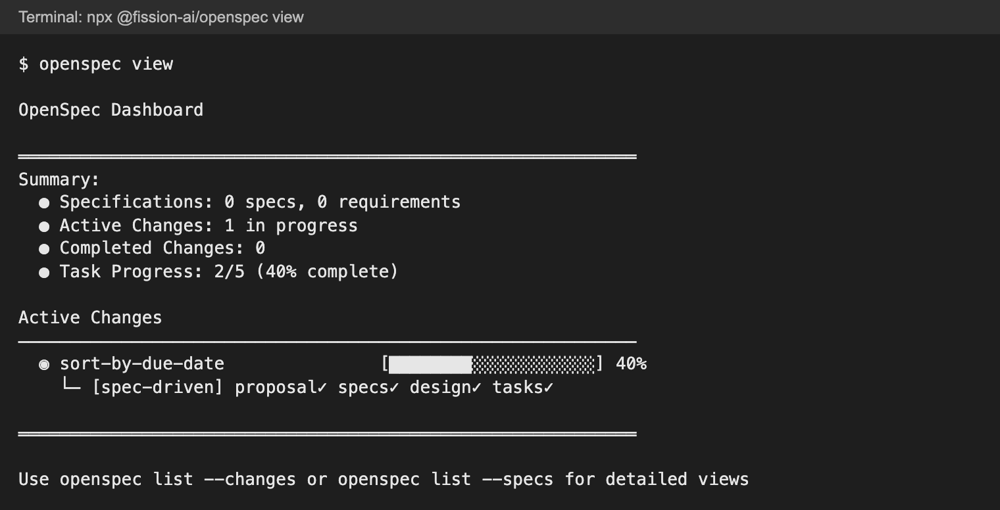
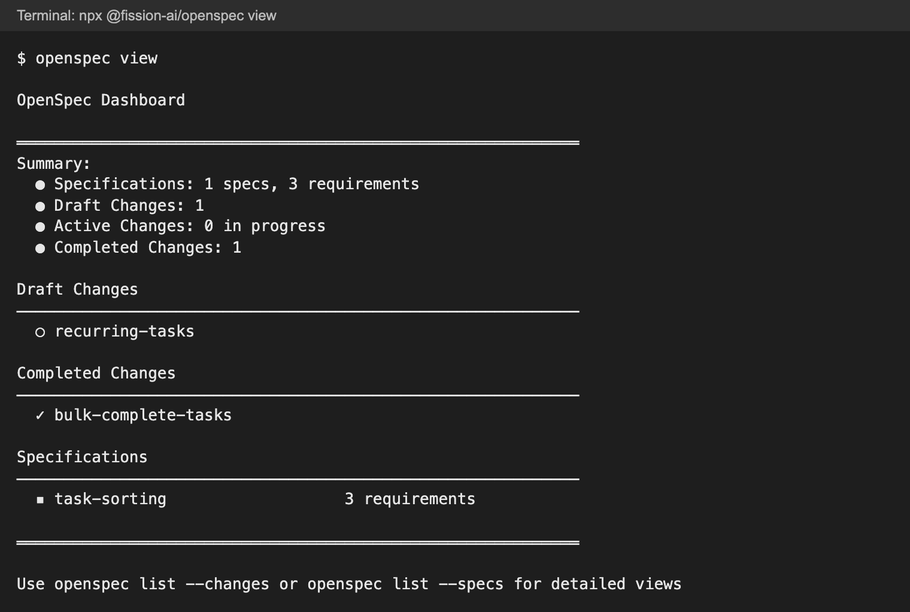
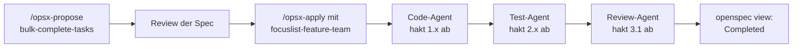

# OpenSpec-Workflow: FocusList-Feature mit Spec umsetzen

OpenSpec ist ein Open-Source-Werkzeug für Spec-Driven Development: eine CLI plus Prompt-Dateien und Skills für Copilot. Jede Änderung ist eine **Change** mit Proposal, Spec-Delta, Design und Tasks; nach der Umsetzung wird sie archiviert, und ihr Delta wird Teil der gültigen Specs.

## Leitfragen

<details>
<summary>Warum eignet sich "Aufgaben nach Fälligkeitsdatum sortieren" als Übungsfeature?</summary>

Es wirkt trivial, hat aber einen echten Randfall: Aufgaben ohne Datum. Die Spec muss ihn vor dem Code klären.

</details>

<details>
<summary>Wo sollten Proposal und Spec liegen, damit sie Wochen später noch auffindbar und aktuell sind?</summary>

Im Repository neben dem Code, versioniert und mit festen Orten für geplante, laufende und abgeschlossene Änderungen. OpenSpec gibt diese Ordner vor.

</details>

<details>
<summary>Woran lässt sich der Fortschritt eines Features ablesen, ohne den Code zu lesen?</summary>

An einer Checkliste der Umsetzungsschritte, die beim Arbeiten abgehakt wird. OpenSpec zählt diese Checkboxen und zeigt sie als Dashboard.

</details>

## Installation und Einrichtung

```bash
npm install -g @fission-ai/openspec@latest   # Node.js ab 20.19, auch im Python-Projekt
openspec --version                           # getestet: 1.15.0
openspec init --tools github-copilot --language de --no-copilot-cloud
```

| `openspec init` legt an | Zweck |
| --- | --- |
| `openspec/config.yaml` | Schema `spec-driven`, Projektkontext, Sprache `de` |
| `openspec/specs/` | gültige Specs, eine Capability pro Ordner |
| `openspec/changes/archive/` | abgeschlossene Changes |
| `.github/prompts/opsx-*.prompt.md` | Befehle für den Chat: `/opsx-propose`, `/opsx-apply`, `/opsx-archive` u. a. |
| `.github/skills/openspec-*/SKILL.md` | Abläufe, die Copilot dazu lädt (Modul 5) |

Ohne `--tools` fragt `init` interaktiv nach den genutzten KI-Werkzeugen. Nach `init` das VS-Code-Fenster neu laden, damit die neuen `/`-Befehle erscheinen. In Copilot heißen die Befehle `/opsx-propose` mit Bindestrich; die OpenSpec-Dokumentation schreibt allgemein `/opsx:propose`.

_Stand: 10/2026 (OpenSpec 1.15.0, Paket `@fission-ai/openspec`, Node.js ≥ 20.19.0), Quelle: [github.com/Fission-AI/OpenSpec](https://github.com/Fission-AI/OpenSpec)._

## Die Ordnerstruktur

Endstand FocusList v7 ([`focuslist/js-ts/steps/m09/openspec`](../project/focuslist/js-ts/steps/m09/openspec)):

```text
openspec/
├── config.yaml
├── specs/
│   └── task-sorting/spec.md          # gültige Anforderungen
└── changes/
    ├── recurring-tasks/              # nur proposal.md: Entwurf
    ├── bulk-complete-tasks/          # alle Tasks erledigt, noch nicht archiviert
    │   ├── proposal.md · design.md · tasks.md
    │   └── specs/task-completion/spec.md
    └── archive/
        └── 2026-10-14-sort-by-due-date/   # archiviert, Delta in specs/task-sorting übernommen
```

| Datei einer Change | Inhalt |
| --- | --- |
| `proposal.md` | `## Why`, `## What Changes`, `## Capabilities`, `## Impact` |
| `specs/<capability>/spec.md` | Spec-Delta: was sich an den Anforderungen ändert |
| `design.md` | technische Entscheidungen, z. B. "reine Funktion, schreibt nichts" |
| `tasks.md` | Umsetzungsschritte als Checkboxen `- [ ]` |

## Wie sieht ein Spec-Delta aus?

Eine Change beschreibt nicht die ganze Spec, sondern nur die Änderung. Überschriften in Englisch, Inhalt auf Deutsch (so in `config.yaml` festgelegt):

```markdown
## ADDED Requirements

### Requirement: Alles-oder-nichts bei unbekannten ids
Das System MUST den Aufruf abbrechen und nichts speichern, wenn eine der ids nicht existiert.

#### Scenario: Eine id unbekannt
- **WHEN** `complete-tasks a1 unbekannt` ausgeführt wird
- **THEN** meldet das System einen Fehler und Aufgabe a1 bleibt offen
```

| Abschnitt | Wirkung beim Archivieren |
| --- | --- |
| `## ADDED Requirements` | Anforderung kommt neu in `openspec/specs/<capability>/spec.md` |
| `## MODIFIED Requirements` | ersetzt die gleichnamige Anforderung |
| `## REMOVED Requirements` | entfernt sie |
| `## RENAMED Requirements` | benennt sie um |

`openspec validate <change>` prüft das Format: Jede Change braucht mindestens ein Delta, jedes Requirement mindestens ein `#### Scenario:`.

## Der Ablauf in drei Schritten

| Befehl | Wo | Wirkung |
| --- | --- | --- |
| `/opsx-propose <name und Beschreibung>` | Copilot Chat | legt `changes/<name>/` mit allen vier Artefakten an, schreibt keinen Code |
| `/opsx-apply <name>` | Copilot Chat | setzt `tasks.md` Schritt für Schritt um und hakt ab |
| `/opsx-archive <name>` | Copilot Chat | verschiebt nach `changes/archive/JJJJ-MM-TT-<name>/`, übernimmt das Delta nach `specs/` |
| `openspec view` | Terminal | Dashboard: Specs, Entwürfe, aktive und abgeschlossene Changes |
| `openspec list` / `openspec list --specs` | Terminal | Changes mit Task-Stand bzw. Specs mit Anzahl Requirements |
| `openspec validate <name>` | Terminal | Format der Change prüfen |

Weitere Befehle aus `init`: `/opsx-explore` (Idee durchdenken, ohne Dateien), `/opsx-update` (Artefakte einer Change überarbeiten), `/opsx-sync` (Delta ohne Archivieren in die Specs übernehmen).

## Drei Stadien im Dashboard

**1. Vorgeschlagen:** Nach `/opsx-propose sort-by-due-date` gibt es eine aktive Change mit allen Artefakten und 0 von 5 Tasks. Jetzt ist der Zeitpunkt für das Review der Spec: Ist "kein Fälligkeitsdatum" eindeutig geregelt?



**2. In Umsetzung:** `/opsx-apply` hakt jede fertige Aufgabe in `tasks.md` ab (`- [ ]` → `- [x]`). Der Balken kommt allein aus den Checkboxen: 2 von 5 = 40 %.



**3. Archiviert:** `/opsx-archive` verschiebt die Change ins Archiv; `task-sorting` erscheint mit 3 Requirements unter Specifications.



_Quelle: eigene Aufnahmen von `openspec view` im Referenzprojekt FocusList, 10/2026; Textfassung in [`docs/openspec-dashboard/`](../project/focuslist/js-ts/steps/m09/docs/openspec-dashboard)._

| Change | Stadium im Endstand | Entsteht durch |
| --- | --- | --- |
| `sort-by-due-date` | archiviert, jetzt Spec `task-sorting` (3 Requirements) | Spec-First-Durchlauf mit `/opsx-propose`, `/opsx-apply`, `/opsx-archive` |
| `bulk-complete-tasks` | Completed: alle Tasks erledigt, noch nicht archiviert | `/opsx-apply` mit `focuslist-feature-team` (Modul 7) zu Ticket `FL-102` |
| `recurring-tasks` | Draft: nur Proposal, noch keine Tasks | Platzhalter für Ticket `FL-103` |

## OpenSpec und die Agenten-Kette

Der `focuslist-code-agent` aus Modul 7 liest bereits `openspec/changes/<name>/` und hakt `tasks.md` ab. Damit lässt sich eine Change auch über den Koordinator umsetzen:



Die Tasks der Change sind deshalb nach Rollen gegliedert ([`tasks.md`](../project/focuslist/js-ts/steps/m09/openspec/changes/bulk-complete-tasks/tasks.md)): "1. Umsetzung (focuslist-code-agent)", "2. Tests (focuslist-test-agent)", "3. Review (focuslist-review-agent)".

## Typische Stolperstellen

| Problem | Abhilfe |
| --- | --- |
| `/opsx-propose` erscheint nicht im Chat | nach `openspec init` Fenster neu laden; `.github/prompts/` prüfen |
| `/opsx-propose` schreibt gleich Code | Prompt enthält eine Planungsgrenze; Code verwerfen, `/opsx-apply` erst nach dem Review starten |
| Dashboard zeigt 0 %, obwohl Code fertig ist | Checkboxen in `tasks.md` wurden nicht abgehakt |
| `openspec validate` meldet "No deltas found" | Delta-Überschrift `## ADDED Requirements` fehlt oder kein `#### Scenario:`; bei einem reinen Entwurf mit nur `proposal.md` ist das erwartet |
| keine OpenSpec-CLI erlaubt | Ordner und Dateien von Hand anlegen; der Ablauf Spec vor Code bleibt derselbe, nur ohne Dashboard |

## Übung

**Start:** eigener Stand aus Modul 8 oder Stand v6 erzeugen: `node <kursmaterial>/project/focuslist/catch-up.mjs <stack> m09 focuslist` ([Projektdateien](../project/README.md)), mit [`focuslist-tickets/`](../project/focuslist-tickets/) daneben
**Referenz:** [`steps/m09/`](../project/focuslist/js-ts/steps/m09/) bzw. [Python](../project/focuslist/python/steps/m09/) — nur die in Modul 9 geänderten Dateien, getestet mit OpenSpec 1.15.0 am 28.10.2026
**Dauer:** 45 Min. (Teil A ca. 30 Min., Teil B ca. 15 Min.)

Node.js ab 20.19 (`node --version`), auch im Python-Projekt; Agent-Modus, Session Target **Copilot**; Stand committet.

**Teil A: `sort-by-due-date` vom Vorschlag bis ins Archiv**

1. Installiere die CLI (`npm install -g @fission-ai/openspec@latest`), prüfe `openspec --version` und führe im FocusList-Ordner `openspec init --tools github-copilot --language de --no-copilot-cloud` aus. Lade danach das Fenster neu (**Developer: Reload Window**).
2. Schreibe im Chat: `/opsx-propose sort-by-due-date: add-task bekommt ein optionales Fälligkeitsdatum (JJJJ-MM-TT), list-tasks --sort due-date gibt Aufgaben aufsteigend nach Datum aus.` Den Randfall "Aufgabe ohne Datum" absichtlich nicht nennen.
3. Öffne `openspec/changes/sort-by-due-date/` und führe `openspec view` aus.
4. Reviewe `specs/task-sorting/spec.md` (der Ordnername kann abweichen): Gibt es ein Requirement mit Scenario für Aufgaben ohne Datum? Bleibt die gespeicherte Reihenfolge unverändert? Ergänze Fehlendes von Hand oder mit `/opsx-update`, dann `openspec validate sort-by-due-date`.
5. Starte `/opsx-apply sort-by-due-date`. Führe `openspec view` aus, sobald die ersten Tasks abgehakt sind, und noch einmal am Ende.
6. Prüfe über die CLI mit drei Aufgaben (`2026-12-01`, ohne Datum, `2026-11-01`): `list-tasks --sort due-date`, danach `list-tasks` ohne Sortierung.
7. Starte `/opsx-archive sort-by-due-date`, prüfe mit `openspec view` und `ls openspec/changes/archive/`, führe die Task "FocusList: Lint + Test" aus und committe.

**Teil B (Capstone): `bulk-complete-tasks` mit der Agenten-Kette**

8. Schreibe im Agent-Modus: `/opsx-propose bulk-complete-tasks nach Ticket FL-102 aus focuslist-tickets. Gliedere tasks.md in drei Abschnitte: Umsetzung (focuslist-code-agent), Tests (focuslist-test-agent), Review (focuslist-review-agent).` Prüfe in den Tool-Aufrufen, dass das Ticket über den MCP-Server gelesen wurde, und reviewe die Spec auf die Regel "eine unbekannte id ändert nichts".
9. Wähle `focuslist-feature-team` im Agent-Dropdown und schreibe: `/opsx-apply bulk-complete-tasks – setze die Change mit der Kette Code-Agent, Test-Agent, Review-Agent um und hake jeden erledigten Punkt in tasks.md ab.`
10. Prüfe mit `openspec view`, teste `complete-tasks` über die CLI mit zwei bekannten ids und mit einer unbekannten id und committe den Stand als v7. Die Change wird bewusst nicht archiviert.

**Checkpoint:**

- Schritt 1: `✔ Setup complete for GitHub Copilot`, `6 skills and 6 commands in .github/`, `Config: openspec/config.yaml (schema: spec-driven)`.
- Schritt 3: eine aktive Change `sort-by-due-date` mit `proposal✓ specs✓ design✓ tasks✓` und 0 %.
- Schritt 4: ein Requirement mit Scenario für Aufgaben ohne Datum; `openspec validate` meldet die Change als gültig.
- Schritt 5: Zwischenstand z. B. `2/5 (40% complete)`, am Ende 5/5.
- Schritt 6:

  ```text
  $ npm start -- list-tasks --sort due-date        # Python: uv run focuslist list-tasks --sort due-date
  …  [ ] Frueh (medium) fällig 2026-11-01
  …  [ ] Spaet (medium) fällig 2026-12-01
  …  [ ] Ohne (medium)
  ```

  `list-tasks` ohne `--sort` zeigt wieder die Anlagereihenfolge.
- Schritt 7: `openspec view` zeigt `▪ task-sorting  3 requirements`; das Archiv enthält `JJJJ-MM-TT-sort-by-due-date/`.
- Schritt 10: `complete-tasks <id> unbekannt` endet mit `Fehler: Task mit id "unbekannt" existiert nicht.`, `list-tasks` zeigt die erste Aufgabe weiter offen, und `openspec view` zeigt:

  ```text
  Summary:
    ● Specifications: 1 specs, 3 requirements
    ● Active Changes: 0 in progress
    ● Completed Changes: 1
  Completed Changes
    ✓ bulk-complete-tasks
  Specifications
    ▪ task-sorting                   3 requirements
  ```

**Falls es hakt:**

- Globale Installation nicht erlaubt: `npx @fission-ai/openspec@latest init …` und `npx @fission-ai/openspec@latest view`.
- Gar kein OpenSpec-Tooling verfügbar: `openspec/changes/sort-by-due-date/` mit `proposal.md`, `specs/task-sorting/spec.md`, `design.md` und `tasks.md` von Hand nach dem Vorbild der [Referenz](../project/focuslist/js-ts/steps/m09/openspec/changes/archive/2026-10-14-sort-by-due-date) anlegen, im Agent-Modus "Setze `openspec/changes/sort-by-due-date/tasks.md` um und hake ab" schreiben, zum Archivieren den Ordner nach `changes/archive/JJJJ-MM-TT-sort-by-due-date/` verschieben und das Delta nach `openspec/specs/task-sorting/spec.md` übernehmen. Das Dashboard entfällt.
- `focuslist-feature-team` startet den `/opsx-apply`-Ablauf nicht: Koordinator auswählen und ohne Slash-Befehl schreiben: "Setze die Change `openspec/changes/bulk-complete-tasks/` mit der Kette Code-Agent, Test-Agent, Review-Agent um und hake `tasks.md` ab."
- Teil A oder B bricht ab: den Endstand mit `catch-up.mjs <stack> final focuslist --force` erzeugen und dort mit `openspec view` weitermachen.

**Erweiterung:** Kopiere `openspec/changes/recurring-tasks/` aus der Referenz (nur `proposal.md` und `.openspec.yaml`) oder lege den Ordner mit einer eigenen `proposal.md` zu Ticket `FL-103` an. `openspec view` zeigt dann zusätzlich `● Draft Changes: 1`; `openspec validate --all` meldet für den Entwurf "No deltas found", was für einen Entwurf ohne Spec-Delta erwartet ist.

### Was sich in der Referenz geändert hat

| Datei | Änderung gegenüber v6 |
| --- | --- |
| `openspec/config.yaml`, `.github/prompts/opsx-*.prompt.md`, `.github/skills/openspec-*/` | aus `openspec init` |
| `openspec/specs/task-sorting/spec.md` | 3 Requirements, u. a. "Aufgaben ohne Datum am Ende" und "Gespeicherte Daten bleiben unverändert" |
| `openspec/changes/archive/2026-10-14-sort-by-due-date/` | archivierte Change |
| `src/actions/sort-by-due-date.ts` bzw. `focuslist/actions/sort_by_due_date.py` | reine Funktion: erst Aufgaben mit Datum aufsteigend, dann ohne Datum; schreibt nichts |
| Modell, `add-task`, CLI | optionales `dueDate` / `due_date`, Prüfung über `assertIsoDate` / `assert_iso_date`, `--sort due-date` |
| `openspec/changes/bulk-complete-tasks/` | Change nach Rollen gegliedert, `tasks.md` vollständig `[x]` |
| `src/actions/complete-tasks.ts` bzw. `focuslist/actions/complete_tasks.py` | alles-oder-nichts wie `bulk-set-priority` |
| Tests | `sort-by-due-date`, `complete-tasks` |

## Fazit

- `openspec init` richtet Ordner, `/opsx-*`-Befehle und Skills ein; die CLI braucht Node.js ab 20.19.
- Propose, Apply, Archive: Spec reviewen, Tasks abhaken, Delta in die gültigen Specs übernehmen.
- `openspec view` zeigt den Stand aller Changes aus den Dateien selbst; mit `focuslist-feature-team` setzt die Agenten-Kette eine Change um.

FocusList ist auf Stand v7. Modul 10 blickt auf die ganze Kette v0 → v7 zurück.
