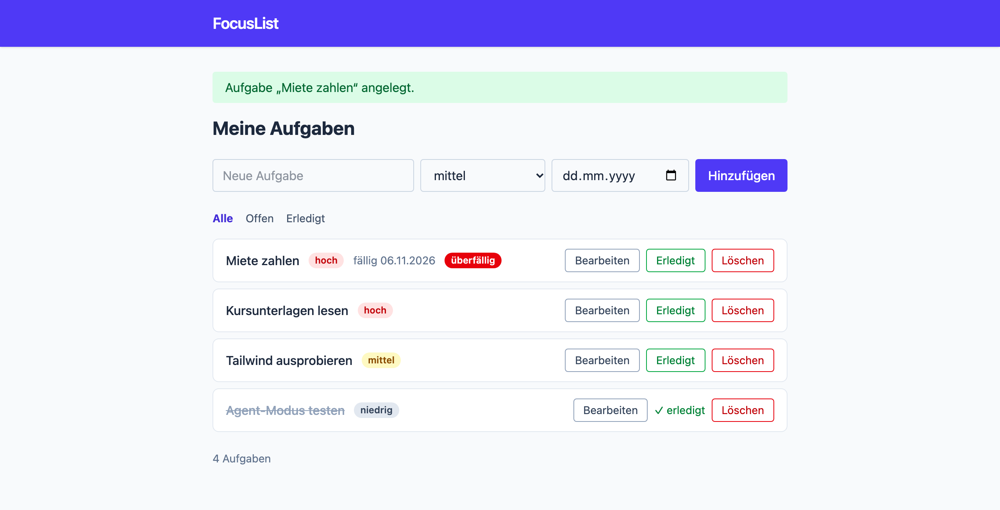
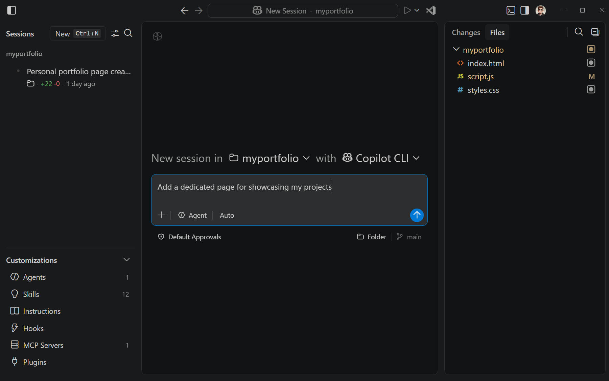
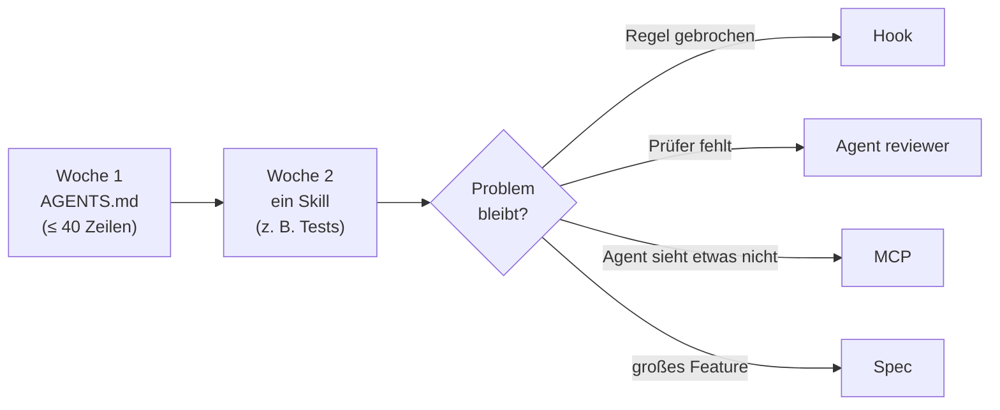

# Lab 9.1: Rückblick und Transfer

**Leitfragen:**

Welche Zeile der Status-quo-Liste ist noch offen?

Zeile 8: Was die Fußzeile zählen soll, ist weiter offen. m08 hat den Weg gezeigt (Spec am Beispiel Fälligkeitsdatum); der nächste Change per Spec klärt die Fußzeile. Offen bleibt außerdem, was keine Datei lösen kann: Ziel vorgeben, Grenzen setzen, Ergebnis abnehmen (Lab 1.1).

Was würde im eigenen Team den größten Unterschied machen?

Für die meisten Teams eine kurze `AGENTS.md` mit Befehlen und Verboten, weil sie sofort bei jeder Anfrage wirkt. Danach der eine Ablauf, der am häufigsten schiefgeht, als Skill (oft: Tests schreiben).

- Jeder Baustein löst eine Fehlerklasse aus dem Vibecoding: Instructions, Skill, Custom Agent, Hook, MCP, Spec.
- Leitmotiv des Kurses: Der Agent ist so gut wie das, was im Repo steht.
- Im eigenen Projekt klein anfangen: `AGENTS.md` und ein Skill, dann nach Bedarf erweitern.

## Begriffe

| Begriff | Bedeutung |
| --- | --- |
| Fehlerklasse | Art eines Problems im KI-Code (Lab 3.3): Inkonsistenz, falsche Annahme, fehlende Tests, Sicherheitslücke, überflüssige Abhängigkeit |

## Die Status-quo-Liste gegen v5

Die acht Zeilen der Status-quo-Liste aus Lab 3.3 und wo sie in FocusList v5 gelöst sind:

| # | Mangel | Baustein | Gelöst in v5 durch |
| --- | --- | --- | --- |
| 1 | Titel ungeschützt im HTML (XSS) | Regel in Instructions für Templates (m04), Fix per Skill `security-checker` (m05) | Escaping-Regel in `templates.instructions.md`; `\|safe` entfernt bzw. `escapeHtml()` |
| 2 | Eingaben ungeprüft: leerer Titel, beliebige Priorität | Skill `security-checker` (m05) | Validierung, Fehler mit Status 400 |
| 3 | Secret und fest verdrahteter Debug-Modus im Code (Python); Path Traversal, Body ohne Limit (Node.js) | Skill `security-checker` (m05) | `FOCUSLIST_SECRET` aus der Umgebung, ein Startbefehl; Pfadprüfung, 413 bei zu großem Body |
| 4 | neue ID = Anzahl + 1, doppelte IDs nach dem Löschen | Instructions (m04) | Konvention „`max(id) + 1`“ in `AGENTS.md` |
| 5 | Logik verstreut, Filter doppelt (Python: `?status=all`), Stile gemischt, zweiter Startweg | Instructions (m04) | `AGENTS.md`: „Route → Service → Store“, eine Filterfunktion (`?status=all` liefert alle), ein Startbefehl |
| 6 | keine neuen Tests, niemand prüft unabhängig | Skill `test-writer` (m05), Custom Agents (m06), Check-Hook (m07) | Tests je Route; `reviewer`, `tester`, `feature-lead`; `agentStop` führt die Tests nach jeder Runde aus |
| 7 | feste Breiten, Formular bricht auf Handybreite; Agent hat die Seite nie gesehen | MCP Playwright (m07) | responsives Layout, vom Agenten im Browser geprüft |
| 8 | Fußzeile zählt nur gefilterte Aufgaben (Python-Referenz) | Spec (m08) | offen: nächster Change per Spec (der Weg ist mit dem Fälligkeitsdatum in `openspec/specs/tasks/spec.md` gezeigt) |

Dazu kam in m07 eine Grenze, die keine Zeile der Liste war, aber jeder Agent braucht: Der Guard-Hook lehnt das Lesen von `.env` ab.

Was offen bleibt: Annahmen, die nirgends stehen, und die Abnahme. Kein Baustein ersetzt das Lesen des Diffs.

_Quelle: eigener Screenshot, FocusList v5, 07.11.2026._

Endstand des Kursprojekts: FocusList v5.

## Entscheidungshilfe: welcher Baustein wann

| Problem | Baustein | Datei | Erkennungszeichen |
| --- | --- | --- | --- |
| Agent kennt Stack, Befehle, Regeln nicht | Instruction | `AGENTS.md`, `.github/instructions/*.instructions.md` | dieselbe Korrektur in jedem Chat |
| wiederkehrende Aufgabe wird jedes Mal anders erledigt | Skill | `.github/skills/<name>/SKILL.md` | „so machen wir das immer“, mit Schritten und Vorlage |
| eine Rolle braucht eigene Rechte oder einen frischen Blick | Custom Agent | `.github/agents/<name>.agent.md` | Prüfer soll nichts ändern; Aufgabe lässt sich delegieren |
| etwas muss immer passieren oder darf nie passieren | Hook | `.github/hooks/*.json` | „bitte nicht“ hat schon einmal nicht gereicht |
| Agent braucht ein Werkzeug außerhalb des Editors | MCP | `.mcp.json` | „das sieht er ja nicht“ (Browser, Issues, Datenbank) |
| unklar, was genau gebaut werden soll | Spec | `openspec/` | mehrere Dateien, offene Fragen, Abnahme durch andere |

Reihenfolge im Zweifel: von oben nach unten. Instructions kosten am wenigsten und wirken überall; Hooks, MCP und Specs lohnen sich, wenn ein konkretes Problem auftritt.

_Quelle: VS Code Blog, Modern UI (https://code.visualstudio.com/blogs/2026/10/15/modern-ui), Microsoft, CC BY 3.0 US, abgerufen am 07.11.2026._

Alle Bausteine an einem Ort: Das Agents-Fenster listet Agents, Skills, Instructions, Hooks und MCP-Server unter „Customizations“ (Ansicht Okt. 2026).

## Einstieg im eigenen Projekt

| Schritt | Inhalt | Prüfung |
| --- | --- | --- |
| `AGENTS.md` | Stack, Ordner, Befehle Start/Test, Konventionen, Verbote | Agent nennt im neuen Chat die Testbefehle richtig |
| ein Skill | häufigster Ablauf mit Schritten, Vorlage, Abnahmekriterium | Skill greift ohne `/`-Aufruf, wenn die Aufgabe passt |
| messen | gleiche Aufgabe vorher / nachher (Lab 4.3) | weniger Korrekturen im Diff |
| Team | Dateien ins gemeinsame Projekt legen, im Review mitlesen | alle nutzen denselben Stand |

Reihenfolge: zuerst `AGENTS.md` (oder die Datei, die das Team schon nutzt), dann ein Skill für einen wiederkehrenden Ablauf, dann ein Hook für eine harte Grenze. Jedes Artefakt bekommt ein Prüfkriterium wie in der Tabelle oben.

Hinweise:

- Klein anfangen: lieber eine gute `AGENTS.md` mit 20 Zeilen als fünf halbfertige Dateien.
- Im Team erst klären, ob Hooks (Preview) und MCP erlaubt sind.
- Gleiche Dateien funktionieren in anderen Werkzeugen ähnlich: `AGENTS.md` bei Codex, `CLAUDE.md` und `.claude/skills` bei Claude Code (Lab 1.3).

## Fazit

- Jede Zeile der Status-quo-Liste hat einen Baustein; offen bleibt, was nur ein Mensch abnehmen kann.
- Im eigenen Projekt mit `AGENTS.md` und einem Skill anfangen, weitere Bausteine erst bei konkretem Bedarf.
- Wirkung messen: gleiche Aufgabe vorher und nachher vergleichen.
