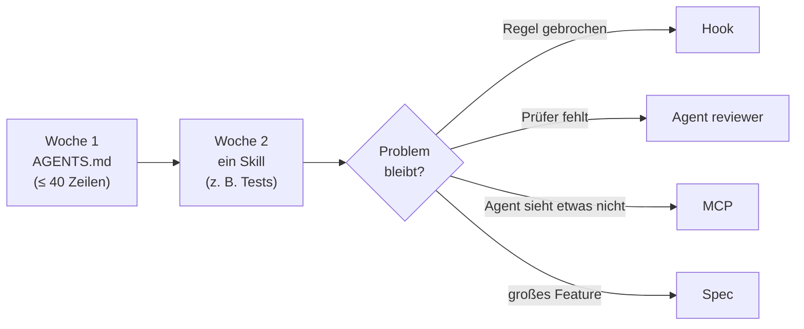

# Lab 9.1: Rückblick und Transfer

**Leitfragen:**

<details>
<summary>Welche Zeile der Status-quo-Liste ist noch offen?</summary>

Meist Zeilen, die keine Datei lösen kann: „Agent nimmt etwas Falsches an, das nirgends steht“ oder „niemand liest den Diff“. Dafür bleibt der Mensch zuständig: Ziel vorgeben, Grenzen setzen, Ergebnis abnehmen (Lab 1.1).

</details>

<details>
<summary>Was würde im eigenen Team den größten Unterschied machen?</summary>

Für die meisten Teams eine kurze `AGENTS.md` mit Befehlen und Verboten, weil sie sofort bei jeder Anfrage wirkt. Danach der eine Ablauf, der am häufigsten schiefgeht, als Skill (oft: Tests schreiben).

</details>

- Jeder Baustein löst eine Fehlerklasse aus dem Vibecoding: Instructions, Skill, Custom Agent, Hook, MCP, Spec.
- Leitmotiv des Kurses: Der Agent ist so gut wie das, was im Repo steht.
- Im eigenen Projekt klein anfangen: `AGENTS.md` und ein Skill, dann nach Bedarf erweitern.

## Begriffe

| Begriff | Bedeutung |
| --- | --- |
| Transfer-Plan | persönliche Liste der Artefakte, die im eigenen Projekt als Nächstes entstehen |
| Fehlerklasse | Art eines Problems im KI-Code (Lab 3.3): Inkonsistenz, falsche Annahme, fehlende Tests, Sicherheitslücke, überflüssige Abhängigkeit |

## Die Status-quo-Liste gegen v5

Typische Zeilen der Status-quo-Liste (Lab 3.3) und wo sie in FocusList v5 gelöst sind:

| Zeile der Status-quo-Liste | Fehlerklasse | Baustein | Gelöst in v5 durch |
| --- | --- | --- | --- |
| Logik teils in Routen, teils im Store | Inkonsistenz | Instructions (m04) | `AGENTS.md`: „Route → Service → Store“ |
| IDs per `len(tasks) + 1` | falsche Annahme | Instructions (m04) | Konvention „`max(id) + 1`“ |
| Filter in Seite und API verschieden | Inkonsistenz | Instructions (m04) | eine Filterfunktion für beide |
| leerer Titel, beliebige Priorität möglich | Sicherheitslücke | Skill `security-checker` (m05) | Validierung, Fehler mit Status 400 |
| Titel ungeschützt im HTML (XSS) | Sicherheitslücke | Skill `security-checker` (m05) | `\|safe` entfernt bzw. `escapeHtml()` |
| Secret oder `debug=True` im Code; Path Traversal, kein Body-Limit (Node.js) | Sicherheitslücke | Skill `security-checker` (m05) | `FOCUSLIST_SECRET` aus der Umgebung; Pfadprüfung, 413 bei zu großem Body |
| kein einziger neuer Test | fehlende Tests | Skill `test-writer` (m05), Check-Hook (m07) | Tests je Route; `agentStop` führt sie nach jeder Runde aus |
| niemand prüft das Feature unabhängig | fehlende Tests | Custom Agents (m06) | `reviewer` (nur lesen), `tester` (nur Tests), `feature-lead` |
| Agent liest `.env`, löscht Ordner | Sicherheitslücke | Guard-Hook (m07) | `preToolUse` lehnt ab |
| feste Breiten, Formular bricht auf dem Handy | falsche Annahme | Playwright-MCP (m07) | responsives Layout, im Browser geprüft |
| „Fälligkeitsdatum“: jeder versteht etwas anderes | falsche Annahme | Spec (m08) | `openspec/specs/tasks/spec.md` mit Szenarien |

Was offen bleibt: Annahmen, die nirgends stehen, und die Abnahme. Kein Baustein ersetzt das Lesen des Diffs.


_Quelle: eigener Screenshot, FocusList v5, 07.11.2026._

Endstand des Kursprojekts: FocusList v5.

## Entscheidungshilfe: welcher Baustein wann

| Problem | Baustein | Datei | Erkennungszeichen |
| --- | --- | --- | --- |
| Agent kennt Stack, Befehle, Regeln nicht | Instruction | `AGENTS.md`, `.github/instructions/*.instructions.md` | dieselbe Korrektur in jedem Chat |
| wiederkehrende Aufgabe wird jedes Mal anders erledigt | Skill | `.github/skills/<name>/SKILL.md` | „so machen wir das immer“, mit Schritten und Vorlage |
| eine Rolle braucht eigene Rechte oder einen frischen Blick | Custom Agent | `.github/agents/<name>.agent.md` | Prüfer soll nichts ändern; Aufgabe lässt sich delegieren |
| etwas muss immer passieren oder darf nie passieren | Hook | `.github/hooks/*.json` | „bitte nicht“ hat schon einmal nicht gereicht |
| Agent braucht ein Werkzeug außerhalb des Editors | MCP | `.mcp.json` | „das sieht er ja nicht“ (Browser, Issues, Datenbank) |
| unklar, was genau gebaut werden soll | Spec | `openspec/` | mehrere Dateien, offene Fragen, Abnahme durch andere |

Reihenfolge im Zweifel: von oben nach unten. Instructions kosten am wenigsten und wirken überall; Hooks, MCP und Specs lohnen sich, wenn ein konkretes Problem auftritt.


_Quelle: VS Code Blog, Modern UI (https://code.visualstudio.com/blogs/2026/10/15/modern-ui), Microsoft, CC BY 3.0 US, abgerufen am 07.11.2026._

Alle Bausteine an einem Ort: Das Agents-Fenster listet Agents, Skills, Instructions, Hooks und MCP-Server unter „Customizations“ (Ansicht Okt. 2026).

## Einstieg im eigenen Projekt



| Schritt | Inhalt | Prüfung |
| --- | --- | --- |
| `AGENTS.md` | Stack, Ordner, Befehle Start/Test, Konventionen, Verbote | Agent nennt im neuen Chat die Testbefehle richtig |
| ein Skill | häufigster Ablauf mit Schritten, Vorlage, Abnahmekriterium | Skill greift ohne `/`-Aufruf, wenn die Aufgabe passt |
| messen | gleiche Aufgabe vorher / nachher (Lab 4.3) | weniger Korrekturen im Diff |
| Team | Dateien ins gemeinsame Projekt legen, im Review mitlesen | alle nutzen denselben Stand |

## Selbst ausprobieren

**Dauer:** ca. 15 Minuten · **Start:** ein eigenes Projekt (Arbeit oder privat) · **Referenz:** Vorlage unten

1. Notiere drei Probleme, die im eigenen Projekt mit einem KI-Agenten schon aufgetreten sind oder zu erwarten sind.
2. Ordne jedem Problem mit der Entscheidungshilfe einen Baustein zu.
3. Wähle drei Artefakte, die nächste Woche entstehen sollen. Das erste ist `AGENTS.md` (oder die Datei, die das Team schon nutzt).
4. Schreibe für jedes Artefakt ein Prüfkriterium: Woran ist erkennbar, dass es wirkt?
5. Trage einen Termin ein, an dem der Plan überprüft wird.

**Checkpoint:** Ein ausgefüllter Transfer-Plan mit drei Artefakten, je einem Prüfkriterium und einem Termin.

<details>
<summary>Lösungsweg</summary>

Vorlage zum Kopieren:

```markdown
# Transfer-Plan: <Projekt>

| # | Problem | Baustein | Artefakt | Prüfkriterium | bis |
| --- | --- | --- | --- | --- | --- |
| 1 | Agent nutzt falschen Testbefehl | Instruction | `AGENTS.md` (Befehle, Verbote) | neuer Chat nennt `npm run test:unit` | Mo |
| 2 | Tests fehlen Grenzfälle | Skill | `.github/skills/test-writer/SKILL.md` + Vorlage | jeder neue Test hat Normal-, Grenz-, Fehlerfall | Mi |
| 3 | Agent hat Secrets gelesen | Hook | `.github/hooks/guard.json` + Skript | `echo '…' \| …` liefert `deny` | Fr |

Überprüfung am: <Datum> · Ergebnis: <was hat gewirkt, was nicht>
```

Hinweise:

- Klein anfangen: lieber eine gute `AGENTS.md` mit 20 Zeilen als fünf halbfertige Dateien.
- Im Team erst klären, ob Hooks (Preview) und MCP erlaubt sind.
- Gleiche Dateien funktionieren in anderen Werkzeugen ähnlich: `AGENTS.md` bei Codex, `CLAUDE.md` und `.claude/skills` bei Claude Code (Lab 1.3).

</details>

## Fazit

- Jede Zeile der Status-quo-Liste hat einen Baustein; offen bleibt, was nur ein Mensch abnehmen kann.
- Im eigenen Projekt mit `AGENTS.md` und einem Skill anfangen, weitere Bausteine erst bei konkretem Bedarf.
- Wirkung messen: gleiche Aufgabe vorher und nachher vergleichen.
