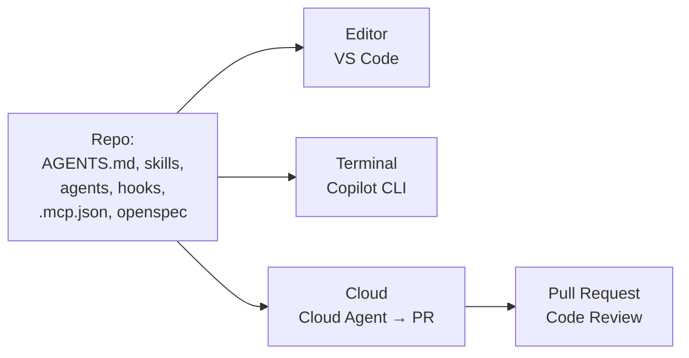
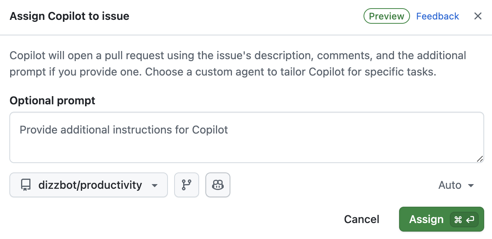
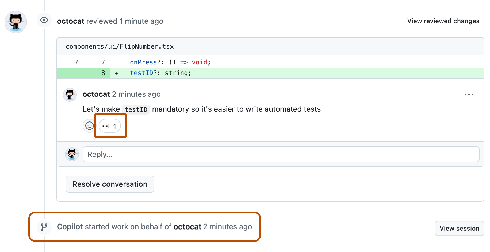
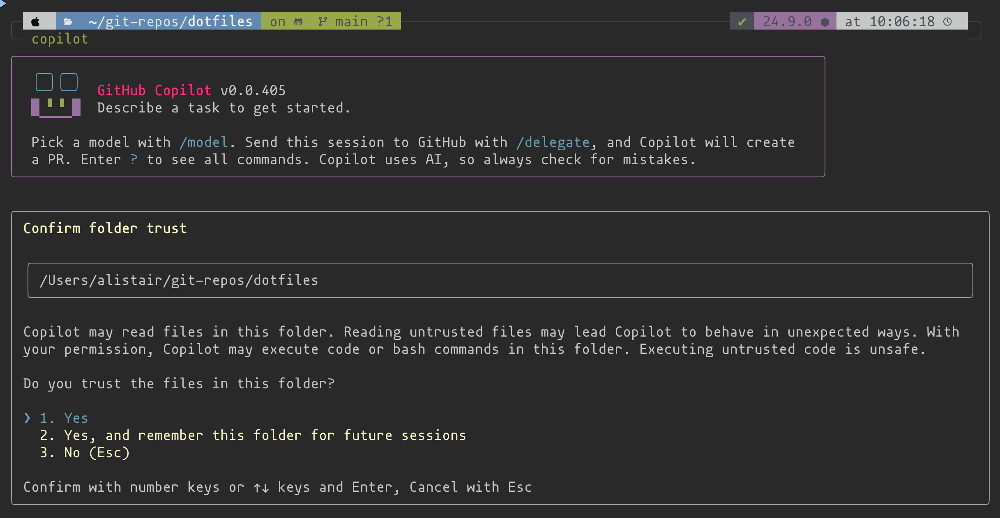

# Lab 9.2: Ausblick und Feedback

**Leitfragen:**

Welche Aufgabe würde man als Erstes ganz an einen Agenten abgeben?

Eine gut abgegrenzte, gut testbare Aufgabe mit geringem Risiko: Tests für bestehenden Code ergänzen, Abhängigkeiten aktualisieren, kleine Bugs mit klarer Reproduktion. Gut geeignet für den Cloud Agent, weil das Ergebnis als Pull Request zur Prüfung kommt.

Was fehlt nach zwei Tagen noch?

Typisch: Übung im eigenen, größeren Codebestand; Absprachen im Team (welche Dateien, wer pflegt sie); Erfahrung mit Kosten und Grenzen bei langen Agent-Läufen. Das entsteht erst im Alltag.

- Die Bausteine aus dem Kurs (Instructions, Skills, Agents, Hooks, MCP, Spec) gelten über VS Code hinaus: auf GitHub, im Terminal und in anderen Harnesses.
- Die Entwicklung ist schnell; Funktionen und Namen ändern sich im Monatsrhythmus. Vor dem Einsatz die aktuelle Doku prüfen.
- Gleiche Dateien im Repo, mehrere Orte der Ausführung: Editor, Terminal, Cloud.

## Begriffe

| Begriff | Bedeutung |
| --- | --- |
| Copilot Cloud Agent | Copilot arbeitet auf GitHub an einem Issue und liefert einen Pull Request |
| Copilot CLI | Copilot als Agent im Terminal |
| Copilot Code Review | Copilot kommentiert Pull Requests auf GitHub als Reviewer |

## Ausblick

Stand: 11/2026, vor dem Einsatz prüfen. Quellen: [GitHub Changelog Universe 2026](https://github.blog/changelog/2026-10-28-github-copilot-in-vs-code-universe-releases/), [Agent harnesses](https://code.visualstudio.com/docs/agents/run/agent-harnesses)

| Thema | In einem Satz | Anknüpfung im Kurs |
| --- | --- | --- |
| Copilot Cloud Agent | Issue zuweisen, der Agent arbeitet auf GitHub und öffnet einen Pull Request (seit Mai 2025 als Coding Agent) | Cloud als Ausführungsziel (Lab 2.2); nutzt die Instructions aus dem Repo |
| Copilot CLI | Copilot im Terminal, allgemein verfügbar seit Feb 2026 | Landkarte (Lab 1.3), gleiche Bausteine im Projektordner |
| Copilot Code Review | Copilot als Reviewer im Pull Request | Agent `reviewer` (Lab 6.2) als lokale Vorstufe |
| Claude- und Codex-Harness in VS Code | dieselbe Oberfläche, anderer Agent; liest `CLAUDE.md`, `.claude/skills` bzw. `AGENTS.md`, `.agents/skills` | Lab 2.2 |

_Quelle: GitHub Docs, Using Copilot cloud agent on GitHub (https://docs.github.com/en/copilot/how-tos/use-copilot-agents/cloud-agent/use-cloud-agent-on-github), GitHub, CC BY 4.0, abgerufen am 07.11.2026._

Cloud Agent: Beim Zuweisen eines Issues lassen sich ein Zusatz-Prompt und ein Custom Agent wählen; Copilot öffnet danach einen Pull Request.

_Quelle: GitHub Docs, Using Copilot cloud agent on GitHub (https://docs.github.com/en/copilot/how-tos/use-copilot-agents/cloud-agent/use-cloud-agent-on-github), GitHub, CC BY 4.0, abgerufen am 07.11.2026._

Im Pull Request reagiert der Cloud Agent auf Review-Kommentare und arbeitet weiter.

_Quelle: GitHub Docs, About GitHub Copilot CLI (https://docs.github.com/en/copilot/concepts/copilot-surfaces/copilot-cli), GitHub, CC BY 4.0, abgerufen am 07.11.2026._

Copilot CLI: Vor der Arbeit fragt die CLI, ob den Dateien im Ordner vertraut wird; mit `/delegate` geht eine Sitzung an GitHub.

Weiterlernen:

| Quelle | Wofür |
| --- | --- |
| [Agent harnesses (VS Code)](https://code.visualstudio.com/docs/agents/run/agent-harnesses) | welche Harnesses es gibt, was jeder liest |
| [Agent skills (VS Code)](https://code.visualstudio.com/docs/agent-customization/agent-skills) | Skills im Detail |
| [Hooks (VS Code)](https://code.visualstudio.com/docs/agent-customization/hooks) | Events und Ausgabeformate |
| [OpenSpec (GitHub)](https://github.com/Fission-AI/OpenSpec) | neue Versionen, Workflows |

## Selbst ausprobieren

**Dauer:** ca. 10 Minuten · **Start:** Transfer-Plan aus Lab 9.1 · **Referenz:** keine; persönliche Reflexion

1. Beantworte schriftlich: Was war der wichtigste Moment der zwei Tage, und warum?
2. Notiere einen Baustein, der klar geworden ist, und einen, der noch unklar ist.
3. Wähle eine Aufgabe aus dem eigenen Alltag, die probeweise ganz an einen Agenten geht (Cloud Agent, CLI oder Editor). Notiere, woran das Ergebnis geprüft wird.
4. Notiere eine Frage, die nach dem Kurs offen ist, und wo die Antwort zu suchen ist (Doku, Team, Kurs-Handout).
5. Ergänze den Transfer-Plan um Schritt 3.

Variante im Plenum: Feedbackrunde mit denselben Fragen, jede Person ein bis zwei Sätze.

**Checkpoint:** Vier kurze Notizen (wichtigster Moment, klar/unklar, Aufgabe für den Agenten mit Prüfung, offene Frage); der Transfer-Plan hat einen zusätzlichen Eintrag.

Lösungsweg

Beispiel-Notizen:

| Frage | Beispielantwort |
| --- | --- |
| wichtigster Moment | Guard-Hook lehnt `.env` ab, obwohl der Prompt es verlangt: Unterschied „bitte nicht“ und „geht nicht“ |
| klar / unklar | klar: Skills; unklar: wann sich ein ganzes Agenten-Team lohnt |
| Aufgabe für den Agenten | „Tests für das Modul `billing` ergänzen“ als Issue an den Cloud Agent; Prüfung: Pull Request lesen, Tests lokal ausführen, Coverage vergleichen |
| offene Frage | Darf die Firma MCP-Server nutzen? → IT-Sicherheit fragen |

## Fazit

- Die Bausteine aus dem Repo wirken im Editor, im Terminal und in der Cloud.
- Stand und Namen ändern sich schnell: Datum und Quelle bei jedem Fakt mitdenken.
- Der nächste Schritt ist klein und konkret: eine Datei im eigenen Projekt, eine Aufgabe für einen Agenten.
